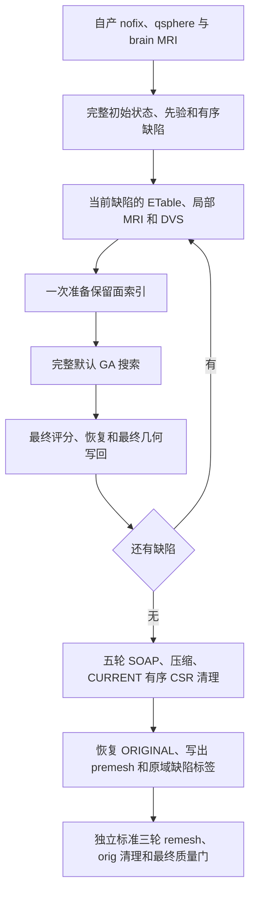
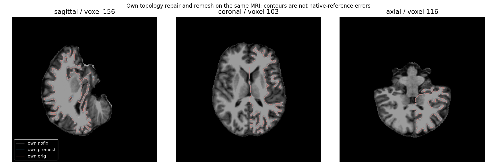
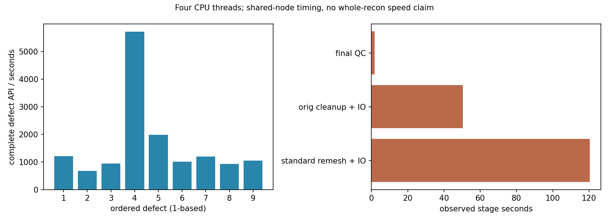
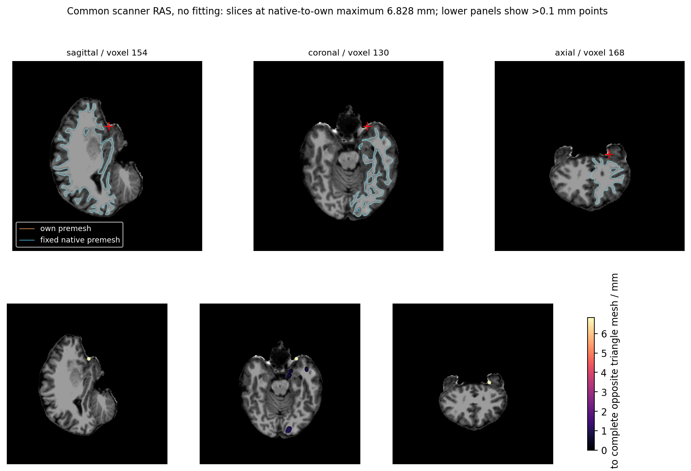
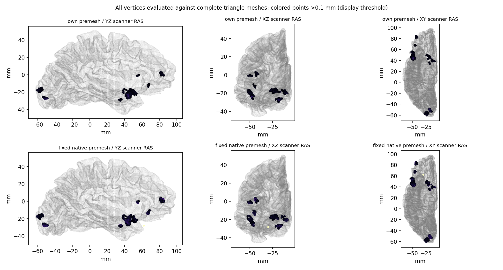

# 全九缺陷面索引缓存验证与完成门

## 1. 功能简介

这项验证在每个缺陷进入 GA 时，建立一次该缺陷保留面的不可变索引。该次搜索的所有候选、最终评分和最终几何共用这个索引；下一缺陷根据已经写回的自产网格重新建立索引。

当前运行绑定 `topology_genetic_repair_cache_20261011_v3`，采用早期冻结的 Python 阻挡扫描和诊断包装入口。它没有采用后来发布的 Numba 完整阻挡扫描，也没有采用 `state_context`。实际源码清单 SHA 为 `3060001b4eff1359afefde017512fa4f2cd581e284b515e8e25bbc0a5a24f104`。



## 2. Python 调用及输入输出

算法入口由既有完整 GA 验证工具提供。本页新增的 `export_completed_premesh_cache` 只读取真实完成回执，复用成熟 `verified_premesh` 校验，再导出安全指标。它不重新执行算法。

```python
from pathlib import Path
import json
from export_recon_topology_genetic_repair_cache import export_completed_premesh_cache

# 路径均为调用者自己的验证目录。provenance 是原执行保存的身份记录，
# 应使用它的 SHA；不要用另一次成功运行的记录替换。
provenance = json.loads(Path("execution_provenance.json").read_text())
input_run_directory = Path("completed_run")
frozen_source_directory = Path("frozen_source")
source_manifest_path = frozen_source_directory / "SOURCE_MANIFEST.private.json"
exit_record_path = input_run_directory / "EXIT.json"
process_record_path = input_run_directory / "process.private.json"
request_record_path = input_run_directory / "request.private.json"
protocol_record_path = frozen_source_directory / "protocol.private.json"
public_output_directory = Path("new_public_metrics")

export_receipt = export_completed_premesh_cache(
    input_run=input_run_directory,                  # 实际完整运行目录
    frozen_source=frozen_source_directory,         # 同次不可变源码
    source_manifest=source_manifest_path,          # 全部源码的 SHA/大小清单
    expected_source_manifest_sha256=provenance["source_manifest_sha256"],
    exit_record=exit_record_path,                  # 此运行自己的 exit0 回执
    expected_exit_sha256=provenance["exit_sha256"],
    process_record=process_record_path,            # 原进程的源码/driver/墙钟记录
    expected_process_sha256=provenance["process_sha256"],
    request_record=request_record_path,            # 同次启动参数、输入和协议身份
    expected_request_sha256=provenance["request_sha256"],
    protocol_record=protocol_record_path,          # 冻结源码旁的原协议
    expected_protocol_sha256=provenance["protocol_sha256"],
    output_directory=public_output_directory,     # 必须是不存在的新目录
    hemisphere="lh",                             # 本次实际侧别：lh 或 rh
    expected_defects=9,                            # 本次固定协议的完整缺陷数
)
```

| 输入 | 格式和含义 |
|---|---|
| 原始算法输入 | 自产 `H.orig.nofix`、同索引同有序面的 `H.qsphere.nofix`、自产 `brain.mgz`；nibabel 读写，surface RAS/mm 和原 MRI 网格分别保留 |
| `input_run` | 含 `candidate` 的运行目录；需要真实 `report.json`、`COMPLETE.json`、面缓存完成回执、全部检查点及有序评分/控制记录 |
| `frozen_source`、`source_manifest` | 同次完整冻结源码与显式清单路径；所有 payload 的大小和 SHA 都要匹配 |
| `expected_source_manifest_sha256`、`expected_exit_sha256`、`expected_process_sha256`、`expected_request_sha256`、`expected_protocol_sha256` | 对应原执行身份记录中的 64 位 SHA-256 字符串；全部必填 |
| `exit_record` | 同运行原始稀疏完成回执；整数 `exit_code=0` 且实际面缓存完成回执存在；不要求原件中不存在的源码字段 |
| `process_record` | 同运行原进程记录；整数 exit0、源码 SHA、driver SHA、源码未变标志及完整 CLI 墙钟 |
| `request_record` | 同运行原请求；源码和协议 SHA、三个输入 SHA、完整政策必须与原协议和 producer 报告一致 |
| `protocol_record` | 同冻结源码目录的原协议；固定九缺陷、线程、seed、完整 GA 控制和面缓存政策 |
| `output_directory` | 新公开指标目录；存在时拒绝覆盖 |
| `hemisphere` | `lh` 或 `rh`，决定匹配的真实表面及缺陷标签文件 |
| `expected_defects` | 正整数，默认 9；与原协议、检查点和完成报告一致 |

算法输出包括 `H.orig.premesh`、完整状态、映射和真正写出的 `H.defect_labels`。缺陷标签长度及编号属于原 `orig.nofix` 顶点域，以 float32 morph 格式写出、`fnum` 使用原有序面数，不能改配压缩或 remesh 后的网格。

安全导出输出 `metrics.json` 和 `EXPORT_RECEIPT.json`。其中保留实际数字、布尔、null、程序及产物 SHA；MRI、NPZ、地址、账号、路径和日志留在私有验证目录。未完成、失败、源码变化、输出变化或回执拼接均拒绝导出。

两个新增只读入口分别处理旧 Python 全九缺陷对照和固定原生完整曲面距离。`compare_completed_python_baseline` 接受 `candidate_run` / `candidate_source`（缓存执行与源码）、`baseline_run` / `baseline_source`（无缓存执行与 PATCH 源码）、`baseline_inherited_source`（原执行继承源码）、`publication`（已验证缓存指标）和新 `output_directory`。其 `expected_metrics_sha256`、`expected_export_receipt_sha256`、双 `expected_*_progress_sha256`、`expected_baseline_*` 的 manifest/report/complete/exit/process/inherited_receipt SHA 全部来自原件，均必填。它不运行 GA；全部11个 NPZ 按字段集合、dtype、shape、bytes 核对，九条完整控制逐项关联原 producer。

`export_completed_python_comparison` 与 `export_completed_native_shape` 共用以下具名参数。新目录存在、缺收据、错误类型或原数值变化均拒绝。

| 参数 | 格式和意义 |
|---|---|
| `input_run` | 已完成的只读比较目录，含 `candidate/report.private.json`、`candidate/COMPLETE.json` 和父 `EXIT.json` |
| `frozen_source`、`source_manifest` | 该比较器的不可变源码目录及清单，不使用当前工作树代替实测版本 |
| `expected_source_manifest_sha256` | 原比较器源码清单 SHA |
| `expected_report_sha256`、`expected_complete_sha256`、`expected_exit_sha256` | 同次实际比较报告、完成门与 exit0 原件 SHA |
| `output_directory` | 不存在的新安全指标目录，输出 typed `metrics.json` 和 `EXPORT_RECEIPT.json` |
| `comparison_source`、`comparison_manifest` | 仅 native shape：成熟全曲面比较器及完整距离核源码目录/清单 |
| `expected_comparison_manifest_sha256` | 仅 native shape：原成熟比较器清单 SHA；全部候选扩展核也逐文件校验 |

```python
from pathlib import Path
import json
from export_recon_topology_genetic_repair_cache import export_completed_python_comparison

# 原比较执行保存的身份记录；这里不读取原MRI或检查点进算法。
comparison_identity = json.loads(Path("comparison_identity.json").read_text())
comparison_run_directory = Path("completed_python_comparison")
comparison_source_directory = Path("frozen_python_comparison")
python_comparison_arguments = dict(
    input_run=comparison_run_directory,
    frozen_source=comparison_source_directory,
    source_manifest=comparison_source_directory / "SOURCE_MANIFEST.json",
    expected_source_manifest_sha256=comparison_identity["source_manifest_sha256"],
    expected_report_sha256=comparison_identity["report_sha256"],
    expected_complete_sha256=comparison_identity["complete_sha256"],
    expected_exit_sha256=comparison_identity["exit_sha256"],
    output_directory=Path("new_python_comparison_metrics"),
)
python_comparison_receipt = export_completed_python_comparison(**python_comparison_arguments)
```

## 3. 命令行调用

```bash
python tools/export_recon_topology_genetic_repair_cache.py \
  --input-run completed_run \
  --frozen-source frozen_source \
  --source-manifest frozen_source/SOURCE_MANIFEST.private.json \
  --expected-source-manifest-sha256 "$recorded_source_manifest_sha256" \
  --exit-record completed_run/EXIT.json \
  --expected-exit-sha256 "$recorded_exit_sha256" \
  --process-record completed_run/process.private.json \
  --expected-process-sha256 "$recorded_process_sha256" \
  --request-record completed_run/request.private.json \
  --expected-request-sha256 "$recorded_request_sha256" \
  --protocol-record frozen_source/protocol.private.json \
  --expected-protocol-sha256 "$recorded_protocol_sha256" \
  --output-directory new_public_metrics \
  --hemisphere lh \
  --expected-defects 9
```

五个 shell 变量必须来自该次原执行保存的身份记录。原进程、请求和协议逐 SHA、同目录、source/driver/input/policy 交叉验证；不向稀疏 EXIT 补字段，也不把这些一致性声明当作隔离执行证明。全 GA、标准 orig 和导出分别计时；导出耗时不计入算法墙钟。

新增后验导出也可从命令行显式调用。`python_comparison_arguments.json` 的键必须是上例全部具名参数，Path 值写成调用者自己的字符串路径，SHA 使用同次原件记录。

```bash
PYTHONPATH=tools:src python -c \
  'import json,sys; from pathlib import Path; from export_recon_topology_genetic_repair_cache import export_completed_python_comparison; export_completed_python_comparison(**json.loads(Path(sys.argv[1]).read_text()))' \
  python_comparison_arguments.json
```

原生形状导出使用同样的完整参数文件，入口改为 `export_completed_native_shape` 并增加表中三个 `comparison_*` 参数。完整点到面诊断需要真正的距离检查点；只给均值或固定 k 最近面结果不能导出。

## 4. 原软件调用

完整拓扑阶段对应 `mris_fix_topology -ga <subject> <hemisphere>`。保留面索引和安全指标导出属于内部实现及验证工具，没有独立原软件命令。原软件程序只用于独立 benchmark；本次自有执行由 Python/NumPy/Numba 完成。

标准后续顺序是三轮 `mris_remesh` 和 `mris_remove_intersection` 对应的自有实现。ORIGINAL premesh 的相交数先记录诊断，不能提前替代后续标准 remesh/orig 的严格质量门。

## 5. 真实精度、时间与脑图

缓存 v3 已真实完成九个缺陷，父执行 `exit0`，生产者和面缓存完成回执均存在。完整 CLI 为 **15196.729397 秒**，含准备、搜索、五轮 SOAP、压缩、CURRENT 清理、读写和质量检查；4879 次评分、9 次索引准备、4888 次索引消费，实际 RNG 调用 18353710 次。原输入、源码、全部九个检查点和最终三个产物逐 SHA 绑定。

| 完整阶段 | 顶点 / 面 | CLI 秒 | source / 独立 F64 相交面 | 结构与几何 |
|---|---:|---:|---:|---|
| 九缺陷 GA → ORIGINAL premesh | 108746 / 217488 | 15196.729397 | ORIGINAL 0 / 0；CURRENT 0 / 0 | Euler 2、单连通分量、边界/非流形/退化/重复面 0，坐标有限 |
| 标准三轮 remesh → ORIGINAL orig 清理 | 114414 / 228824 | 183.192466 | 0 / 0 | Euler 2、单连通分量、其余结构检查 0，有效几何头，premesh footer 原字节保留 |

标准 orig 的 remesh 含读写 120.439422 秒，清理 50.435713 秒，最终质量检查 1.745544 秒。父阶段完成前的等待 14700.530554 秒单独记录，没有计入 183.192466 秒；残留 WAITING 文件不能覆盖真实 COMPLETE/EXIT。原域 `defect_labels` 真正写出并读回相同：长度 110534，float32 morph，`fnum=221116`，标签 0–9，共1996个非零顶点。

固定预算为四线程、CUDA 隐藏。旧 Python 无缓存基线已 COMPLETE 9/9，其**全部九个检查点加末态/映射，共11个 NPZ、404个数组字段，dtype/shape/bytes 全部相同**；有序面、F32坐标和六项 F64 数值头也完全相同，同索引最大偏差0 mm。九个完整控制按类型逐项 JSON 相等，不证明浮点符号零或 JSON 文本字节一致；历史输出字段 `ordered_nine_controls_bit_exact` 名称保留原件。NPZ 文件自身 SHA 全部相同；surface 文件的创建前导文字不同，footer 原字节相同，不称整个 surface 文件同字节。旧 RNG 只记录总数18353710，与缓存相同，没有旧逐 draw 的 bounds/value SHA，故不宣称逐 draw 全同。

旧基线完整 fresh CLI **31419.875133 秒**，其内部 tool wall **31414.436612 秒**另列；缓存 CLI 15196.729397秒。两次均四线程，使用不同四核、不同执行时段和共享负载，本页不把这两个墙钟当受控配对速度。6.684100秒为独立后验对照，未加入任一 GA 墙钟。旧清单实际名为 `PATCH_SOURCE.json`，68份补丁清单之外还有13个实际继承模块；69个已记录模块内容均逐 SHA 闭合。原 `077d1c55…` base archive 容器未定位，该容器身份单列未验，不能拿后来 archive 替代。

独立固定原生程序的 default/verbose 重复使用相同三个原始输入、seed 1234，程序 SHA 与实际线程记录单独绑定；重复之间坐标、有序面和数值几何相同。原生 premesh 为108710顶点/217416面，无法与本次自产网格逐索引比较。原始 F64 footer 的文本精度差导致第一版严格同头比较退出，失败保留；新独立诊断分别按各自真实头变换到共同 scanner RAS/mm，没有拟合、配准或网格重排。

完整保守点到三角面的双向距离结果：自产→原生 mean **0.001129989 mm**、P99 **2.15946×10⁻⁹ mm**、max **1.089618 mm**；原生→自产 mean **0.001789094 mm**、P99 **2.13874×10⁻⁹ mm**、max **6.828374 mm**。超过0.1 mm的顶点分别385和422。局部最大差异不能当作浮点尾差；两侧 Euler 2 也不代表解剖等效。距离诊断188.753740秒独立计时，未计入任一生产阶段。



图中轮廓和位移来自本次自产网格，表示修复运动，不表示原生误差。完整整例、脑区指标和整体等效仍为 `not_assessed`。





该图自动选完整距离数组的原生→自产最大点，并按两侧各自真实 footer 变换到共同 scanner RAS，再用自产 brain 的 affine 显示三平面。没有拟合、配准或重排。当前没有 atlas 标注，不从图形外观指定脑区名称。



0.1 mm 仅为着色显示阈值，距离核评价全部108746/108710个顶点。黑色重叠区域不能替代完整数值检查，6.828374 mm局部差异仍需后续定位。

已经完成的首缺陷面缓存及有序阻挡扫描证据见 [完整首缺陷缓存](TOPOLOGY_GENETIC_FACE_CACHE.md) 和 [有序阻挡扫描](TOPOLOGY_ORDERED_BLOCKER_SCAN.md)。这些图和时间绑定各自版本，不能替代本次全九缺陷末态。

## 6. 版本和 benchmark 记录

- 缓存全九缺陷 v1/v2 在启动或预检阶段失败，原记录保留；v3 修补完整依赖闭包后启动。
- v3 全九缺陷采用旧 `ae4a9b3a` controller、`c30d34d5` search、`bac43cc3` dynamic、`92326f62` 面索引 helper；每缺陷一次工厂由独立验证包装传递。
- 后来发布的实际库参数 `face_detection_cache` 和 `blocker_scan_backend` 使用另一冻结版，已经完成实际六评分配对；它们没有追写到本次 v3。
- 初版导出准备把源码身份直接要求于 EXIT；真实 v3 的稀疏 EXIT 没有该字段，源码和墙钟保存在同运行 `process.private.json`。这是导出器的 schema 问题，算法及原回执没有修改。
- 新版明确接受原 process/request/protocol 及逐文件 SHA，缺任一绑定拒绝；核同 run、source、driver、输入、政策及真实 producer 输出后再导出。14项本地合同通过，0.144秒仅计导出器合同，覆盖稀疏 EXIT 的合法关联及缺记录、foreign process、错误 driver、替换协议、bool/int 政策拼接等拒绝门。
- v3 全九缺陷及 strong orig 的白名单导出已真实完成。导出 v1换行语法、v2缺helper、v4错误installed import准备失败分别保留；v5显式冻结包冷导入与真实完成绑定通过，未重跑或改写MRI生产者。
- 原生形状诊断 v1在严格 F64 footer 同头检查处失败，未开始距离；v2保留各自实际变换，以完整保守核在共同 scanner RAS 中完成。数字头转原F32字段相同，F64文本差异和两个矩阵独立报告，旧严格比较器没有修改。
- 新 native shape 导出实际逐完整距离数组重算 count/mean/P99/max/超过0.1 mm数量；7项负向/正常合同覆盖错误距离摘要、私有字符串、bool矩阵、变更核文件、不完整候选扩展与负时间拒绝。
- 旧 Python 对照 v1因漏传原继承源码目录在读模块前失败；v2已完成对照，审计后v3另加原 export receipt、双progress SHA、完整控制schema、原producer控制关联及九个检查点身份门，结果仍为全部404字段0差。7项源码/控制合同与3项安全导出合同通过；31项本页focused合同合并实际通过，MRI执行/原旧收据均未改写。

## 7. 参考文献和实现

- [面索引实现](../../src/fnit/recon_all/topology_face_detection_cache.py)、[动态重连](../../src/fnit/recon_all/topology_retessellation_dynamic.py)、[完整拓扑控制器](../../src/fnit/recon_all/topology_genetic_repair.py)。
- [严格标准 orig 验证](../../tools/benchmark_recon_topology_genetic_orig.py)、[本页安全导出](../../tools/export_recon_topology_genetic_repair_cache.py)。
- [完整后验比较](../../tools/compare_recon_topology_genetic_repair_cache.py)、[T1/误差图](../../tools/plot_recon_topology_genetic_repair_cache.py)、[安全机器指标](../../validation/recon_all/optimizations/20261011_topology_genetic_repair_cache/README.md)。
- [FreeSurfer 源码库](https://github.com/freesurfer/freesurfer)，原拓扑阶段的实现依据与固定源码绑定见 [动态 retessellation](TOPOLOGY_DYNAMIC_RETESS.md)。
- Ségonne F, Pacheco J, Fischl B. Geometrically accurate topology-correction of cortical surfaces using nonseparating loops. IEEE Transactions on Medical Imaging. 2007;26:518–529.
