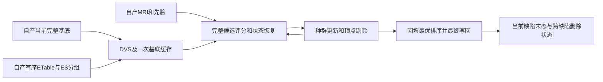

# 独立拓扑GA的单缺陷连续搜索

## 1. 功能简介

`search_and_finalize_defect()`连接已经实现的自产有序边输入、DVS、不可变基底缓存、完整种群控制和最终写回。它在一个缺陷的所有候选之间保留曲率、切向、反馈和原选择性恢复规则；不再由诊断工具拼接这些阶段，不调用原版阶段程序。



这是单缺陷接口。全半球必须按源顺序运行全部缺陷，再完成SOAP、压缩、自相交处理和网格质量检查；单缺陷成功返回不表示完整拓扑或整例通过。

新增显式 `distance_backend="serial"|"parallel"`，默认 serial。搜索与最终评分共用选择；实际 unMRI 跳过时记录 actual=null，Numba mask/slab 与采样 OS 线程数分开。参数、真实六评分和预算证据见 [距离路由](TOPOLOGY_GENETIC_DISTANCE_ROUTING.md)。

## 2. Python调用、输入与输出

```python
import numpy as np
from fnit.recon_all.topology_genetic_search import (
    TopologyRandomStream,
    search_and_finalize_defect,
)

# 一个半球只建立一次；同一流必须继续传给后面的缺陷。
topology_random_stream = TopologyRandomStream(seed=1234)  # 固定整数种子，复用已验证VNL序列

defect_search_report = search_and_finalize_defect(
    surface_state=own_current_surface_state,  # 自产corrected域完整当前状态，不从初始base重置
    defect_inputs=own_ordered_defect_inputs,  # 自产完整ETable/ES/inside/border/hull与重叠策略
    candidate_inputs=own_candidate_report["candidate_kwargs"],  # 每缺陷一次自产局部MRI及共享全局先验
    draw_random_number=topology_random_stream,  # 连续随机流，不在每代或每个缺陷重置
    population_size=10,  # 源标准初始种群大小；超大缺陷沿源规则裁剪种群
    max_unchanged=10,  # 源未改善门，不用缩短该门来宣称标准搜索通过
    niters=-1,  # 源迭代不限，使用真实停止及顶点剔除规则
    initial_selection=True,  # 使用自产旧边的分组，包括源空槽
    vertex_eliminate=True,  # 保留源无进展及周期顶点剔除
    deletion_count=1,  # 首缺陷为1；下一缺陷传上一次返回值
    elimination_threshold=np.float32(4),  # 首缺陷为F32的4；随后传回实际持久阈值
    check_surface_intersection=False,  # 源GA内部可选计数默认关闭；全表面质量检查仍须执行
    intersection_checker=None,  # 内部可选计数关闭时明确传None
)
own_current_surface_state = defect_search_report["surface_state"]  # 下一缺陷复用此完整末态
next_deletion_count = defect_search_report["deletion_count"]  # 跨缺陷持久删除计数
next_elimination_threshold = defect_search_report["elimination_threshold"]  # 跨缺陷持久F32阈值
```

| 参数 | 输入格式、坐标与含义 |
| --- | --- |
| `surface_state` | `create_genetic_base`或上一缺陷产生的完整mapping；`original_vertices/canonical_vertices/vertex_normals/tangent_e1/tangent_e2/flattened_vertices`为F32 `(N,3)`，源曲率/反馈/面积等为F32 `(N,)`，rip/marks及7列topology、原序邻接与入射面/角点、完整面容量和logical nfaces同[候选闭环](TOPOLOGY_CANDIDATE_CYCLE.md)。本版只接原一环、vtotal=vnum和all模式 |
| `defect_inputs` | [有序缺陷输入](../../src/fnit/recon_all/topology_genetic_defect_inputs.py)的自产mapping；整数 `(E,2)`边和全部inside/border/hull采用corrected域，DISCARD为bool `(K,)`；`old_edge_table_indices`是ES行→ETable映射，`segment_rows`仍为ETable行号，本接口会转换成控制器需要的ES域，不把两种索引混用 |
| `candidate_inputs` | 完整[候选输入](../../src/fnit/recon_all/topology_candidate_inputs.py)的`candidate_kwargs`；MRI uint8 `(X,Y,Z)`、4×4拓扑surface RAS→体素矩阵、局部白灰卷与logP、共享PDF、曲率mean及四权重。每缺陷局部卷使用当前corrected ORIGINAL，不重置为raw平均坐标 |
| `draw_random_number` | 必填callable `(low,high)→有限double`，区间闭边界遵循源规则；一个半球共享流。已有VNL核先在F32产生随机量，再按double区间缩放，不能改为NumPy RNG或F32缩放 |
| `population_size` | 必填整数1…1000；源标准10，边数大于50000/100000/200000分别按固定源码裁剪；不裁剪候选边 |
| `max_unchanged` | 必填非负整数，源标准10；超大缺陷沿源裁剪。下一代需要不存在的第二父代时明确报错，不复制原未定义越界行为 |
| `niters` | 必填整数−1或非负；−1不限，非负是显式实验上限。报告保留实际值，不能把有限上限称为标准默认运行 |
| `initial_selection` / `vertex_eliminate` | 必填bool，标准均True；关闭属于显式实验，报告不隐藏实际政策 |
| `deletion_count` / `elimination_threshold` | 必填正整数 / 非负有限F32标量；源static状态在半球内跨缺陷传递，初值1/4。与每个缺陷独立calloc的RP计数/反馈分开 |
| `check_surface_intersection` / `intersection_checker` | 必填bool与具名回调或None，语义同[最终写回](TOPOLOGY_GA_FINALIZE.md)。源内部计数关闭不会跳过最终生产质量门 |

坐标为surface RAS、单位mm；曲率k1/k2/H为mm⁻¹、K为mm⁻²，面积mm²；法向、rip、标签和索引无量纲。球面与original不是同一个坐标槽。本函数不压缩、重排或转换到体素坐标。

返回mapping的`surface_state`是实际最终末态；`search`完整保留种群、严格最佳排序/状态、逐代/逐候选记录、终止原因及计数；`finalization`包含最后真实评分与几何、清理及可选计数；`deletion_count/elimination_threshold`供下一缺陷；`actual_policy`记录大缺陷裁剪后的政策；`seconds`含准备、搜索、最终写回及完整API校验，不含外部加载和写出。`complete_ga=False`、`whole_surface_quality/overall_metric_equivalence="not_assessed"`仍明确标注全半球未完成。

`prepare_genetic_defect_evaluator(surface_state=..., defect_inputs=..., candidate_inputs=...)`是准备子接口，三个参数格式同表；返回`evaluator`、ES域初始分组、overlap控制参数、policy及含校验的秒数。不重算全局先验、不评候选。关闭重叠时给控制器显式空CSR并标`disabled`，不将它称为真实完整重叠列表。

`source_population_limits(edge_count=..., population_size=..., max_unchanged=...)`仅返回源超大缺陷裁剪后的两个整数，边数为非负整数，其他格式同表。`TopologyRandomStream(seed=...)`要求有符号32位种子，初始化消费一次源prime；`stream(low=..., high=...)`返回double，即使两界相等也消费一次随机量，`draws`记录prime之后的次数。需要恢复此前随机消费状态时须传入连续回调，而不是另建实例。

全部参数明确提供；非法类型、跨域分组、不完整状态、多环和源未定义分支抛`ValueError`。RNG、评分和检查回调失败原样传播；不返回失败的半成品，不回滚外部随机流。输入数组不原地修改；CUDA/TF32、autocast和全局线程不变，无半精度或新依赖。

## 3. 命令行调用

内部单缺陷搜索没有独立生产CLI。隔离真实诊断从自产nofix/qsphere/MRI起步，不输入before属性、边表或参考PDF：

```bash
python tools/benchmark_recon_topology_genetic_search.py \
  --input-surface /benchmark/fnit-subject/surf/lh.orig.nofix \
  --input-qsphere /benchmark/fnit-subject/surf/lh.qsphere.nofix \
  --brain /benchmark/fnit-subject/mri/brain.mgz \
  --hemisphere lh \
  --output /benchmark/new-run/genetic-search \
  --reference-statistics /benchmark/reference/patch-statistics.bin \
  --reference-volume /benchmark/reference/volume.bin \
  --reference-fitness /benchmark/reference/fitness.json \
  --threads 4 \
  --population-size 10 \
  --max-unchanged 10 \
  --niters -1 \
  --seed 1234 \
  --initial-selection \
  --vertex-eliminate
```

前三项是同一FNIT连续上游；`hemisphere`明确侧别；`output`必须为新目录；三项参考只在全部自产候选及最终写回保存后读取；其余参数固定线程与完整搜索政策。此工具只跑首缺陷，参考目前只覆盖首候选。`--no-initial-selection`、`--no-vertex-eliminate`或有限niters均记录为不同政策，不代表源标准验收。

`progress.jsonl`仅是运行观测；完成需成功退出、`report.json`、结果哈希和`COMPLETE.json`。失败保留`failure.json`与已生成诊断，不产生完成回执。私有NPZ含完整网格，不上传原影像或许可证。

## 4. 原软件调用

对应固定d932源码`mrisComputeOptimalRetessellation_wkr`及其种群/最终段；这些内部步骤没有独立CLI。隔离参考的完整入口为：

```bash
mris_fix_topology -mgz -ga -seed 1234 -threads 4 reference_subject lh
```

原程序仅用于独立benchmark。生产候选复用自有Python/Numba：初始种群、精英/交叉/变异、全部完整评分、DVS、顶点剔除、最优回填及完整最终几何均保留。原RNG范围缩放和按序消费与成熟自有VNL实现连接。

## 5. 当前精度、耗时和可视化

7项本地合同通过，pytest包含导入共8.55秒；验证ETable→ES转换、空槽保留、不可变基底/DVS域、重叠开关、跨评分持久字段、末次剔除rip和随机流缩放。这些小网格控制测试不替代真实MRI benchmark。

公开T1的自产首缺陷连续验证保留独立的失败和修复记录：

| 版本与范围 | 实测结果 |
| --- | --- |
| v1，原始nofix/qsphere/MRI至完整搜索入口 | 退出码1，在首候选前停止；完整冷CLI为104.177秒，工具内部分段101.506秒。自产基底71.732秒、全局先验0.874秒、共享输入上下文10.835秒、有序边13.062秒、局部先验1.638秒 |
| v1失败原因 | 自有`prepare_defect_candidate_inputs`返回的消费参数漏了`volume`与`ras_to_voxel`，不是数值算子失败。先验阶段通过不能证明完整消费者接口可调用 |
| v2最小修复 | 仅传递共享上下文中已有只读MRI和矩阵；不增加计算或复制。完整`evaluate_candidate`签名绑定合同通过。同输入producer的24组消费字段及29组重复字段逐位一致，详见[自产候选输入](TOPOLOGY_CANDIDATE_INPUTS.md) |
| v2完整默认搜索 | 成功退出；29轮（轨迹索引0–28；继承字段`search_generations=28`保留）、495次搜索评分及1次最终评分，停止原因为`euthanasia_wait_limit`。最佳/最终均为−93.04168701171875；实际随机流消费1,362,381次 |
| v2严格首候选 | 五项核心量、总评分、全坐标、有序面、法向、K1、K2、距离及curvbak共9组逐位相同，所有组最大/P99误差均0。参考只在自产最终状态落盘后读取 |
| v2范围和资源 | 自产当前基底110,534顶点、216,722面、全部9缺陷，本工具只完成首缺陷67个内点/4723条候选边。四核同节点CPU，无CUDA；子进程峰值RSS1,718,853,632字节，显存记None |
| v2完整计时 | 搜索及写回2394.128秒，含准备/对照/I/O的工具2499.239秒，冷子CLI2502.916秒；另列导入预检4.114秒，不称完整recon-all墙钟 |

v2完整搜索使用相同公开输入、四线程、种子1234、种群10、未改善门10及`niters=-1`重新运行。源码绑定实际提交`d76310419eb71b2d59e39d980de0e9e829ed9d41`及冻结覆盖哈希；修复模块SHA-256为`b3fc6e1e56549c3a98cf15cb31cfa42ae39949f45576796821ffbc415a9c7527`。完整[数字报告、退出回执、版本、计时和脑图](../../validation/recon_all/optimizations/20261010_topology_genetic_search/README.md)已保留。源初始观测程序的两次捕获重复一致，但它只观测首候选，6.228/5.112秒不能与完整495次搜索作速度比。

暖候选完整评分中位数3.354秒，几何部分3.241秒；496次含最终评分的评分回调合计1694.881秒。候选状态装配、种群控制和其他开销仍在完整2394.128秒内，不能仅用小算子秒数外推整例。


左图是自身最优缺陷叠加，中图是自身最终相对自身首候选的位移，右图是全部评分及最佳值轨迹。96个保留选中顶点的自身位移最大4.034mm、P99为3.069mm，表示搜索造成的几何改变，不是官方误差。面发生变化，不对最终/初始面声称同索引一致；完整源赢家和最终局部形状仍待比较。

只读图函数`tools.plot_recon_topology_genetic_search.run(brain=..., first_candidate=..., final_state=..., stage_report=..., output=...)`五参必填：brain为报告SHA绑定的uint8 XYZ MGZ，两NPZ是同一未压缩顶点域的自产检查点，报告为实际完整JSON，output为新PNG。图输出包含图片/输入/工具SHA、切片、选中顶点数与自身位移；哈希不符或报告未完成则报错，不读取参考或改变算法。

```bash
python tools/plot_recon_topology_genetic_search.py \
  --brain /benchmark/fnit-subject/mri/brain.mgz \
  --first-candidate /benchmark/new-run/genetic-search/first_candidate.private.npz \
  --final-state /benchmark/new-run/genetic-search/final_state.private.npz \
  --stage-report /benchmark/new-run/genetic-search/report.json \
  --output /benchmark/new-figures/first-defect.png
```

当前完整源赢家一致性、全半球网格、脑区指标和整例提速仍未验证；已完成的[全局先验](TOPOLOGY_GLOBAL_PRIORS.md)、[最终写回](TOPOLOGY_GA_FINALIZE.md)和[自产基底](TOPOLOGY_GENETIC_BASE_PREPARE.md)保留各自版本与比较范围。全部缺陷、最终SOAP/压缩与CURRENT清理接线见[全半球premesh控制器](TOPOLOGY_GENETIC_REPAIR.md)。

## 6. 更新与benchmark记录

- 2026-10-10：从完整当前基底建立DVS与缓存，连接成熟种群和最终写回；每个新缺陷才初始化RP，跨缺陷删除状态与随机流由调用者继续传递。
- 接线审查明确区分旧ES序与ETable序，保留空分组；最终调用还接收搜索末次剔除后的rip，不使用旧回调值覆盖。
- 实际连续运行发现候选producer漏传MRI/矩阵，修复生产者并增加完整消费签名合同；v1失败回执没有改写为成功，v2使用新目录及独立源码清单。
- v2完成默认完整首缺陷29轮（轨迹索引0–28；继承字段`search_generations=28`保留）/495次评分，首候选9组严格门通过；仍未把初始源比较称为完整源最优解复现。
- 后续缺陷的base边存在性必须读取当前corrected有序邻接。初态全25边表只能验证输入准备，不能作为全部连续搜索的固定边表。
- 当前为独立实验接口，不改生产默认；NumPy/Numba已在主页Conda安装路径。完整半球、raw T1整例、600秒和干净环境隔离待实测。

## 7. 参考文献与源码

- [固定上游拓扑源码](https://github.com/freesurfer/freesurfer/blob/d932c45b7941662ea380a05efef580568b98d41a/utils/mrisurf_defect.cpp)。
- [FNIT完整单缺陷接线](../../src/fnit/recon_all/topology_genetic_search.py)与[真实诊断工具](../../tools/benchmark_recon_topology_genetic_search.py)。
- [Fischl等，2001，Automated manifold surgery](https://doi.org/10.1109/42.906426)。
