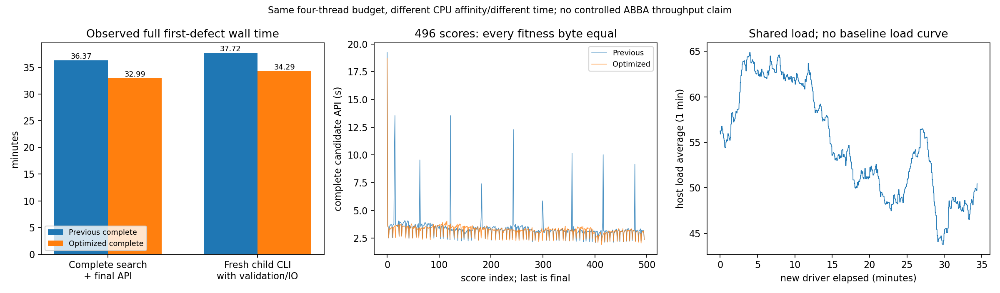

# 完整首缺陷 GA 的显式状态缓存验证

## 1．功能与流程

六次候选的冷阶段曾因上下文构造、JIT和完整准备变慢，不能直接判断495次搜索中的摊销。本接口复用完整默认首缺陷搜索，只在成熟 evaluator 创建后，为当前完整基底准备一次显式状态上下文。全部候选、最终评分和末态装配共享它；动态坐标、曲率、RP、rip和随机流不缓存。


本轮不混面索引缓存，不改变生产默认 `None`，不修改搜索/终止/剔除控制器。它只验证首缺陷，不能代替全部缺陷、最终网格QC或原始T1整例。

## 2．Python调用、输入和输出

```python
from pathlib import Path
from benchmark_recon_topology_genetic_state_cache import run

state_cache_result = run(
    state_cache=True,  # 明确启用实验状态上下文；False沿原完整装配
    input_surface=Path("inputs/lh.orig.nofix"),  # 自产完整未修复表面
    input_qsphere=Path("inputs/lh.qsphere.nofix"),  # 同顶点和有序面的自产球面
    brain=Path("inputs/brain.mgz"),  # 同上游uint8(X,Y,Z)归一化MRI
    hemisphere="lh",  # 明确半球，不由文件名推测
    output=Path("runs/fresh-state-cache-first-ga"),  # 必须不存在的新目录
    threads=4,  # 固定总Torch/Numba/OpenMP预算
    reference_statistics=Path("reference/patch_statistics.bin"),  # 仅保存后首候选比较
    reference_volume=Path("reference/volume.bin"),  # 仅保存后距离/反馈比较
    reference_fitness=Path("reference/fitness.json"),  # 仅保存后五项与标量比较
    baseline_directory=Path("previous-complete/candidate"),  # 完整旧495+final产物，事后读取
    source_manifest=Path("frozen/SOURCE_MANIFEST.json"),  # 实际冻结程序文件/模块SHA
    protocol=Path("frozen/protocol.json"),  # 事先声明输入SHA、默认政策、旧报告SHA
    population_size=10,  # 源标准初始种群
    max_unchanged=10,  # 源标准无改进终止参数
    niters=-1,  # 源标准完整搜索，不人为截断
    seed=1234,  # 连续同源随机流，候选/代际之间不重置
    initial_selection=True,  # 保留源初始排序
    vertex_eliminate=True,  # 保留源顶点剔除
)
```

| 参数或产物 | 格式、意义与失败行为 |
|---|---|
| `input_surface` / `input_qsphere` | 完整FreeSurfer三角表面格式，nibabel读取；坐标转float32 `(N,3)`，面int32 `(F,3)`。前者surface RAS/mm，后者canonical RAS；shape及全部有序面必须一致。 |
| `brain` | MGH/MGZ头及uint8三维体素。使用MRI tkregister RAS→voxel矩阵，不桥接scanner RAS。 |
| `hemisphere` | 显式 `lh` / `rh`；无默认半球。 |
| `output` | 新目录。产生首候选、完整末态、种群三个NPZ、完整控制JSON、原报告、优化报告、上下文报告及各完成门。不是标准`orig`文件。 |
| `threads` | 正整数预算；协议必须与本次固定值相同。调用成熟线程上下文，退出恢复原设置。 |
| 三项`reference_*` | 同输入原程序捕获的事后参考。算法不读取其坐标、PDF、评分或距离作为初值。 |
| `baseline_directory` | 已完成同输入完整搜索的输出；含报告、COMPLETE、三个NPZ及控制JSON。全部新产物保存后才读取。 |
| `source_manifest` / `protocol` | JSON绑定全部源文件大小/SHA、预期实际加载模块、原始输入SHA及政策。不能用当前HEAD替代实际overlay。 |
| 六项搜索控制 | `population_size`、`max_unchanged`、`niters`、`seed`、`initial_selection`及`vertex_eliminate`沿成熟完整接口；本轮协议固定10/10/-1/1234/True/True。 |
| `state_cache` | 必填bool。True为每缺陷一次工厂，评分及最后装配显式同context；False不安装包装器。未改变生产默认。 |
| 上下文报告 | 准备数、完整装配数、每次实际context身份、顶点/面数和秒数；源字段单位、容量和全域校验沿[状态缓存](TOPOLOGY_CANDIDATE_STATE_CACHE.md)。 |

`explicit_state_cache(enabled=...)` 是独立串行验证作用域，不支持在其他线程同时调用被包装函数。它只显式forward成熟参数，成功和异常均还原原函数身份。没有工厂、错误context、输入/模块SHA不符、非法完整状态或科学门不通过时抛异常；已有产物保留，不写本工具的`STATE_CACHE_COMPLETE`。较早阶段自己的完成门不能代替这项最终门。原DVS和所有公共shape/前缀/容量校验仍执行。

## 3．命令行

同一完整调用的具名CLI示例：

```bash
export CUDA_VISIBLE_DEVICES=''  # 本项CPU有序状态装配，不初始化CUDA
export OMP_NUM_THREADS=4 NUMBA_NUM_THREADS=4 OPENBLAS_NUM_THREADS=4 MKL_NUM_THREADS=4
arguments=(
  --state-cache  # 明确实验选择；关闭用--no-state-cache
  --input-surface inputs/lh.orig.nofix  # 自产未修复表面
  --input-qsphere inputs/lh.qsphere.nofix  # 自产同序球面
  --brain inputs/brain.mgz  # 同版本自身MRI
  --hemisphere lh  # 显式左侧
  --output runs/fresh-first-ga  # 新输出目录，包含全部读写时间
  --reference-statistics reference/patch_statistics.bin  # 仅事后比较
  --reference-volume reference/volume.bin  # 仅事后比较
  --reference-fitness reference/fitness.json  # 仅事后比较
  --baseline-directory previous-complete/candidate  # 已完整完成的旧回归
  --source-manifest frozen/SOURCE_MANIFEST.json  # 冻结完整源码SHA
  --protocol frozen/protocol.json  # 事先声明政策，不据结果更改
  --threads 4  # 固定总预算
  --population-size 10  # 标准种群
  --max-unchanged 10  # 标准停止
  --niters -1  # 完整运行
  --seed 1234  # 固定连续随机流
  --initial-selection  # 保留初始选择
  --vertex-eliminate  # 保留剔除
)
PYTHONPATH=src:tools python tools/benchmark_recon_topology_genetic_state_cache.py "${arguments[@]}"
```

此工具验证完整首缺陷的运行和输出；没有将其中某次固定ordering作为完整赢家。公开导出使用 `export_recon_topology_genetic_state_cache.export_metrics()`，四个必填参数均为目录`Path`：`input_run`是本次完整运行，`baseline_run`是已完成旧运行，`frozen_source`是本次实际冻结源码，`output_directory`必须不存在。仅消费退出0、完整科学门及497次装配后生成的报告，保留原私有报告字节；返回公开收据字典并写出白名单JSON。新增导出metadata镜像是事后兼容绑定，不修改原冻结源码。缺少完成门、源SHA不符或含禁止发布元信息时明确失败。

```bash
export_arguments=(
  --input-run runs/complete-state-cache  # 完整新运行及退出收据
  --baseline-run runs/complete-baseline  # 同输入完整旧结果
  --frozen-source frozen/state-cache  # 本次实际源文件与协议
  --output-directory public/fresh-state-cache  # 不存在的公开白名单目录
)
PYTHONPATH=tools python tools/export_recon_topology_genetic_state_cache.py "${export_arguments[@]}"
```

## 4．原软件调用

对应固定 `mris_fix_topology -ga` 的完整首缺陷种群、评分、DVS恢复和最优写回；上下文状态装配属于内部函数，没有独立官方CLI。原程序仅用于独立benchmark生成首候选参考；本次生产算法路径没有原版程序调用。

```bash
mris_fix_topology -mgz -ga -seed 1234 -threads 4 reference_subject lh
```

此命令用于独立参考路径，不由本接口调用。复用的首候选参考程序SHA为`2df26fc8…`；本次三项实际参考输入SHA与其两次捕获一致，见[参考绑定](../../validation/recon_all/optimizations/20261011_topology_genetic_state_cache/reports/source_reference_binding.json)。完整原程序赢家及全部缺陷的参考仍未测，原观测器约6秒不与495次搜索作速度比。

## 5．最新版真实精度、时间与图

本轮公开`ds000114`、`sub07/ses-test`左半球已成功退出并完成全部门。由相同自产nofix、qsphere及uint8 MRI重新生成基底110,534顶点/216,722面、全9个缺陷；本工具只搜索第一个缺陷的67个内点、4723条候选边。[启动收据](../../validation/recon_all/optimizations/20261011_topology_genetic_state_cache/launch.json)保持启动时字节，绑定实际基线manifest `ec573743…`的846个Python文件，以及新850文件manifest `896557ae…`；只有cycle显式接口和缓存核变化，未混面索引缓存。当前发布HEAD不替代实际运行的源码哈希。

| 完整同输入检查 | 本轮结果 |
|---|---|
| 搜索和控制 | 495次搜索评分加1次最终评分，29条代际记录（索引0–28）；随机流1,362,381次、全部控制、终止及剔除与旧完整输出逐项相同 |
| 完整状态 | 首候选32字段、末态40字段、种群8字段，共80字段及三个完整NPZ原文件SHA均相同；所有496个float64评分逐位相同 |
| 参考首候选 | 核心量、总评分、坐标、有序面、法向、K1、K2、距离及curvbak九组逐位相同，最大/P99误差均0；不代表原程序完整赢家 |
| 显式上下文 | 工厂1次；497次完整装配全部使用当前context，最终评分和写回各1次；动态属性、容量尾部和原公共校验保留 |
| 最优结果 | 旧/新最佳及最终评分均为−93.04168701171875，源终止`euthanasia_wait_limit`保留 |

下列秒数均为实际完整阶段，不把嵌套步骤重复相加：

| 范围 | 基线，秒 | 显式状态缓存，秒 |
|---|---:|---:|
| 自产基底 | 53.980533 | 51.133455 |
| 自产全局先验 | 1.514378 | 1.414513 |
| 静态输入上下文 | 4.070122 | 3.761005 |
| 完整有序边表 | 6.897616 | 6.582453 |
| 局部MRI先验 | 3.164583 | 2.861119 |
| 连接搜索及最终写回API | 2182.039244 | 1979.388001 |
| 产物写出 | 2.924221 | 3.082562 |
| 新Python子进程CLI，含导入/校验/JIT/I/O | 2263.422952 | 2057.242890 |

完整CLI观察缩短**9.1092%**；搜索加final API观察缩短**9.2872%**。新驱动墙钟另为2064.715903秒，包含导入预检7.467125秒；驱动不替代子CLI口径。缓存工厂0.425730秒、497次装配合计303.362309秒/中位0.612706秒，均已包含在上层计时。暖评分（不含首次和最终一次）中位3.240205→3.266672秒，反而慢0.8168%；不能将总墙钟差异归结为单个缓存核的提速。

旧/新使用同公开MRI、已核同主机、四线程，但CPU亲和性分别8–11与88–91、运行时段及共享负载不同。上述单次结果是观察，不能称受控ABBA或稳定吞吐。子进程峰值RSS为1,722,355,712→1,736,519,680字节；采样间隔1秒，父子同时合计CPU内存峰值未测。CUDA隐藏，显存为`null`而非零，TF32没有参与CPU状态计算。源float32赋值和float64计算边界、全部25/40轮几何步骤保持，无半精度或近似。

声明的同一环境在导出时读取Python3.11.16、NumPy1.26.4、Numba0.67.0、Torch2.5.1、nibabel5.4.2和SciPy1.17.1；这是明确事后版本观察，不冒称循环中的前向精度统计。缓存源码SHA `64d57c49…`、实际cycle SHA `4ffe4373…`、独立验证工具SHA `2d771dad…`、完整原报告SHA及图像SHA见[机器报告](../../validation/recon_all/optimizations/20261011_topology_genetic_state_cache/reports/summary.json)。



图中没有绘制旧运行的负载曲线，不等于证明旧运行没有负载记录；完整评分中含首次JIT及异常慢轮，没有只画暖中位数。


脑图读取本轮三个自产输入/输出的实测SHA，显示96个保留选中顶点、65个切片邻近顶点。位移最大4.034mm/P99 3.069mm是自身最终相对自身首候选的搜索变化，**不是官方误差**；首/末面不同，不据这幅图声称同索引面一致或网格QC通过。[绘图输入/程序回执](../../validation/recon_all/optimizations/20261011_topology_genetic_state_cache/reports/first_defect_receipt.json)与性能图另行绑定。

上下文适配器两个本地合同8.29秒通过，仅验证身份/异常恢复，不是影像benchmark。本次完成的是完整首缺陷，全部缺陷GA、原始T1整例、最终网格质量、安装隔离及整体指标等效仍未评估；600秒目标没有通过。状态上下文保留为显式选项，默认仍为`None`。

## 6．版本与记录

- 原显式缓存：六次冷完整阶段慢4.3799%，热候选循环观察快8.5987%；失败性能证据和默认None保留，不外推495次。
- 本轮新适配器：仅benchmark作用域，每缺陷工厂一次，候选/最终score/write显式同context。新增两个必要合同，不重复旧17项完整缓存合同。
- 本轮独立完整运行已退出0，完整497装配、80字段/三NPZ和控制门通过。保留启动收据；新公开报告、PNG及逐项SHA另外保存，不回写原源码、私有报告或基线。
- 846文件科学克隆未包含显示工具，首次只读画图出现`ModuleNotFoundError`；在独立显示目录上传现有自有绘图函数并核SHA后成功。此失败不涉及算法，原冻结源码和已完成输出未改变。
- 安全导出v1只验证未运行；v2增加同主机收据校验和明确事后软件版本观察，再执行公开白名单导出。原日志、NPZ、影像及命令留在服务器。
- 无新增依赖；NumPy/Numba/nibabel与既有绘图库沿主页Conda环境。任何生产接入仍需完整回归，不能根据热局部值改变默认。

## 7．原代码与参考

- [完整搜索](TOPOLOGY_GENETIC_SEARCH.md)、[选择性DVS](TOPOLOGY_CANDIDATE_STATE.md)、[显式状态缓存](TOPOLOGY_CANDIDATE_STATE_CACHE.md)。
- [独立验证工具](../../tools/benchmark_recon_topology_genetic_state_cache.py)、[安全导出](../../tools/export_recon_topology_genetic_state_cache.py)。
- [固定FreeSurfer mrisurf_defect.cpp](https://github.com/freesurfer/freesurfer/blob/d932c45b7941662ea380a05efef580568b98d41a/utils/mrisurf_defect.cpp)。
- Fischl et al. 2001, Automated manifold surgery. [DOI](https://doi.org/10.1109/42.906426)。
