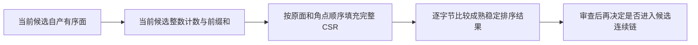

# 候选几何有序 CSR：实验与审查协议

## 1. 功能与范围

基线固定为现场可读取的 `19b913f1e7857fe6f37e3836450c8547bed8323d`。实验只在独立工具中将当前候选的有序三角面转换为完整入射面/角点 CSR；不修改生产模块、默认后端或协调者的四点谓词缓存工具。

成熟 `candidate_geometry` 依次执行重连、25 轮平滑、40 轮 MRI 匹配和完整法线构建。平滑及匹配的主要数值循环已经是 Numba；每个候选构造新的 `FaceNormalTopology`，同候选内共享整数 CSR。实验将其中稳定排序换成串行编译的计数/前缀和/按面及角点次序填充。所有顶点、面、重复项及空行保留，不引入候选上限。



本轮首先检查拓扑准备，尚不能将它称为累计约 633 秒几何的主瓶颈。已有第四缺陷旧版 cProfile 中，CSR 构造约 0.040 秒，完整 geometry 约 6.077 秒；该带剖析开销版本仍有 Python 阻挡扫描，与完整第一 GA 的 Numba 阻挡扫描配置不同。最新几何细分计时应先于任何收益归因。

## 2. Python 调用与输入输出

工具接口 `counted_face_csr(faces, nvertices)`：

- `faces`：当前候选完整有序整数数组 `(F,3)`，值位于 `[0,N)`；面列保持角点 0、1、2。允许重复面、重复角点和非连续内存视图；不改变输入。
- `nvertices`：非负 Python/NumPy 整数 `N`；包含孤立顶点。浮点数、布尔值、非法面形状或越界索引在分配内核前报错。
- 返回三个独立 int64 数组：`offsets (N+1,)`、`face_ids (3F,)`、`corners (3F,)`。顶点 v 的入射行位于 `[offsets[v],offsets[v+1])`，面号和角点按原 face-major/corner-major 次序排列。

```python
from benchmark_recon_topology_geometry_csr import counted_face_csr

# 当前候选自产面及完整顶点数，不能装入参考后态或旧候选 CSR。
incident_offsets, incident_faces, incident_corners = counted_face_csr(
    faces=current_candidate_faces,
    nvertices=current_original_vertices.shape[0],
)
```

不缓存跨候选的 faces、邻接、坐标、法线或 MRI 反馈。每次调用重新读取当前面表，返回数组互不共享、也不跨调用共享。整数准备不改变 F32 更新/F64 累加、Gauss-Seidel 顺序和 RNG 消费；连续链是否保持这些属性仍需后续实际验证。

## 3. 命令行及执行协议

CSR 协议已获范围内授权并实测，完整候选尚未替换 CSR。以下调用复现独立同面 API 配对：

```bash
# 同一环境和四核亲和性。变量指向已核验的当前自产候选与冻结源码清单。
# candidate_checkpoint_sha256 是输入 NPZ 的 SHA-256；不得填旧参考赢家。
PYTHONPATH="$frozen_workspace/src:$frozen_workspace/tools" \
OMP_NUM_THREADS=4 NUMBA_NUM_THREADS=4 MKL_NUM_THREADS=1 OPENBLAS_NUM_THREADS=1 \
taskset -c 80-83 "$fnit_python" \
  "$frozen_workspace/tools/benchmark_recon_topology_geometry_csr.py" \
  --candidate-npz "$candidate_checkpoint" \
  --candidate-sha256 "$candidate_checkpoint_sha256" \
  --source-manifest "$frozen_workspace/SOURCE_MANIFEST.private.json" \
  --source-manifest-sha256 "$source_manifest_sha256" \
  --output "$new_experiment_output" --pairs 3
```

最新第一候选剖析入口：

```bash
# 三份输入来自同一 FNIT 自产连续链：二进制 surface nofix/qsphere 与 uint8 MGH brain。
# 三者不能替换成官方参考后态；候选初态、先验、排序均从这些输入重新生成。
PYTHONPATH="$frozen_workspace/src:$frozen_workspace/tools" \
OMP_NUM_THREADS=4 NUMBA_NUM_THREADS=4 MKL_NUM_THREADS=1 OPENBLAS_NUM_THREADS=1 \
taskset -c 80-83 "$fnit_python" \
  "$frozen_workspace/tools/benchmark_recon_topology_first_geometry_profile.py" \
  --input-surface "$own_nofix_surface" \
  --input-qsphere "$own_qsphere_surface" \
  --brain "$own_uint8_brain_mgh" \
  --manifest "$frozen_workspace/SOURCE_MANIFEST.private.json" \
  --output "$new_first_profile_output" --threads 4
```

`input-surface` 为自产 nofix 有序面/顶点，surface RAS、mm；`input-qsphere` 为同一顶点/面次序的自产球面，必须逐面对应；`brain` 为同一链 uint8 三维 MGH，使用 nibabel 与 MRI-only tkregister RAS→voxel。`manifest` 必须是冻结目录逐文件 size/SHA 清单；核验实际导入模块及观测驱动。`output` 新建，保存三次完整候选 NPZ、持久状态 NPZ、候选控制 JSON、各段时间及独立 cProfile；这些完整数组留在私有目录。`threads` 默认 4，当前实测固定为 4；由调用方设置相同环境与 CPU 亲和性。

`candidate-npz` 包含当前完整 `faces` 与 `original_vertices`；只读取面表和顶点数。两个 SHA 参数必须与文件匹配；清单逐文件校验，并核验实际导入成熟模块与驱动 SHA。`output` 必须新建；`pairs` 为正整数，默认 3。第一次两侧调用单列，随后 BA/AB 交替；计时含各自 API 的输入检查、布局转换、分配与完整 CSR 构建，逐字段比较位于计时外。报告只输出形状、SHA、完整三数组一致性及时间；原面表和坐标留在私有任务目录。首次进程调用不自动等于清空磁盘 JIT 缓存的冷启动。

按顺序推进：先最新源码短候选细分剖析；再同面 CSR 的 AB/BA；若有收益，在隔离工具中显式替换 CSR 构造，运行三个连续候选并比较所有状态、评分、控制及 RNG；通过后交协调者判断是否需要完整第一 GA。每门失败保留原结果；动态面更换强制重建。本轮已完成获授权的最新短候选剖析和同面 CSR 配对；下一主优化范围仍交协调者审查。

## 4. 原软件对应关系

CSR 属于源有序拓扑准备，没有独立 FreeSurfer 命令。对应 `mris_fix_topology` 内部候选几何和入射面状态。实验不执行原软件、不复制原代码，直接复用 FNIT 的 `ordered_face_csr` 作为整数次序基准。完整工具链与原版整体比较由已有拓扑验证门处理。

## 5. 精度、时间与可视化证据

12 项组件合同通过：重复面和重复角点、孤立顶点、空网格、反向非连续视图、完整 dtype/shape/bytes 一致、输入不变、输出独立、面变化后重新构建，以及非法输入在分配前失败。人工网格只作合同。随后使用当前自产真实第一候选完成短链和同面配对，三份输入 SHA 与已验证同链一致；冻结清单 SHA 为 `efd3e9b0e6964e9322552b06af52127b9e5906f8de006281bbebe8c69efe2490`。

原始 nofix/qsphere/brain 完整上游准备在首次进程运行一次，共 140.953 秒（含新目录首次 JIT）；raw base 100.223、全局先验/输入上下文 4.959、有序边 32.354、局部先验 3.165 秒。各 trial 重新准备 evaluator，使用同一自产初态和身份首排序，严格零 RNG；不使用旧赢家。

| 计时范围 / 秒 | 首次普通调用 | 热普通调用 | 热 cProfile |
| --- | ---: | ---: | ---: |
| evaluator 准备 | 5.978 | 6.152 | 8.921 |
| 完整候选状态闭环 | 17.478 | 1.508 | 2.424 |
| 完整 geometry（嵌套） | 8.278 | 0.654 | 0.753 |
| 重连与面检测（嵌套） | 4.650 | 0.377 | 0.450 |
| 25 轮平滑（嵌套） | 0.755 | 0.053 | 0.049 |
| 40 轮 MRI 匹配（嵌套） | 1.302 | 0.082 | 0.082 |
| 完整法线准备（嵌套） | 1.470 | 0.035 | 0.033 |
| 完整状态装配（闭环内、geometry 外） | 0.629 | 0.620 | 1.322 |
| 原完整面 CSR（geometry 内） | 0.032 | 0.032 | 0.031 |
| DVS 恢复（闭环内） | 0.022 | 0.015 | 0.021 |

三次独立重新构造的首候选：固定 36 个候选/反馈数组及 40 个持久状态数组逐字节一致，候选控制 JSON 一致；第一排序禁止 RNG，实际调用为 0。候选控制只保存一类文件，本轮不是完整 GA 的两类控制门。完整字段名单、形状、dtype、数组哈希和独立重读检查见 `FIRST_CANDIDATE_PROFILE_AND_CSR.json`。

同一热候选完整有序面表：110,534 个顶点、216,860 个面。首次 CSR 编译/调用 0.996 秒；三组 BA/AB/BA 热配对的完整 API：成熟实现 34.596/33.018/30.245 毫秒，编译实现 13.135/9.431/10.355 毫秒，三数组全部逐字节一致。热中位数 33.018→10.355 毫秒，约 3.19 倍，仅为 CSR API 收益。完整候选尚未替换 CSR，不能据此声明完整闭环、GA 或整例提速。

线程上下文进入 0.0484 秒、恢复约 0.000068 秒；初始 Torch 线程设置计入 main 总观察时间，但没有独立计时。main 入口到结果前约 203.453 秒，顶层 NumPy 导入/解释器启动位于此计时外，因此不称完整子进程 CLI 时间。observed nested calls 覆盖 evaluator 准备与候选；不能直接把其总和当作 candidate 时间。cProfile 的额外开销与普通运行分列，所有计时是共享节点、四线程/固定亲和性的一次短链观察。

真实热点结论：热闭环中的状态装配约 0.620 秒，与完整 geometry 的 0.654 秒相近；geometry 中重连约 0.377 秒。CSR 仅约 0.032 秒，保持独立实验。后续应先审查成熟 `topology_candidate_state_cache` 的 `_pack`、`_append_prefix` 与 `_publish_candidate_attributes`，针对全域逐顶点装配/临时数组提出兼容编译方案，保留每次当前可变状态的全部值检查、容量尾部及动态反馈。不能直接重复实现或自动启用旧缓存：已存在的 v3 短链完整 API/CLI 分别慢约 3.59%/4.38%；另一次完整 GA 的跨时段/亲和性总时间差不能作为受控收益。重连谓词缓存属于协调者当前独占范围。

本轮 CSR 为离散索引，完整三数组相等是主要验收证据；短链状态逐字段相等不替代最终脑表面质量。没有生成新的脑图或执行完整 GA；此前距离脑图与旧第四缺陷 cProfile 不作为本轮新证据。

## 6. 更新记录

- 2026-10-11 实测：保留最初审查包与 12 项合同记录，新增本轮短链/cProfile、完整字段门、真实同面 CSR BA/AB/BA、JSON/CSV及冻结清单。下一步聚焦状态装配，默认不变。

- 2026-10-11：固定当前已合入源码，核对平滑/匹配的现有编译实现，新增独立 CSR 计数/填充实验。生产代码和默认行为保持不变。首次仅交短合同；后续范围授权后完成最新第一候选短链与同面 CSR 配对，仍未启动完整 GA 或 GPU benchmark。短合同结果和各文件 SHA 见 `GEOMETRY_CSR_CONTRACT.json`。

## 7. 原实现与参考

- FNIT 当前 `src/fnit/recon_all/place_surface_normals.py`：成熟 `ordered_face_csr` 和同面版本 `FaceNormalTopology`。
- FNIT 当前 `topology_candidate_geometry.py`、`topology_defect_smooth.py`、`topology_defect_mri_match.py`：实际几何准备、25/40 轮更新及反馈依赖。
- [FreeSurfer 源码](https://github.com/freesurfer/freesurfer/tree/dev/mris_fix_topology)：内部算法位置；运行证据以本轮冻结 FNIT 源码 SHA 为准。
- Fischl B, Liu A, Dale AM. Automated manifold surgery: constructing geometrically accurate and topologically correct models of the human cerebral cortex. IEEE Transactions on Medical Imaging, 2001.
