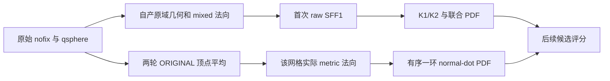
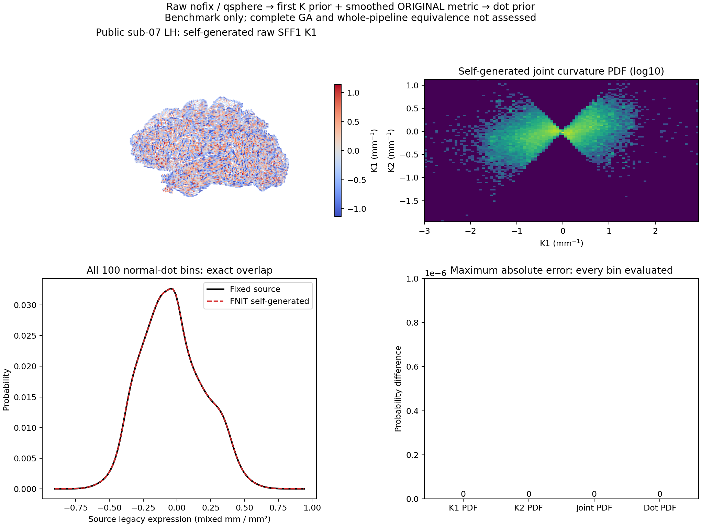

# 拓扑修复的自产全局曲率和法向先验

## 1. 功能简介

`global_topology_priors()` 把首次全局 SFF1 的自产 K1/K2 与平滑 ORIGINAL 网格组合成完整全局先验：两个 100-bin 曲率 PDF、100×100 联合 PDF 和 100-bin normal-dot PDF。它复用已有 SFF、曲率直方图、有序法向修复及直方图平滑，使用 Python/NumPy/Numba，不运行 FreeSurfer 阶段程序。



接口接收已经自产的 SFF1 和平滑 ORIGINAL，避免再拟合一次。完整验证工具从公开 nofix/qsphere 开始生成这两项输入。原 `mris` 的后续 SFF2 和 corrected base 的字段属于不同相位；本接口不把 SFF2 回写到 clone，也不构造完整 GA。

## 2. Python 调用、输入与输出

```python
from fnit.recon_all.topology_global_priors import global_topology_priors

global_priors = global_topology_priors(
    principal_curvature_fields=first_sff_state,  # 自产首次 SFF1 的 k1/k2 字典
    smoothed_original_vertices=averaged_original_vertices,  # 自产两轮平均原域坐标，mm
    faces=original_ordered_faces,               # 原域有序三角面索引
    neighbor_offsets=original_one_ring_offsets, # vt.vnum 一环 CSR 偏移
    neighbors=original_one_ring_neighbors,      # 同一原域的有序一环邻点
    vertex_rip=original_vertex_rip_flags,        # 原阶段顶点 rip 标记
    surface_status="sphere",                   # 实际 MRIS 状态，供退化法向修复
)
```

| 参数 | 类型与结构 | 空间、意义及默认值 |
| --- | --- | --- |
| `principal_curvature_fields` | dict，`k1/k2` 均 float32(N,) | 同域自产首次 SFF1，单位 mm⁻¹；必填，不能用参考输出或后续 SFF2 代替 |
| `smoothed_original_vertices` | 有限 float32(N,3) | surface RAS/mm，原网格两轮平均的 ORIGINAL，不是 raw current/canonical/corrected base；必填 |
| `faces` | 整数(F,3) | 同域有序面，索引 0…N−1；必填 |
| `neighbor_offsets` | 整数(N+1,) | 原有序 vt.vnum 一环 CSR；必填，不能用 SFF 二环偏移 |
| `neighbors` | 整数(E,) | CSR 的原有序邻点；必填 |
| `vertex_rip` | bool/整数(N,) | 非零跳过中心；源 dot 仍消费中心的 ripped 邻点；必填 |
| `surface_status` | str | 默认 `sphere`；其他值沿成熟法向接口支持范围，必须为实际状态 |

返回字典包含：

- `curvature`：现有 `curvature_histograms` 完整返回结构。`k1_bins/k2_bins/k1_counts/k2_counts` 为 float32(100)，`joint` 为 float32(100,100)，另含 mean/start/width/joint_norm。
- `normal_dot`：100-bin 平滑 `counts`、`bins/raw_counts`，float32；`bin_size/minimum_projection/maximum_projection`，float32；E 条边的 `projected_values`、bool `consumed`、int32 `bin_indices`，以及 `sampled_edges/seconds`。
- `smoothed_metric`：完整 `NormalRepairResult`，包括实际坐标、法向、面积、面叉积、五轮 pending、未解决顶点和坐标变更。正常输入不改变调用方数组；dot 使用返回的实际坐标与法向，五轮退化处理产生的共享几何变化不会被忽略。
- `seconds`：含校验、首次 JIT、metric 和两项先验的 API 墙钟；`step_seconds` 分列曲率 PDF、平滑 ORIGINAL metric 和 normal-dot PDF。外部读写另计。
- `restored_raw_metric_included=False/original_sff2_included=False/complete_ga=False`：说明阶段范围；后续 raw metric 和 SFF2 由原流程显式处理。

曲率统计只消费非 rip 的中心，保持 −3/3 的源范围夹取、float32 顺序分 bin、频率地板 0.01、联合 PDF 地板 0.1 和 x→y 顺序归一化。dot 保持固定源码 `dx*nx + dy*ny*dz*nz` 的表达式，不能把这个混合 mm 与 mm² 的历史量描述成常规三维投影距离。100-bin 直方图复用 sigma=2 平滑。

格式、索引、空消费、非有限消费 K、零宽或非法 CSR 抛 `ValueError`；dot 非有限产物及源允许的 bin==100 越界分别明确失败，不填均匀先验或删异常顶点。被跳过中心的初始非有限 K 保留。接口不改变线程、CUDA、TF32 或 dtype 策略，也不要求 GPU；没有新增依赖。

## 3. 命令行调用

此内部组合接口没有独立生产 CLI。独立验证工具从自产 nofix/qsphere 生成全局先验，先写候选再读取参考，只用于 benchmark：

```bash
python tools/benchmark_recon_topology_global_priors_producer.py \
  --input-surface public_subject/surf/lh.orig.nofix \
  --input-qsphere public_subject/surf/lh.qsphere.nofix \
  --reference benchmark_reference/repeat0/statistics.bin \
  --reference-repeat benchmark_reference/repeat1/statistics.bin \
  --reference-receipt benchmark_reference/public_receipt.json \
  --source-manifest frozen_source/SOURCE_MANIFEST.json \
  --output validation_output/new_empty_case \
  --threads 4
```

上述路径分别表示同有序自产未修复网格、其快速球面、两次固定参考捕获、去敏版本收据、实际源码清单和新的空输出目录。参考文件不得放进生产评分输入。工具保存自产检查点、完整 JSON、退出码及完成标记，比较失败仍保留原结果。

## 4. 对应原软件调用

对应固定 `d932c45b7941662ea380a05efef580568b98d41a` 的内部 `mrisComputePrincipalCurvatureDistributions` 和 `mrisComputeNormalDotDistribution`，无各自独立 CLI。标准拓扑参考入口为 `mris_fix_topology -ga ...`；实际被试目录、固定参数、种子、线程与观察器程序 SHA 见各次参考收据。

固定调用顺序：raw current 的 mixed-normal SFF1 → 曲率先验 → 恢复两轮平滑 ORIGINAL → metric → dot 先验 → 恢复 raw TMP → metric → clone → 后续 original SFF2。最后两项不在本组合接口里重复执行。

## 5. 当前精度与耗时

公开 ds000114 sub-07 ses-test 左半球、110,534 顶点/221,116 面，从 FNIT 自产 nofix/qsphere 独立生成全部先验。原输入 SHA 与固定参考输入相同；完整有序面、平滑 ORIGINAL 坐标及一环 CSR 均逐位一致。两次自产重新计算的完整检查点相同，两个固定源码参考捕获也相同。

| 比较项 | 实测结果 |
| --- | --- |
| K1/K2 bins、PDF 和 bin_size，共 6 项 | 不同值/字节、最大/P99 误差均 0 |
| 联合曲率 PDF 及 `[xstart, ystart, xsize, ysize]` 几何 | 两项逐位一致 |
| 663,348 条有向边生成的 dot bins/PDF/bin_size | 三项逐位一致 |
| 匹配使用的 K1/K2 均值 | −0.09168962389230728 / −0.03310907259583473，与实际参考参数 float32 位模式相同 |
| 退化法向处理 | pending `[0]`，无未解决顶点或坐标改动 |

全部 11 个先验字段通过；补充的两项均值在候选保存后才读取 MAT1 参考参数。参考当前坐标与顶点 K 属于后续 SFF2 相位，捕获中的先验保留首次 SFF1 和平滑 ORIGINAL dot 阶段结果；生产端没有消费参考 K/PDF。完整 JSON、源码绑定和保留的失败见 [当前验证](../../validation/recon_all/optimizations/20261010_topology_global_priors_producer/README.md)。

同 CPU 节点四核、总线程 4，Python 3.11.16、NumPy 1.26.4、Numba 0.67.0。下表是共享负载下两次完整重新生成的观察，已有 JIT 缓存，不作为冷进程或稳定吞吐结论。

| 自产步骤，含各自校验 | 首次 API（s） | 重复 API（s） |
| --- | ---: | ---: |
| 快速球面准备、居中及缺陷标记 | 16.576186 | 12.836259 |
| mixed 法向与有序邻域 | 0.687212 | 0.663638 |
| 原域首次 SFF1 | 0.350666 | 0.338086 |
| 两轮 ORIGINAL 坐标平均 | 4.720125 | 4.640404 |
| 曲率 PDF | 0.004636 | 0.004529 |
| 平滑 ORIGINAL metric 法向 | 0.163643 | 0.165722 |
| dot PDF | 0.014224 | 0.010151 |
| 完整 raw nofix/qsphere → 全局先验 API | **22.517566** | **18.659587** |

完整驱动包含两次生成、加载、检查点写入及对照，43.756364 秒，导入另计 0.400679 秒；最终 JSON 写出和解释器启动未计入该驱动数字。固定参考观察器两次为 5.072093/5.221656 秒，覆盖的阶段及写出不同，不能据此计算阶段速度比。本轮使用 CPU，不初始化 CUDA；显存未测（null），TF32 和半精度策略未变。17 项接口与相位/几何导出契约通过，JUnit 7.556 秒。



图中脑表面仅为显示按 5 顶点步长采样，误差图使用全部 bin。完整 GA、整例耗时、最终网格和脑区指标等效尚未评估；已有 [SFF1→base K 事后比较](../../validation/recon_all/optimizations/20261010_topology_sff1_base_subset/README.md) 与 [SFF2 全 K 核比较](../../validation/recon_all/optimizations/20261010_topology_global_sff2_core/README.md) 保持各自范围。

## 6. 最近版本与 benchmark

| 版本 | 改动与证据 |
| --- | --- |
| 2026-10-10 global 接口 | 复用已验证 candidate VNL/SVD/EISPACK，分离 raw SFF1、smoothed SFF2 与 dot 的实际相位 |
| 2026-10-10 SFF2 核 | 同输入 110,534 顶点 K1/K2 完整逐位一致；未捕获字段另列 |
| 2026-10-10 SFF1→base | 从 raw 三输入自产 base，126,778 个顶点 K1/K2/坐标/有序面一致；参考只事后读取 |
| global producer v1 | 工具把 raw current 与捕获的 smoothed ORIGINAL 相位混淆；EXIT 1 保留，先验比较被同域门阻断 |
| global producer v2 | 相位与输入核对通过，但工具导出联合 PDF 的 origin/spacing 顺序错误；EXIT 1 保留，其余先验为零差异 |
| global producer v3 | 只修工具导出顺序；算法未改，11 项先验和两个匹配均值逐位一致，17 契约通过；完整 API 22.518/18.660 秒 |

历史捕获和失败报告维持其实际源码版本；不把旧 SFF2 通过记录改名为 SFF1/PDF 或整例证据。

## 7. 参考文献与源码

- [固定 FreeSurfer metricProperties 源](https://github.com/freesurfer/freesurfer/blob/d932c45b7941662ea380a05efef580568b98d41a/utils/mrisurf_metricProperties.cpp)：`mrisComputeNormalDotDistribution` 与 `mrisComputePrincipalCurvatureDistributions`。
- [固定 FreeSurfer 拓扑调用链](https://github.com/freesurfer/freesurfer/blob/d932c45b7941662ea380a05efef580568b98d41a/utils/mrisurf_defect.cpp)：原几何状态、候选评分和先验相位。
- Fischl et al. Automated manifold surgery: constructing geometrically accurate and topologically correct models of the human cerebral cortex. *IEEE TMI* (2001).
- [FNIT 全局 SFF](TOPOLOGY_GLOBAL_SFF.md)、[normal-dot 内部核](TOPOLOGY_GLOBAL_DOT_PRIOR.md)、[自产 pre-base 接口](TOPOLOGY_GENETIC_BASE_PREPARE.md)。
