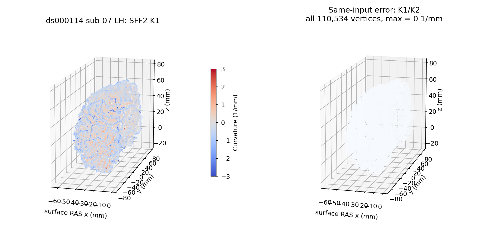
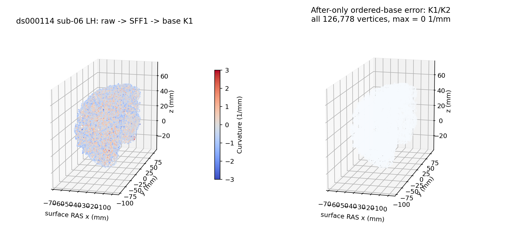

# 全局二阶曲面拟合与曲率先验

## 1. 功能简介

`global_second_fundamental_form()` 用当前坐标、实际法向及原有序多跳邻域生成 K1/K2 和主方向。`global_curvature_priors()` 接着复用现有 `curvature_histograms()` 生成两个 100-bin PDF 和 100×100 联合 PDF。它们是拓扑修复的显式阶段接口，不调用原版程序，不修改旧默认。

`global_second_fundamental_form_state()` 复用同一拟合，额外生成原流程的顶点 H/K 和表面汇总；不重写优化器。法向投影先验的另一阶段见 [全局法向先验](TOPOLOGY_GLOBAL_DOT_PRIOR.md)。


候选 SFF 与全局 SFF 的切平面、rip/有效行和零矩阵主方向不同。这里复用已验证的 3×3 SVD、2×2 EISPACK 和有序 float32 原语，没有用候选整个函数冒充全局函数。全局初始法向、球面、MRI、normal-dot PDF 和 GA 仍由各自阶段提供。

## 2. Python 调用、格式和输入输出

```python
from fnit.recon_all.topology_global_sff import global_curvature_priors

curvature_prior = global_curvature_priors(
    current_vertices=current_surface_xyz,       # float32(N,3)，实际当前surface RAS，mm
    vertex_normals=current_vertex_normals,       # float32(N,3)，实际前序法向，无量纲
    neighbor_offsets=original_vtotal_offsets,    # 整数(N+1)，原邻域CSR偏移
    neighbors=original_ordered_neighbors,        # 整数(E)，原vt.v[0:vtotal]顺序
    vertex_rip=original_rip_flags,                # bool/整数(N)，非零不拟合
    initial_k1=before_stage_k1,                   # float32(N)，未更新值，mm⁻¹
    initial_k2=before_stage_k2,                   # float32(N)，未更新值，mm⁻¹
)
principal_k1 = curvature_prior["sff"]["k1"]      # 完整顶点数组，保留未更新顶点
joint_curvature_pdf = curvature_prior["histogram"]["joint"]  # float32(100,100)
```

全部参数必填；`global_second_fundamental_form()` 使用同一组参数，返回 SFF 字典。输入转换为连续 float32/int32，不修改原缓冲。坐标是实际 current，不是 orig 备份；在原调用中两个全局拟合时点可以使用不同坐标。CSR 必须覆盖实际 vtotal，不能排序、由面重建或仅提供 vnum 一圈。

返回 `k1/k2` 为 `(N,)` mm⁻¹，`tangent_e1/e2` 为 `(N,3)` 无量纲。`condition_number` 为 `(N,)`；`fit_kind` 的 -1/0/1/2/3 分别为 rip、无邻点、拟合、病态回退、零矩阵。`valid_neighbors`、`search_attempts` 记录有效行和尝试次数；`gram(N,3,3)`、`rhs(N,3)`、`hessian(N,2,2)` 的单位依次为 mm⁴、mm³、mm⁻¹。`seconds` 包含参数校验与首次 JIT，不包含外部读写。

原流程对所有顶点先更新切平面，再跳过 ripped/无邻点的曲率更新。初始 K 在未更新顶点原样保留，可为非有限；PDF 消费时再检查非 rip 的自产 K 有限。全局函数仅对应 `pct_thresh=-1` 非平面流程，不支持其他截断 profile。形状、索引、CSR、非有限坐标/法向报 `ValueError`，SVD 不收敛报 `RuntimeError`。无可消费顶点、非有限消费 K 或直方图零宽范围也报错，不返回占位 PDF。

首次 SFF1 的法向具有明确前序状态：白灰采样前 `MRIScomputeNormals()` 在缺陷临时 rip 期间仅更新非 rip 顶点，缺陷顶点保留此前 canonical metric 法向；解除 rip 后直接进入 SFF1。不能把这里的法向统一替换成 raw current 全网格重算法向。后续 base copy 前恢复 TMP 并重新 metric，才形成另一组全 raw 法向。接口显式消费前序数组，不猜测这些备份和恢复操作。

需要保留完整 H/K 写回语义时使用以下入口：

```python
from fnit.recon_all.topology_global_sff import global_second_fundamental_form_state

global_fields = global_second_fundamental_form_state(
    current_vertices=current_surface_xyz,          # float32(N,3)，当前surface RAS，mm
    vertex_normals=current_vertex_normals,          # float32(N,3)，实际前序法向
    neighbor_offsets=original_vtotal_offsets,       # 整数(N+1)，原有序vtotal偏移
    neighbors=original_ordered_neighbors,           # 整数(E)，不从面重建邻域
    vertex_rip=original_rip_flags,                  # bool/整数(N)，原rip标记
    initial_k1=before_stage_k1,                     # float32(N)，未更新主曲率，mm⁻¹
    initial_k2=before_stage_k2,                     # float32(N)，未更新主曲率，mm⁻¹
    initial_h=before_stage_mean_curvature,          # float32(N)，未更新H，mm⁻¹
    initial_gaussian_curvature=before_stage_gaussian_curvature, # float32(N)，未更新K，mm⁻²
    vertex_area=before_stage_vertex_area,           # float32(N)，实际前序面积，mm²
)
```

新增三个参数均必填。`h`、`gaussian_curvature` 为 float32(N)，rip/无邻域顶点保留初始值；病态回退更新顶点 H/K，但原流程在该分支不累计表面汇总。`surface_statistics` 的 `Kmin/Kmax` 为 mm⁻²，`Hmin/Hmax` 为 mm⁻¹，`Ktotal` 为无量纲，均保存为 float32；`total_area_mm2` 为 float64。Ktotal 按原顶点序逐次累加 double 曲率乘积，再逐次写回 float32。无有效汇总顶点时保留原 ±10000 哨兵和总量 0。面积必须有限，允许原 0 面积；初始 H/K 可在未消费位置非有限。`curv`、`curvbak`、`valbak`、法向、面积从未被此接口改写，调用方应保留原字段。

`global_curvature_priors()` 返回 `sff`、`histogram`、总 `seconds`。histogram 的 `k1_bins/k2_bins/k1_counts/k2_counts` 为 float32(100)，`joint` 为 float32(100,100)，另含两个 mean/start/width 及 joint_norm。只生成曲率先验，不产生完整 MRI 或 GA。

## 3. 命令行调用

此阶段没有独立生产 CLI。隔离验证工具要求带哈希的 actual-before NPZ 与独立 after 参考：

```bash
python tools/benchmark_recon_topology_global_sff.py \
  --input frozen_global_before.npz \
  --reference frozen_global_after.npz \
  --reference-repeat frozen_global_after_repeat.npz \
  --source-manifest frozen_source_manifest.json \
  --mode priors \
  --threads 4 \
  --output new_global_sff_diagnostic
```

输入 NPZ 只含第 2 节对应入口的具名参数，不允许 pickle。`--mode` 默认 `sff`，`priors` 同时计算 PDF，`state` 另需 H/K/面积三字段，`dot` 使用另一页的五字段；`--threads` 默认 4。四个路径和新输出目录必填，参考重复可选。工具在自产计算完成后才加载 after 参考，返回逐字段不同值/字节、最大/P99、重复性和时间；私有输出包括 candidate NPZ 和报告，不将全网格数组发布。参考不能为空或省去完整主曲率/主方向。

已有冻结参考只捕获 K1/K2 时，独立核心诊断使用另一工具，不改变上述完整状态门：

```bash
statistics_capture=statistics.bin             # FNITFIT1，SFF2 后实际当前几何及 K 输出
statistics_repeat=statistics_repeat.bin       # 同输入第二次源运行
calibration_capture=calib.before.bin          # 后续 FNITHST1 入口，原域实际完整 vtotal
calibration_repeat=calib_repeat.before.bin    # 同输入第二次邻域捕获
source_manifest=SOURCE_MANIFEST.json          # 本次运行代码、脚本版本和 SHA
diagnostic_output=new_sff2_core               # 必须不存在的新诊断目录
python tools/benchmark_recon_topology_global_sff2_core.py \
  --statistics "$statistics_capture" \
  --statistics-repeat "$statistics_repeat" \
  --calibration "$calibration_capture" \
  --calibration-repeat "$calibration_repeat" \
  --source-manifest "$source_manifest" \
  --threads 4 \
  --output "$diagnostic_output"
```

全部路径必填、线程默认 4。必须是同原域、有序面和一圈前缀一致、nsize2 的 phase0 校准捕获；不合条件报 `ValueError`，已有输出报 `FileExistsError`。初始 K 独立 0，若存在 rip/无邻域保留分支，则完整核心门失败，报告保留未覆盖范围；不从后态参考填初始 K。输出完整私有 candidate NPZ 和聚合 `report.json`；进程退出 0 只代表该 K 核门，非完整 global 状态或 GA。

SFF1 没有直接的同域 after 快照时，可以用独立自产 base 和既有 DVS record 做另一组事后比较：

```bash
candidate_state=own_base_state.npz       # 自产 raw→SFF1→base 的完整状态，不从参考补字段
candidate_maps=own_base_maps.npz         # 自产 source_order/vertex_translation 全排列
candidate_report=own_producer_report.json # 已完成生产收据，包含输入、程序和两个 NPZ 的 SHA
reference_state=state.record.bin         # 固定源码的首次 DVS record，phase0，比较时才读取
reference_repeat=state_repeat.record.bin # 同输入第二次参考，完整捕获逐位相同
reference_receipt=reference_receipt.json # 两次参考程序、原输入和捕获文件的 SHA
source_manifest=comparator_manifest.json # 比较器及既有运行依赖的版本清单
diagnostic_output=new_sff1_base_subset   # 必须不存在的新诊断目录
python tools/benchmark_recon_topology_sff1_base_subset.py \
  --candidate-state "$candidate_state" \
  --candidate-maps "$candidate_maps" \
  --candidate-report "$candidate_report" \
  --reference-state "$reference_state" \
  --reference-repeat "$reference_repeat" \
  --reference-receipt "$reference_receipt" \
  --source-manifest "$source_manifest" \
  --output "$diagnostic_output"
```

八个路径必填。该工具不重新计算 base，不修改已有候选；先验证已落盘自产 checkpoint 的 SHA、原输入来源及自身映射互逆全排列，再读取参考。完整 orig/current 坐标、有序 logical 面及实际参考映射前缀全部逐字节相同时才比较 K1/K2。映射/几何门失败则曲率 `not_assessed`，不重排参考找最近点。格式、phase 或来源不符报 `ValueError`；已有输出报 `FileExistsError`。写出聚合 `report.json`，退出 0 仅表示该事后 K 核门及参考重复性通过。

## 4. 对应原软件步骤

固定 FreeSurfer `d932c45b7941662ea380a05efef580568b98d41a` 的 `mrisComputeTangentPlanes()`、`MRIScomputeSecondFundamentalFormThresholded(...,-1)` 与 `mrisComputePrincipalCurvatureDistributions()`。这些是 `mris_fix_topology` 内部步骤，没有独立官方命令。

独立 reference 可由固定源码构建的 `mris_fix_topology` 在隔离目录运行 `-ga -seed 1234 -threads 4`。本次复用了已有统计和校准观察器的两次相同捕获，未上传新的 head 观察器；生产不读取这些参考输出。新增 SFF1 before/after 与完整状态观察仍须对应授权与证据，不能由 SFF2 核通过替代。

## 5. 当前精度、时间和可视化

当前全局 SFF、H/K 写回、法向先验和隔离 CLI 合计 43 项本地契约通过，JUnit 记录 10.513 秒，含冷进程的本地测试包装器 12.035 秒。包括解析抛物面、rip/无邻点、零矩阵 identity、病态回退、有效行压缩、H/K 选择性写回、Ktotal 逐顶点舍入、输入不变及重复性。它们是算子契约，**不替代真实 MRI benchmark**。源码绑定见 [测试收据](../../validation/recon_all/optimizations/20261010_topology_global_priors/reports/contracts_v3.json)。本接口不改变 TF32/线程/CUDA策略，尚无显存或真实端到端速度结论。

先前拿 `statistics.bin` 的 K 与首次曲率 PDF 比较的诊断不能作为此核验收：该捕获位于 `mrisComputeSurfaceStatistics()` 的第二次全局 SFF 后，坐标已恢复到平滑 orig；首次生成曲率先验在更早的 current 坐标和不同法向/邻域状态上执行。阶段相位不同会造成 PDF 不同，不能由此认定现有直方图有 bug。本次不修改已通过的 histogram 子函数。

既有3a DVS record 捕获的是 corrected base。它在原网格 SFF2/校准之后执行，但 base 的 k1/k2/H/K 已在 SFF1 之后、SFF2 之前复制，后续原网格统计不会回写 base。因此其 K1/K2 可作为同3a自产 raw→SFF1→base 映射后的 after 子集，不是直接同域 SFF1 快照；不能从该参考取上游输入。DVS 未捕 H/K、TMP/canonical；base 未复制 e1/e2，不用其零初始化方向冒充 SFF1 主方向验证。

### 当前 SFF2 完整核心回归

公开 ds000114 sub-07 LH、`79a41cdd` 自产上游的第二次全局拟合已完成同输入核验。既有 `FNITFIT1` 统计检查点保留实际当前 XYZ、法向和 rip；同一源码运行的后续 `FNITHST1` 校准入口保留完整有序 vtotal。固定调用链在两者之间没有改变原网格邻域，全部面、一圈前缀、原坐标和 rip 也逐项相同。没有用面重建邻域。

110,534 顶点、221,116 面、2,166,570 项有序两圈邻接；rip 和无邻域顶点均为 0，全部顶点实际进入拟合。初始 K 独立置 0 且没有被保留分支消费，参考输出 K 只在自产结果写出后用于比较。

| 本次实际范围 | 结果 |
| --- | --- |
| 完整 K1/K2，相对固定源码两重复 | 不同值/字节均 0，max/P99 均 0 mm⁻¹ |
| 自有两重复，11 个完整数组 | 全部逐位相同 |
| 首次 API，含 JIT/校验 | 9.035304 秒 |
| 同进程热 API | 0.348773 秒 |
| 脚本，含导入、加载、候选写出，截止报告写入前 | 17.748947 秒；未计解释器启动 |
| 当前环境 | 四核/总线程 4，Python 3.11.16、NumPy 1.26.4；CPU，无 CUDA |
| 未捕获的参考主方向、H/K、表面汇总 | `not_assessed` |
| raw→SFF1/PDF、全局 dot、完整 GA/整例/网格质量 | `not_assessed` |

独立源观察器还计算准备与多种似然，不能用其完整墙钟除以这个子项发布速度比。此门证明同输入 SFF2 的全部 K 核心，不把 SFF2 输出当作 SFF1 曲率先验。完整参考重复性、来源/版本、时间边界和 11 项新契约见 [本次回归目录](../../validation/recon_all/optimizations/20261010_topology_global_sff2_core/README.md)。



图仅每四个点显示一个，所有数值检查覆盖全部顶点。完整 global H/K、主方向和 SFF1 priors 仍需对应阶段参考；旧正常 candidate SFF 的证据属于另一子功能。

### 当前 SFF1 经自产 base 的核心回归

公开 ds000114 sub-06 LH、历史 3a 的原 nofix/qsphere/brain 冻结输入已独立运行 raw→混合法向→SFF1→base。候选生产没有读取 DVS 输出；参考在候选落盘之后用于比较。首次和补齐初始法向相位后的两个生产冻结版都完成，产出的 state/maps 文件 SHA 相同，原报告分别保留。

| 本次实际范围 | 结果 |
| --- | --- |
| 自产 base 完整 orig/current XYZ、246,985 有序面 | 相对两个稳定参考，全部逐位相同 |
| 自产完整 source_order/translation | 互逆全排列；参考只捕获 1,889 项 translation 前缀，这些项逐位相同 |
| 126,778 顶点的 K1/K2 | 不同值/字节 0，max/P99 0 mm⁻¹ |
| 新生产 v2 完整 API，含校验和首次 JIT | 79.611412 秒，CPU/总线程 4，共享环境观察 |
| 新生产 v2 工具，含加载/写出，不含导入和最终 JSON | 82.021968 秒；导入另计 1.600589 秒 |
| 独立事后比较 v3，含两个参考和候选加载，截止报告写入前 | 3.831842 秒，非生产算法耗时 |
| 未捕获字段或完整流程 | H/K/E、曲率 PDF、完整 base 其他属性、GA、网格质量及整体等效 `not_assessed` |

参考在另一环境运行整个观察流程，不能与这个自产 API 发布速度比。K 字段复制时点在 SFF1 之后、SFF2 之前；本例 base 没有把 SFF2 的 K 或候选拟合结果回填上游。

初始缺陷 border 法向与 merge 后均值的相位分开：固定主程序在进入 `MRIScorrectTopology()` 前对尚未中心化的 canonical 球面做 metric；`centerSphere()` 后分割读取这些保留法向，之后才重算 centered metric 供 merge。新生产显式生成两组法向，但既有参考未捕初始缺陷法向，该字段仍未验证；本例 merge 0 也不能证明两组法向等价。新增 13 项映射/来源契约和两版完整来源见 [事后比较报告](../../validation/recon_all/optimizations/20261010_topology_sff1_base_subset/README.md)。



只对渲染每四点取一点；误差统计使用完整 126,778 顶点。图是该阶段数值展示，不是完整拓扑或原始 T1 整例质量结论。

## 6. 最近更新与 benchmark

- 2026-10-10：新增 prepared 全局 SFF 与 PDF adapter，复用成熟 VNL、EISPACK 和 histogram。
- 同日补全显式 H/K 及表面汇总写回，原 `curv/curvbak/valbak` 保留；全局法向先验独立消费平滑 orig 阶段，不混用原始 K 先验输入。
- 保留全局 source 特有的 normal permutation 切平面、倒数乘法归一化、原有效行写入、rip、102 次退化尝试上限和零矩阵 identity 分支；无邻点初始 K 保留。
- 旧 `first_principal_curvatures()`、其真实历史输入和默认调用不在此次替换范围。本接口 `production_default_changed=False`，必须用完整真实阶段验证之后才能考虑接入。
- 同日后续：复用已有两种原域捕获完成 SFF2 全顶点 K1/K2 同输入逐位回归；未新增 head 观察器，未将尚未捕获字段或 SFF1/PDF 改标通过。
- 同日后续：自产 raw→SFF1→base 与已有 3a DVS record 做事后全 K1/K2 核验；先通过完整坐标/有序面域检查，再评曲率。初始法向相位的新旧冻结收据分别保留，未改旧结果。

## 7. 原代码和参考文献

- [全局 SFF 与 PDF 固定源码](https://github.com/freesurfer/freesurfer/blob/d932c45b7941662ea380a05efef580568b98d41a/utils/mrisurf_metricProperties.cpp)。
- [矩阵/SVD 固定源码](https://github.com/freesurfer/freesurfer/blob/d932c45b7941662ea380a05efef580568b98d41a/utils/matrix.cpp)。
- [拓扑 caller 固定源码](https://github.com/freesurfer/freesurfer/blob/d932c45b7941662ea380a05efef580568b98d41a/utils/mrisurf_defect.cpp)。
- Fischl B et al. Automated manifold surgery. *NeuroImage* (2001). [DOI](https://doi.org/10.1006/nimg.2001.0781)。
