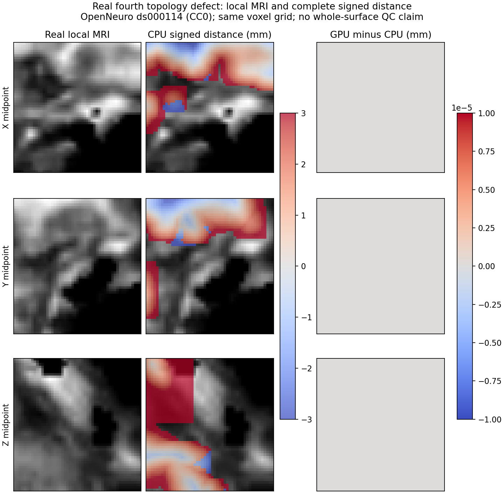

# 拓扑 GA 的显式 GPU 距离评分

## 1. 功能简介

`gpu_defect_signed_distance` 从当前候选几何生成完整有向距离场。不同体素并行；每个体素按原始面顺序更新，保留当前距离剪枝、边/面分支、同分正值优先及 1000 mm 未设置哨兵。块索引只排除与整个块包围盒不相交的面，保留全部候选和重复行。角点伪法向、邻面和包围盒复用成熟 CPU 函数，每次候选重新计算。

`evaluate_prepared_patch_fitness` 和 `evaluate_candidate` 新增 `distance_evaluator=None`。缺省行为不变；显式传入 callable 时，完整距离场进入原有 unMRI 和反馈函数。搜索、选择、停止、winner 恢复、重连接和 Gauss-Seidel 没有修改。CUDA 失败向上报错。


## 2. Python 调用、输入和输出

```python
from functools import partial
from fnit.recon_all.topology_gpu_distance import gpu_defect_signed_distance
from fnit.recon_all.topology_patch_fitness import evaluate_prepared_patch_fitness

# prepared_inputs 为同一候选自产的五个输入 Mapping 和 valid_faces。
# 禁止将参考距离、赢家或原程序输出装入这些输入。
distance_evaluator = partial(
    gpu_defect_signed_distance,
    device="cuda:0",       # 必须显式指定当前机器上的目标 GPU
    block_voxels=64,        # 只接受 32、64、128；改变块划分，保持完整候选
)
fitness_result = evaluate_prepared_patch_fitness(
    **prepared_inputs,
    distance_evaluator=distance_evaluator,
)
```

直接距离接口全部参数如下。距离和坐标单位为 mm，索引轴顺序为 `(X,Y,Z)`。

| 参数 | 意义和格式 |
| --- | --- |
| `original_vertices` | 当前 surface RAS 坐标，有限数组 `(N,3)`，按源规则转换 F32 |
| `faces` | 当前有序三角面，整数 `(F,3)`，顶点索引合法 |
| `face_normals` | 当前完整面法向，有限 F32 `(F,3)` |
| `incident_offsets` | 顶点入射面 CSR 偏移，整数 `(N+1,)` |
| `incident_faces` | CSR 面索引，整数 `(I,)`，保持源行顺序 |
| `incident_corners` | 与入射面对应的角点编号，整数 `(I,)`，0/1/2 |
| `volume_shape` | 正整数 `(3,)`，完整局部距离体积大小；总格点不超过 `2**31-1`，超出 GPU 线性索引范围时在分配前明确报错 |
| `volume_origin_mm` | 有限 F32 `(3,)`，局部体积原点 |
| `volume_index_scale_per_mm` | 有限正 F32 `(3,)`，每 mm 的索引倍率 |
| `ordered_candidate_faces` | 默认 `None` 使用全部有序面；或完整整数 `(B,)`，允许重复；不截断候选 |
| `backend` | 默认 `serial`；接受原 API 的 `serial/parallel`，此 GPU callable 的实际执行后端始终为 `gpu_ordered_voxels` |
| `device` | 必填 `cuda:N`；无 CUDA 或失败时不回退 |
| `block_voxels` | 默认 64；Python 或 NumPy 整数 32/64/128，独立体素块大小；浮点数、布尔值和其他值在设备设置及 CUDA 分配前报错 |

返回 `distance_mm`：F32 `(X,Y,Z)`。同时返回成熟接口的全部 `buffer_bounds`（整数 `(B,7)`：面索引及 XYZ 闭区间）、`buffer_coordinates`（F32 `(B,9)`，每面原三角坐标，顺序为 x0/x1/x2、y0/y1/y2、z0/z1/z2）、`other_edge_faces`（整数 `(B,3)`）、`query_vertices`（有序唯一顶点索引）、`query_pseudonormals`（F32 `(Q,3)`）和 `scope`。新增 `actual_backend`、`block_voxels`、`complete_face_rows`、`block_face_entries` 只记录实际执行配置。

五项接口的输入、四个权重、反馈和有效面语义继续见 [准备后评分说明](TOPOLOGY_PATCH_FITNESS_ASSEMBLY.md)。`distance_evaluator` 必须为 callable 或 `None`，接收完整 `distance_inputs` 关键字，返回同结构完整距离。有效 unMRI 权重被源规则跳过时不调用它。`evaluate_candidate` 也接受同一个参数，可放入 `candidate_inputs` 交给成熟 `search_and_finalize_defect`；`distance_policy.actual_backend` 记录实际 GPU 后端。`caller_numba_thread_mask/slab_count` 是原 requested CPU backend 的兼容元数据；GPU 不按这些值划分执行，应查看距离返回的 `block_voxels/block_face_entries`。

计算使用源 F32 顺序及 round-to-nearest 除法/平方根，关闭 FMA 融合；不使用半精度、近似除法或矩阵乘法。TF32 保持用户策略，该距离核没有矩阵乘法。启动前检查距离张量需求不超过 20,000,000,000 字节；完整进程树峰值另行监测。依赖复用当前环境的 PyTorch、Numba 和 Linux CUDA PyTorch 环境已安装的 Triton 3.1.0；尚未完成独立干净 Conda 安装验证。

MRI/PDF 驻留采样做过真实第四缺陷诊断，八次 CPU/GPU 评分数值字段一致。但 MRI 仅占约 2.6 ms，本轮交付聚焦完整距离评分，实验采样接口保留在私有冻结诊断包，不作为公开生产 API。

## 3. 命令行调用

这些是 FNIT 独立验证工具，不能当生产整例 CLI。`src` 与 `tools` 放入 `PYTHONPATH`。真实输入必须来自同一 FNIT 连续链，校验 nofix/qsphere 的有序面一致。

```bash
python tools/benchmark_recon_topology_gpu_distance.py \
  --inputs prepared_inputs.private.npz \
  --schema prepared_inputs.schema.private.json \
  --output new_distance_run --device cuda:0 --threads 4 --repeats 3

# 完整默认第一缺陷：首候选全状态门→新 CPU 完整 GA→新 GPU 完整 GA。
python tools/benchmark_recon_topology_gpu_ga_pair.py \
  --workspace frozen_source --output new_first_ga_pair \
  --input-surface lh.orig.nofix --input-qsphere lh.qsphere.nofix \
  --brain brain.mgz --device cuda:0
```

距离工具的 `inputs/schema` 是本任务自产五项输入的 typed NPZ/JSON，不允许 pickle；`output` 必须新建，保存完整私有距离场、逐字段比较和报告。`device` 必填，`threads` 默认 4，`repeats` 默认 3，按 AB/BA 交替。

每个完整子进程重新导入和加载输入；本次冻结任务沿用首候选门已暖好的同一磁盘 NumBa/Triton 缓存，因此报告完整 CLI 墙钟，不能称各自空缓存的冷全流程。

`--gate-only` 只验证四次首候选和显存归属，不执行完整 GA。默认不加该参数才运行完整配对。工具针对本报告冻结的 lh 三项输入及默认第一缺陷协议，不是任意被试通用 GA CLI。

配对工具的 `workspace` 必须包含 SHA-256 `SOURCE_MANIFEST.private.json` 及冻结源码；`output` 必须新建。四核预算，固定种子 1234、population=10、max_unchanged=10、niters=-1、initial_selection=True、vertex_eliminate=True；保留完整搜索与最终写回。工具比较所有候选评分、末态和控制，不加载旧赢家。输出原始 NPZ/坐标/体积留在私有服务器目录；只公开聚合指标。

## 4. 原软件调用

距离函数属于 FreeSurfer 拓扑 GA 内部评分，没有独立官方 CLI。对应完整阶段为：

```bash
SUBJECTS_DIR=/path/to/subjects mris_fix_topology -mgz -ga subject_id lh
```

该命令只用于独立参考环境。本任务 GPU/CPU 回归运行 FNIT 自产接口，没有执行原程序，也没有重新运行原始 T1 整例。

## 5. 最新真实精度、耗时和可视化

当前证据见 `validation/recon_all/optimizations/20261011_fnit4_gpu_fitness/FOURTH_STAGE.json`。同一冻结真实第四缺陷，4 核、同一 A100，GPU 共享锁保护。全距离体积 `(51,53,54)`，7216 个完整面行，GPU 块索引 557261 条保守面记录。三组 CPU/GPU 比较中，距离、包围盒、邻面、角点法向、unMRI、完整 curvbak 反馈全部逐字节一致；哨兵不匹配数为 0。

| 距离完整 API | CPU | GPU |
| --- | ---: | ---: |
| 冷运行，含各自 JIT/准备/传输 | 9.646 s | 4.770 s |
| 第一热配对（BA） | 0.494 s | 0.127 s |
| 第二热配对（AB） | 0.474 s | 0.100 s |

GPU 热完整距离 API 约快 3.9–4.8 倍。冷比较是同一进程中的顺序调用，已共享部分 CPU 准备 JIT；不能当两个完全独立冷进程总提速。

新鲜第四首候选 CPU 热剖析：重连接/匹配/平滑/法向 4.547 s，曲率 SFF 0.0050 s，面检查 0.0365 s，MRI 0.0026 s，完整距离 0.4542 s，unMRI 0.0024 s，曲率似然 0.0008 s，normal 0.0043 s，准备后完整五项 0.4667 s。完整 evaluator 准备另为 5.438 s。嵌套时段不能相加；cProfile 含观察开销，独立保留。

第一缺陷四次首候选 CPU/GPU 全状态门通过：全部候选数值字段、完整持久状态和控制决策一致，随机调用数为 0。首候选热 GPU 距离 0.0353 s，CPU 0.0939 s；完整候选闭环 GPU 1.4775 s，CPU 1.5518 s。单次热闭环观察约改善 4.8%，包含状态装配和恢复，不能由距离算子提速外推整个 GA。冷 CPU 闭环 14.0748 s，第一次 GPU 闭环 6.5991 s，第二次 GPU 1.4775 s；共享进程中的前置 JIT 差别另列，不能当独立冷端到端比较。详见 `FIRST_CANDIDATE_STAGE.json`。

完整第一缺陷默认 GA 已完成：两侧各 495 次搜索评分和 1 次最终评分，29 条 generation trace，最后零基 generation 索引 28。4 个 NPZ 的 81 个数组逐字节一致，两个控制 JSON 一致；全部 1,362,381 次实际随机区间和值的 SHA-256 一致。赢家、排名、停止、反馈、完整终态和最终几何相同。新 CPU 结果还与此前完成的两线程 CPU 阶段 81 个数组相同，此项只作事后科学输出诊断，不比较不同冻结版本的时间。

| 完整第一缺陷配对 | CPU | GPU |
| --- | ---: | ---: |
| 完整 CLI 墙钟，包含子进程导入、准备、缓存加载、搜索、写回、退出 | 1275.139 s | 1225.616 s |
| 496 次完整距离 API 总和（嵌套） | 49.542 s | 20.560 s |
| 相同 CPU 几何 API 总和（嵌套） | 633.542 s | 627.171 s |

单次新配对观察到 CLI 缩短 49.523 s（3.884%），完整距离 API 总和约快 2.41 倍。共享节点其他 CPU 时段的波动保留原始记录，不能把整段差额全部归因于距离核。四核、同源同输入、默认完整策略，没有并行候选、截断迭代或读旧赢家。

PyTorch GPU 全阶段 allocated 峰值 775680 字节、reserved 峰值 2097152 字节。晚阶段按内核 `sched` 映射宿主 PID 的 283 次 NVML 样本准确归属本任务：观测树峰值 438304768 字节（418 MiB），失败 0 次，实际最大间隔 1.144 s，目标间隔 0.5 s。早期先缺 psutil，再遇到容器 PID/宿主 PID 不匹配；原失败和空匹配记录保留，完整早期 NVML 树峰值仍未验证，不称为零。后续工具已修复依赖、PID 映射和实际 UUID 选择。



图为同一局部 XYZ 网格的三个中间切片，CPU 距离颜色范围 ±3 mm，GPU−CPU 差图全零。来源 [OpenNeuro ds000114](https://github.com/OpenNeuroDatasets/ds000114/blob/master/dataset_description.json)，原作者当前声明 CC0；公开派生图，不公开原始 MRI/坐标/完整私有距离场。

v3 核心和受影响接口合计 51 项测试通过（26 + 20 + 当时 5），最新块合同测试与总数见第 6 节。完整证据见 `COMPLETE_FIRST_GA.json`，最新输入校验和监测门见 `FINAL_VALIDATION.json`。默认仍为 CPU；全部缺陷、原始 T1 整例、完整表面质量与原版整体等效尚未由本次验证评估。

## 6. 更新与 benchmark 记录

- 2026-10-11 v1：独立 GPU 距离全覆盖块索引和源序内核；真实第四距离/反馈三组逐字节通过。现有 distance/slab/有序 retess 文件未修改。
- 2026-10-11 v1：默认不变的两个显式 callable 接口；26 项评分接口测试、4 项完整块覆盖/重复行测试及 20 项候选闭环/搜索接口测试通过，不替代真实 benchmark。
- 2026-10-11 v1：第一缺陷首候选四次全状态门与完整 CPU/GPU 默认 GA 配对均通过；81 数组/两控制/全部评分/RNG/终态一致。父监测脚本遇到未安装 psutil；冻结任务保留失败采样，另启无新增依赖的独立 `/proc` 进程树采样。初始导入/准备时段存在监测缺口，不称整段显存已验证。后续工具消除 psutil 依赖，不修改已运行冻结源码。
- 2026-10-11 v2：监测工具新增实际 GPU UUID 握手、`sched` 宿主 PID 映射及保留原始 NVML 行；用 `--gate-only` 在冻结新包验证首候选和监测，不重跑完整 GA。该新监测门已通过，210 次样本、峰值 438304768 字节，最大间隔 1.057 s；启动时等待 UUID 文件的 15 次失败样本保留。
- 2026-10-11 v3：复核发现 GPU 平铺线性索引为 signed int32；新增分配前体积格点边界检查，超过 `2**31-1` 报错，无裁剪/回退。数值内核 SHA 与完整第一 GA 冻结内核相同；第一缺陷局部体积固定且远小于边界。新增拒绝超界在内的 5 项测试通过；最新真实第四距离三组重放全部原字段和下游反馈逐字节一致。数值内核未变，本版本只有域外输入校验；不冒充再次完整 GA。
- 上一阶段 `8b14cf4b`：F64 三角形平面保守过滤独立候选，与本轮距离评分收益分别计量。

- 2026-10-11 接口修复：严格检查 `block_voxels` 的整数类型，接受 NumPy integer 并转为 Python int，排除浮点数和布尔值。仅修复声明域外输入，不改变数值 kernel 或已冻结完整 GA 源码；完整 GA 的源版本与结果仍按原记录绑定。 15 项块合同测试通过（替代原 5 项），受影响测试合计 61 项（26 + 20 + 15）；本次未重跑数值未变的完整 GA。

## 7. 原实现与参考文献

- [FreeSurfer mris_fix_topology.cpp](https://github.com/freesurfer/freesurfer/blob/dev/mris_fix_topology/mris_fix_topology.cpp)：内部 GA 和评分入口；验证绑定项目保存的版本，不以 dev 浮动分支充当冻结版本。
- [FreeSurfer mrisurf_topology.cpp](https://github.com/freesurfer/freesurfer/blob/dev/utils/mrisurf_topology.cpp)：原拓扑及距离算法背景。
- [Fischl B, Liu A, Dale AM](https://pubmed.ncbi.nlm.nih.gov/11293693/). Automated manifold surgery: constructing geometrically accurate and topologically correct models of the human cerebral cortex. IEEE Transactions on Medical Imaging, 2001, 20(1):70–80.
- Ségonne F, Pacheco J, Fischl B. Geometrically accurate topology-correction of cortical surfaces using nonseparating loops. IEEE Transactions on Medical Imaging, 2007, 26(4):518–529.
- [Triton](https://github.com/triton-lang/triton)：本环境 3.1.0 的自有 GPU 算子编译；没有复制原脑影像软件代码。
