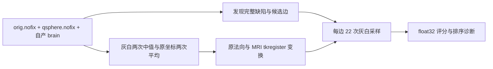

# 拓扑候选边的 MRI 评分

## 1．功能

`topology_edge_mri_score.py` 是自有 Python/Numba 实现。它准备灰白质边界强度、两轮平均的原坐标及其法向，再为完整候选边计算原拓扑算法的 MRI `EDGE.len`。不调用原软件程序，也不读取官方输出。

本页只覆盖准备与边评分。动态重连的完整 fitness、USE_SOME 分类、mutation、crossover、种群控制和全部缺陷接受尚未完成。此前首个重连候选仍有 17 个相交面，质量失败，不产生可用生产表面。



## 2．Python 调用、输入与输出

```python
import nibabel as nib
import nibabel.freesurfer.io as surface_io
import numpy as np
from fnit.recon_all.topology_edge_mri_score import (
    prepare_topology_edge_inputs,
    source_mri_edge_scores,
    source_topology_ras_to_voxel,
)

coordinates, triangles = surface_io.read_geometry("subject/surf/lh.orig.nofix")
brain_image = nib.load("subject/mri/brain.mgz")
brain_volume = np.ascontiguousarray(np.asarray(brain_image.dataobj))
topology_matrix = source_topology_ras_to_voxel(
    volume_header=brain_image.header,  # MRI 的 MGH 头；不传表面 footer
)
prepared = prepare_topology_edge_inputs(
    vertices=coordinates,            # (N,3)，原表面 RAS，单位 mm
    faces=triangles,                  # (F,3)，完整有序整数三角面
    defect_vertices=defect_labels != 0,  # (N,) bool；全部已发现缺陷
    volume=brain_volume,              # (X,Y,Z) uint8，自产归一化 MRI
    ras_to_voxel=topology_matrix,     # float32(4,4)，MRI tkregister RAS→体素
)
edge_scores = source_mri_edge_scores(
    original_vertices=prepared["original_vertices"],  # 两轮平均，float32(N,3)
    original_normals=prepared["original_normals"],    # 同坐标法向，无量纲
    edge_vertices=complete_source_edges,              # 完整整数(E,2)，原顶点序
    white_values=prepared["white_values"],            # 两轮中值后的 float32(N,)
    gray_values=prepared["gray_values"],              # 同序灰质强度
    original_edge_present=original_edge_present,      # bool(E,)，原 nofix 是否有边
    volume=brain_volume,                              # 相同 MRI；不能换参考影像
    ras_to_voxel=topology_matrix,                      # 相同变换矩阵
)
```

`defect_labels`、`complete_source_edges` 和 `original_edge_present` 来自已有 `topology_preflight_python` 的完整缺陷发现、base translation 和候选边表；不是人工选择的参考成功子集。完整自动生成示例见下面的 benchmark 命令。

三个函数均为具名参数接口，没有设备、迭代或精度开关。MRI 变换函数复用 nibabel 的 `get_vox2ras_tkr()` 和 FNIT 的有序 VNL 仿射逆。输入必须是该 MRI 的 tkregister RAS，而不是 scanner RAS；矩阵输出连续体素索引。

准备返回字典：`original_vertices` / `original_normals` 为 float32 `(N,3)`；`white_values` / `gray_values` 为 float32 `(N,)`；`ripped` 为 bool `(N,)`；`neighbors` 为逐顶点有序邻居列表。全部索引沿用输入网格。边评分返回 float32 `(E,)`，保持完整输入边顺序，不自行排序或写表面。

每条边包含两个端点及 0.1…0.9 的九个内部位置；每位置沿平均法向 ±0.5 mm 采样，共 22 次。MRI 强度单位沿用 uint8 0…255；偏差由 float64 累计，结果存 float32。原网格没有的边按源码加 100。保留源码 `FZERO = FLT_EPSILON`，不新增 epsilon、不启用半精度。形状、标签、索引、uint8 类型或有限性不合法时抛 `ValueError`；不改原数组，不写占位文件，不原生回退。

## 3．命令行

```bash
python tools/benchmark_recon_topology_mri_edges.py \
  --input-surface subject/surf/lh.orig.nofix \
  --input-qsphere subject/surf/lh.qsphere.nofix \
  --intensity-volume subject/mri/brain.mgz \
  --output-dir isolated_diagnosis/candidate \
  --native-before isolated_reference/edges.before.bin \
  --native-after isolated_reference/edges.after.bin \
  --source-root .
```

前三项为同源、同序的 FNIT 自产输入；`output-dir` 必须不存在。两个 `native-*` 是独立 benchmark 观察的完整边表，**候选计算及 checkpoint 保存完成后才读入**。`source-root` 用于逐文件 SHA 绑定。输出是完整 JSON 和压缩 checkpoint，不是整例输出。参考字段交换仅发生在 `compare_preparation.py`，不进入任何生产链。

`build_prepare_observer.py`、`build_sample_observer.py`、`build_active_transform_observer.py` 只在新目录从固定上游源码与 Conda 工具链编译诊断参考，记录实际编译、链接、源码及程序 SHA；不修改生产源码、已测二进制或运行目录。`build_cache_observer.py` 保留未激活分支的排错实验；本次源码 `MATRIX_ALLOCATION=1`，不能以其无日志声称实际 cache 有误。

## 4．原软件内部步骤

对应固定源码 `d932c45b7941662ea380a05efef580568b98d41a` 的 `mrisFindGrayWhiteBorderMean` 和 `mrisTessellateDefect_wkr` 内部边评分，无独立官方 CLI。独立参考使用完整入口并在首次完整边表排序后停止，尚未运行 GA：

```bash
mris_fix_topology_fnit \
  -threads 4 -mgz \
  -sphere qsphere.nofix -inflated inflated.nofix \
  -orig orig.nofix -out diagnostic.orig.premesh \
  -ga -seed 1234 -threads 4 subject lh
```

该参考是允许的固定源码独立 Conda 构建，包含仓库原有数值适配，**不是系统安装官方程序**。评分源代码、适配、观察程序和输入绑定均在收据内。qsort 记录器独立停止点由完整候选数设置，不含被试判断。

## 5．当前真实数据精度与耗时

公开 ds000114 sub-07，79a41cdd 原始 T1 连续自产的 LH nofix/qsphere/brain。CPU affinity 8–11、4 线程、CUDA 隐藏，同一 A100 主机；本阶段未使用 GPU，显存实测范围不适用于其他阶段。原影像 SHA、模块 SHA、参考程序 SHA、完整原始收据均保留。

| 检查范围 | 当前 v3 结果 |
|---|---:|
| 全部 110,534 顶点的平均坐标、原法向、灰白中值 | 各自 0 不同元素 |
| 有序 221,116 三角面 | 相同 |
| 完整初选 4,851 边 ×22 点的体素坐标及采样 | 106,722 次全部相同 |
| 剪枝后完整 4,723 边及 used 标记 | 全部相同 |
| MRI 评分 max / P99 | 0 / 0 |
| 最终排序端点及重复评分 | 全部相同 |
| 参考两次完整观察矩阵、准备、采样、排序表字节 | 相同；观察未改变旧参考评分 |

| 耗时边界 | 当前观察值 |
|---|---:|
| 自产候选表和全部准备，包含读取及首次 JIT | 51.023 s |
| 完整边评分首次 JIT / 热调用 | 0.330 / 0.00688 s |
| 候选计算到打开参考之前 | 51.359 s |
| 候选完整 harness，包含 checkpoint 压缩和比较 | 74.941 s |
| 只读完整采样回放 / 准备字段诊断 | 1.568 / 1.001 s |

参考准备到首次边表的两个原进程约 5 秒，但与候选范围不同，不能据此发布阶段或整例提速。上述是单侧阶段验证；另半球、另一例、完整 MRI fitness 和全 GA 尚未验收，整体指标等效 `not_assessed`。

同源解剖图见[首个缺陷的 T1 和失败重连候选](../../validation/recon_all/optimizations/20261010_topology_retessellation/reports/figures/v5_intersecting_patch_T1.png)。这张图说明原始缺陷及 17 面相交失败，不是本评分修复后完整重连通过的证据。

## 6．更新与 benchmark 记录

v1 / v2 的 4,723 边中 4,467 评分不同（max 0.00037384，P99 0.00027466），排序不同。v2 修正 `sqrt(float)` 仍未消除首差；这些失败结果保留。

v3 定位了通用接口错误：误把放置阶段的 surface-footer→scanner→MRI 变换用于 topology。固定 topology 源码实际使用 MRI-only tkregister inverse；此例误用变换令 Z 平移多 0.00001525878906 体素。改为实际分支并保留行 float64 乘加→float32 结果后，全部采样、准备和评分一致。成熟 placement 的变换和插值函数保持原样，已通过的两轮平均与法向实现继续复用。

实际活跃矩阵观察两次程序退出均为 0；原驱动随后将字符串 `__file__` 传给 `Path.read_bytes`，仅事后 JSON 收据失败。`recover_capture_receipt.py` 在新诊断目录恢复已完成数据的收据并逐个复核 SHA；原驱动退出 1、日志及输出保留，不将恢复称为新连续整例。

全部公开 JSON 见[机器可读报告](../../validation/recon_all/optimizations/20261010_topology_source_mri_score/README.md)。服务器侧导出复用项目发布器，核对每个数值、布尔和 null 不变；不发布 MRI、许可证、账号、地址、原二进制或 checkpoint。

## 7．源码和参考文献

- [固定 FreeSurfer 拓扑源码](https://github.com/freesurfer/freesurfer/blob/d932c45b7941662ea380a05efef580568b98d41a/utils/mrisurf_defect.cpp)：准备、22 点边评分与剩余 GA。
- [固定 MRI 变换源码](https://github.com/freesurfer/freesurfer/blob/d932c45b7941662ea380a05efef580568b98d41a/utils/mri.cpp)：`voxelFromSurfaceRAS_` 和 `GetSurfaceRASToVoxelMatrix`。
- [固定度量源码](https://github.com/freesurfer/freesurfer/blob/d932c45b7941662ea380a05efef580568b98d41a/utils/mrisurf_metricProperties.cpp)：`mriSurfaceRASToVoxel` 实际类型规则。
- Ségonne F, Pacheco J, Fischl B. *Geometrically accurate topology-correction of cortical surfaces using nonseparating loops*. IEEE TMI 26:518–529, 2007：[作者网站全文](https://surfer.nmr.mgh.harvard.edu/ftp/articles/IEEE.TMI.segonne.2007.separating.loops.pdf)。
