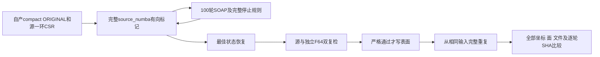
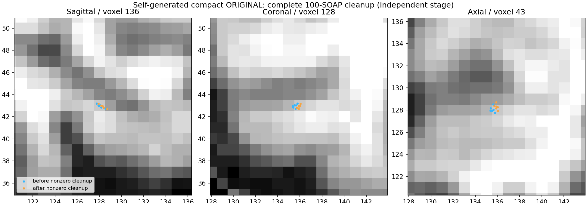

# 自产 ORIGINAL 网格的非零相交 CSR 阶段验证

## 1. 功能与流程

本验证读取同版本自产压缩网格的 ORIGINAL 坐标槽及其有序邻接，运行
成熟完整 `run_remove_intersection()` 两次。保留每周期100轮有序 F32
双pass SOAP、全部停滞判断、最佳状态恢复，以及源有向标记和独立
F64三角形几何的严格双复检。不调用原软件程序，不增加依赖。



这是独立阶段诊断。原拓扑最终算法清理 CURRENT/TMP 后恢复 ORIGINAL
再写 premesh；该 ORIGINAL 中间状态可能有相交，后续标准 remesh 和
相交清理承担最终检查。本验证不把 ORIGINAL 提前清理接入标准流程。
输入也不是完成全部25缺陷后的最终网格。

## 2. Python 调用、输入与输出

```python
from pathlib import Path
import sys
sys.path.insert(0, "/path/to/FNIT/tools")  # 将本仓库tools加入诊断模块搜索路径
from benchmark_recon_topology_nonzero_csr import run

report = run(
    compact_state=Path("/data/own/compact.private.npz"),  # 同版本自产完整状态
    input_surface=Path("/data/own/lh.orig.nofix"),  # 同源几何头，不消费其坐标
    source_manifest=Path("/data/frozen/SOURCE_MANIFEST.json"),  # 实际冻结源码SHA
    output=Path("/data/runs/nonzero-original-csr"),  # 必须是不存在的新目录
    threads=4,  # 每次完整阶段CPU线程预算
    repeats=2,  # 相同输入连续完整重复，至少两次
)
```

调用前须设置 `CUDA_VISIBLE_DEVICES=''`；本次是自有 Python/Numba CPU
阶段，不改变父进程或生产 CUDA 策略。

| 参数 | 格式、默认值和限制 |
|---|---|
| `compact_state` | 必填无pickle NPZ。ORIGINAL为float32 `(N,3)` surface RAS/mm；含逻辑面 `(F,3)`、完整neighbor storage及topology的vnum。必须已压缩且无rip元素 |
| `input_surface` | 必填同源三角表面，只读nibabel几何头；原参考坐标不进入计算 |
| `source_manifest` | 必填文件，记录实际冻结源码；报告另算所有实际调用模块SHA |
| `output` | 必填新目录；已存在报FileExistsError，不覆盖原输出 |
| `threads` | 默认4，正整数，通过现有thread_budget管理；本次亲和性8–11 |
| `repeats` | 默认2，至少2；每次从同一输入开始，不继续上一修复末态 |

返回 JSON dict，包含每次完整文件API的读、计算、独立双复检、写入
和总墙钟；逐次标记的面数/顶点数/坐标SHA；每个100轮SOAP首尾SHA；
初末残余、自身重复的最大/P99坐标误差（mm）、文件SHA、输入和代码SHA、
峰RSS（KiB）。输入→输出位移单独列为几何变化，不能称与官方的误差。
导入、加载、生成初始文件、透明观察及完整诊断CLI分别计时。

透明观察只转发原函数一次，不额外检测、不截断候选、不修改精度。
哈希及末态副本的开销包含在工具墙钟；逐算子秒不包含这部分观察开销。
新输入只使用自产坐标/面，同源nofix几何尾部保留原字节，避免文本序列化
舍入。修复后有序面按整数值比较，另严格比较实际输入的全部非坐标文件
字节，不用大小端字节差当面顺序错误。
每次严格残余失败保留JSON和私有末态NPZ，不写替代网格；两次仍完整
执行，以便比较失败轨迹。最终状态失败时CLI返回2；输入/系统异常原样
传播。两次零交输入或没有实际SOAP不能通过本非零门。

## 3. 命令行

```bash
CUDA_VISIBLE_DEVICES='' OMP_NUM_THREADS=4 MKL_NUM_THREADS=4 \
OPENBLAS_NUM_THREADS=4 NUMBA_NUM_THREADS=4 \
python tools/benchmark_recon_topology_nonzero_csr.py \
  --compact-state /data/own/compact.private.npz \
  --input-surface /data/own/lh.orig.nofix \
  --source-manifest /data/frozen/SOURCE_MANIFEST.json \
  --output /data/runs/nonzero-original-csr \
  --threads 4 \
  --repeats 2
```

命名参数与上表一致。生成的影像、表面、完整轨迹和失败末态仅保留在
私有验证目录；公开报告只纳入聚合指标及程序SHA。计时从解释器初始
导入后的首语句另记，外层CLI墙钟包括子解释器启动、导入、加载和读写。

## 4. 原软件调用

对应隔离参考命令：

```bash
mris_remove_intersection /data/benchmark/input.surface /data/benchmark/output.surface
```

固定源码 `d932c45b7941662ea380a05efef580568b98d41a` 的
`MRISremoveIntersections` 读取当前 `vt.v[0:vnum]`，每周期调用
`MRISsoapBubbleVertexPositions(100)`。本次未运行同输入原程序；保留
算法来源与该未评估范围，不能把自重复当作与官方一致。

## 5. 本版真实数据、精度、耗时与脑图

公开 ds000114 历史3a左半球，自产 pre-GA 基底压缩后124723顶点、
246985面；同版本CURRENT既有双检查均0，ORIGINAL本次独立计数确认
源与F64几何均2相交面/6顶点。计数包含加载45.852135秒，其中源检测
35.967417秒、独立几何1.932073秒。全部输入SHA绑定，不制造反例。

完整非零 v2 双调用已退出0：各一个周期、完整100轮SOAP，将2相交面/
6标记顶点修为0；源检测与独立F64复检均0。全部坐标、完整数值轨迹、
有序面、文件SHA自身重复0差，坐标重复最大/P99误差0 mm。几何头及
全部非坐标文件字节保持实际输入，原nofix几何尾部在初始构造时也保持。

| 完整阶段 | 读/s | 标记与100SOAP计算/s | 严格双复检/s | 写/s | API含观察和I/O/s |
|---|---:|---:|---:|---:|---:|
| 第一次 | 0.016373 | 84.595859 | 41.608238 | 0.130247 | 126.954754 |
| 第二次 | 0.013103 | 76.775939 | 40.378488 | 0.144184 | 117.323497 |

完整100轮SOAP本身首次0.357239秒、重复0.029452秒，含首次JIT差异；
主要耗时是全网格有向检测。不能用SOAP局部耗时推断完整阶段或整例
速度。本轮只做自身重复，没有与原版同输入对照，不能宣称原版精度
一致或提速。透明观察开销分别在机器报告中单列。

冷双调用CLI256.350625秒、峰RSS1,035,692 KiB，包含解释器启动、导入、
加载、两个完整API和诊断读写；不是一次API或整例时间。工具自身
246.066404秒，导入8.255361秒、加载0.861753秒另列。Intel Xeon
Platinum 8369B 2.90GHz，亲和性8–11、线程预算4、共享主机。
Python3.11.16/NumPy1.26.4/Numba0.67.0/nibabel5.4.2；GPU隐藏，
allocated/reserved和显存不适用，报告保留null，不写成0。

实际工具SHA `a95ebdc3…`，完整cleanup/SOAP复用已提交的
`15683c1b…`/`ca8d970f…` 实现，实际模块SHA逐项记录；本轮未改变算法。
新工具在冻结时属于未提交代码，报告通过完整文件SHA绑定，不把同分支
后来提交或历史main重新标为已测版本。完整私有源码清单和执行记录
保留服务器，仅指标、程序SHA和派生图公开。



蓝点为实际修复前、橙点为后；图以同源MRI的tkreg逆矩阵把surface RAS
映射到voxel，展示最大位移处±8 voxel。6顶点改变，输入→输出最大位移
0.665353 mm、均值0.000020669 mm；全网格P99为0。这是实际修复形变，
不是官方误差；不能以大部分不动的顶点掩盖局部变化。

图复用 `plot_recon_topology_compact.render()`，显式提供自有完整初末
状态、同源brain MGZ、PNG/JSON输出，以及
`figure_title="Self-generated compact ORIGINAL: complete 100-SOAP cleanup (independent stage)"`、
`before_label="before nonzero cleanup"`、`after_label="after nonzero cleanup"`、
`zoom_voxels=8.0`。这三项标题/图例参数只改变显示，`zoom_voxels`是正
有限voxel半径；默认None显示全切片，不改变顶点选择或全网格统计。
绘图调用具名参数与示例见下一段：

```python
import numpy as np
from benchmark_recon_topology_candidate_state import load_state_checkpoint, dump_state_checkpoint
from plot_recon_topology_compact import render

initial_state_path = Path("/data/own/compact.private.npz")  # 本阶段实际初态
final_state = load_state_checkpoint(initial_state_path)  # 原完整state，不能用参考补字段
with np.load("/data/runs/nonzero-original-csr/repeat-0.terminal.private.npz",
             allow_pickle=False) as terminal:
    final_state["original_vertices"] = terminal["vertices"].copy()  # 自产末态坐标
final_state_path = Path("/data/runs/nonzero-original-csr/plot-final.private.npz")
dump_state_checkpoint(final_state_path, final_state)  # 仅用于同索引叠加，不反馈生产
render(
    initial_state=initial_state_path,  # 全量初态及rip域
    compact_state=final_state_path,  # 本次完整修复末态
    brain=Path("/data/own/brain.mgz"),  # 同源conformed MRI，tkreg空间
    output=Path("/data/runs/nonzero-original-csr/brain-overlay.png"),  # 新PNG
    report_output=Path("/data/runs/nonzero-original-csr/figure.json"),  # 位移/空间/SHA
    figure_title="Complete nonzero CSR cleanup: independent real stage",  # 显式阶段名
    before_label="before cleanup",  # 初态图例
    after_label="after cleanup",  # 末态图例
    zoom_voxels=8.0,  # 最大形变点周围8 voxel，统计仍覆盖全网格
)
```

[完整机器指标及版本记录](../../validation/recon_all/optimizations/20261010_topology_nonzero_csr/README.md)
保留每次完整周期/坐标SHA和输入/程序绑定。仅通过该非零阶段；完成25
缺陷的网格、原版同输入一致性、全网格质量、独立环境安装和整体指标
等效均未评估。未把本次ORIGINAL清理用于生产GA流程。

## 6. 最近版本与 benchmark

- 2026-10-10：新增非零完整阶段验证工具；复用已提交成熟完整CSR接口，
  生产算法及默认不变。保留全部循环和严格双复检。
- v1完整两次计算及自重复通过，但新诊断器的面字节比较未区分文件
  big-endian与NPZ native int32，且用初始文本写出前的几何对象作为
  修复后头参考。两个flag为False却遗漏于打印的passed条件，属于
  `checker_schema_error`；原数值和错误状态保留，不将其作为结构验收。
- v2只修诊断器的整数/头来源、初始几何尾部保存和passed判据，成熟
  清理算法不改；在新冻结目录完整重跑两次，上述结构合同全部True。
- [既有CURRENT零交完整文件对照](TOPOLOGY_FINAL_INTERSECTION_CSR.md)：
  有序CSR与面邻接坐标/文件0差，实际40条不被面支持的邻接保留；其
  初始零交，不应替代本次非零验证。
- [自产最终几何与压缩](TOPOLOGY_COMPACT.md)：本次输入来源；完整25
  缺陷搜索和最终输出尚未在此阶段验证。

## 7. 参考文献与代码库

- [固定FreeSurfer源码](https://github.com/freesurfer/freesurfer/tree/d932c45b7941662ea380a05efef580568b98d41a)。
- [自有相交修复接口与历史非零数据](INTERSECTION_REPAIR.md)。
- [源有向标记和完整清理](SOURCE_INTERSECTION_CLEANUP.md)。
- [最终有序CSR接口](TOPOLOGY_FINAL_INTERSECTION_CSR.md)。
