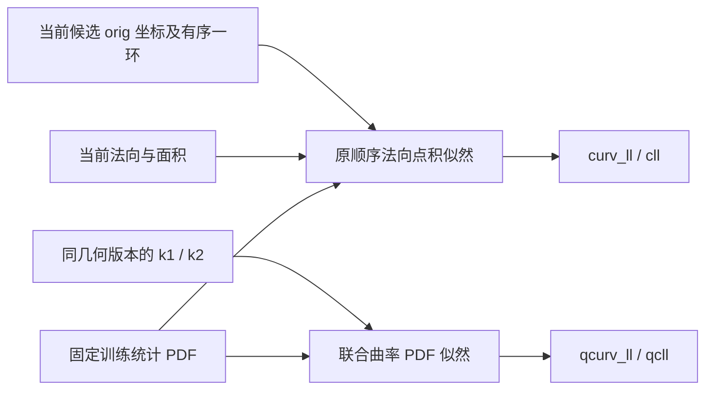
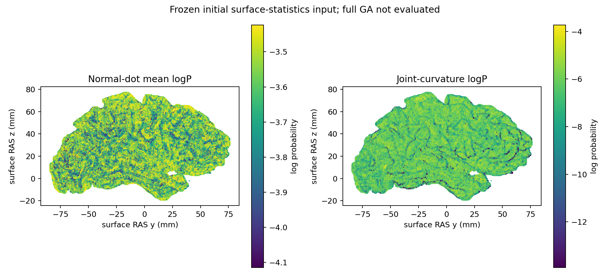

# 拓扑缺陷的法向与曲率似然

## 1．功能

`topology_defect_normal_likelihood.py` 用自有 Python/Numba 计算固定拓扑算法的两项内部似然：相邻原坐标差在顶点法向上的投影，以及主曲率在二维联合 PDF 中的概率。函数不调用 FreeSurfer、不修改几何，不重新实现已有主曲率求解器。

这是完整的两个评分子项；MRI、unMRI、重连、种群更新和缺陷接受仍由其他模块负责。子项通过不能视为完整 GA 或重建质量通过。



## 2．Python 调用、输入与输出

以下变量来自调用者的**同一个候选几何版本**，不得跨 original、white.preaparc、final white 或 retessellation 复用失效法向、面积、邻接和曲率。

```python
from fnit.recon_all.topology_defect_normal_likelihood import (
    patch_normal_dot_likelihood,
    patch_curvature_likelihood,
)

normal_result = patch_normal_dot_likelihood(
    original_vertices=original_coordinates,       # float32(N,3)，surface RAS，mm
    vertex_normals=current_vertex_normals,         # float32(N,3)，同几何的法向，无量纲
    vertex_areas_mm2=current_vertex_areas,          # float32(N,)，mm²
    patch_vertices=modified_vertex_indices,        # 整数(K,)，完整、有序、唯一的 tp.vertices
    neighbor_offsets=one_ring_offsets,             # 整数(N+1,)，有序一环 CSR 偏移
    ordered_neighbors=one_ring_vertex_indices,     # 整数(E,)，仅 vt.v[0:vt.vnum]，保留顺序
    normal_dot_histogram=normal_histogram,         # 字典：bins/counts/bin_size，单位 mm
)
curvature_result = patch_curvature_likelihood(
    principal_curvature_k1_mm_inv=current_k1,      # float32(N,)，同几何 k1，mm⁻¹
    principal_curvature_k2_mm_inv=current_k2,      # float32(N,)，同几何 k2，mm⁻¹
    vertex_areas_mm2=current_vertex_areas,          # 同序 float32(N,)，mm²
    patch_vertices=modified_vertex_indices,        # 同一完整、有序 patch
    k1_histogram=first_curvature_histogram,         # 字典：bins/counts/bin_size，单位 mm⁻¹
    k2_histogram=second_curvature_histogram,        # 相同结构，k2 的训练 PDF
    joint_curvature_pdf=joint_curvature_probability,  # float32(B1,B2) 或 (B1,B2,1)，k1 为第一轴
    joint_origin_mm_inv=joint_pdf_origin,          # float32(2,)，原 xstart / ystart，mm⁻¹
    joint_spacing_mm_inv=joint_pdf_spacing,        # 正 float32(2,)，原 xsize / ysize，mm⁻¹
)
```

### 输入约定

| 输入 | 结构、含义与限制 |
| --- | --- |
| `original_vertices` | 完整网格 `(N,3)`；字段按原算法转换 float32。不是 scanner RAS，也不是球面半径坐标。 |
| `vertex_normals` | 当前候选的 `(N,3)` 有限法向；合法零向量不被归一化或加入 epsilon。 |
| `vertex_areas_mm2` | `(N,)` float32；允许带符号的原顶点面积；总面积按原有序 double 累加；零分母保留原 IEEE 面积诊断，不拒绝有限核心评分。不取绝对值、不丢弃负面积；单个零面积保留。 |
| `patch_vertices` | `(K,)` 整数，完整有序且无重复。函数不自行排除 marked/rip；调用者按原 `TP` 语义选取。 |
| `neighbor_offsets` / `ordered_neighbors` | 原一环顺序的 CSR；选中顶点必须有邻居，不使用二环或按索引排序重建。 |
| 三个 `*_histogram` | `{"bins": float32(B,), "counts": float32(B,), "bin_size": 正float32标量}`。`counts` 是正 PDF；函数不平滑或重新归一化，只用原 bins[0] 和间距索引。 |
| `principal_curvature_k1_mm_inv` / `k2` | `(N,)` float32；优先由已有主曲率原语产生，本子项不估计曲率。已有 `topology_principal_curvature` 的首次统计支持范围不自动等于任意动态 patch 的完整主曲率求解。 |
| `joint_curvature_pdf` | 正 float32 `(B1,B2[,1])`；两个轴不可互换，不插值。 |
| `joint_origin_mm_inv` / `joint_spacing_mm_inv` | 有限 float32 `(2,)`；间距为正，保留原 MRI 联合图的几何字段。 |

两个函数没有默认阈值、设备、迭代、随机种子或精度开关。它们按原顺序使用 double 累加，再写成原 `TP` 的 float32 字段。CPU NumPy/Numba 的此处计算精度由源算法决定，不修改进程的 TF32、CUDA 或半精度设置。

### 输出与失败行为

| 返回项 | 含义 |
| --- | --- |
| 法向 `curv_ll` | 每顶点的平均邻边 logP 再对 patch 顶点取均值，源 float32 写回后转 Python float。不是全部邻边直接取均值。 |
| 法向 `cll` | 按原 `area * 邻边logP和 / 邻居数` 顺序累计的面积加权诊断值。 |
| 曲率 `qcurv_ll` | **最终二维联合 PDF** 的逐顶点 logP 均值。 |
| 曲率 `qcll` | 联合 logP 的面积加权诊断值。 |
| `marginal_qcurv_ll` | 原源码被最终联合项覆盖的中间值，包含两次 k1 项；只作诊断，不送入最终 fitness。 |
| `per_vertex_log_likelihood` | 与 `patch_vertices` 一一对应的 float64 `(K,)`，用于诊断和图示；不修改原顶点图。 |
| `cll_defined` / `qcll_defined` | 面积加权诊断是否有限；零分母时允许为 False。 |
| `cll_float32_bits` / `qcll_float32_bits` | 原诊断 float32 的 uint32 位模式，保留 NaN/Inf；JSON 写为 null 与此位模式。 |
| `vertex_count` / `scope` | patch 大小与子项范围。 |

空 patch 返回零分和空数组。非法形状、索引、CSR、非有限字段、非正 PDF/间距抛 `ValueError`；非有限核心评分或逐顶点 logP 抛 `FloatingPointError`。面积加权诊断的原 IEEE NaN/Inf 不属于核心评分失败；不将其替换为0。没有原版回退、静默跳过顶点或复制参考结果。不写文件、不保存缓存；调用者更新几何后重新传入当前字段。

## 3．命令行

生产子项没有独立 CLI。完整冻结同输入回归脚本为：

```bash
python tools/benchmark_recon_topology_zero_area_likelihood.py \
  --capture isolated_reference/first.statistics.bin \
  --native-repeat isolated_reference/repeated.statistics.bin \
  --observer-receipt isolated_reference/build.public.json \
  --output isolated_diagnosis/normal_curvature \
  --threads 4 \
  --snapshot-scope "first complete candidate patch"
```

`capture` 和 `native-repeat` 为相同输入、独立参考进程的完整 `FNITFIT1` 统计快照；只用于隔离 benchmark。`observer-receipt` 绑定固定源码、观察器与独立编译记录。`output` 必须不存在，保存完整数值 JSON、私有逐顶点 NPZ 和公开衍生脑图；`snapshot-scope` 显式区分初始表面与完整候选，`threads` 默认4，通过已有 `thread_budget` 恢复调用者设置。检查点、原始 MRI 和原软件源码不发布；生产函数不读取这些参考文件。

## 4．原软件调用

对应固定提交 `d932c45b7941662ea380a05efef580568b98d41a` 的 `mrisComputeDefectNormalDotLogLikelihood` 和 `mrisComputeDefectCurvatureLogLikelihood`。两者属于 `mris_fix_topology` 的内部步骤，没有独立原软件 CLI。隔离参考使用同源 Conda 编译的完整入口和只读统计观察器：

```bash
mris_fix_topology_statistics_observer \
  -threads 4 -mgz \
  -sphere qsphere.nofix -inflated inflated.nofix \
  -orig orig.nofix -out diagnostic.orig.premesh \
  -ga -seed 1234 subject lh
```

观察器在初始完整 surface-statistics 的四项计算后记录字段，在后续既有诊断停点停止；不是完整 GA 重建。原统计索引分两种：直方图用 `nint(double)` 半分离零舍入后裁剪；联合曲率图先 float32 商、向零截断再裁剪。法向点积的几何差值和投影为 double；曲率直方图减法/除法仍为 float32。

## 5．当前真实精度、时间与图示

当前源码 `a4080960…` 修复成熟子项的零面积输入 bug：完整真实候选的99个顶点面积全0，原程序 `cll/qcll` 做0/0得到 `0xffc00000`，但用于 fitness 的 `curv_ll/qcurv_ll` 有限。自有实现保留相同位模式并单列诊断有效性。新冻结回归分别重测初始108,538顶点和完整99顶点候选，四个源字段逐位相同、双方重复相同。详细收据见[零面积完整候选报告](../../validation/recon_all/optimizations/20261010_topology_zero_area_diagnostics/README.md)。这不是完整GA验收。

初始版本源码 `bfb461f2…` 的以下记录保留原版本绑定。带符号面积终版源码 `202c4813…` 在同一真实快照重新计算，四个 TP 字段仍零差异、逐顶点两次重复一致；10项合同覆盖负顶点权重、负总面积与原顺序精确零分母。该真实快照本身没有触发负顶点面积，负权重分支目前是固定源码规则和合同证据。完整新收据见[带符号面积修复报告](../../validation/recon_all/optimizations/20261010_topology_signed_vertex_area/README.md)。候选似然允许原算法的带符号面积，最终网格质量检查仍单独执行。

2026-10-10 已完成公开 `ds000114 sub-07 ses-test` 左半球的完整初始统计快照回归。输入由固定 `79a41cdd` 原始 T1 连续流程生成；本轮将它作为冻结同输入诊断，不改标为当前整例。完整网格 110,534 顶点，选中 108,538 顶点，完整一环表 663,348 项。

| 源字段 | 自有函数与固定源码参考的共同值 | 不同字段数 / 最大误差 |
| --- | ---: | ---: |
| `curv_ll` | −3.6333346366882324 | 0 / 0 |
| `cll` | −3.63374662399292 | 0 / 0 |
| `qcurv_ll` | −6.340480327606201 | 0 / 0 |
| `qcll` | −6.261255741119385 | 0 / 0 |

两个独立原程序参考进程的完整 `FNITFIT1` 快照 SHA 相同；自有函数两次计算的四个字段和逐顶点数组也相同。原程序没有记录逐顶点 logP，因此逐顶点**原程序对照尚未评估**；不能把标量通过扩大为全部中间量逐位通过。

同主机、总线程预算4：法向完整 API 热重复 0.035314 秒，曲率 0.012981 秒；首次 benchmark API 分别为 0.222197 / 0.016058 秒，已复用先前合同的 Numba cache。包含快照读取、校验、两次 API、NPZ 写入与哈希的诊断为 1.498044 秒；绘图含导入和 PNG 写入另为 15.566284 秒。工具入口起的记录墙钟 18.842104 秒，未包括前置解释器/bootstrap 和最后报告 JSON 写出。原观察器两次 7.614243 / 5.089190 秒包含其他准备、统计及首次边表记录，**没有这两个函数的独立 timer，不能计算原生提速倍数**。CPU 核为参考8–11、候选100–103；共享节点负载未排除。这些算子不使用 GPU，不更改显存/精度策略，无整例速度结论。

完整数值、类型、几何字段/邻接/PDF SHA、原源码与程序重复、私有/公开 SHA 区分见 [本次报告](../../validation/recon_all/optimizations/20261010_topology_normal_curvature_likelihood/README.md)。部署首版因 companion parser 尚未落盘，在 benchmark 启动前失败；原记录保留，新目录复用现成解析器后完成，算法没有因部署失败而改变。



图中颜色为本次自有子项的逐顶点值，不是候选与原版的逐顶点误差图，也不是完整拓扑修复输出。

## 6．更新与 benchmark

- 2026-10-10 零面积后续：10项合同和两套真实快照回归通过。有限核心评分与 IEEE 面积诊断分开，不改公式、几何或阈值；历史报告保留原源码与提交绑定。

- 2026-10-10 后续：固定原 `mrisOrientPlane` 会重新累加有符号面面积，顶点面积并非所有状态都非负。修复成熟子项的过严输入限制，保留源权重及 double 累加顺序；该历史版本非空精确零分母报错，完整候选新证据已在后续修复；空 patch 仍返回0。修复不更改几何、PDF、评分公式或停止规则。

- 2026-10-10：新增独立有序 Python/Numba 法向和曲率子项；8项合同通过，核对 `TP` 字段实际为 float32；真实完整统计四个源字段零差异和两侧重复性通过。
- 保留旧主曲率、MRI 和 fitness composition 函数，各自支持范围不扩大。本模块未接生产 GA，不替换数字拓扑，不声明原始 T1 整例提速或整体指标等效。

## 7．参考文献、代码与许可

- [固定原法向/曲率似然源码](https://github.com/freesurfer/freesurfer/blob/d932c45b7941662ea380a05efef580568b98d41a/utils/mrisurf_defect.cpp#L1502-L1623)。
- [固定 TP 字段结构](https://github.com/freesurfer/freesurfer/blob/d932c45b7941662ea380a05efef580568b98d41a/include/topo_parms.h)。
- [固定舍入定义](https://github.com/freesurfer/freesurfer/blob/d932c45b7941662ea380a05efef580568b98d41a/utils/utils.cpp)。
- Ségonne F, Pacheco J, Fischl B. Geometrically accurate topology-correction of cortical surfaces using nonseparating loops. IEEE TMI. 2007;26:518–529. [DOI](https://doi.org/10.1109/TMI.2006.887364)。
- 许可与来源通知见 [FreeSurfer.txt](../../licenses/FreeSurfer.txt) 和 [THIRD_PARTY_NOTICES.md](../../THIRD_PARTY_NOTICES.md)。本模块是独立适配，不发布原 `.cpp` 或原版二进制。
