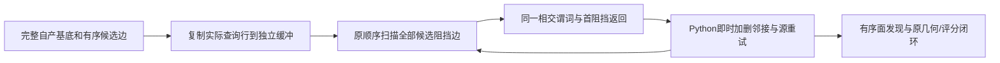

# 有序拓扑边阻挡扫描

## 1. 功能简介

`OrderedBlockerScan` 将完整的首阻挡扫描放进 Numba，复用项目已有的
`topology_preflight_python._edge_intersects`。候选边按原顺序检查
inside 和完整 hull 的当前邻接，遇到第一个相交阻挡边就返回。源加边、
删边之后立即同步被改变的行；顶点分类、重试、面发现和 GA 控制仍由
成熟的 Python 接口执行。计算不启动 FreeSurfer 程序。



这是一个计算实现选择。`blocker_scan_backend="python"` 仍是库默认；
`"numba"` 显式开启编译循环。它不减少候选集合、不改变精度或质量门，
也不等于完整拓扑修复或 recon-all 已完成。完整默认首缺陷回归已完成数值一致门；独立共享窗口未测到完整阶段提速。
实际库显式参数贯通采用另一个冻结与六评分协议。

## 2. Python 调用、输入与输出

```python
from fnit.recon_all.topology_retessellation_dynamic import (
    prepare_retessellation_base,
    retessellate_and_detect_candidate,
)
from fnit.recon_all.topology_face_detection_cache import prepare_face_detection_context

# 下列数组由完整自产缺陷准备器生成；不能用原程序的after结果初始化。
retessellation_base = prepare_retessellation_base(
    canonical=canonical_vertices,          # float32 (N,3)，canonical surface RAS
    base_faces=retained_base_faces,         # int32 (F,3)，保留原面顺序
    neighbors=ordered_base_neighbors,      # N行完整源一环；允许未由面支撑的边
)
face_detection_context = prepare_face_detection_context(
    base_faces=retessellation_base.base_faces,
    vertex_count=len(retessellation_base.canonical),
)
candidate_state = retessellate_and_detect_candidate(
    canonical=retessellation_base.canonical,
    base_faces=retessellation_base.base_faces,
    neighbors=retessellation_base.neighbors,
    base_context=retessellation_base,
    face_detection_context=face_detection_context,
    candidate_edges=complete_candidate_edges,  # int32 (E,2)，完整自产MRI评分边表
    edge_used=initial_edge_states,              # int32 (E,)，源0…6状态
    ordering=candidate_edge_order,              # int32 (E,)，完整边编号排列
    inside_vertices=mapped_inside_vertices,     # int32 (I,)，当前网格的原顺序
    inside_discarded=initial_discard_flags,     # bool (I,)，源DISCARD状态
    border_vertices=mapped_border_vertices,     # int32 (B,)，完整原border
    hull_vertices=mapped_hull_vertices,         # int32 (C,)，前B项为border
    vertex_rip=current_vertex_rip,              # bool (N,)，当次不可用顶点
    fixed_mapping=None,                         # 缺省全true，不改变有效域
    mode="all",                                # all或some，沿用原控制规则
    overlaps=None,                              # 可选E行自产有序重叠边表
    overlap_complete=None,                      # 有表时必需bool (E,)
    blocker_scan_backend="numba",               # python参考或numba编译循环
    blocker_scan_audit=False,                   # 普通运行不创建逐调用审计缓冲
)
ordered_faces = candidate_state["faces"]
ordered_neighbors = candidate_state["neighbors"]
scan_count = candidate_state["blocker_scan_calls"]
```

完整基底、映射、边状态和返回状态的逐项语义见
[动态重连](TOPOLOGY_DYNAMIC_RETESS.md)。上述两个缓存都只复用不可变基底。
扫描缓冲每个 candidate 新建一次，不跨候选保存动态邻接或坐标。

| 新参数或返回字段 | 含义 |
|---|---|
| `blocker_scan_backend` | 字符串 `python` / `numba`；默认 `python`，非法值报错，无自动回退 |
| `blocker_scan_audit` | `bool` / `np.bool_`；默认False。True记录每次实际谓词的 `(a,b,v,w,hit)` |
| `blocker_scan_calls` | 本候选首阻挡扫描的实际调用次数 |
| `blocker_predicate_calls` | Numba实际谓词数；Python仅审计开启时有计数，否则None |
| `blocker_predicate_sequence_sha256` | 审计开启时，完整有序little-endian int32五列的SHA；否则None |
| `blocker_scan_preparation_seconds` | 复制查询行与构建typed缓冲的墙钟，已包含在重连时间内；Python为None |
| `retessellation_seconds` / `face_detection_seconds` | 组合接口的两段墙钟；包括各自验证、编译或调用开销 |

低层 `OrderedBlockerScan(scan_vertices=..., neighbor_rows=..., audit=False)`
接受完整整数查询序列和N行源邻接。查询序列中的重复项仍按原序扫描。
`sync_vertex(vertex, row)` 用完整当前行更新实际查询缓冲；
`first_blocker(xyz=..., a=..., b=..., scan_vertices=..., valid=...)` 返回首
`(v,w)` 或None。有效域只应用于邻接端点w，不能额外排除查询顶点v。
canonical有限性和端点范围由成熟重连接口一次验证。浮点、越界或溢出的
行索引在整数转换前拒绝，不静默截断。

算法输入不修改，返回全N邻接副本仍保留。相交核内部沿用已有float64
运算；canonical输入仍按成熟接口转float32。没有新增fastmath、half或
TF32计算；本阶段是CPU/Numba实现，allocated/reserved显存记录为null。

### 完整自有库入口

```python
from fnit.recon_all.topology_genetic_search import (
    TopologyRandomStream, search_and_finalize_defect,
)

# 三个字典均由自身nofix/MRI和上一个缺陷的实际末态准备，不能读参考after。
# corrected_surface_state含完整坐标槽/有序邻接/面/持久字段。
# ordered_defect_inputs含本缺陷完整有序边、inside/border/hull及源分类。
# prepared_candidate_inputs含volume/matrix、全局校准PDF与本缺陷局部priors。
hemisphere_random_stream = TopologyRandomStream(seed=1234)  # 整个半球共享一次初始化
completed_defect = search_and_finalize_defect(
    surface_state=corrected_surface_state,
    defect_inputs=ordered_defect_inputs,
    candidate_inputs=prepared_candidate_inputs,
    draw_random_number=hemisphere_random_stream,  # 后续缺陷沿用该流
    population_size=10,
    max_unchanged=10,
    niters=-1,
    initial_selection=True,
    vertex_eliminate=True,
    deletion_count=current_deletion_count,       # 首缺陷为1，后续传上一返回值
    elimination_threshold=current_elimination_threshold,  # 首为float32(4)
    check_surface_intersection=False,             # 原标准策略；最终mesh门另行执行
    intersection_checker=None,
    face_detection_cache=True,                    # 每缺陷一次不可变保留面索引
    blocker_scan_backend="numba",                 # 明确编译扫描，无失败回退
)
next_corrected_surface_state = completed_defect["surface_state"]
actual_blocker_backend = completed_defect["blocker_scan_backend"]
```

`prepare_genetic_defect_evaluator`接受前三个字典及两个实现选择，返回evaluator、
source分组/overlap与prepare_seconds；它不评分。`search_and_finalize_defect`全部
控制参数见上述具名调用，返回完整search/finalization/state/耗时和实际backend。
`repair_genetic_topology`接受原始三个数组、MRI/matrix/metadata和完整GA策略，
对每个缺陷传同一backend，全部结束才SOAP/压缩/CURRENT清理和恢复ORIGINAL。
`run_genetic_topology_files`接受nofix/qsphere/brain/wm四文件、半球和新输出目录；
其`parameters.blocker_scan_backend`在写出前核对core实际返回值。文件和后续orig
输入输出语义沿用原接口；新增实现选择不改变空间、原域标签或最终质量门。

## 3. 命令行调用

```bash
# 固定第四缺陷首候选：此前三个缺陷必须已有完整自产检查点。
python tools/benchmark_recon_topology_fourth_candidate_profile.py \
  --input-surface /workspace/own_subject/surf/lh.orig.nofix \
  --input-qsphere /workspace/own_subject/surf/lh.qsphere.nofix \
  --brain /workspace/own_subject/mri/brain.mgz \
  --state-checkpoint /workspace/own_run/defect-002.npz \
  --producer-progress /workspace/own_run/progress.jsonl \
  --frozen-source-manifest /workspace/new_source/SOURCE_MANIFEST.json \
  --expected-source-manifest-sha256 "$frozen_source_sha256" \
  --expected-checkpoint-sha256 "$previous_checkpoint_sha256" \
  --defect-number 3 --threads 4 --blocker-scan-backend numba \
  --audit-sequence --skip-profile \
  --output /workspace/new_diagnostic/candidate
```

所有路径为具名参数；输入仅为自身nofix、qsphere、MRI和完整typed前态。
两个expected SHA是实际文件的64位十六进制SHA，不是允许跳过校验的开关。
此固定协议只接受缺陷零基编号3和4线程。每次从同一完整初态独立执行
cold、warm、audit；仅audit记录完整谓词序列，不把哈希成本当普通热吞吐。
不传 `--skip-profile` 时第三次是包含观察开销的cProfile。

`benchmark_recon_topology_genetic_blocker_scan.py` 复用完整默认首缺陷工具，
具名输入和控制参数与[完整首缺陷面缓存](TOPOLOGY_GENETIC_FACE_CACHE.md)
相同，增加必填 `--blocker-scan-backend numba`。这份诊断工具只在自身
prepare返回后透明设置本次evaluator参数，aliases在finally恢复；它不是
生产库参数贯通证明。默认完整协议保留10个体、10次停滞、niters−1、
seed1234、原删除和排序规则。旧结果只在新产物全部保存后读入比较。

实际库参数由`prepare_genetic_defect_evaluator`、`search_and_finalize_defect`、
`repair_genetic_topology`和`run_genetic_topology_files`逐层传递。前三个返回
`blocker_scan_backend`，文件返回/保存的`parameters.blocker_scan_backend`来自core
实际值；非法值在准备或创建输出目录前拒绝。新六评分工具直接调用search入口，
没有替换全局函数；文件调用和全部缺陷传递另由focused契约覆盖。

```bash
# 原始自身输入→初始5评分+最终1评分，两fresh进程同预算，仅选择扫描后端。
python tools/benchmark_recon_topology_genetic_blocker_wiring.py \
  --frozen-source /workspace/own_frozen_source \
  --input-surface /workspace/own_subject/surf/lh.orig.nofix \
  --input-qsphere /workspace/own_subject/surf/lh.qsphere.nofix \
  --brain /workspace/own_subject/mri/brain.mgz \
  --hemisphere lh --threads 4 --seed 1234 --output /workspace/new_pair
```

`population_size=5,niters=0`是明确阶段验证协议，不是默认完整GA。两边面缓存
均True；Python→Numba串行，总4线程，无CUDA。

## 4. 原软件对应步骤

对应 `mris_fix_topology -ga` 内部 `retessellateDefect_wkr` 的有序边相交扫描，
没有官方独立阶段命令。完整原程序只作为隔离benchmark参考：

```bash
mris_fix_topology -mgz -sphere qsphere.nofix -inflated inflated.nofix \
  -orig orig.nofix -out diagnostic.orig.premesh -ga -seed 1234 \
  -threads 4 subject lh
```

本轮比较的是同一成熟FNIT Python扫描与编译扫描，不是将原程序全GA墙钟
冒充这个内部子步骤。全原程序、子步骤捕获及Python生产输入分开绑定。
原参考源码固定d932c45b7941662ea380a05efef580568b98d41a；新模块只复用
项目已有谓词，未复制原软件程序或通过wrapper调用原阶段。

## 5. 真实数据精度、计时与脑图

公开ds000114 sub07 ses-test LH，原始T1自产链79a41cdd；用自身第三缺陷
完整检查点恢复第四缺陷首候选。17,213边、1,428inside、162hull，局部
MRI为51×53×54。两个fresh进程同CPU84–87、总4线程、CUDA隐藏；Python→
Numba顺序，各自完整读入、准备、冷/热/审计和写出。共享负载存在，本轮
单次配对不作为稳定ABBA吞吐，也不外推整例或600秒目标。

| 完整或子阶段 | Python | Numba |
|---|---:|---:|
| 完整fresh CLI（读写/准备/三次调用） | 150.780363s | 145.214401s |
| cold完整候选状态闭环 | 21.553973s | 20.656951s |
| warm完整候选状态闭环 | 6.779169s | 3.825242s |
| warm重连 | 4.891674s | 2.173376s |
| warm面发现 | 0.012523s | 0.013254s |
| warm25次smooth | 0.060848s | 0.056197s |
| warm40次match | 0.105663s | 0.094322s |
| audit完整闭环（含序列缓冲/哈希） | 7.044466s | 5.133127s |
| peak RSS | 2,063,772KiB | 2,077,476KiB |

Numba查询行准备普通热值0.011017s，已包含在重连内。每次evaluator准备
仍独立计时：普通热Python7.601382s、Numba9.138787s，不能从fresh CLI
中去掉后再称完整速度。cold包含实际首次JIT。signed-distance等未改子段
的少量时间变化属于本次共享窗口观察，没有据此宣称新核加速那些步骤。

- 冷/热/审计每组全部72个数值/状态字段shape、dtype、bytes一致，自重复一致。
- 17,123次扫描、2,656,862次实际谓词调用；完整五列序列SHA两边一致。
- 全有序面、邻接、源分类/首阻挡/重试控制、score、DVS后态逐位一致。
- fitness为−119.29359245300293；初始identity排序没有随机draw。
- 无最终mesh/sphere、全九缺陷或recon-all整体等效结论。

原剖析在同冻结输入上实测：已有njit谓词被Python dispatcher调用
2,656,862次，累计1.731605s；全N返回邻接副本约0.867s继续保留。
编译扫描移入同一核，没有把全N拷贝、分类或质量门删除。cProfile时间
包含观察开销。精确原剖析与本次配对分别见
[第四缺陷剖析](../../validation/recon_all/optimizations/20261011_topology_ga_nine_performance/README.md)
和[本轮机器报告](../../validation/recon_all/optimizations/20261011_topology_ordered_blocker_scan/README.md)。


完整首缺陷真实机器报告和496评分轨迹见
[完整默认回归](../../validation/recon_all/optimizations/20261011_topology_genetic_blocker_scan/README.md)。

新显式库六评分门与实际模块/失败收据见
[直接接口回归](../../validation/recon_all/optimizations/20261011_topology_genetic_blocker_wiring/README.md)。

## 6. 更新与benchmark记录

- profile v1：从自身第三检查点恢复完整第四首候选，cold/warm/profile
  72字段一致，定位完整扫描和dispatcher成本；没有改默认全GA。
- pair v1：显式Numba阻挡扫描，真实cold/warm/audit全部字段与完整谓词
  序列通过。第四实测helper为6cc1e3d…，dynamic为74c381ac…。
- 发布/完整首缺陷冻结：helper仅文档改为33a919df…，两版本去docstring
  后可执行AST相同；动态源SHA不变。9条新契约与旧14条分别通过。
- exporter v1：错误要求Python参考加载其未使用的Numba模块，验证阶段
  拒绝导出；算法输出未改。v2明确区分实际加载模块，完整白名单通过，
  271个选中数值/布尔/null的值与类型保真，旧失败收据保留。
- 完整默认首缺陷：495+最终1评分、497重连、29trace、80字段/3NPZ、
  全fitness/control与RNG drawcount1,362,381全部一致。CLI1329.628818→1357.057126s，
  search+final1252.548780→1277.391707s；独立共享窗口没有完整GA提速结论。
  逐draw数值未捕获；不称完整原版winner逐位相同。
- 实际库贯通：prepare/search/repair/files新增显式blocker_scan_backend，默认
  python、可选numba，无回退；文件report核实际core选择，失败不写成功COMPLETE。
  新六评分v5：实际direct search/prepare/finalize五模块SHA绑定，81字段/4NPZ、
  全控制与20,877次RNG bounds/value序列一致。CLI118.402266→119.882949s，
  search+final39.564362→39.261308s；不称完整阶段加速。与alias495冻结分开，
  7新增+13既有file契约20项通过；四个算法前setup错误完整保留。

## 7. 参考文献与代码

- [固定FreeSurfer拓扑源码](https://github.com/freesurfer/freesurfer/blob/d932c45b7941662ea380a05efef580568b98d41a/utils/mrisurf_defect.cpp)
- [FNIT源码](https://github.com/weikanggong1/Fudan-Neuroimaging-toolkit)
- [完整动态重连](TOPOLOGY_DYNAMIC_RETESS.md)、[不可变基底](TOPOLOGY_PREPARED_BASE_CACHE.md)、[保留面索引缓存](TOPOLOGY_FACE_DETECTION_CACHE.md)

使用项目现有NumPy/Numba依赖，主页Conda环境可安装，无新增第三方网格
包。原始MRI、状态NPZ、原程序、完整日志/编译参数/内部地址与路径均留
在授权私有目录；公开只含数值白名单、程序/输入SHA和自产派生脑图。
