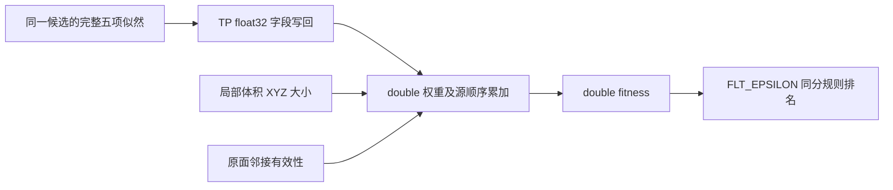
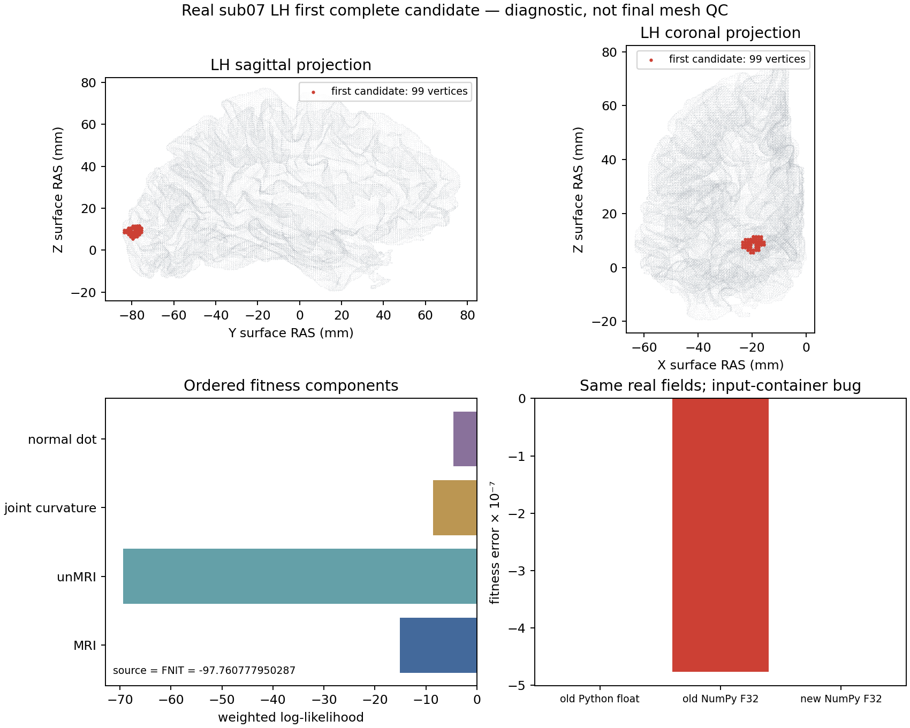

# 拓扑候选的 fitness 合成与排名

## 1．功能简介

`topology_fitness_search.compose_patch_fitness()` 复用现有 MRI、unMRI、法向点积及主曲率似然，按照固定 FreeSurfer `d932c45b7941662ea380a05efef580568b98d41a` 的顺序组成一个候选的 fitness。`rank_patch_fitness()` 对一组候选按该源码的同分规则排名。两个函数只使用 NumPy 和 Python 标量；五项标量合成无需把数据搬到 GPU。



本接口不进行候选生成、几何更新、距离场计算、突变或交叉。中间候选的相交、负面积、负权重不能被接口擅自过滤；最终网格仍须通过连通性、流形、自相交和球面翻折检查。完整 GA 尚未由本项测试验收。

## 2．Python 调用、输入和输出

```python
from fnit.recon_all.topology_fitness_search import compose_patch_fitness, rank_patch_fitness

fitness_report = compose_patch_fitness(
    face_ll=mri_result["face_ll"],                 # 同一候选 MRI 面似然；无单位 log-P
    vertex_ll=mri_result["vertex_ll"],             # 同一候选 MRI 顶点似然
    normal_dot_ll=normal_result["curv_ll"],        # 同一几何和邻接版本的法向似然
    quadratic_curvature_ll=curvature_result["qcurv_ll"],  # 最终联合主曲率似然
    volume_unmri_ll=volume_result["unmri_ll"],     # 已完成 float32 白灰相加的 unMRI
    valid_faces=modified_edges_are_valid,         # 原 mrisCheckDefectFaces 的结果；不是自相交门
    mri_weight=1.0,                               # 实际全局 double l_mri
    volume_unmri_weight=10.0,                      # 实际全局 double l_unmri
    normal_dot_weight=1.0,                        # 实际全局 double l_curv
    quadratic_curvature_weight=1.0,               # 实际全局 double l_qcurv
    defect_volume_shape=defect_intensity_volume.shape,  # 局部体积 XYZ 采样数，不是 world 尺寸
    return_diagnostics=True,                      # 返回完整合成诊断；默认 False 返回 float
)
candidate_ranks = rank_patch_fitness(
    fitness=all_candidate_fitness,                # 候选原有顺序的 (P,) float64，不提前重排
)
```

五个似然输入均为有限实数标量，先写回 float32，再拓宽为 double。MRI 子项先分别拓宽再相加；不能提前将两者的和舍入为 float32。unMRI 子函数自身先按 float32 计算白灰均值之和，其最终 `unmri_ll` 才传入合成器。原 TP 的 `fll/vll/cll/qcll` 等面积加权诊断值不代替上述五项。

四个权重为实际全局 double 值，默认 `1/10/1/1`；允许负值。若控制器从原 `TOPOLOGY_PARMS` 获取权重，它负责保持参数字段到实际 double 状态的转换及生命周期。本接口没有进程全局的 `first_time` 缓存。

`defect_volume_shape` 默认 `None`，表示调用者已经确认允许计算体积项。传入时必须是三个正整数；任一轴 ≤5 时只将本次有效 `l_unmri` 置零。下一候选不会继承这个临时零值。绝对权重严格小于 `FLT_EPSILON=1.1920928955078125e-7` 的项不执行；边界等于 epsilon 时仍执行。

`return_diagnostics=False` 返回 Python float（double）。设为 True 返回：

| 字段 | 内容 |
| --- | --- |
| `fitness` | 按源顺序合成的 double 标量 |
| `tp_fields` | `face_ll/vertex_ll/curv_ll/qcurv_ll/unmri_ll`，经过 float32 写回 |
| `terms` | `l_mri/l_unmri/l_qcurv/l_curv` 的有序加权项 |
| `requested_weights` / `effective_weights` | 请求的 double 权重及小体积处理后的本次权重 |
| `volume_term_enabled` | 本次 unMRI 项是否实际启用 |
| `face_penalty` | 面有效时 0，否则 −10,000,000 |

排名输出是与输入同长度的 `(P,) int32`。更大 fitness 更优，按 double 差的 `abs < FLT_EPSILON` 判同分，先出现的候选优先。空输入返回空数组，不返回一张重排后的网格。

非有限或非标量似然/权重、超 float32 范围的 TP 值、非法维度/布尔值抛 `ValueError`；合成溢出抛 `FloatingPointError`。输入不修改，无影像读写、CUDA 初始化、原版程序或精度全局设置变更。

## 3．命令行调用

库函数没有独立生产 CLI。隔离回归脚本读取同一次完整原 fitness 调用的标量收据，并验证第二次参考重复性：

```bash
# 两份 JSON 由完整真实候选观察器派生，不能用初始统计或 unMRI-only 检查点替代。
python tools/benchmark_recon_topology_fitness.py \
  --reference-json benchmark/reference0.json \
  --repeated-reference-json benchmark/reference1.json \
  --output-json benchmark/new_fitness_comparison.json \
  --repeat-calls 10000
```

三个路径分别是首个完整参考、同输入第二次参考和新输出报告。`repeat_calls` 默认为 10000，至少 2；计时仅包括完整标量 API 的输入校验、类型写回和合成，不包括 MRI、曲率、距离场、GA 或整例读写。脚本拒绝覆盖已有报告，严格比较失败时先保存失败报告再抛异常。真实影像与原软件源码主体不写入公开报告。

## 4．对应原软件调用

这是 `mris_fix_topology -ga` 内部的 `mrisComputeDefectLogLikelihood()` 与 `defectPatchRank()`，没有独立原软件 CLI。独立 benchmark 可对冻结被试目录调用：

```bash
# reference_prefix 仅用于独立参考，不得由 FNIT 生产流程发现或执行。
"${reference_prefix}/mris_fix_topology" \
  -threads 4 -mgz \
  -sphere qsphere.nofix -inflated inflated.nofix -orig orig.nofix \
  -out diagnostic.orig.premesh -ga -seed 1234 -threads 4 \
  "${reference_subject_name}" lh
```

首个缺陷的诊断停止不代表完整拓扑修复。参考观察器必须绑定固定源码、程序和输入 SHA，并在完整 fitness 返回处捕获；较早的初始化统计或体积聚合调用不能替代本次完整调用。

## 5．当前代码与真实数据精度、耗时

当前 32 项契约测试通过，包含 TP float32 写回、MRI double 相加、负权重、epsilon 边界、小体积禁用、面惩罚、重复调用无隐藏状态和非法输入。这些测试是边界检查，不是脑影像 benchmark。

本次使用公开 `ds000114/sub-07/ses-test` T1 的 FNIT 自产左半球上游，在同主机独立 Conda 固定源码参考中捕获首个完整候选：99 个顶点、138 个面，局部体积为 `21×19×16`。公开数据的[作者元数据声明 CC0](https://github.com/OpenNeuroDatasets/ds000114/blob/master/dataset_description.json)；本页发布派生图与标量报告，原始影像不入仓库。两次参考均退出 0；完整五项、实际 double 权重、原始字段位模式和最终 fitness 均重复相同。参考程序 SHA 为 `2df26fc8…`，候选合成模块 SHA 为 `d9f90820…`，全部输入及完整 SHA 见 [本轮机器报告](../../validation/recon_all/optimizations/20261010_topology_patch_fitness/README.md)。

| 完整候选的原子项 | 参考 TP float32 字段 | 本次加权项（double） |
| --- | ---: | ---: |
| MRI 面 / 顶点 | −7.894798278808594 / −7.215606212615967 | −15.11040449142456 |
| unMRI | −6.938152313232422 | −69.38152313232422 |
| 联合主曲率 | −8.637045860290527 | −8.637045860290527 |
| 法向点积 | −4.631804466247559 | −4.631804466247559 |
| 面有效性惩罚 | 原检查返回 1 | 0 |
| **最终 fitness** | **−97.760777950286865** | **与参考 double 字节一致** |

旧合成器在 Python float 输入下本例无差异；相同字段改用 NumPy float32 容器时，MRI 首次相加提前舍入，旧 fitness 为 `−97.76077842712402`，偏差 `−4.76837158203125e−7`。修复后两种容器均与参考一致，10,000 次完整标量 API 调用的 double 字节也全部一致。这个误差略大于源排名同分 epsilon，可能影响接近的候选排序；本次只有一个真实候选，不据此宣称整个 GA 的排序变化已经验收。

该候选的选中顶点/面面积均为 0，源面积加权诊断 `fll/vll/cll/qcll` 是 `0/0` 产生的 NaN（原 float32 位模式 `0xffc00000`），五个被消费的核心字段却全部有限。报告用 JSON null 加原 uint32 位模式保存这些诊断，不填 0，也不把它们作为 fitness 输入。它是允许评分的中间候选；最终网格质量不由此通过。

| 实际计时边界 | 本次耗时 |
| --- | ---: |
| 新标量 API，10,000 次输入校验、TP 写回、合成 | 0.565269 s，平均 56.527 μs/次 |
| 新脚本冷子进程，包含导入、JSON 读写和上述循环 | 0.710216 s |
| 派生参考，含检查点解析与原输入 SHA 核对 | 7.149605 s |
| 原程序两次观察器，含上游准备、首候选、完整评分及捕获写出 | 6.227574 / 5.112346 s |

最后一行不是原版 fitness 子函数时间，不能与 56.527 μs 相除作为提速。此处没有 GPU 调用或显存测量，未改 TF32、dtype 策略或安装依赖；也没有新整例耗时。32 项契约用时 3.55 s。执行完成与严格标量复现通过；独立生成全部子项、完整 GA、最终网格质量和整体指标等效不由本项判定。已有子项回归分别见 [MRI 似然](TOPOLOGY_MRI_LIKELIHOOD.md)、[法向及曲率似然](TOPOLOGY_NORMAL_CURVATURE_LIKELIHOOD.md) 和 [体积似然](TOPOLOGY_VOLUME_LIKELIHOOD.md)。



灰色是原表面在 surface RAS/mm 下的解剖投影，红色是本次候选顶点；下方显示完整评分各项与容器类型误差。这是评分定位图，不是最终修复或 MRI 叠加的质量验收图。

## 6．最近更新与 benchmark 记录

2026-10-10 核对固定源发现两个现有 helper 问题：旧排名使用 `1e-5`，会把差为 `5e-6` 的候选误判为同分；实际翻译单元使用 `FLT_EPSILON`。旧合成器的 MRI 首加法受输入容器类型影响，也没有显式执行 TP float32 写回，只支持固定权重且未覆盖局部体积 ≤5 的禁用规则。本次复用原接口修正这些通用行为，默认六个位置参数保持，新增选项均为具名参数。

例如旧排序对 `[-1, -1+5e-6, -2]` 给出 `[0,1,2]`，源规则为 `[1,0,2]`；候选选择可能因此改变，不能称无影响尾差。对 MRI 字段 `[-16777216,-1]`，源规则合成 −16777217，提前 float32 相加会丢掉后一项。

历史材料见 [早期首次缺陷记录](../../validation/recon_all/python_gpu_port/experimental/TOPOLOGY_FITNESS_SEARCH.md)。其中 verbose 四位小数的组合检查和首代排名仅对应当时版本，不是本次完整标量回归。当前源、输入、程序及收据以本次专属机器报告为准。

完整观察器 v1 的核心值和捕获字节已一致，但原 printf 将 NaN 写成 `-nan`，不是标准 JSON；原 v1 保留。v2 只将该打印字段改为 null 并同时捕获原位模式，两次完整候选结果重新实测，不把 v2 回标为 v1。绘图首次尝试因检查点路径错误在读取前退出 1；改用实际已绑定的文件后生成图，未改变候选或评分源码。

## 7．参考文献与原源码

- [FreeSurfer 固定 `mrisurf_defect.cpp`](https://github.com/freesurfer/freesurfer/blob/d932c45b7941662ea380a05efef580568b98d41a/utils/mrisurf_defect.cpp)：完整 fitness 顺序、字段返回和面惩罚。
- [固定 `topo_parms.h`](https://github.com/freesurfer/freesurfer/blob/d932c45b7941662ea380a05efef580568b98d41a/include/topo_parms.h) 与 [macros.h](https://github.com/freesurfer/freesurfer/blob/d932c45b7941662ea380a05efef580568b98d41a/include/macros.h)：TP 类型及 FEQUAL/FZERO；实际 epsilon 必须核对编译翻译单元。
- Fischl B, Liu A, Dale AM. Automated manifold surgery: constructing geometrically accurate and topologically correct models of the human cerebral cortex. IEEE Transactions on Medical Imaging. 2001;20:70–80. [DOI](https://doi.org/10.1109/42.906426)。
- Ségonne F, Pacheco J, Fischl B. Geometrically accurate topology-correction of cortical surfaces using nonseparating loops. IEEE Transactions on Medical Imaging. 2007;26:518–529. [DOI](https://doi.org/10.1109/TMI.2006.887364)。
