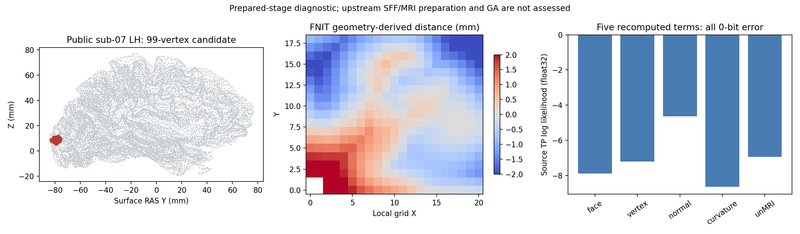

# 准备后的完整五项拓扑评分

## 1. 功能简介

`evaluate_prepared_patch_fitness()` 将同一个已准备候选的 MRI、法向、主曲率、完整有向距离和 unMRI 聚合接成评分阶段，复用现有 FNIT 函数。它不调用 FreeSurfer 程序，不改变候选坐标。全部计算使用有序 NumPy/Numba CPU 实现，保留源 float32 字段写回及最终 double 合成；不改变 GPU 的 TF32 或分配器策略。


**接口边界是准备后的五项评分。** 候选主曲率拟合 `computeDefectSecondFundamentalForm`、局部 MRI 与白灰 log-P 准备不在本接口中。真实验证冻结这些上游字段作为同输入诊断；生产调用只能传 FNIT 自产字段。这里不执行 GA、重铺网格、最终质量验收或原始 T1 整例。

## 2. Python 调用、输入与输出

```python
from fnit.recon_all.topology_patch_fitness import evaluate_prepared_patch_fitness

# 五个字典由同一候选的 FNIT 准备阶段生成，字段逐项见下表。
# 必须保留原顶点/面顺序；不能装入参考输出、参考距离或参考反馈。
fitness_result = evaluate_prepared_patch_fitness(
    mri_inputs=mri_prepared_inputs,                # 主 MRI、当前几何及自产灰白联合 PDF
    normal_inputs=normal_prepared_inputs,          # 当前法向、原有序一环邻接和校准直方图
    curvature_inputs=curvature_prepared_inputs,    # 同版候选 k1/k2 和校准联合 PDF
    distance_inputs=distance_prepared_inputs,      # 完整网格、原 incident 邻接及局部采样变换
    volume_inputs=volume_prepared_inputs,          # 局部 MRI/log-P、初始均值及 curvbak 状态
    valid_faces=source_face_validity,              # bool：自有控制器原面合法性检查是否非负
    mri_weight=1.0,                               # 源全局 double MRI 权重
    volume_unmri_weight=10.0,                     # 源全局 double unMRI 权重
    normal_dot_weight=1.0,                        # 源全局 double 法向点积权重
    quadratic_curvature_weight=1.0,               # 源全局 double 主曲率联合权重
)

candidate_score = fitness_result["fitness"]       # Python float，实际源 double fitness
updated_curvbak = fitness_result["vertex_curvbak"] # 独立 float32 副本；调用者显式决定写回
```

五个 `*_inputs` 必须是 Mapping，键恰好使用下列现有函数的具名参数。`N/F` 为完整候选顶点/面数量，`K/M` 为完整修改 patch 的有序顶点/面数量；索引从 0 开始。

### 共同字段和一致性

| 字段 | 格式、空间和意义 |
| --- | --- |
| `original_vertices` | `(N,3)`，转 float32；本候选 orig 的 tkregister/surface RAS，mm，不是 scanner RAS |
| `faces` | `(F,3)` 整数，有序三角面；不可按几何重排 |
| `vertex_normals` / `face_normals` | `(N,3)` / `(F,3)` float32，无量纲，当前源流程的法向 |
| `vertex_areas_mm2` / `face_areas_mm2` | `(N,)` / `(F,)` float32 mm²；中间球面状态可有负面积或全零，保留源值 |
| `patch_vertices` / `patch_faces` | `(K,)` / `(M,)` 唯一有序整数索引；不得只保留质量较好的子集 |

MRI 与法向的坐标、法向、面积、patch 索引必须相同；主曲率的面积和 patch 索引必须相同；距离与 MRI 的坐标、面和面法向必须相同。局部体积 shape、起点和比例也必须匹配。接口在计算前检查这些关系，防止缓存跨候选版本使用。

### `mri_inputs`：MRI 两项

包含 `original_vertices`、`faces`、`vertex_normals`、`face_normals`、`vertex_areas_mm2`、`face_areas_mm2`、`patch_vertices`、`patch_faces`，另有：

| 字段 | 格式和意义 |
| --- | --- |
| `volume` | `(X,Y,Z)` uint8 主 MRI，0…255；保持源图网格 |
| `ras_to_voxel` | `(4,4)` float32，本主 MRI 的 tkregister RAS→连续体素变换；使用 `source_topology_ras_to_voxel(volume_header=...)`，不使用 placement 的 scanner 桥 |
| `gray_white_pdf` | `(256,256,1)` 正 float32 联合概率；轴依次为白/灰强度，复用初始 FNIT `joint_gray_white_pdf()` 结果，不用已改变的候选 marked 标记重建 |

MRI ±0.5 mm 采样、面中心和累加规则由 [MRI 子函数](TOPOLOGY_MRI_LIKELIHOOD.md) 保持。

### `normal_inputs`：法向点积项

包含 `original_vertices`、`vertex_normals`、`vertex_areas_mm2`、`patch_vertices`，另有：

| 字段 | 格式和意义 |
| --- | --- |
| `neighbor_offsets` | `(N+1,)` 整数 CSR 偏移 |
| `ordered_neighbors` | `(E,)` 整数，保持源 `vt.v[0:vt.vnum]` 的原一环顺序；选中顶点邻接非空 |
| `normal_dot_histogram` | Mapping：`bins(B,)`、正概率 `counts(B,)`、正标量 `bin_size`，均 float32；横轴为法向投影 mm |

### `curvature_inputs`：主曲率项

包含 `vertex_areas_mm2`、`patch_vertices`，另有：

| 字段 | 格式和意义 |
| --- | --- |
| `principal_curvature_k1_mm_inv` / `principal_curvature_k2_mm_inv` | 同序 `(N,)` float32，mm⁻¹；必须已经完成本候选的源 SFF 重算，不可复用不匹配的初始球面曲率 |
| `k1_histogram` / `k2_histogram` | `bins/counts/bin_size` Mapping，格式同上；横轴为 mm⁻¹ |
| `joint_curvature_pdf` | `(B1,B2)` 或 `(B1,B2,1)` 正 float32；轴 k1/k2 |
| `joint_origin_mm_inv` / `joint_spacing_mm_inv` | `(2,)` float32，源联合图起点/正间距，mm⁻¹；按源商截断和边界裁剪，不插值 |

### `distance_inputs`：自产完整有向距离

包含 `original_vertices`、`faces`、`face_normals`，另有：

| 字段 | 格式和意义 |
| --- | --- |
| `incident_offsets` / `incident_faces` / `incident_corners` | `(N+1,)` / `(I,)` / `(I,)` 整数 CSR，保持原 `vt.f/n` 顺序；corner 为 0…2，不按编号重新排序 |
| `volume_shape` | XYZ 三个正整数，局部缺陷体积大小 |
| `volume_origin_mm` | `(3,)` float32，局部 x/y/z 起点，surface RAS/mm |
| `volume_index_scale_per_mm` | `(3,)` 正 float32，源坐标→索引乘数，mm⁻¹；不是 MRI spacing 的除数 |
| `ordered_candidate_faces` | 可选 `(B,)` 整数；默认 `None`，遍历全部候选面、自算 bbox。若控制器提供空间索引列表，必须是同状态的完整保守候选，不能遗漏扩展 bbox 内的任何面 |

复用 [完整有向距离](TOPOLOGY_SIGNED_DISTANCE.md)；不允许调用者提供 `signed_distance_mm`。

### `volume_inputs`：unMRI 聚合与反馈

| 字段 | 格式和意义 |
| --- | --- |
| `defect_intensity_volume` | `(X,Y,Z)` uint8 局部缺陷 MRI，0 为无体素 |
| `white_log_probability` / `gray_log_probability` | 同 shape 的有限 float32，已经求 log 的组织概率 |
| `initial_white_mean_log_probability` / `initial_gray_mean_log_probability` | 源缺陷初始有限标量，转换 float32；计数各从 1 开始 |
| `initial_white_mean_intensity` / `initial_gray_mean_intensity` | 源初始强度均值，有限 float32 标量，0…255 强度单位 |
| `volume_origin_mm` / `volume_index_scale_per_mm` | 与距离字段相同 |
| `vertex_sampling_positions_mm` | `(N,3)` float32，源 fx/fy/fz，surface RAS/mm；不默认等于 orig XYZ |
| `initial_vertex_curvbak` | `(N,)` float32，本候选进入评分前的完整有序状态 |
| `translated_defect_vertices` | `(D,)` 整数，原 vertex_trans 后索引；允许重复，逐次按原顺序相乘 |
| `discarded_defect_vertices` | bool `(D,)`，仅原 `status==DISCARD_VERTEX` 为 True |
| `distance_unset_sentinel_mm` | 必填有限标量，固定 `1000` mm；保留源 NPY 精确相等规则，不作为真实脑距离 |

四个权重默认 `1/10/1/1`，为实际源 double；允许负数，绝对值小于 `FLT_EPSILON` 的项不调用。局部任一轴≤5 时只跳过当次 unMRI/距离，其他项不变。`valid_faces=False` 按源扣 10,000,000，不据此掩盖最终网格质量。

### 返回、状态及失败

| 返回键 | 结构 |
| --- | --- |
| `fitness` / `composition` | Python double 标量；后者包含五个 float32 写回后的 `tp_fields`、四项 double `terms`、requested/effective weights、penalty |
| `components` | 实际执行的 `mri/unmri/curvature/normal` 返回字典；保留逐顶点 log-P、面积加权诊断及定义性/原 float32 bits |
| `distance` | 自产完整距离的返回字典：`distance_mm(X,Y,Z)`、bbox、面映射、查询顶点及伪法向；unMRI 未执行时为 `None` |
| `vertex_curvbak` | 新的 float32 `(N,)` 副本；未执行 unMRI 时为 `None`，调用者保持旧状态 |
| `seconds` / `executed_components` | 含验证的完整 CPU API 及子段秒数、有序实际执行名称；子段已经包含在总 API 内，不能再累加 |
| `scope` | 明确准备后阶段，不表示原始 T1/GA 已完成 |

输入和原状态不修改，不读写文件或运行程序。缺字段抛 `KeyError`；非 Mapping、跨候选版本、几何/类型非法或参考输出键抛 `ValueError`；具体算子核心输出非有限抛 `FloatingPointError`。中间零面积的原 `0/0` 加权诊断保持 IEEE NaN，核心五项有限即可评分；JSON 用 `null` 加原 bits 表示，不能改成0。任何 `reference_*` 键或调用者距离都在计算前拒绝。空 patch、CSR、PDF、索引等细节沿用各子函数的现有校验。最终连通性、流形、自相交和翻折质量仍由控制器严格检查。

## 3. 命令行调用

没有新增生产 CLI；这是完整拓扑控制器的内部评分 API。独立 benchmark 工具只允许在诊断路径读取冻结准备字段及参考结果；参考输出仅在两次自产评分和候选 NPZ 写出后比较。

```bash
# source/inputs/references 位于私有授权诊断目录；不使用参考作为生产输入。
OMP_NUM_THREADS=4 NUMBA_NUM_THREADS=4 OPENBLAS_NUM_THREADS=4 \
python tools/benchmark_recon_topology_patch_fitness.py \
  --statistics-capture inputs/patch_statistics.bin \
  --volume-capture inputs/volume.bin \
  --distance-capture inputs/distance.bin \
  --brain inputs/brain.mgz \
  --fnit-joint-pdf inputs/fnit_initial_joint_pdf.npz \
  --reference-fitness references/repeat0.json \
  --reference-repeat references/repeat1.json \
  --source-manifest source/TRANSFER_SOURCE_MANIFEST.json \
  --output new_run/candidate \
  --threads 4 \
  --mri-weight 1.0 \
  --volume-unmri-weight 10.0 \
  --normal-dot-weight 1.0 \
  --quadratic-curvature-weight 1.0
```

统计 capture 使用 `FNITFIT1`，距离使用含真实算法变换的 `FNITDST2`，局部体积使用 `FNITVOL1`；这些检查点不是生产文件。`--brain` 为同一候选的 uint8 主 MRI；`--fnit-joint-pdf` 为已有 FNIT 初始校准 NPZ 的 `gray_white_pdf`，不从候选参考 PDF 取值。`--reference-*` 是已绑定完整首次调用的固定 schema JSON；`--source-manifest` 绑定候选源码，不自动获取资源。`--output` 必须不存在；`--threads` 默认4，恢复调用者线程。四个权重意义同 API；`--invalid-faces` 显式对应控制器 False。工具另写 `candidate/repeat.npz`、标准 JSON 和所有哈希，严格数值失败保留报告后非零退出。

## 4. 原软件调用

对应固定 FreeSurfer `d932c45b7941662ea380a05efef580568b98d41a` 的 `mrisComputeDefectLogLikelihood` 内部五项评分，没有独立原软件 CLI。

```bash
# 只在隔离 benchmark 中执行固定源码独立构建参考程序。
mris_fix_topology \
  -threads 4 -mgz \
  -sphere qsphere.nofix \
  -inflated inflated.nofix \
  -orig orig.nofix \
  -out diagnostic.orig.premesh \
  -ga -seed 1234 -threads 4 \
  subject lh
```

本轮观察器在第一次完整 fitness 调用后有意结束，捕获同一候选、类型、权重及全部字段；这不是完整 GA 计时。原程序仅生成独立参考，评分实现不调用它。

## 5. 最新真实精度、时间及脑图

本版使用公开 ds000114 `sub-07/ses-test`、FNIT 79a41cdd 自产 LH 的第一次完整 GA 候选，同一主机四核、NumPy/Numba CPU。完整候选为 110,534 个顶点、216,860 个面；修改 patch 99 顶点/138 面；局部图 21×19×16。参考程序两次独立调用的 capture 与评分完全稳定，程序 SHA `2df26fc8f997e13eee8d1dd97c46b452e2d25980645927b1d4de31f2eec9bec7`。

| 项目 | FNIT 与固定源码参考 |
| --- | --- |
| face / vertex / normal / curvature / unMRI 五个 TP 核心字段 | 全部 float32 位模式相同 |
| 最终 fitness | `−97.760777950286865`，double 位模式相同 |
| 全张自产距离、110,534 个 curvbak、8 个 unMRI 返回字段 | 全部逐位相同 |
| 4 个零面积加权诊断 | 原 NaN 位模式 `0xffc00000` 相同，核心有限 |
| 自身两次完整 API | 全部核心、距离、反馈及 fitness 逐位重复 |
| 主 MRI→体素矩阵 | 16 个数值相同；7 个元素仅正负零位模式不同 |
| 整个内部状态逐位复现 | **False**，保留矩阵位模式诊断；评分输出严格复现为 **True** |
| 完整 GA、最终网格质量、整体指标等效 | **未验收** |

| 本版完整评分边界 | 首次 API（含当次 JIT） | 第二次 API |
| --- | ---: | ---: |
| MRI 两项 | 1.059430 s | 0.061243 s |
| 全候选网格→完整有向距离 | 4.069943 s | 0.081210 s |
| unMRI 聚合/反馈 | 0.539264 s | 0.001844 s |
| 主曲率联合项 | 0.302047 s | 0.001910 s |
| 法向点积项 | 0.200221 s | 0.003527 s |
| 完整 API（含同版验证、合成） | **6.176420 s** | **0.156202 s** |

外部冷子进程墙钟 **10.619875 s**，包括导入、加载、两次完整评分、对照和候选/报告写出。输入读取/验证 0.424373 s，两个候选 NPZ 写出 0.007647 s；单独计时边界不能再相加为整例时间。参考观察器包含整个准备与捕获，6.227574/5.112346 s；没有可比的独立五项评分计时，因此不给速度比或整例提速。共享节点观察不等于稳定吞吐。

运行 Python 3.11.16、NumPy 1.26.4、Numba 0.67.0、Torch 2.5.1，CPU Intel Xeon Platinum 8369B，固定四核，线程恢复和全部源码/输入 SHA 见机器报告。峰值进程 RSS 585,711,616 字节；本阶段不初始化 CUDA，未采样 GPU 显存，不能报告“零显存”。没有新增依赖、模型、权重或安装路径；干净环境完整部署未在此验收。



机器报告和复现材料：[本轮验证目录](../../validation/recon_all/optimizations/20261010_topology_prepared_fitness/README.md)。图仅展示冻结候选诊断，不是最终表面质量证明。当前作者元数据声明数据为 [CC0](https://github.com/OpenNeuroDatasets/ds000114/blob/master/dataset_description.json)；不将当前元数据版本推断为本次下载版本，不发布原始影像。

## 6. 更新与验证记录

- 本轮：新增完整准备后组装接口，复用已有五项、全部网格距离及状态反馈；默认流程、GA 和成熟子函数不变。31 项接线/防参考泄漏/失败诊断契约通过。
- v4：同输入两个完整调用和写出成功。评分输出严格逐位相同，整体内部逐位复现仍为 False。准备矩阵逐值门沿已有 MRI 子函数规则；字节诊断未删除，未改变成熟矩阵或任何非零容差。
- v3：计算全部完成，但新工具把准备矩阵字节诊断与评分输出合并，`strict_stage_passed=False`、exit1。原报告、矩阵 7 个正负零差异、时钟及全部数值原样保留，不回标通过。
- v2 启动器：嵌套 SSH 文本转义造成第27行 SyntaxError，候选未开始；单独保存退出原因、启动器 SHA。后续使用本地完整脚本直接传输，不改旧目录。
- 首次契约：23/24，通过失败仅为测试夹具把 `(256,256,1)` PDF 写成二维；修改夹具后24/24，最终加入诊断合同31/31。模拟契约不能替代上述真实验证。
- [前一版 scalar compose/rank](TOPOLOGY_PATCH_FITNESS.md) 只验证五个已给标量的合成，本版额外执行完整五项算子与自产距离。两者边界分别保留，不把旧标量回归当完整组装。

## 7. 原实现与参考资料

- 固定原实现：[mrisurf_defect.cpp](https://github.com/freesurfer/freesurfer/blob/d932c45b7941662ea380a05efef580568b98d41a/utils/mrisurf_defect.cpp)，完整源 fitness 及内部 SFF/unMRI，源码 SHA `55ace70ab09b1868a8cb152a9547879abdce790635b484bef1bf056986958187`。
- 参数类型：[topo_parms.h](https://github.com/freesurfer/freesurfer/blob/d932c45b7941662ea380a05efef580568b98d41a/include/topo_parms.h)；源 TP 12×4 字节、全局四权重 double。实际类型观察和原参考哈希见本轮报告，不发布原 C++ 主体。
- Ségonne F, Pacheco J, Fischl B. Geometrically accurate topology-correction of cortical surfaces using nonseparating loops. *IEEE Transactions on Medical Imaging*. 2007;26:518–529. [DOI](https://doi.org/10.1109/TMI.2006.887364)。
- 子函数说明：[normal/curvature](TOPOLOGY_NORMAL_CURVATURE_LIKELIHOOD.md)、[MRI](TOPOLOGY_MRI_LIKELIHOOD.md)、[完整距离](TOPOLOGY_SIGNED_DISTANCE.md)、[unMRI 聚合](TOPOLOGY_VOLUME_LIKELIHOOD.md)、[scalar fitness](TOPOLOGY_PATCH_FITNESS.md)。
