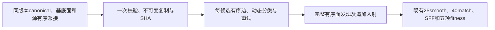
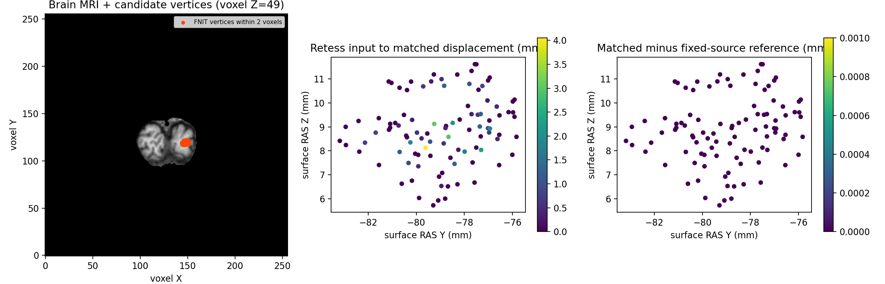

# 拓扑候选的不可变基底缓存

## 1. 功能简介

`prepare_retessellation_base()` 一次校验完整源邻接、canonical坐标和保留面，创建独立且不可变的基底。显式使用它时，有序重连只复制本候选触及的邻接行；入射CSR保留全体顶点，只追加新面对应的入射。普通调用继续使用完整校验和同一重连核心。



缓存不保存匹配坐标、动态边、marks、rip、K/E、curvbak、RP或DVS。没有从面重建邻接；原本没有保留面支撑的外部阻挡边仍参加检查。完整GA与最终网格质量属于外层接口。

## 2. Python调用、输入和输出

```python
from fnit.recon_all.topology_retessellation_dynamic import (
    prepare_retessellation_base,
    retessellate_and_detect_candidate,
)

immutable_base = prepare_retessellation_base(
    canonical=canonical_vertices,  # 有限非零(N,3)，原canonical surface RAS尺度，内部float32
    base_faces=retained_base_faces,  # 完整有序整数(F,3)，已按本链语义移除缺陷面
    neighbors=ordered_source_neighbors,  # 全N行整数一环，保留顺序和未由面支撑的源边
)

candidate_inputs = dict(complete_ordered_candidate_inputs)  # 其余参数仍为本候选自产状态
candidate_inputs.update(
    canonical=immutable_base.canonical,  # 必须是缓存自身只读对象
    base_faces=immutable_base.base_faces,  # 必须是缓存自身只读对象
    neighbors=immutable_base.neighbors,  # 必须是缓存自身完整tuple行对象
    base_context=immutable_base,  # 显式开启；缺省None保持普通接口
)
candidate_result = retessellate_and_detect_candidate(
    **candidate_inputs,  # 完整具名域、边、排序和overlap参数见动态重连专页
)
```

其余全部参数、坐标和失败规则见[有序动态重连](TOPOLOGY_DYNAMIC_RETESS.md)。`candidate_geometry()`/`evaluate_candidate()` 可通过同一 `retessellation_inputs` 传递缓存；初态 `surface_state.faces` 必须仍等于完整基底面。

返回 `PreparedRetessellationBase`：`canonical float32(N,3)`、`base_faces int32(F,3)` 是bytes-backed只读数组；`neighbors` 为tuple的tuple行、`linked_neighbors` 为tuple的frozenset行；`face_rows`、`incident_faces`、`incident_corners` 是有序tuple行；`face_identities` 用于临时面分类。`state_sha256` 绑定完整坐标/面/源邻接值，`preparation_seconds` 包含校验、复制和索引构建。无文件、GPU或精度设置副作用。

复制后改变原输入不会修改缓存；数组不能重新开启writeable。调用时必须同时使用缓存自身三个对象，并校验shape/dtype/只读等可变元数据。混入另一个状态，或修改数组元数据，抛 `ValueError`。基底面、canonical或源邻接改变后应重新创建缓存；不得跨defect、坐标或DVS基底版本盲目复用。

重连新增 `base_context=None`，结果新增 `prepared_base_used bool`、`prepared_copied_rows int`；所有原输出语义保持。返回的邻接行是独立可变列表，修改结果不改变缓存。`candidate_incidents(faces=...,vertex_count=...,base_context=None)` 仍返回完整int32 `incident_offsets(N+1)`、`incident_faces(3F)` 和 `incident_corners(3F)`，显式缓存时要求完整基底前缀逐元素同序，仅复制被追加面的行。没有坐标缓存或缺失顶点。

## 3. 命令行复现

这是内部Python接口，没有新增生产CLI。完整同输入ABBA诊断复用现有输入准备：

```bash
# 初始属性/global priors明确冻结；参考后态只在全部自产候选写出后打开。
PYTHONPATH=src:tools python tools/benchmark_recon_topology_prepared_cache.py \
  --before-retess diagnosis/retess.before.bin \
  --initial-attributes diagnosis/match.before.bin \
  --initial-global-priors diagnosis/statistics.bin \
  --input-surface own-subject/surf/lh.orig.nofix \
  --input-qsphere own-subject/surf/lh.qsphere.nofix \
  --brain own-subject/mri/brain.mgz \
  --after-statistics-reference benchmark-only/patch_statistics.bin \
  --after-volume-reference benchmark-only/volume.bin \
  --fitness-reference benchmark-only/fitness.json \
  --output diagnosis/new-cache-abba \
  --threads 4
```

全部参数必填，含义及初始冻结边界同[连续候选接口](TOPOLOGY_CANDIDATE_PIPELINE.md)。新目录生成冷普通调用、首次缓存调用以及A/B/B/A完整NPZ、边控制记录和JSON。两种布局各预热一次后，才比较四次热调用，并记录实际Numba签名数量。完整API包含校验、几何和评分；缓存创建、NPZ写出、原MRI准备及fresh CLI分别记录。失败保留输出，不回写生产、不放宽最终QC。

## 4. 原软件对应步骤

对应固定 `mris_fix_topology -ga` 内部的 `retessellateDefect_wkr`、面发现以及候选邻接/入射维护，没有独立官方缓存CLI。复用的原顺序动态规则、球面相交、接受/拒绝、重试、25轮平滑和40轮MRI匹配保持不变。固定C++观察器只在隔离benchmark生成参考，不由本接口调用。

## 5. 当前真实数据与耗时

公开ds000114 sub-07 ses-test LH，使用79a41cdd自产上游，110,534个顶点、216,722个基底面、4,723条候选边。完整候选生成138个新面，最终216,860面，99个selected顶点。初始完整属性和global K/dot先验明确冻结；原MRI、nofix与qsphere自行准备局部强度、校准PDF及几何。参考后态只在所有候选写出后读取用于比较。记录见[机器可读报告](../../validation/recon_all/optimizations/20261010_topology_prepared_cache/README.md)。

v3同主机、CPU8–11、4线程、隐藏CUDA，顺序执行A/B/B/A；背景共享负载保留。A是普通调用，B是显式缓存调用，数值算法和完整输入相同：

| 测量范围 | 实际耗时（秒） |
|---|---:|
| 一次完整缓存校验、复制和索引创建 | 2.712116 |
| 冷普通完整候选API，含首次JIT | 19.002998 |
| 首次缓存完整候选API，含新布局JIT | 4.066449 |
| 热A0 / B0 / B1 / A1 | 5.997462 / 2.897194 / 3.193912 / 5.734832 |
| 热普通 / 缓存API中位数 | 5.866147 / 3.045553 |
| 本组完整候选API倍率 / 缩短比例 | 1.926倍 / 48.08% |
| 每次额外完整诊断NPZ写出 | 1.074576–1.078976 |
| 整个fresh诊断CLI，含六次API、MRI准备及读写 | 100.735969 |
| 子进程最大RSS | 1,380,884 KiB |

首次缓存调用实际新增Numba布局签名：`_edge_intersects`从2变3、`_contains_neighbor_on_sphere`从1变2；之后四次热调用签名数量均不变。缓存数组是连续只读布局，原输入还包含可变或strided视图，因此首次缓存编译成本另计。缓存调用只复制98/110,534行邻接。完整诊断CLI含六次调用，不能与旧诊断CLI的不同调用数量直接比较，也不是recon-all整例时间。

六次自产结果的有序面、坐标、平滑后的original坐标、法向、K1/K2、E1/E2、fx、curvbak、FACE.area、法向缓存面积、位移、signed-distance、完整邻接/入射CSR和五项fitness均逐位相同；有序边分类、接受/拒绝、重试及面发现轨迹相同。最终double fitness为`-97.760777950286865`，原同候选参考门也通过。这里的候选中间面状态仍遵循源算法语义，不能用组件相同宣称最终mesh QC或完整GA通过。

本地19项接口契约通过；同声明Conda环境的CFFF19项实际通过，2.879916秒。覆盖some/all分类、外部无面支撑阻挡边、不可变复制、元数据/版本不匹配及新面入射顺序。真实all模式完整候选与这些接口测试分别报告，未新增依赖。GPU隐藏，显存字段为`null`；不作20 GB资源验收。



图来自同一原始输入与已验证候选，缓存未改变几何。本轮未执行完整种群GA或原始T1整例，整体指标等效为`not_assessed`。

## 6. 更新记录

- 2026-10-10：新增显式once-validated不可变基底，普通调用共用校验/数值核心；按触及行复制邻接与追加面入射。
- 保存完整外部阻挡边和源顺序，shape/dtype元数据异常在使用前拒绝。
- 缓存v1启动器错误查找旧目录不存在的`FROZEN_SOURCE.json`，算法未开始；失败证据保留，原进程退出码未记录，公开字段为`null`。
- v2五次完整调用全部逐位相同，观察中位数6.062617→3.507614秒。首个B仍含新布局JIT，保留为原顺序观察，不称稳态吞吐。
- v3从新目录加入独立首次缓存预热和实际签名计数，四次真正热ABBA完成，全部数值/决策不变。v2的数值和耗时未覆写。
- 原完整候选v1检查器列定义错误及v2/v3严格结果保留在[原阶段报告](TOPOLOGY_CANDIDATE_PIPELINE.md)。本缓存不修改那些冻结源或结果。

## 7. 参考文献与源码

- [固定FreeSurfer拓扑源码](https://github.com/freesurfer/freesurfer/blob/d932c45b7941662ea380a05efef580568b98d41a/utils/mrisurf_defect.cpp)。
- [FNIT有序重连](../../src/fnit/recon_all/topology_retessellation_dynamic.py)、[候选几何](../../src/fnit/recon_all/topology_candidate_geometry.py)、[完整候选](../../src/fnit/recon_all/topology_candidate_pipeline.py)。
- Fischl, B., Liu, A. & Dale, A. M. (2001). Automated manifold surgery. IEEE TMI 20, 70–80. [论文](https://surfer.nmr.mgh.harvard.edu/pub/articles/fischl01-topology-fixing.pdf)。

无新增依赖，沿用主页Conda中的NumPy/Numba。此缓存没有替换完整GA控制器或最终拓扑验收。
