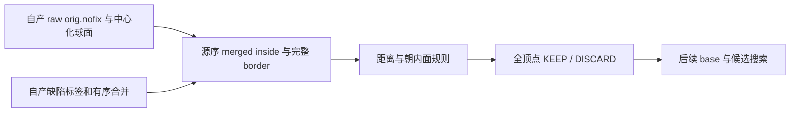

# 拓扑缺陷的有序初始保留规则

## 1. 功能简介

`defect_retention_status` 在 GA 搜索前执行源算法的球面距离、原始面距离和朝内面检查。它只给出初始 KEEP/DISCARD；不选边、不生成替换面，也不是完整拓扑修复。合并后的缺陷允许是不直接连通的 inside 并集；显式接口保留源合并时的拼接顺序。



## 2. Python 调用与输入输出

```python
from fnit.recon_all.topology_preflight_python import defect_retention_status

retention = defect_retention_status(
    canonical=canonical_vertices,  # float32(N,3)，中心化 canonical sphere，surface RAS/mm
    original=raw_nofix_vertices,   # float32(N,3)，两轮平均前的 raw orig.nofix
    faces=ordered_faces,          # 整数(F,3)，同一有序顶点域
    labels=merged_defect_labels,   # 整数(N,)，0 外部、1…D 合并后的缺陷
    ordered_regions=merged_regions,  # D 项源序字典，每项含 vertices 与 border
)
source_discard = retention[ordered_inside_vertices] == -1  # 原缺陷顺序，bool(K,)
```

- `canonical`、`original`：同 N、同顶点顺序的有限三维坐标。原始坐标必须来自本阶段的 raw 表面，不能以平滑后坐标替代。
- `faces`：完整整数面表。显式合并接口在类型转换前检查范围和整数类型。
- `labels`：完整非负标签域；正标签连续且必须由列表完整覆盖。
- `ordered_regions`：默认 `None`，沿用现有组件 BFS。显式值接受 `[{"vertices": inside, "border": border}, ...]` 或 `(inside, border)` 二元组列表。inside 完整覆盖所属标签、无重复；border 是完整零标签一环集合，保留调用者顺序。
- 返回 `int8(N,)`：外部 0、KEEP +1、DISCARD −1。生产调用方需显式转换为原程序 KEEP 0 / DISCARD 1，不能直接把有符号返回值当源枚举。
- 球面和原始面的平方距离阈值分别为 0.01 和 0.75；保留原严格小于比较和顺序。外层虽然遍历 border，源内层上限是 `ninside`，不会做 border-to-inside 丢弃。
- `defect_border_labels`、`defect_hull_labels` 同样接受 `ordered_regions`，只生成源序诊断标签；hull 保留完整一环扩展语义。
- 输入不修改。非法形状、非有限坐标、浮点索引、缺失/重复域或不完整 border 抛 `ValueError`；无文件副作用、GPU/线程/精度切换或默认近似。

## 3. 命令行调用

这是拓扑修复的内部步骤，没有独立生产 CLI。真实阶段复现工具需要显式提供本链自产 checkpoint、原始 nofix 文件和隔离参考；参考只在候选保存后读取。

```bash
python tools/benchmark_recon_topology_retention_ordered.py \
  --own-inputs OWN_SFF_MERGE_CHECKPOINT.npz \
  --original-surface OWN_LH_ORIG_NOFIX \
  --reference-state FIRST_SOURCE_DVS_RECORD.bin \
  --reference-repeat REPEATED_SOURCE_DVS_RECORD.bin \
  --reference-program-sha256 ACTUAL_64_HEX_SHA256 \
  --output NEW_DIAGNOSTIC_DIRECTORY \
  --threads 4
```

`own-inputs` 为 raw/canonical/完整面、合并 labels 与有序 inside/border CSR 的自产 NPZ；`original-surface` 核对全坐标和面；两个 reference 是 FNITDVS1 下游首 record，仅作诊断；SHA 必须实际核验；输出必须不存在，写完整私有候选 NPZ 和机器可读报告。GPU 隐藏，线程预算显式指定。

## 4. 原软件调用

对应固定源码 `mris_fix_topology -ga` 内的 `mrisDiscardDefectVertices` 两组距离检查和朝内面检查。独立基准可以执行固定源码构建程序；本函数不调用它。源 merge 在该检查前，原始坐标的两轮平均在之后，因此这两个输入阶段不可交换。

## 5. 最新真实精度与运行时间

公开 ds000114 历史 3a sub-06 左半球，126,778 顶点、253,652 面、25 个缺陷。使用本链自产 raw/canonical/merge，CPU 8–11、4 线程、CUDA 隐藏；共享环境观察值，不是整例时间。

| 检查 / 时间 | 实测 |
|---|---:|
| 初始保留 / 丢弃 | 773 / 2,055 顶点 |
| 两次自产状态、默认 BFS 兼容 | 全元素 / 字节 0 差异 |
| 捕获的 1,889 个映射前缀及对应下游 rip | 0 差异 |
| 第一次 / 第二次完整状态 API | 5.609 / 5.495 s |
| 完整 hull API | 10.166 s |
| 新 CLI（加载、候选写出、完整诊断） | 47.794 s |
| 9 项同环境契约 | 全通过，0.027 s |

源两次 FNITDVS1 完整捕获 SHA 相同。参考生成于另一主机，且映射只捕获首缺陷域所需前缀，不是全 N 映射；全域严格参考复现尚未判定。这里不评价最终网格、解剖形状、整体指标等效、GPU 显存或完整 GA。脑形状图见 [数字拓扑的局部差异诊断](TOPOLOGY_VOLUME_PYTHON.md)，不能把这里的初始标签检查当最终表面质量通过。

完整数字指标和实际源码/程序/输入 SHA 在 [本轮报告](../../validation/recon_all/optimizations/20261010_topology_retention_ordered/report.json)。原影像和完整私有状态留在授权计算环境。

## 6. 更新和 benchmark 记录

- 增加显式合并域接口，保留默认 BFS 行为和全部距离/负面规则；未把曾被怀疑的 border 越界当成新 bug。核对确认现有内循环已正确使用 `j < ninside`。
- v1 诊断 workspace 遗漏 parser 的成熟状态模块，未进入计算；失败收据保留。
- v2 完整自产候选已写出，诊断器误把截断的 1,889 映射当全 N，末尾失败；没有更改候选或原算法。
- v3 修正观察覆盖范围，完整执行通过；未用参考 after 补输入，没有修改失败历史。

## 7. 参考文献和源码

- [FreeSurfer 源码：拓扑修复](https://github.com/freesurfer/freesurfer/blob/d932c45b7941662ea380a05efef580568b98d41a/utils/mrisurf_defect.cpp)。本轮固定源码 SHA 和程序 SHA 见报告。
- [FreeSurfer cortical reconstruction 文档](https://surfer.nmr.mgh.harvard.edu/fswiki/ReconAllDevTable)。
- Fischl et al. Automated manifold surgery: constructing geometrically accurate and topologically correct models of the human cerebral cortex. *IEEE Transactions on Medical Imaging* 20, 70–80 (2001).
