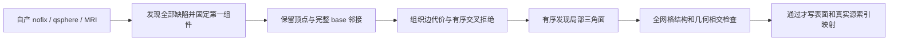

# 自有局部动态重三角化候选

## 1. 功能简介

`run_first_retessellation()` 从自产 `orig.nofix`、同序 `qsphere.nofix` 和 MRI 发现全部球面缺陷，固定处理源顺序的第一个完整缺陷。它复用现有缺陷发现、顶点状态、候选边、白质直方图和有序交叉拒绝，重新生成局部边和三角面；保留外部面顺序与源顶点映射。

这是独立开发中的 **首缺陷原语**。当前尚未实现完整 GA 的动态顶点重分类、全部 fitness、mutation/crossover 与全缺陷控制。失败候选不写表面，不进入生产默认。它与已单列验证的数字体素拓扑算法不同。



## 2. Python 调用与输入输出

```python
from fnit.recon_all.topology_retessellation_python import run_first_retessellation

report = run_first_retessellation(
    input_surface="subject/surf/lh.orig.nofix",  # 自产原始三角网格，surface RAS、mm
    input_qsphere="subject/surf/lh.qsphere.nofix",  # 与原网格完全相同的顶点顺序和有序面
    intensity_volume="subject/mri/brain.mgz",  # 自产、同空间、三维 uint8 MGH/MGZ
    output_surface="diagnosis/candidate.orig",  # 新路径，仅质量通过时写出
    report_path="diagnosis/candidate.json",  # 新 JSON 路径，保存失败和全部映射
    tissue_scale_mm=1.0,  # 非负组织代价权重，mm；默认 1.0
    edge_sample_spacing_mm=0.5,  # 完整线段的最大 MRI 采样间隔，mm；默认 0.5
    require_quality=True,  # 默认质量失败抛 RuntimeError，并保留报告
)
```

输入表面使用 nibabel FreeSurfer 二进制格式：坐标 `(N,3)`，读入 float32；有序面 `(F,3)`、int32。`orig.nofix` 必须包含与 MRI 对应的几何尾部，不能以 scanner RAS 坐标代替 surface RAS。MRI 头与表面几何共同定义 surface RAS→voxel 变换。输入必须有限，同序面须完全相等；五个输入/输出路径须不同，两个输出路径不得已经存在。

边代价定义为 `线段长度(mm) − tissue_scale_mm × 沿完整线段的平均 log p(WM)`。采样至少两个点，间隔不超过指定值；白质概率来自现有四环局部直方图。此显式独立配方不是原版全部 fitness。边按代价和原表序稳定排序；初始 KEEP 顶点固定，不按已知被试坐标筛边或删困难顶点。

返回字典与 JSON 包含三项输入 SHA、模块 SHA、全部边决策哈希、结构计数、相交计数、耗时、原/新顶点映射和外部面源索引。主要字段如下。

| 字段 | 结构与意义 |
| --- | --- |
| `mesh_input` / `mesh_output` | 顶点、面、边、Euler、边界边和非流形边计数 |
| `output_vertex_source_indices` | 长度为候选顶点数的整数列表：新顶点→原 nofix 顶点 |
| `outside_face_source_indices` | 保留外部面→原始面索引，顺序不变 |
| `removed_vertex_source_indices` | 初始 DISCARD 且未再使用的源索引；KEEP 不得丢失 |
| `source_face_discovery` | 完整有序三角面候选与接受/拒绝理由 |
| `original_removed_patch_domain` | 原删除子域的 Euler 与真实边界图；分支边界不冒称简单单环 |
| `base_edges_without_preserved_faces` | 两个面都删除、但仍须保留的独立 base 邻接边数 |
| `execution_status` / `mesh_quality_status` | 原语执行状态与独立质量状态 |
| `geometric_intersecting_faces` | 结构通过后全网格几何检查的相交面数；未运行时为 `null` |
| `output_written` / `output_sha256` | 是否写出及完整文件 SHA；失败没有表面文件 |
| `total_seconds_including_IO_JIT_quality` | API 校验、读写、必要 JIT、计算和质量检查墙钟 |

尚有其他缺陷时，修复一个 patch 的 Euler 不要求为 2。完整闭合、流形、连通、非退化、无重复面、KEEP 完整以及几何无相交全部满足后才写出。`require_quality=False` 仅让诊断调用返回失败字典，仍不写失败表面。参数/几何错误抛 `ValueError`；输出已存在抛 `FileExistsError`；I/O 异常正常传播。

模块提供下列内部原语。所有索引均以传入坐标的顶点顺序为准，不能混用源序与 base 序。

| 函数 | 全部参数与返回结构 |
| --- | --- |
| `source_base_neighbors` | `source_neighbors`：N 个有序整数一环；`labels`：源序 `(N,)` 非负缺陷号，0 未标记；`translation`：源→base 完整索引置换。返回 N 个 base 序一环，缺陷行为空，无面支持的 base 边仍保留。非法置换/重复、自连或越界邻居抛 `ValueError`。 |
| `detect_patch_faces` | `canonical`：有限 float32 `(N,3)` 源球面坐标；`vertices`：待发现面的完整有序顶点列表；`neighbors`：N 个当前有序一环；`external_faces`：保留的 int32 `(F,3)` 三角面。返回 int32 `(P,3)` 新面及完整有序决策字典；不改变坐标，邻接或面数据非法则报错。 |
| `removed_patch_domain` | `faces`：原移除域 int32 `(F,3)` 源索引面。返回 V/E/F/Euler、边界组件数/非二度顶点数/真实有向边；仅所有边界顶点 degree=2 时给简单环数，否则为 `null`。 |
| `graph_triangles` | `canonical`：有限非零 `(N,3)` 球面点；`edges`：整数 `(K,2)` 无向边；`external_faces=None`：可选完整保留面及其固定 half-edge 后继。返回三角面及全部循环/非三角/外部约束冲突字典；自连、越界、零球面点或冲突外部后继报错。不填 fan。 |
| `constrain_patch_boundary` | `patch`：候选整数 `(P,3)` 面；`external_faces`：保留面；`nvertices`：全图顶点数。返回满足外部 incidence/反向共边条件的子集及完整拒绝索引；不能代替全网格 QC，当前调用只记录诊断而不改候选。 |

`graph_triangles()` 和 `constrain_patch_boundary()` 保留为失败版本的诊断工具。当前真实面由固定源规则的三角面发现原语生成，它们不承担完整 GA。

## 3. 命令行调用

```bash
python -m fnit.recon_all.topology_retessellation_python \
  --input-surface subject/surf/lh.orig.nofix \
  --input-qsphere subject/surf/lh.qsphere.nofix \
  --intensity-volume subject/mri/brain.mgz \
  --output-surface diagnosis/candidate.orig \
  --report-path diagnosis/candidate.json \
  --tissue-scale-mm 1.0 \
  --edge-sample-spacing-mm 0.5
```

参数与 Python 同名；CLI 保持 strict 质量门，不提供放行失败输出的开关。

真实阶段复现使用 `tools/benchmark_recon_topology_retessellation.py`，具名参数 `--source-root`、`--input-surface`、`--input-qsphere`、`--intensity-volume`、`--output-dir`、`--input-source-commit` 指定冻结源码、三项自产输入、新空目录与上游版本；代价参数同上。驱动保存所有 Python 源码 SHA，并在 fresh 子解释器执行阶段。GPU 显式隐藏，线程和亲和性由调用环境固定。

`tools/diagnose_recon_topology_retessellation.py` 的 `--stage-report` 指定保留的失败收据；`--canonical-checkpoint` 和 `--checkpoint-report` 指定带哈希的原语球面检查点及其来源；其余三项原始输入和 `--output-dir` 均显式给出。脚本重新计算全部 canonical 点并逐元素检查检查点，重建失败候选计数，绘制原 T1 的四边界投影。`--replay-edge-decisions` 用原代价完整重跑已失败原语，只捕获边表与阻挡顺序；要求所有输入、边成本/顺序/接受哈希、面决策和顶点映射完全相同。不补边，不把重建的失败表面写回生产。

## 4. 原软件调用

原版 `mris_fix_topology -ga` 包含该领域的完整遗传拓扑修复；这里移植的是其内部边/面构造的一部分，没有对应独立 CLI。不得将一次首 patch 调用称为该命令完整替代。

核对版本为 FreeSurfer `d932c45b7941662ea380a05efef580568b98d41a`：`detectDefectFaces`、`containsAnotherVertexOnSphere`、`orientDefectFaces`、`intersectDefectEdges`，以及独立于面表复制 base 邻接的规则。固定源码只用于只读核对，未把原版源码或二进制复制到模块；本模块不调用原版阶段程序。

## 5. 当前真实数据精度、耗时与脑图

[完整机器可读收据](../../validation/recon_all/optimizations/20261010_topology_retessellation/README.md)绑定公开 ds000114 sub-07 左侧、`79a41cdd` 原始 T1 整例自产的 nofix/qsphere/MRI。每版处理同一完整第一缺陷：67 个 inside、61 个 border、38 个初始 KEEP，原删除域 128 顶点、330 边、200 面，Euler −2。其 60 条边界边包含一个 degree-4 节点，因此不能假定它是单个简单凸多边形。

| 实际版本 | 新 patch 面 | 开放边 | 非流形边 / 顶点 | 零面积面 | 朝向冲突边 | API 秒 | 结果 |
| --- | ---: | ---: | ---: | ---: | ---: | ---: | --- |
| v1 half-edge | 180 | 8 | 50 / 0 | 2 | 58 | 55.025 | strict 拒绝 |
| v2 外部边筛选 | 147 | 23 | 0 / 21 | 0 | 23 | 55.037 | strict 拒绝 |
| v3 外部 half-edge 约束 | 113 | 111 | 0 / 32 | 0 | 111 | 55.109 | strict 拒绝 |
| v4 完整 chull＋源面发现 | 136 | 4 | 0 / 0 | 0 | 4 | 61.124 | strict 拒绝 |
| v5 保留无面支持的 base 边 | 138 | 0 | 0 / 0 | 0 | 0 | 116.517 | 17 相交面，strict 拒绝 |

v4 保留全部 38 个 KEEP 和外部面顺序，输出候选计数 110,505 顶点、221,052 面、331,580 边。开放边尚未消除，几何相交检查字段为 `null`，未写候选文件。未进行完整阶段的原版同输入对照、另一半球、第二例、连续链或整例数值验收，整体指标等效为 `not_assessed`。

v4 只读回放验证全部 canonical、边成本/排序/接受哈希和面决策相同。四条开放边形成 592–600–833–601–592：对角 592–833 被早先接受的 827–600 阻挡；600–601 已在 base（`used=1`），但两张支持面都删除。原语从剩余面重建一环时丢失这条独立 base 边，违反固定源的邻接复制语义。下一版据此修复一般 base 图构造，不按这些编号补面。

本实验为共享 A100 节点上的 CPU 8–11、4 线程阶段观测，GPU 不使用、显存为不适用；不是十分钟整例证据。首次 unit 已使用同一新 NumBa 缓存，部分 kernel 预热；fresh 子解释器仍包含导入、文件 I/O、其他 JIT 与 QC。跨版本墙钟不能代替受控算法提速结论。

## 6. 更新与 benchmark 记录

- v1–v3 的真实失败保留，用于解释为什么角排序及事后筛面不能替代固定源面构造。
- v4 补齐真实 chull 的完整阻挡边与有序三角面发现。13 项结构/包含/朝向合同通过；完整真实首缺陷仍失败。
- v5 修复独立 base 邻接：按原始一环次序保留两个端点均未标记的边，不从保留面重新推断边图。新增两项合同覆盖“两个支持面都删除但边仍保留”及源邻接顺序，15 项本地合同通过。远端同环境 15 项合同 .817 s 通过；真实首缺陷形成闭合、流形、连通网格，但完整几何检查仍发现 17 相交面，因此未写出、不接默认。

已有函数复用及精度边界保留。仍缺动态 USE_SOME/retry、全 MRI/曲率 fitness、mutation/crossover、总体 controller 和全部缺陷验证；局部结构通过也不等于解剖形状或最终脑区指标等效。

## 7. 参考文献与代码

- Fischl B., Liu A., Dale A. M. Automated manifold surgery: constructing geometrically accurate and topologically correct models of the human cerebral cortex. *IEEE Transactions on Medical Imaging* 2001;20:70–80. [原作者全文](https://surfer.nmr.mgh.harvard.edu/pub/articles/fischl01-topology-fixing.pdf)，DOI: [10.1109/42.906426](https://doi.org/10.1109/42.906426)。
- Ségonne F. et al. A genetic algorithm for the topology correction of cortical surfaces. *Information Processing in Medical Imaging* 2005:393–405. DOI: [10.1007/11505730_33](https://doi.org/10.1007/11505730_33)。
- [固定缺陷/边/面控制源码](https://github.com/freesurfer/freesurfer/blob/d932c45b7941662ea380a05efef580568b98d41a/utils/mrisurf_defect.cpp)。
- [球面包含和度量源码](https://github.com/freesurfer/freesurfer/blob/d932c45b7941662ea380a05efef580568b98d41a/utils/mrisurf_metricProperties.cpp)。
- [FNIT 自有候选](../../src/fnit/recon_all/topology_retessellation_python.py)、[合同](../../tests/recon_all/test_topology_retessellation_python.py)、[阶段驱动](../../tools/benchmark_recon_topology_retessellation.py)、[只读诊断](../../tools/diagnose_recon_topology_retessellation.py)。
