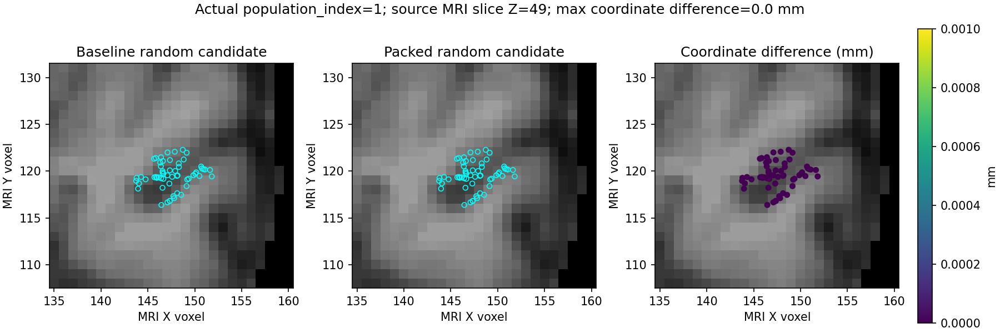

# 完整候选状态装配：无持久缓存打包实验

## 1. 功能简介与流程

把当前一环状态和完整候选结果装配成下一候选可用的完整表面状态。复用 FNIT 已有整数打包、编译前缀检查与属性发布函数，逐次检查全部当前行；不保存跨候选缓存。生产源码与默认调用保持原样，实验只在串行作用域内替换装配回调。


本轮冻结来源是 `39151ab72b98cd5c51fd93d43e299a026bab51a8`，生产数值源码基线为 `19b913f1e7857fe6f37e3836450c8547bed8323d`。源码清单和运行时实际导入模块摘要见交付目录。既有许可与输入现场哈希已核对：使用既有 CC0 OpenNeuro ds000114 数据产生的 FNIT 自产表面和 MRI，不新增权重、模板或依赖；交付只含汇总、凭据和局部脑图。

## 2. Python 调用、输入与输出

将项目 `src` 与 `tools` 放入 Python 导入路径。直接装配不重新评分，也不消费随机数。

```python
from recon_topology_state_pack_experiment import materialize_packed, state_pack_scope

# complete_initial_state：当前完整一环状态字典，包含下表所有必需字段。
# complete_candidate_result：同一次成熟候选计算返回的完整结果字典。
next_complete_state = materialize_packed(
    initial=complete_initial_state,
    result=complete_candidate_result,
    validated=None,  # 独立调用重新验证当前一环；不要传旧候选的校验值。
)

# 仅用于串行实验；调用结束或异常时恢复原装配回调。
with state_pack_scope(enabled=True):
    next_feedback = prepared_candidate_evaluator(
        ordering=current_edge_ordering,  # 当前候选的完整边次序
        discarded_defect_vertices=current_discarded_vertices,
        vertex_rip=current_vertex_rip,
        use_counts=current_use_counts,
        vertex_fitness=current_vertex_fitness,
    )
```

`materialize_packed` 的参数均为关键字：`initial` 是当前完整状态；`result` 是当前完整候选；`validated` 默认 `None`，仅成熟 cycle 内部可传本次刚校验的 `(顶点数, vertex_topology, nfaces)`。`state_pack_scope(enabled)` 接受显式布尔值，`True` 临时启用实验，`False` 使用原回调；作用域为进程内串行实验，不支持并发替换。

设顶点数为 N、当前有效面数为 F、候选面数为 F′。

| 输入字段 | 格式与意义 |
|---|---|
| `initial.original_vertices`, `vertex_normals`, `flattened_vertices` | N×3 坐标、法线、展平坐标；保持生产来源 dtype |
| `vertex_rip`, `vertex_marks` | N 个源标记，含有符号 rip 的原始状态 |
| `vertex_topology` | int32 N×7：nsizeCur、nsizeMax、vtotal、vnum、v2num、v3num、num；支持成熟一环约束 |
| `neighbor_storage` | N 行有序整数邻接存储；有效长度取 vnum，容量尾部保留 |
| `incident_faces`, `incident_corners` | N 行有序面编号与面内角点；有效长度取 num，角点域 0–2 |
| `faces`, `nfaces` | 整数三角面容量数组与逻辑有效面数 F |
| `face_area`, `vertex_area` | 面和顶点面积；保留源面积与符号约定 |
| `curvbak`, `k1`, `k2`, `tangent_e1`, `tangent_e2` | N 行动态曲率与切向基；结构随成熟状态 |
| 可选 `H`, `K`, `face_rip` 及其他属性 | 已存在 H/K 必须 float32 N；保持成熟发布的拟合选择规则，其他状态按成熟浅拷贝传递 |
| `result.geometry` | 完整 F′×3 faces、N 行 neighbors、neighbor_offsets/ordered_neighbors、incident_offsets/incident_faces/incident_corners、removed_vertices，以及成熟坐标/marks/selected_vertices 等几何属性 |
| `result.vertex_normals`, `face_area`, `flattened_vertices`, `vertex_curvbak`, `sff` | 成熟评分结果；sff 含 k1/k2/tangent_e1/tangent_e2，fit_kind 按原更新规则使用 |

候选必须保留全部顶点和原 F 个面前缀，邻接与入射面只能按当前有序前缀追加。整数 CSR offsets 长 N+1，值域覆盖整个合法范围；完整邻接行须与冗余 CSR 一致。损坏的冗余 CSR 会被实验额外拒绝，此行为比原私有装配入口更严格，故结果适用于成熟 producer 的合法完整候选域。

输出是完整新状态字典，字段名称与成熟 cycle 一致。未改变的邻接对象和容量尾部保留；新邻接复制；入射面与角点复制到各自完整缓冲，再提供不重叠行视图。这些新行不与输入共享数据，但它们是缓冲视图，不能把旧版每行独立拥有和可 resize 的假设套到新行。动态坐标、法线、K/E/H、curvbak、RP、反馈发布继续使用成熟函数；不冻结动态状态。

字段的全部 dtype、shape、原始字节摘要及控制键清单见 `REAL_SHORT_ABBA.json`，包括每候选 36 个候选/反馈数组、40 个状态数组及 3 个排序数组。

## 3. 命令行与产物

```bash
# frozen_source_dir：含冻结 src、tools 和源码清单的独立目录。
# input_surface_file：FNIT 自产 lh.orig.nofix，FreeSurfer 二进制三角表面格式。
# input_qsphere_file：对应 lh.qsphere.nofix，同顶点编号的球面坐标。
# input_brain_file：对应 brain.mgz，含 MGH tkRAS 几何头的真实 MRI。
# output_run_dir：尚不存在的新运行目录；保存本轮私有候选和汇总。
PYTHONPATH="$frozen_source_dir/src:$frozen_source_dir/tools" \
python "$frozen_source_dir/tools/benchmark_recon_topology_state_pack_short.py" \
  --input-surface "$input_surface_file" \
  --input-qsphere "$input_qsphere_file" \
  --brain "$input_brain_file" \
  --manifest "$frozen_source_dir/SOURCE_MANIFEST.private.json" \
  --output "$output_run_dir" --threads 4
```

五个路径参数均必需：前三项为上述真实输入，`--manifest` 是冻结源码根目录内 JSON，payload 对每个源码保存 size 与 SHA-256；`--output` 必须不存在。`--threads` 默认 4，控制项目线程预算。实际运行额外绑定四个 CPU、隐藏 GPU，浮点仍采用源 float32/float64，fastmath=False；保留默认 TF32 标志，本实验整数装配不使用 GPU 数值计算。

每个 ABBA 子目录含三组 candidate/state/ordering NPZ、候选与排序控制 JSON、计时 JSON。最终 `report.private.json` 保存完整比较、输入/源码哈希和进程内环境，`COMPLETE.json` 保存报告哈希；shell EXIT=0 与 COMPLETE 联合确认完成。原始 NPZ 与 MRI 保留私有运行区，不进入交付包。

脑图另在计算结束后生成：

```bash
PYTHONPATH="$frozen_source_dir/src" python tools/plot_recon_topology_state_pack.py \
  --baseline "$baseline_candidate_npz" --packed "$packed_candidate_npz" \
  --brain "$input_brain_file" --output "$new_figure_dir"
```

四个参数均必需：前两项是同一 population_index=1 的原版/实验版完整候选 NPZ，brain 是同源 MRI，output 是新的图像目录。输出 PNG 与图像来源 SHA 凭据；绘图时间不计入 benchmark。读取采用 nibabel，不调用原软件。

## 4. 对应原软件调用

此步骤对应 FreeSurfer `mris_fix_topology` 内部候选表面状态发布，没有单独的状态装配命令。整体原版入口为：

```bash
# subjects_directory：原版受试者目录；subject_identifier：对应受试者名称。
# hemisphere：lh 或 rh；以下命令仅说明算法对应位置。
SUBJECTS_DIR="$subjects_directory" mris_fix_topology -mgz "$subject_identifier" "$hemisphere"
```

本轮精度与计时对照是冻结 FNIT 成熟装配入口，不是重新执行 FreeSurfer 的端到端对照。完整原软件比较由项目原有拓扑验证流程负责；本实验不调用 FSL、FreeSurfer 等运行时。

## 5. 真实数据精度、耗时与脑图

每阶段重建 evaluator，从同一初始状态依次运行 identity、random、random 三个候选，阶段内状态与反馈连续传递；四阶段次序 A/B/B/A。随机种子 1234，三个候选累计抽样 0、5215、10447 次，四阶段随机调用上下界和值的顺序摘要相同：`c45dea6e9271eee4716c4473a4e3e79f9f0273e975f6310a103c0936cd10dad9`。

所有完整数组的 keys、dtype、shape、tobytes 以及候选/排序控制 JSON 完全一致。每阶段有 237 个数组字段记录；四阶段 948 条记录包含 A0 自比较，不能当作 948 个独立验证案例。11 项契约测试通过，覆盖容量尾部、输入独立性、当前动态前缀、完整 CSR/角点损坏拒绝、异常恢复、连续反馈；小构造仅用于契约测试，性能与脑图全部使用真实输入。

单位秒；装配已包含在 cycle 内，不能与 cycle 相加。完整阶段 API 包含 evaluator 准备、分配、验证、候选排序/闭环和全量压缩 NPZ/JSON 写入。

| 阶段 | evaluator 准备 | 三候选 cycle 合计 | 其中装配合计 | 写入合计 | 完整阶段 API |
|---|---:|---:|---:|---:|---:|
| 0 / baseline | 5.669625 | 21.164224 | 1.964703 | 10.194091 | 37.214044 |
| 1 / packed | 5.690308 | 6.843983 | 2.900663 | 9.809762 | 22.822429 |
| 2 / packed | 5.894963 | 4.461477 | 1.246041 | 9.738925 | 20.502265 |
| 3 / baseline | 5.966781 | 5.501582 | 1.810833 | 8.994997 | 20.919939 |

| 阶段 | 候选序号 | 装配 | 完整 cycle | 累计 RNG |
|---|---:|---:|---:|---:|
| 0 / baseline | 0 | 0.690030 | 17.511881 | 0 |
| 0 / baseline | 1 | 0.638735 | 1.496916 | 5215 |
| 0 / baseline | 2 | 0.635938 | 2.155426 | 10447 |
| 1 / packed | 0 | 2.099600 | 3.709855 | 0 |
| 1 / packed | 1 | 0.381840 | 1.919373 | 5215 |
| 1 / packed | 2 | 0.419223 | 1.214755 | 10447 |
| 2 / packed | 0 | 0.442911 | 1.296804 | 0 |
| 2 / packed | 1 | 0.414544 | 1.291846 | 5215 |
| 2 / packed | 2 | 0.388585 | 1.872827 | 10447 |
| 3 / baseline | 0 | 0.603224 | 2.062499 | 0 |
| 3 / baseline | 1 | 0.625708 | 2.111361 | 5215 |
| 3 / baseline | 2 | 0.581901 | 1.327722 | 10447 |

剔除 A0/B1 各自首个装配后，每种实现五次热态装配中位数：0.625708 → 0.414544 秒，减少 33.75%。完整热态三候选 API（A3 对 B2）：20.919939 → 20.502265 秒，减少 2.00%。B1 首个装配为 2.099600 秒，包含编译代价，保留在原始记录中。

上游准备 61.855926 秒，包括 raw_base、global_prior/input_context、ordered_edges、local_prior；各步骤时间见报告。main 入口到完整比较结束 199.469590 秒，不包含解释器启动与最初 NumPy import。这是同进程 ABBA，新建独立阶段编译缓存，契约测试另用缓存；不是独立冷启动子进程或完整 CLI 计时。共享节点入口负载约 57.8/61.7/63.6，几何与 IO 有波动；完整流程仅约 2% 改善，不能把 cycle 的全部变化归因于装配。没有完整 GA 搜索、T1 recon-all 或十分钟完成证据。

运行进程在阶段前直接记录：Python 3.11.16、NumPy 1.26.4、Numba 0.67.0、Torch 2.5.1、nibabel 5.4.2，Intel Xeon Platinum 8369B、Linux x86_64 / kernel 3.10.0-1160.el7.x86_64，4 CPU 预算。环境未完全锁定。另行附给旧 39151ab7 的环境补充是事后只读核查，不能替代本轮进程内记录，也不能追认旧运行时动态库身份。



图为热态候选序号 1 的真实坐标，99 个选中顶点中 59 个落在轴向切片 Z=49 附近。左右坐标逐位相同，最大差 0 mm；显示实际候选坐标与一致性，不代表最终拓扑质量。

## 6. 更新与 benchmark 记录

- 2026-10-11：本轮新增无持久缓存装配 helper、11 项契约、三连续候选 ABBA、完整凭据和真实 ROI。保留生产默认。
- 39151ab7：旧首候选几何/有序 CSR 实验与 profile 原文件保持原样；本轮不是该记录的改写。
- 3ba18ab7：仅补充旧 profile 的事后环境核查与说明，未重跑科学计算。
- 既有 state cache v3：原短 API/CLI 负收益约 3.6%/4.4% 的记录保留。当前实现每次重打包全部当前前缀，不启用旧跨候选缓存。

## 7. 参考文献与实现位置

- 当前成熟实现：[topology_candidate_cycle.py](../../src/fnit/recon_all/topology_candidate_cycle.py)、[topology_candidate_state_cache.py](../../src/fnit/recon_all/topology_candidate_state_cache.py)。复用 `_pack`、`_csr`、`_append_prefix` 与 `_publish_candidate_attributes`，生产源码本轮未修改。
- 实验：[recon_topology_state_pack_experiment.py](../../tools/recon_topology_state_pack_experiment.py)、[短流程驱动](../../tools/benchmark_recon_topology_state_pack_short.py)、[契约测试](../../tests/recon_all/test_topology_state_pack_experiment.py)。新增依赖为零，沿用项目已有 Conda 环境。
- [FreeSurfer mris_fix_topology 源码](https://github.com/freesurfer/freesurfer/tree/dev/mris_fix_topology)：原内部算法对应位置；本轮不复制和发布原软件代码。
- Fischl B, Liu A, Dale AM. Automated manifold surgery: constructing geometrically accurate and topologically correct models of the human cerebral cortex. IEEE Transactions on Medical Imaging, 2001.
