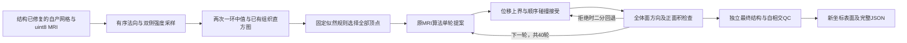
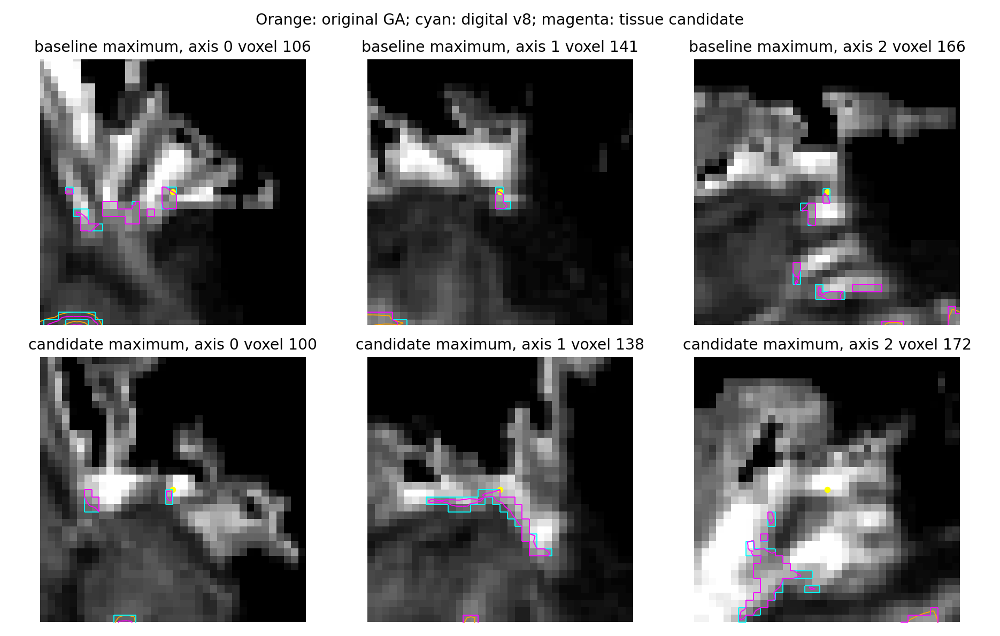

# 组织似然与顺序碰撞的局部表面原语

## 1．功能与流程

`run_tissue_patch()` 在已完成结构修复的表面上，根据同空间自产MRI选择组织匹配较弱的顶点，复用已有组织直方图和完整40轮MRI拟合。独立候选在每轮提案后复用顺序动态碰撞接受，并检查面方向与面积。原版阶段程序不参与计算，没有新增依赖。



这是固定面局部形变原语，尚无动态边重连、体素删填、补片候选搜索和完整代价最小化，**不是完整GA，也未接入生产拓扑**。它用于评估MRI组织证据与安全接受机制；结构通过还须单独评价局部形状及下游指标。已测数字拓扑v8和正在运行的原始T1整例保持各自冻结版本。

## 2．Python调用、全部输入与输出

```python
from fnit.recon_all.topology_tissue_patch_python import run_tissue_patch

report = run_tissue_patch(
    input_surface="frozen_subject/surf/rh.orig.premesh",  # 自产已修复三角表面，surface RAS/mm
    intensity_volume="frozen_subject/mri/brain.mgz",  # 同空间三维uint8归一化MRI
    output_surface="new_diagnosis/rh.tissue-patch",  # 新路径，只替换坐标，保留面序与几何头
    log_shape_prior=0.0,  # 默认0；选择log(p_gray/p_white)>该值的所有顶点
    normal_offset_mm=0.5,  # 默认0.5mm；初次法向两侧采样距离
    require_quality=True,  # 默认True；独立QC失败时不写成功表面并抛异常
    report_path="new_diagnosis/rh.tissue-patch.json",  # 默认None；完整轨迹、SHA与QC
    collision_acceptance="ordered",  # 默认ordered；复用每轮顺序接受，none仅供失败诊断
    step_motion_limit_mm=0.3,  # 默认0.3mm，正且不超过0.3，符合现有碰撞候选边界
)
```

| 输入或参数 | 格式、默认值、空间与限制 |
|---|---|
| `input_surface` | 必填str/Path；nibabel可读三角表面，坐标 `(N,3)`、有序整数面 `(F,3)`，须有体积几何尾部；坐标surface RAS/mm |
| `intensity_volume` | 必填str/Path；MGH/MGZ，三维 `(X,Y,Z)` uint8，归一化MRI强度，不是离散标签；用header与表面几何计算RAS→voxel矩阵 |
| `output_surface` | 必填新str/Path；不得覆盖输入MRI或表面；坐标float32，面和顶点编号、体积几何及文件尾部保持 |
| `log_shape_prior` | float默认0；有限。固定组织似然选择先验；不按被试、坐标、mask、脑区或分支长度筛选 |
| `normal_offset_mm` | float默认0.5；有限且正。只影响初始选择采样；既有MRI拟合内部保留原固定±0.5mm采样 |
| `require_quality` | bool默认True。False只允许保存带 `failed_quality` 的诊断候选，不能用于绕过生产验收 |
| `report_path` | str/Path或None默认None；不得和输入/输出同路径；写JSON，包含失败状态 |
| `collision_acceptance` | str默认ordered；ordered每轮完整查询接受，ordered-active显式只构造实际消费查询行并缓存固定拓扑，none完整执行未受碰撞限制的原40轮提案，仅诊断用 |
| `step_motion_limit_mm` | float默认0.3；须在 `(0,0.3]`。逐顶点截断提案长度，仍使用完整空间候选，无截断候选数量 |

初始采样后，包含自身和完整一环邻居的中值执行两次；这是本实验的明确配方，不能当作原GA所有采样步骤已复现。直方图复用 `first_defect_intensity_histograms()` 的256 bins、原平滑与均值核；选择使用灰质/白质似然比，并在40轮中固定初始直方图。所有未选择顶点固定。碰撞按现有子体积及顶点顺序在即时坐标上接受/拒绝；每轮最后检查所有面相对该轮输入法向的正方向和正面积，失败以同一提案的二分系数回退，最多12次，仍失败则保持整轮输入。

返回dict包含输入/输出与各复用模块SHA、256-bin均值、选择索引SHA及分量、前后强度、位移mean/P99/max、40轮坐标SHA/候选量/接受/回退记录、V/E/F/Euler/闭合/非流形/方向/自相交/面积QC、分步骤和完整I/O/JIT秒。`complete_dynamic_topology_solver=False`、`overall_metric_equivalence="not_assessed"` 保留。

`FixedPatchCollisionCache(faces=..., selected=...)` 独立复用固定面incident CSR；faces为整数 `(F,3)`，selected为bool `(N,)`，复制为不可写数组并绑定SHA。`step(current=..., proposal=..., faces=...)` 要求同一有序面、有限float32 `(N,3)` 坐标，未选择顶点提案保持；网格变化或非法精度立即报错。返回新坐标、原完整顶点顺序与候选/构建/接受计时dict。坐标、全目标面中心/半径、空间树、动态子体积顺序每次重算，缓存不跨坐标版本。查询行只包含选择顶点的incident faces；**所有目标三角面仍保留**，扩展半径、live窄相、共享顶点排除和顺序接受核均复用原函数，没有候选截断。此缓存仅供本候选显式使用，已有white/pial默认接受器不变。

非法路径、参数、图像类型、非有限坐标或缺失几何抛ValueError；输入文件错误传播。最终QC要求单分量、Euler2、闭合、零非流形边/顶点、边方向一致、正面积、有限坐标、独立几何自相交0。严格失败保留JSON、抛RuntimeError，不写成功表面。默认输出是原格式坐标字节更新，不新建占位面或从参考复制。

底层成熟 `defect_mri_match(xyz=..., faces=..., inside_vertices=..., runtime_neighbors=..., volume=..., ras_to_voxel=..., white_mean=..., gray_mean=..., iterations=40, step_acceptor=None)` 保留原默认40轮；数组shape为 `(N,3)/(F,3)/(K,)`，邻居列表与选择顶点一一对应，MRI为uint8，4×4矩阵由surface RAS映射至voxel，均值为原始强度单位。返回float32 `(N,3)`，无文件I/O。新增 `iterations` 为非负整数，0返回副本；可选回调 `(current, proposal, iteration)→float32 accepted` 必须保留shape、固定顶点与有限坐标，否则抛ValueError。默认None继续原完整更新；回调版本是独立候选，不能把其输出标成原40轮逐位复现。

```python
from fnit.recon_all.topology_defect_mri_match import defect_mri_match
from fnit.recon_all.topology_collision_cache_python import FixedPatchCollisionCache

matched_coordinates = defect_mri_match(
    xyz=surface_vertices,  # float32 (N,3)，surface RAS/mm
    faces=surface_triangles,  # 整数 (F,3)，完整有序面
    inside_vertices=selected_vertex_indices,  # 整数 (K,)，仅这些顶点更新
    runtime_neighbors=selected_vertex_neighbor_lists,  # K个按原顺序的一环索引列表
    volume=normalized_brain_volume,  # uint8 (X,Y,Z)，不是分割标签
    ras_to_voxel=surface_RAS_to_voxel_matrix,  # float64 (4,4)，由MRI和表面几何构造
    white_mean=white_histogram_mean,  # 白质直方图均值，MRI强度单位
    gray_mean=gray_histogram_mean,  # 灰质直方图均值，同单位
    iterations=40,  # 原默认完整40轮
    step_acceptor=None,  # 原默认；不插入实验碰撞配方
)

collision_cache = FixedPatchCollisionCache(
    faces=surface_triangles,  # 缓存该完整面序，拓扑变化必须新建
    selected=selected_vertex_mask,  # bool (N,)，固定选择集合
)
accepted_coordinates, vertex_order, diagnostics = collision_cache.step(
    current=surface_vertices,  # 本轮当前float32坐标，不复用旧坐标空间树
    proposal=single_round_proposed_coordinates,  # float32 (N,3)，固定顶点必须不变
    faces=surface_triangles,  # 再次核对面序与缓存绑定
)
```

## 3．CLI与真实复现

```bash
python -m fnit.recon_all.topology_tissue_patch_python \
  --input-surface frozen_subject/surf/rh.orig.premesh \
  --intensity-volume frozen_subject/mri/brain.mgz \
  --output-surface new_diagnosis/rh.tissue-patch \
  --log-shape-prior 0 \
  --normal-offset-mm 0.5 \
  --collision-acceptance ordered \
  --step-motion-limit-mm 0.3 \
  --report-path new_diagnosis/rh.tissue-patch.json
```

参数同Python表；CLI报告路径必填。`--allow-failed-diagnostic-output` 显式允许保存失败诊断，必须读取报告的 `execution_status/mesh_quality_status`，不能把该诊断命令退出0解释为结构通过。

`tools/benchmark_topology_tissue_patch.py` 用具名 `--input-surface/--intensity-volume/--reference-python/--output-dir/--log-shape-prior/--normal-offset-mm/--step-motion-limit-mm/--collision-acceptance`。输出目录必须不存在。reference-python只读冻结的旧FNIT原语源码，用于同输入兼容诊断，不是原版GA命令或生产参考输入。依次运行旧40轮、新默认40轮、40次identity回调及旧重复；三项逐元素比较全零后才运行独立碰撞候选。`--compatibility-only` 只完成该兼容门；`--probe-query-cache` 另做同一真实首轮提案的完整query/active-query ABBA，逐元素和顺序全同后才继续。输出完整JSON、坐标SHA与新表面；这不是原始T1整例。

事后形状脚本 `tools/diagnose_topology_tissue_patch_shapes.py` 只读候选、数字拓扑和GA参考及真实T1；参考仅用于诊断。参数全部必填：`--candidate-surface` 为新坐标表面；`--baseline-surface` 为同有序网格的数字拓扑原表面；`--GA-reference-surface` 为只读完整GA几何；`--T1-volume` 为同空间MGH/MGZ；`--surface-distance-module` 为固定的完整三角面距离实现；`--baseline-distance-checkpoint` 为已完成双向距离float64 NPZ，含forward/reverse全部顶点；`--baseline-distance-report` 为绑定两个源表面和距离模块SHA的完成JSON；`--output-dir` 为不存在的新目录。输入/参考三角面不同不能做同索引GA比较。输出JSON、完整双向距离NPZ及三面T1叠加PNG，坐标surface RAS/mm，经T1 `vox2ras_tkr` 逆矩阵转到体素截面；空间/网格、源SHA或检查点指标不符即报错。

```python
import subprocess
import sys

subprocess.run(
    args=[
        sys.executable,  # 当前验证环境，不启动原软件程序
        "tools/diagnose_topology_tissue_patch_shapes.py",
        "--candidate-surface", "new_diagnosis/rh.tissue-patch",  # 本候选输出
        "--baseline-surface", "frozen_subject/surf/rh.digital.premesh",  # 候选输入，面序相同
        "--GA-reference-surface", "benchmark_reference/surf/rh.orig.premesh",  # 仅诊断参考
        "--T1-volume", "frozen_subject/mri/T1.mgz",  # 同空间真实MRI
        "--surface-distance-module", "validation/recon_all/accuracy_20261003/task_04/reference_surface_distance.py",  # 固定完整距离核
        "--baseline-distance-checkpoint", "completed_baseline/rh.distances.npz",  # 已算全部顶点的双向数组
        "--baseline-distance-report", "completed_baseline/report.json",  # 源表面/模块SHA及指标绑定
        "--output-dir", "new_diagnosis/rh-shape",  # 不覆盖旧报告
    ],
    check=True,  # 失败传播，不把缺失图当完成
)
```

全目标GA面不变时，仅复用源坐标完全未改变的已完成精确距离；所有已改变源顶点重新完整三角面搜索。反向GA→新候选对全部源顶点计算，仅完全等于实际目标面使用顶点的坐标能证明零距离。旧检查点shape、数值和绑定JSON全部核对；这不是最近顶点替代完整距离。

## 4．原软件内部步骤

复用的MRI原语对应固定FreeSurfer拓扑代码内部 `defectMaximizeLikelihood_new`，没有独立官方CLI。原软件整个流程由 `mris_fix_topology -ga` 执行，包含本原语之外的缺陷搜索、补片、边选择及遗传优化。本候选以自产修复表面为输入，新增全表面似然选择和碰撞接受，**没有等价单条官方命令**。不能将40轮形变与完整原GA修复混称。

## 5．最新真实精度、耗时与脑图

首个未加顺序接受的冻结原语（源码SHA `4ee15b5e4ac3f564a815e71c969f3a0666e7182c0d6d3b82cfe74712e9e4c61e`）在公开ds000114 sub-07 RH实际执行40轮。输入为FNIT79a41cdd自产brain.mgz和数字拓扑v8新orig.premesh；不读取原GA结果来计算。选择10,256顶点、352分量，白质/灰质直方图均值90.7129/73.2551；未选择坐标全部保持。

结果 **失败**：1,971相交面，位移mean/P99/max为0.111854/2.264250/4.829220mm；不能进入生产。采样/直方图9.215s、完整40轮拟合1.682s、独立QC53.631s、文件API64.564s（含I/O及JIT）。显式失败诊断保存命令退出0，但报告为 `failed_quality`；完整代价求解及指标等效没有通过。

[完整初次失败收据](../../validation/recon_all/optimizations/20261010_topology_tissue_patch/initial_failed_v2/sub07_rh.report.json)保留实际模块、输入和输出SHA、数值与计时。原冻结源码保留在服务器独立workspace；[重建补丁](../../validation/recon_all/optimizations/20261010_topology_tissue_patch/initial_failed_v2/reconstruct_initial_source.patch)将当前候选模块恢复为该初版，可检查SHA。不覆盖失败版本或改标为当前回归。

默认40轮接口的真实同输入兼容已完成：旧源码 `27ebaa65…`、新默认 `64cfcb38…`、40次identity回调及旧重复四组坐标SHA全为 `ebf1d660…`，所有不同坐标数、mean/P99/max均0。冷旧/新1.814563/1.773708s，热回调/旧重复0.761005/0.681518s；读取、选择、四次完整拟合及JIT合计15.259556s。这只是兼容与重复性，不由冷热差宣布加速，也不是完整GA的官方重复性证明。CPU8–11、单线程、CUDA隐藏；[完整兼容收据](../../validation/recon_all/optimizations/20261010_topology_tissue_patch/completed_stage_receipts_v1/default_real_compatibility.json)。

真实首轮完整顺序接受ABBA已完成：完整query 5.965/6.061s，active-query 1.070/1.050s；四次坐标SHA相同、完整更新顺序相同、不同坐标0。实际热点是候选构建5.489/5.605s，减少未消费查询后0.620/0.617s；顺序窄相约0.25s保持。查询面234,272→25,029、候选57,107,892→5,614,331，但目标面全部234,272仍参与空间查询。这是同一真实提案的一步API约5.7倍观察，**不是40轮或整例提速**；[ABBA全收据](../../validation/recon_all/optimizations/20261010_topology_tissue_patch/completed_stage_receipts_v1/active_query_real_ABBA.json)。

首侧完整40轮两条路径现已完成：每轮MRI提案SHA、接受坐标SHA、261次回退的面拒绝和顶点决策全同，最终坐标、有序面和完整文件SHA相同。两者独立QC均为单分量、Euler2、闭合、零非流形、正面积、零相交；未选择顶点保持。相对输入数字拓扑的位移mean/P99/max为0.054977/1.006548/1.300227mm。**结构通过不表示已解决原GA的局部形状差或整体指标等效。**

| 首侧完整阶段边界 | 完整query | active-query |
|---|---:|---:|
| 固定缓存准备、完整40轮MRI提案、空间候选、顺序接受与261次回退 | 1082.268s | 201.817s |
| 文件API，包括MRI读取、采样、JIT、40轮、独立QC及写出 | 1140.677s | 260.329s |
| 验证驱动，另含旧/新兼容和可选首轮ABBA | 1154.628s | 289.282s |

文件API单对观察约4.38倍；两次启动时间不同、在共享CPU上运行，**不是完整阶段ABBA、独占吞吐或recon-all整例提速**。完整query的首次顺序窄相还包含JIT，不能把所有差别都归因查询数。CPU12–15及8–11各固定4线程、CUDA隐藏。[完整逐轮比较](../../validation/recon_all/optimizations/20261010_topology_tissue_patch/completed_full40_v1/full40_comparison.json)、[完整query报告](../../validation/recon_all/optimizations/20261010_topology_tissue_patch/completed_full40_v1/complete40_v3.json)和[active-query报告](../../validation/recon_all/optimizations/20261010_topology_tissue_patch/completed_full40_v1/complete40_v4.json)保留所有数值及SHA。

七项契约在同Conda环境9.518s通过；最终八项在9.142s全部通过，包含“未查询目标面仍能拒绝相交”、固定顶点/回调精度/完整轮数、面反转恢复、active/full一致和网格变化缓存失效。实际源码/环境/runner见[绑定收据](../../validation/recon_all/optimizations/20261010_topology_tissue_patch/completed_stage_receipts_v1/runtime_source_binding.json)和[四侧最终汇总](../../validation/recon_all/optimizations/20261010_topology_tissue_patch/completed_four_cases_v1/summary.json)；这是带逐文件SHA的来源明确复制+覆盖snapshot，不把工作目录标签冒充精确Git archive。此步骤没有GPU显存测量，不代表零显存或600s整例达标；物理隔离环境未验证。

四侧active-query完整40轮现均已完成，全部结构QC通过：单分量、Euler2、闭合、零非流形边/顶点、边方向一致、正面积、独立自相交0、固定顶点未移动。都使用先验0、采样0.5mm、单步上界0.3mm。sub-07 RH为先前冻结完成结果，其余三侧为新独立文件API回归；**不是四侧原始T1整例**。

| 实际侧 | 选择顶点 | 回退尝试 | 40轮及缓存/接受 | 完整文件API | 位移mean/P99/max，mm |
|---|---:|---:|---:|---:|---|
| sub-06 LH | 13,845 | 278 | 293.773s | 356.377s | 0.066147 / 1.041023 / 1.305816 |
| sub-06 RH | 15,641 | 268 | 306.304s | 367.063s | 0.072862 / 1.052116 / 1.320198 |
| sub-07 LH | 11,299 | 286 | 230.382s | 290.536s | 0.061409 / 1.021839 / 1.271727 |
| sub-07 RH | 10,256 | 261 | 201.817s | 260.329s | 0.054977 / 1.006548 / 1.300227 |

汇总逐项绑定输入、输出、当前实际源模块和原参考源码SHA。四侧源/GA表面头与T1的维度、间距、方向和中心已核对，中心差最大3.56e-15mm；图使用同一conformed网格。最后汇总的第一次导出因控制脚本预先mkdir目标目录，被保真导出器拒绝；保留原错误，仅在新目录重导出既有数值，没有重跑或修改生产/候选。这属于收据控制问题，不是算法或整例失败。

触发该工作的真实T1局部三面图和全部三角面距离见[数字拓扑局部归因](TOPOLOGY_VOLUME_PYTHON.md#最大局部差异的只读归因)。图中12–14mm差别不是尾差，结构QC通过也不能替代这些形状检查：


首侧新候选的完整形状诊断已完成，包含117,138个候选顶点和109,517个GA顶点，不声称两种网格同索引对应：

| sub-07 RH，全部源点到全部目标三角面/mm | 数字拓扑v8 mean/P99/max | 组织候选 mean/P99/max |
|---|---|---|
| 自产→原GA | 0.550286 / 7.326376 / 13.532159 | 0.550605 / 7.530901 / 13.112749 |
| 原GA→自产 | 0.199220 / 0.595219 / 0.999998 | 0.216197 / 0.639506 / 1.332121 |

原最大分支点由13.532降至12.614mm，但新的最大点是本规则未选择的原顶点，仍为13.113mm；mean/P99及反向距离增大。**该局部原语没有证明改善整体形状，不接入生产拓扑。** 尚缺动态边重连、删填和完整补片代价求解，不能把相交0当作算法完成。[完整形状报告](../../validation/recon_all/optimizations/20261010_topology_tissue_patch/shape_diagnosis_v1/sub07_rh.json)保留全部指标、检查点和源哈希。图中橙色为原GA，青色为数字拓扑v8，品红为组织候选；黄色为最大差异位置：



其余三侧的完整三角面诊断也已结束，四侧反向mean/P99均增大；局部最大改善不能代替整体形状检查：

| 侧 | 候选→GA mean/P99/max，mm | GA→候选 mean/P99/max，mm |
|---|---|---|
| sub-06 LH | 0.450658 / 2.176172 / 7.305296 | 0.224157 / 0.688734 / 1.915834 |
| sub-06 RH | 0.425478 / 1.515615 / 3.584868 | 0.228898 / 0.735862 / 2.236831 |
| sub-07 LH | 0.492060 / 3.749891 / 12.341184 | 0.216192 / 0.673471 / 1.538620 |
| sub-07 RH | 0.550605 / 7.530901 / 13.112749 | 0.216197 / 0.639506 / 1.332121 |

[完整四侧报告](../../validation/recon_all/optimizations/20261010_topology_tissue_patch/completed_four_cases_v1/summary.json)同时保留原v8双向指标、全部源点评估证明和每侧脑图：[sub-06 LH](../../validation/recon_all/optimizations/20261010_topology_tissue_patch/completed_four_cases_v1/sub06_lh.local_shape.png)、[sub-06 RH](../../validation/recon_all/optimizations/20261010_topology_tissue_patch/completed_four_cases_v1/sub06_rh.local_shape.png)、[sub-07 LH](../../validation/recon_all/optimizations/20261010_topology_tissue_patch/completed_four_cases_v1/sub07_lh.local_shape.png)、[sub-07 RH](../../validation/recon_all/optimizations/20261010_topology_tissue_patch/completed_four_cases_v1/sub07_rh.local_shape.png)。原始完整距离NPZ及失败/完成运行保留服务器，仅公开脱敏数值和已授权公开T1的派生图。

## 6．更新和验证记录

2026-10-10初版：复用完整直方图/MRI核，三个接口契约通过；真实首侧40轮产生1,971相交面，保留失败报告。最初启动脚本曾把taskset参数写为 `-c12-15`，控制命令修为 `-c 12-15` 后在新目录重新运行，算法和参数未变；启动失败不算MRI运行结果。

独立候选：成熟MRI函数新增默认兼容的迭代数/接受回调，空选择邻居不再因max空数组报错；原40轮默认未改。新增位移边界、固定顶点、回调精度、完整轮数及面反转拒绝契约；完整query仍按旧默认，active-query另为显式候选。真实默认兼容、一步ABBA、首侧完整40轮逐轮及文件全同、两例四侧结构QC和完整双向三角面/T1评价已完成。形状没有证明全面改善，完整动态拓扑尚缺；所有变更仅实验入口，生产v8和冻结原始T1链不受影响。

## 7．源码与参考

- [原FreeSurfer固定拓扑源码](https://github.com/freesurfer/freesurfer/tree/d932c45b7941662ea380a05efef580568b98d41a/mris_fix_topology)。
- Ségonne F, Pacheco J, Fischl B. Geometrically accurate topology-correction of cortical surfaces using nonseparating loops. *IEEE Transactions on Medical Imaging*. 2007;26:518–529. [DOI](https://doi.org/10.1109/TMI.2006.887364)。本实验不声称完整实现论文算法。
- [自有组织原语](../../src/fnit/recon_all/topology_tissue_patch_python.py)、[已有直方图](../../src/fnit/recon_all/topology_intensity_histogram.py)、[已有MRI拟合](../../src/fnit/recon_all/topology_defect_mri_match.py)、[顺序动态碰撞](../../src/fnit/recon_all/place_surface_collision.py)。
