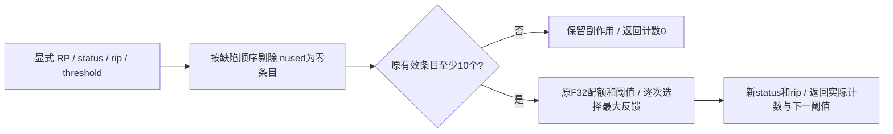

# GA 最差顶点剔除

## 1．功能简介

`eliminate_worst_vertices` 用独立 NumPy 处理拓扑 GA 的缺陷条目和
rip 状态，复用已有 RP 统计的完整输入。原函数的静态阈值改成显式
输入／输出，控制器负责跨调用传递。当前为独立候选，不接生产默认。

它保留原函数三个影响搜索顺序的细节：不足十个有效条目时，返回数
为零，但已经剔除的未使用条目仍生效；停止条件比较条目索引与阈值；
源 float32(0.1) 大于 double 0.1，也会将阈值减半。这里只迁移固定
算法，不将这些行为更改为另一套搜索规则。



## 2．Python 调用与完整输入输出

```python
import numpy as np
from fnit.recon_all.topology_vertex_elimination import eliminate_worst_vertices

# 使用FNIT自产检查点；完整控制器必须传递此前调用的threshold。
defect_state = np.load(file="fnit_defect_state.npz", allow_pickle=False)
elimination_result = eliminate_worst_vertices(
    discarded_defect_vertices=defect_state["discarded"],  # bool(K,)原DISCARD状态
    translated_defect_vertices=defect_state["mapping"],  # 整数(K,)到当前网格映射
    vertex_rip=defect_state["rip"],  # int32(N,)已解码的signed-char值
    use_counts=defect_state["use_counts"],  # int32(K,)RP使用计数
    vertex_fitness=defect_state["vertex_fitness"],  # float32(K,)RP反馈运行均值
    fraction=float(defect_state["fraction"]),  # [0,1]，进入源float32字段
    deletion_count=int(defect_state["deletion_count"]),  # 原计数；<=0改为1
    threshold=defect_state["threshold"],  # 首次4；以后传递函数返回值
)
next_threshold = elimination_result["threshold"]  # 保存后供下一调用/下一个缺陷使用
```

| 输入 | 格式和含义 |
| --- | --- |
| `discarded_defect_vertices` | bool `(K,)`，原缺陷顺序，True 表示 DISCARD |
| `translated_defect_vertices` | 整数 `(K,)`，映射到同一当前网格；DISCARD 的负映射不会查询 |
| `vertex_rip` | int32 `(N,)`，完整网格 rip 的 signed 8 bit 解码值 `[-128,127]` |
| `use_counts` | 非负 int32 `(K,)`，RP.nused；不是全局候选数量 |
| `vertex_fitness` | 有限 float32 `(K,)`，RP 顶点反馈，不是候选 double fitness |
| `fraction` | 有限 `[0,1]` 实数，先写 float32，再按源表达式计算配额和与 double 0.1 比较 |
| `deletion_count` | int32 范围整数，非正改为 1；写 rip 时按固定参考的 signed char 存储 |
| `threshold` | 非负有限 float32 标量，初始 4；跨调用传递，无隐式静态全局变量 |

返回字典逐项为：

- `discarded_defect_vertices`：新 bool `(K,)`；保持先前 DISCARD 状态。
- `vertex_rip`：新 int32 `(N,)`；只有被剔除条目的映射位置改写。
- `threshold`：float32 下一阈值，控制器须保存。
- `source_reported_deleted`：原函数返回的整数；小缺陷分支可能为零而已有副作用。
- `unused_deleted_entries` / `fitness_deleted_entries`：int64 `(U,)` / `(W,)` 原缺陷序号，分别列出未使用剔除与反馈剔除顺序。
- `effective_deletion_count` / `stored_rip_value`：实际正计数与 signed-char 存储值。

所有参数必填，没有设备、线程、阈值或概率默认。所有数组使用同一个
原缺陷顺序与网格编号域，无坐标或物理单位。输入不修改，RP计数和
反馈不修改。无效 dtype、形状、活动负映射、非有限值或越界参数抛
`ValueError`；失败时输入及调用方阈值不变。不改变 CUDA/TF32/线程，
不启用半精度，不执行或链接原版程序。

## 3．命令行

这是 GA 内部数组 API，无独立生产 CLI。本地合同：

```bash
PYTHONPATH=src python -m unittest discover \
  -s tests/recon_all \
  -p 'test_topology_vertex_elimination.py' \
  -v
```

## 4．原软件调用

对应固定 d932 `mrisurf_defect.cpp` 的 `deleteWorstVertices`，属于
`mris_fix_topology -ga` 内部步骤，没有单独官方命令。整步参考命令：

```bash
mris_fix_topology -ga -seed 1234 -threads 4 reference_subject lh
```

固定参考生成头文件的 VERTEX.ripflag 是 plain char；已核编译器为
8 bit signed char，未设置 unsigned-char 编译选项。函数保存其数值
语义；没有将 rip 字段改为永不截断的 int 计数。

## 5．当前精度与耗时

七项本地状态合同通过，覆盖阈值跨调用传递、float32/double 比较、
返回计数与副作用、原配额、索引停止规则、同分顺序、signed-char
存储、负映射跳过、重复映射和失败事务。它们不是影像 benchmark。

完整 GA 真实剔除 before/after 捕获、参考重复性、当前算子误差及耗时
尚未验证；没有公开脑图、官方速度比或整例提速结论。严格真实复现
和整体指标等效为 `not_assessed`。CPU数组接口未初始化CUDA；显存
没有采样，不能宣称零显存。没有新增 Conda 依赖或新的隔离安装验收。

## 6．版本与记录

2026-10-10：新增完整独立剔除算子，静态阈值显式化，保留源返回值
与副作用的区别；仅作为完整 GA 的候选组件，不改变生产默认或QC门。

## 7．参考文献与源码

- [固定原函数](https://github.com/freesurfer/freesurfer/blob/d932c45b7941662ea380a05efef580568b98d41a/utils/mrisurf_defect.cpp#L5206-L5287)。
- [独立实现](../../src/fnit/recon_all/topology_vertex_elimination.py)。
- [RP统计组件](../../src/fnit/recon_all/topology_candidate_statistics.py)。
- Fischl B, Liu A, Dale AM. Automated manifold surgery. IEEE TMI, 2001.
  [DOI](https://doi.org/10.1109/42.906426)。
