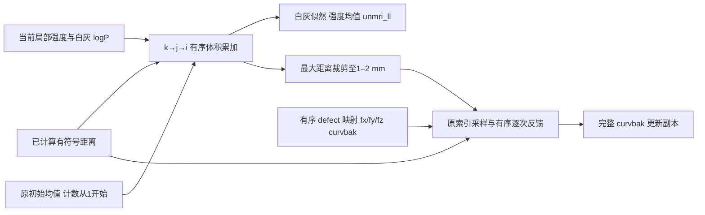
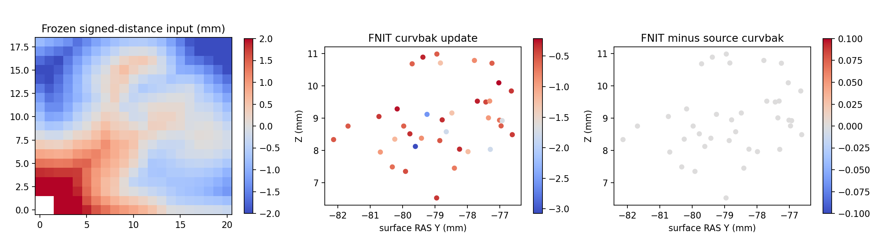

# 拓扑缺陷 unMRI：体积聚合与顶点反馈

## 1．功能

`defect_volume_likelihood()` 用自有 Python/Numba 完整计算固定拓扑算法的 unMRI 体积聚合和 `curvbak` 反馈。输入包括当前候选的局部组织强度、已计算的有符号距离、白/灰组织 logP、初始均值及有序顶点状态；输出源 float32 似然、均值、计数与更新后的顶点字段。函数没有原版程序或二进制回退。

距离场生成是此前的独立内部步骤，本函数不生成距离、不更新网格、不执行种群搜索。首次缺陷的同输入聚合通过，不等于动态候选评分、完整 GA 或原始 T1 重建通过。



## 2．Python 调用、输入与输出

```python
from fnit.recon_all.topology_defect_volume_likelihood import defect_volume_likelihood

volume_result = defect_volume_likelihood(
    defect_intensity_volume=current_defect_intensity,  # uint8(X,Y,Z)，局部强度，0不计入聚合
    signed_distance_mm=current_signed_distance,       # float32(X,Y,Z)，当前候选有符号距离/mm
    white_log_probability=current_white_log_probability,  # 同网格 float32，已经求log的白质概率
    gray_log_probability=current_gray_log_probability,    # 同网格 float32，已经求log的灰质概率
    initial_white_mean_log_probability=white_initial_log_mean,  # 原 defect 白质初始logP均值
    initial_gray_mean_log_probability=gray_initial_log_mean,    # 原 defect 灰质初始logP均值
    initial_white_mean_intensity=white_initial_intensity_mean,  # 原 defect 白质初始强度均值
    initial_gray_mean_intensity=gray_initial_intensity_mean,    # 原 defect 灰质初始强度均值
    volume_origin_mm=local_volume_origin,              # float32(3,)，源xstart/ystart/zstart，mm
    volume_index_scale_per_mm=local_volume_index_scale, # 正float32(3,)，源xsize/ysize/zsize，mm⁻¹
    vertex_sampling_positions_mm=current_sampling_positions,  # float32(N,3)，原fx/fy/fz，surface RAS/mm
    initial_vertex_curvbak=current_vertex_curvbak,       # float32(N,)，同一状态的待更新标量字段
    translated_defect_vertices=ordered_translated_indices,  # 整数(K,)，原vertex_trans后的索引，保留重复
    discarded_defect_vertices=original_discard_status,   # bool(K,)，仅原status==DISCARD_VERTEX
    distance_unset_sentinel_mm=1000.0,                   # 固定源NPY，精确相等判定，不是距离阈值
)
updated_vertex_curvbak = volume_result["vertex_curvbak"]  # 副本；调用者按正确候选状态显式写回
```

| 输入 | 结构、空间与规则 |
| --- | --- |
| `defect_intensity_volume` | 三维 uint8，轴顺序 XYZ，非空尺寸；0只在体积累加中跳过，不改变顶点采样规则。 |
| `signed_distance_mm` | 同网格 float32，有符号距离/mm。固定源 NPY 表示未处理体素，不改为 NaN 或任意近似阈值。 |
| `white_log_probability` / `gray_log_probability` | 同网格有限 float32，已经是 logP；函数不再次求 log、不重新估计概率。 |
| 四个 `initial_*` | 有限标量，按原字段转 float32；组织计数从1开始，对应初始均值这个观测。 |
| `volume_origin_mm` | 有限 float32(3,)，局部体积坐标起点；不是主MRI的 scanner affine。 |
| `volume_index_scale_per_mm` | 正 float32(3,)，源局部采样频率。`iVOL=int(float32((fx-xstart)*xsize)+0.5)`，加0.5后向零截断；不能改成间距除法或对称 nint。 |
| `vertex_sampling_positions_mm` | 完整同序 float32(N,3)，原 fx/fy/fz；不是自动用 origXYZ 或当前XYZ替代。 |
| `initial_vertex_curvbak` | 有限 float32(N,)；反馈是无量纲乘法，返回字段继承输入的意义与单位，不将其改名为厚度或曲率输出。 |
| `translated_defect_vertices` | 完整有序整数(K,)；允许同一译后顶点重复，按原遍历逐次相乘。 |
| `discarded_defect_vertices` | bool(K,)，仅表示源状态 `DISCARD_VERTEX=1`；其余状态保留，不等同于只选择 `KEEP_VERTEX=0`。丢弃条目的译后索引不被消费。 |
| `distance_unset_sentinel_mm` | 固定本版原 NPY=1000.0，调用者显式提供匹配版本的值。聚合遇到哨兵跳过；反馈遇到哨兵乘1。 |

三体素边界不参加累加；分类严格为距离 `>0.5` 和 `<−0.5` mm，恰等于边界的体素仍参与最大距离计算。最大绝对距离按原规则裁剪到1–2 mm。没有算法、设备、精度、随机种子或迭代开关；有序 float32 计算复用现有 Numba，无新依赖。

| 返回项 | 类型、含义 |
| --- | --- |
| `white_ll` / `gray_ll` | 源 float32 白/灰 logP 平均后转 Python float。 |
| `white_mean_intensity` / `gray_mean_intensity` | 源 float32 强度均值后转 Python float。 |
| `nwhite` / `ngray` | Python int，含初始观测；各至少为1。 |
| `max_distance_mm` | 原裁剪后的 float32 最大距离，mm。 |
| `raw_max_distance_mm` | 裁剪前最大绝对距离，额外诊断项；原参考未单独保存该值。 |
| `unmri_ll` | 原 float32 白灰均值之和，写回 TP 的值；不是每体素 logP 总和。 |
| `vertex_curvbak` | float32(N,) 完整副本，保留未更新条目；不修改输入数组。 |
| `scope` | 明确只有体积聚合/反馈，不包括距离场与完整GA。 |

非法 dtype、shape、非有限字段、非正索引比例、状态或有效映射越界抛 `ValueError`；非有限输出抛 `FloatingPointError`。顶点采样落在局部体积之外按原规则保留字段。函数不读写文件、不查原版安装、不读 benchmark 或参考文件；所有几何、体素、概率与映射必须属于同一个当前候选，不能跨动态 patch 缓存。

## 3．命令行

生产内部算子没有独立 CLI。可复现的冻结同输入诊断为：

```bash
python tools/benchmark_recon_topology_volume_likelihood.py \
  --capture isolated_reference/first.volume.bin \
  --native-repeat isolated_reference/repeated.volume.bin \
  --observer-receipt isolated_reference/build.public.json \
  --output isolated_diagnosis/volume_likelihood \
  --threads 4
```

`capture` 和 `native-repeat` 为真实首次 unMRI 调用中距离计算后的完整 FNITVOL1 快照；只供隔离 benchmark。`observer-receipt` 绑定固定源码、独立编译程序和观察器；`output` 必须不存在，保存数值 JSON、私有 NPZ 和授权公开影像的衍生 PNG。`threads` 默认4，复用已有线程预算作用域并恢复父设置。原始影像、参考体积和 NPZ 不发布。

## 4．原软件调用

对应固定 `d932c45b7941662ea380a05efef580568b98d41a` 的 `mrisComputeDefectMRILogUnlikelihood_wkr` 中体积聚合/反馈部分（约3021–3122行）。该函数属于 `mris_fix_topology` 内部步骤，没有独立原软件 CLI。隔离参考由固定源码 Conda 编译并加入只读观察器，在首次 unMRI 聚合后停止、未进入后续 GA：

```bash
mris_fix_topology_volume_observer \
  -threads 4 -mgz \
  -sphere qsphere.nofix -inflated inflated.nofix \
  -orig orig.nofix -out diagnostic.orig.premesh \
  -ga -seed 1234 subject lh
```

该命令只用于 benchmark。生产函数独立计算，不包装此程序。距离生成的前一内部段仍需独立转写与真实验证。

## 5．当前真实精度、时间与图示

2026-10-10，公开 `ds000114 sub-07 ses-test` 左半球，输入由 `79a41cdd` 原始 T1 连续链生成。本轮冻结首次缺陷的完整算子输入：110,534 顶点、67个缺陷条目、21×19×16局部体积。这是当前同输入阶段实测，不是新的原始T1整例。

| 原字段 | 自有/固定源码共同值 | 不同数、最大/P99误差 |
| --- | ---: | ---: |
| 白质 logP 平均 | −3.341054677963257 | 0、0/0 |
| 灰质 logP 平均 | −3.597097873687744 | 0、0/0 |
| 白质强度平均 | 92.74803161621094 | 0、0/0 |
| 灰质强度平均 | 53.91633224487305 | 0、0/0 |
| 最大距离 | 2.0 mm | 0、0/0 |
| `unmri_ll` | −6.938152313232422 | 0、0/0 |
| 白/灰计数 | 579 / 661 | 0、0/0 |
| 完整 `curvbak` | 110,534 个字段；38个实际发生更新 | 0、0/0 |

两个独立参考进程的完整 FNITVOL1 SHA相同；自有函数两次完整返回与全 curvbak 也相同。7项合同覆盖有序 float32、计数初值、哨兵、三体素边界、±0.5 mm、最大距离裁剪、原索引乘法、重复映射、丢弃条目和输入不变。实际源码 SHA、逐字段结构/SHA及原始/公开收据见[完整报告](../../validation/recon_all/optimizations/20261010_topology_volume_likelihood/README.md)。

同主机、总4线程：完整 API 热重复0.001911秒；第一次 API 为0.210241秒，复用先前合同缓存。包含快照加载、校验、两次API、私有 NPZ写出与哈希为1.148384秒；绘图含导入/写出2.246772秒。工具入口墙钟7.008993秒，未含先前解释器/bootstrap及最后 JSON写出。原参考两次6.723703/5.090987秒包含上游距离、几何准备、观察器写出，未单独计时本聚合，不能据此计算提速倍数。参考CPU8–11、候选100–103，共享负载未排除。这里不使用GPU，显存字段为不可适用/null；没有整例提速或整体指标等效结论。



左图为冻结参考输入的有符号距离，不能解释为自有距离核输出；中图为自有字段更新，右图为同索引全零误差。所有脑图来自已授权公开影像衍生状态。

## 6．更新与 benchmark

- 2026-10-10：新增完整有序聚合与 curvbak 反馈，首个真实 unMRI 八字段及全状态逐位通过，双方重复性通过。
- 首次部署只在收据生成时用了错误的 companion parser 路径，测试/benchmark未启动；原失败目录和数值摘要保留，新 v2 目录核验自己的已上传解析器后完成，算法不变。
- 本模块尚未接生产 GA，不修改数字拓扑或原流程默认；动态 mutation 后的缺陷、第二例、完整距离内核和完整 GA仍未验证。

## 7．参考文献、代码与许可

- [固定 unMRI 原内部源码](https://github.com/freesurfer/freesurfer/blob/d932c45b7941662ea380a05efef580568b98d41a/utils/mrisurf_defect.cpp#L3021-L3122)。
- [固定局部体积索引规则](https://github.com/freesurfer/freesurfer/blob/d932c45b7941662ea380a05efef580568b98d41a/include/mrisurf_metricProperties.h)。
- [固定缺陷状态](https://github.com/freesurfer/freesurfer/blob/d932c45b7941662ea380a05efef580568b98d41a/utils/mrisurf_defect.h)。
- Ségonne F, Pacheco J, Fischl B. Geometrically accurate topology-correction of cortical surfaces using nonseparating loops. IEEE TMI. 2007;26:518–529. [DOI](https://doi.org/10.1109/TMI.2006.887364)。
- 来源通知见 [FreeSurfer.txt](../../licenses/FreeSurfer.txt) 和 [THIRD_PARTY_NOTICES.md](../../THIRD_PARTY_NOTICES.md)。公开载荷不含原 `.cpp`、参考程序、MRI或私有NPZ。
