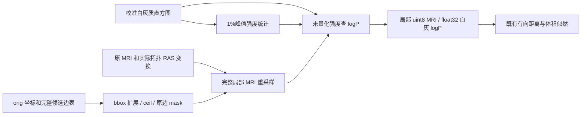

# 拓扑缺陷的局部 MRI 与白灰质概率场准备

## 1．功能

`defect_volume_priors()` 从原 MRI、当前原坐标和完整候选边表生成局部缺陷强度图与白灰质 log 概率图。使用自有 NumPy/Numba，复用项目已验证的拓扑 RAS 采样器；不运行原版阶段程序，不读取参考局部卷或概率图。



对应标准 GA 的 `type=0` 路径。校准直方图是显式阶段输入，其生成可复用已有 `first_defect_intensity_histograms()`；本函数不再重复直方图收集、表面预处理或完整 GA 控制器。其他 `topo_fixer type=1` 对比度代价未纳入此接口。

## 2．Python 调用、输入与输出

```python
from fnit.recon_all.topology_defect_volume_priors import defect_volume_priors
from fnit.recon_all.topology_edge_mri_score import source_topology_ras_to_voxel

topology_transform = source_topology_ras_to_voxel(
    volume_header=brain_image.header,  # nibabel MGHHeader，来自当前自产 brain MRI
)
local_fields = defect_volume_priors(
    original_vertices=original_surface_coordinates,  # float32(N,3)，orig surface RAS，mm
    candidate_edges=complete_candidate_edge_vertices, # 整数(E,2)，完整 potential EDGE 原次序
    volume=original_brain_array,                    # uint8(X,Y,Z)，原 MRI 网格、0…255强度
    ras_to_voxel=topology_transform,                # float32(4,4)，surface RAS→连续 MRI 体素
    white_histogram_bins=calibrated_white_bins,     # float32(B,)，白质校准 bin 中心
    white_histogram_counts=calibrated_white_pdf,    # float32(B,)，正值校准概率
    white_histogram_bin_size=white_bin_width,       # 非负 scalar，原 bin_size，允许元数据0
    gray_histogram_bins=calibrated_gray_bins,       # float32(B,)，灰质校准 bin 中心
    gray_histogram_counts=calibrated_gray_pdf,      # float32(B,)，正值校准概率
    gray_histogram_bin_size=gray_bin_width,         # 非负 scalar，原 bin_size，允许元数据0
    volume_resolution=-1,                         # 默认-1取源 scale=2；正数为mm⁻¹乘数
)
local_intensity = local_fields["defect_intensity_volume"]  # 自产局部 uint8 强度，不是参考卷
```

全部参数除 `volume_resolution=-1` 外必填。`candidate_edges` 需要创建局部卷时的完整候选边表，不是选中 patch 的三角面边。坐标须同一实际版本，不能把候选拟合后的坐标当作准备时原坐标。

校准 bins、counts 各至少256项，与源强度查表规则匹配；counts 须有限且为正，bin_size允许为0。真实源直方图即存在0的元数据，此时保持原 bins，不根据相邻 bins 重建间距。统计先将 `bins - bin_size/2` 写回 float32，再按峰值1%筛选、原次序累计均值和方差；初始 mean log 概率按源半分离零舍入查表。均值须在原 uint8 强度范围内。

返回字典：

| 字段 | 结构、单位和含义 |
| --- | --- |
| `defect_intensity_volume` | `(W,H,D)` uint8；完整局部 MRI 插值后向零截断。 |
| `initial_edge_mask` | 同 shape uint8 0/1；原候选边采样后的初始 mask。后续完整 MRI 重采样覆盖每个体素，不依 mask 跳过。 |
| `white_log_probability`、`gray_log_probability` | 同 shape float32；基于量化前 double 插值强度的自然 log 概率，无量纲。 |
| `volume_origin_mm` | `(3,)` float32；算法实际 `mri_defect` 的 start，surface RAS/mm。 |
| `volume_index_scale_per_mm` | `(3,)` float32；同尺度，坐标到索引乘数 mm⁻¹，不是普通影像 spacing。 |
| `volume_shape` | 三个 Python int，XYZ 顺序。 |
| `bounding_end_mm` | `(3,)` float32；候选边两端包围盒扩展1mm后的最大坐标。 |
| `algorithm_volume_geometry` | `(9,)` float32；原 start、scale、MRIalloc 的 end 元数据，保持与源算法记录一致。 |
| `white_mean`、`gray_mean` | Python float，源 float32 均值，原0…255强度单位。 |
| `white_variance`、`gray_variance` | Python float，源 float32 方差，强度单位平方。 |
| `initial_white_mean_log_probability`、`initial_gray_mean_log_probability` | Python float，源 float32 初始 logP，无量纲。 |
| `scope` | 当前完整准备范围，不表示直方图生成或完整 GA。 |

函数不修改输入、线程、GPU精度或设备，不写文件。非法 dtype/shape、索引、非有限几何、非正 PDF/scale、越界校准均值在采样前抛 `ValueError`；非有限概率场抛 `FloatingPointError`。边 mask 保留源 x-only 迭代条件：竖直边仅标记最后端点，不用新规则改变参考语义。

## 3．命令行

内部准备子项没有生产 CLI。完整阶段回归工具使用具名参数：

```bash
python tools/benchmark_recon_topology_volume_priors.py \
  --creation-capture isolated_reference/repeat0/prepared.creation.bin \
  --likelihood-capture isolated_reference/repeat0/prepared.likelihood.bin \
  --creation-repeat isolated_reference/repeat1/prepared.creation.bin \
  --likelihood-repeat isolated_reference/repeat1/prepared.likelihood.bin \
  --brain own_subject/mri/brain.mgz \
  --observer-build-receipt isolated_reference/build.safe.json \
  --observer-run-receipt isolated_reference/receipt.private.json \
  --producer-benchmark own_subject_run/benchmark.json \
  --output new_diagnostic/volume_priors \
  --threads 4
```

前两参数分别为初始 mask 和完整 MRI/logP 的只读参考捕获；两个 repeat 来自第二个独立原程序。`brain` 为匹配 SHA 的当前自产 uint8 MRI，矩阵由其 nibabel 头独立生成。构建、运行和 producer JSON 用于绑定实际程序、输入与代码版本。`output` 必须不存在；`threads=4` 为总预算并恢复调用前设置。工具生成完整 JSON、私有 NPZ 和授权公开 T1 衍生 PNG；参数格式、阶段、输入版本或路径不符抛异常，数值未通过会保留完成的失败项，不降低门槛。

`tools/diagnose_recon_topology_priors_matrix.py` 接受 `--creation-capture`、`--brain`、`--original-report` 和 `--output`，只读记录矩阵数值及 uint64 位模式，不覆盖原报告或修改成熟矩阵。公开仓库只导出 JSON/CSV 和 PNG；原 MRI、二进制快照和 NPZ 保留在授权计算环境。

## 4．原软件调用

对应固定 d932 的 `mriDefectVolume`、`computeDefectStatistics` 强度统计和 `defectVolumeLikelihood(type=0, contrast=0)`。它们属于 `mris_fix_topology -ga` 内部步骤，没有独立 CLI。参考使用固定源码独立 Conda 构建的只读观察器；候选函数不依赖此程序。

标准路径先按所有 potential EDGE 两端 orig 坐标定 bbox，向外扩展1mm，按 scale 及 ceil 分配体积；随后从完整原 MRI 重采样每个局部体素。概率查表使用舍入前的 double 值，不能用已量化 uint8 强度替代。

## 5．当前精度、耗时与图示

当前真实输入是公开 ds000114 sub-07 ses-test 左半球，来自绑定79a41cdd的自产连续链；不是本函数新跑的 recon-all 整例。创建时110,534个 orig 顶点、4,723条完整候选边和两组256项校准 PDF，生成21×19×16局部卷。

| 完整比较项 | 不同元素 / 最大 / P99 | 逐位一致 |
| --- | --- | --- |
| 初始 edge mask、uint8 MRI 强度 | 0 / 0 / 0 | 是 |
| 完整 float32 白质、灰质 logP | 0 / 0 / 0 | 是 |
| 9项几何、3项 shape、4项校准统计 | 0 / 0 / 0 | 是 |
| 独立生成的内部 RAS 矩阵 | 数值0 / 0 / 0；7个原始位模式不同 | 否：7项为 +0 与 −0 |

白灰均值为85.10910034179688/62.694217681884766，mean logP为−3.2196474075317383/−3.7139668464660645。候选完整 API 两次输出逐位相同；原参考两次创建和采样后捕获也逐字节相同。方差只记录候选重复性，源观察器未捕获方差，不能声称方差已对照通过。矩阵原始比较导致 `strict_full_local_fields_passed=False`，原值保留；单列全部计算输出逐位相同，不改变矩阵或降低门槛。校准直方图是冻结上游输入，尚不能将本测试称为从原 MRI 自行完成所有校准或完整 GA。

完整 API 首次0.31241070199757814秒、热重复0.0608581118285656秒；前置合同已提供部分 JIT cache，首次值不表示全新编译。热重复统计0.000008711591362953186、几何0.000034547410905361176、mask0.0011699758470058441、完整重采样/logP0.0004916572943329811秒，其余0.05915321968495846秒包含输入检查、复制和返回。导入1.2750386046245694秒；工具含读写和图4.124765652231872秒，不含前置解释器 bootstrap 和最后 JSON 写入。原参考5.665037437342107/5.559619378298521秒含其他拓扑准备和观察器 I/O，没有本子项独立 timer，不发布加速比。

同一主机四线程，候选固定 CPU100–103、参考 CPU8–11；共享负载未排除。GPU未使用、显存未测；无新增依赖，未接生产 GA，整例和整体指标等效未判定。7项合同实际服务器1.922秒、本地2.285秒通过。


完整机器记录、原/公开 SHA 和复现脚本见[本次验证目录](../../validation/recon_all/optimizations/20261010_topology_volume_priors/README.md)。候选源码7b4beb48、基线e0d86124、原参考b00d5901均绑定完整SHA；参数化矩阵工具与服务器原诊断脚本版本另行记录，不将其冒称同一脚本。

## 6．更新与 benchmark

- 初版独立实现复用已有 `topology_edge_mri_score._sample()`，保持其实际 surface RAS 变换、边界和 double 插值规则。
- 创建前后完整捕获发现真实校准 `bin_size=0`；修正初版正值假设，保留源 bins 的统计语义，新增零 bin_size 契约。它不是改动成熟采样器或依据特定被试改变算法。
- 固定翻译单元类型探针确认 `log(float)`、`ceil(float)` 结果均为4字节；回归采用同源 float32 运算，完整场逐位匹配。
- 对内部矩阵7个零符号差独立定位后保留原严格 False，没有修改成熟矩阵或为无影响位模式重做采样算法。
- 与已完成的有向距离和体积聚合分开验证；已有局部卷及其分数一致性不能证明本次局部卷生成正确。
- 现已提供完整自产局部字段供后续 prepared fitness 接线；其白灰均值映射到体积聚合的 `initial_white_mean_intensity`、`initial_gray_mean_intensity`。默认调度与整体验收门不变。

## 7．参考文献与原代码

[固定局部卷及概率场准备源码](https://github.com/freesurfer/freesurfer/blob/d932c45b7941662ea380a05efef580568b98d41a/utils/mrisurf_defect.cpp#L5291-L5716)。Ségonne F, Pacheco J, Fischl B. IEEE TMI 2007;26:518–529，[DOI](https://doi.org/10.1109/TMI.2006.887364)。来源与许可沿用项目通知；不发布原 `.cpp`、原版程序或受限制影像。
