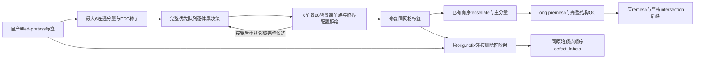
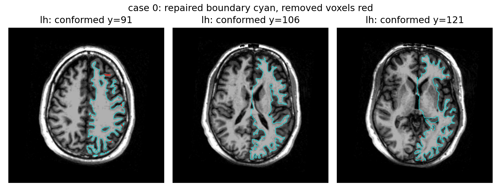
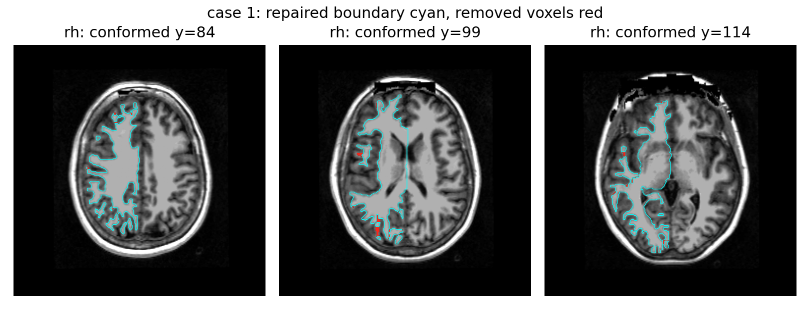
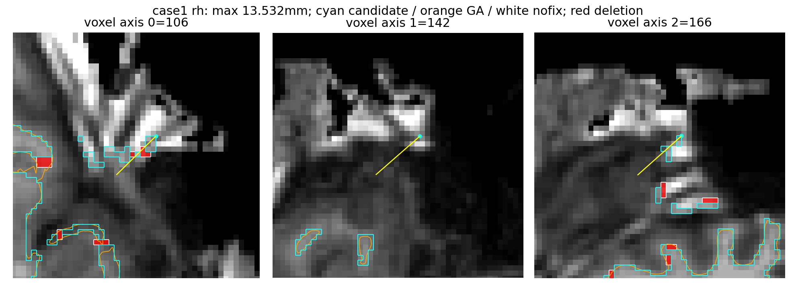

# 自有体素数字拓扑修复候选

## 1．功能与流程

`run_volume_topology()` 从FNIT自产的pretess半球白质标签构造闭合、单分量、球面拓扑的三角网格，同时保留原 `orig.nofix`，写真实切除区的缺陷顶点标签。它是完整独立算法候选：按内部深度和稳定索引顺序加入6/26简单体素，再用FNIT已有有序tessellation和主分量提取生成 `orig.premesh`。运行时不调用原版拓扑程序，没有新增依赖。



算法只保留目标体素子集，切断handle，不在输入目标外填体素。每次决策使用已接受状态，不能批量Jacobi替代；接受一个体素后重新评估全部26邻域阻塞候选，直到完整队列为空。另拒绝2×2棋盘格和互补对角临界体素配置，使提取边界具有可检查的流形结构。它不复现原GA的缺陷搜索与几何优化，也不把Euler数2等同于全部网格质量。

## 2．Python调用、全部输入和输出

```python
from fnit.recon_all.topology_volume_python import run_volume_topology

report = run_volume_topology(
    input_volume="subject/mri/filled-pretess255.mgz",  # 自产左半球uint8标签，conformed网格
    value=255,  # 左侧255、右侧127；允许任意1..255标签
    output_volume="subject/mri/filled-topology-lh.mgz",  # 新修复标签，保留原网格与scanner RAS
    output_surface="subject/surf/lh.orig.premesh",  # 同体积几何的surface RAS/mm三角面
    device="cpu",  # 默认CPU，仅控制tessellation，拓扑决策始终Numba CPU
    source_surface="subject/surf/lh.orig.nofix",  # 原始voxel-corner网格，保持原文件和顶点序
    output_defect_labels="subject/surf/lh.defect_labels",  # 原顶点序(N,)整数值float32 morph
    report_path="subject/scripts/lh.topology-python.json",  # 默认None；保存QC、决策、输入输出SHA
)
```

| 参数 | 格式、默认值、空间与意义 |
|---|---|
| `input_volume` | 必填str/Path；uint8 MGZ/MGH、3D `(X,Y,Z)`，声明scanner RAS与surface RAS变换 |
| `value` | 必填int，1..255；目标标签，其他标签保持 |
| `output_volume` | 必填str/Path；同shape、uint8、affine及几何header；仅删除目标标签为0 |
| `output_surface` | 必填str/Path；三角表面 `(N,3)` 坐标和 `(F,3)` 面，surface RAS/mm，保留体积几何 |
| `device` | str默认cpu；只传给已有tessellation，不改变顺序拓扑判断或用低精度 |
| `source_surface` | str/Path或None默认None；须和缺陷输出成对，必须原 `orig.nofix` voxel-corner坐标，不得用平滑网格 |
| `output_defect_labels` | str/Path或None默认None；同原始顶点序(N,) morph，0无邻接删除，正整数是删除区6连通编号 |
| `report_path` | str/Path或None默认None；完整报告JSON，质量失败也保留 |

输入目标须非空、不接触图像边界，spacing正且有限。输入、输出不能同路径。保留最大6连通目标，组件相同大小以原出现顺序决定。EDT最大体素为种子；优先队列按深度降序、线性索引稳定同分次序。删除区域按6连通编号；源顶点邻接8个体素，接触多个删除区取最小正编号。缺陷标签表示本算法实际切除区，不是原GA缺陷编号的逐位复现。

返回dict包含输入/输出/模块SHA、网格V/E/F/Euler与分量、边/顶点流形及方向检查、零面积/独立自相交计数、删除体素/Dice、种子、全部接受顺序SHA、拒绝次数、最大队列、体素边界距离、文件API墙钟和 `defect_labels` 实际映射报告。输出另保留用于已有tessellate→三角转换的quad中间文件。体素EDT距离不是三角面距离，两者分别报告。

底层 `correct_binary_topology(target=..., spacing_mm=(1,1,1))` 输入3D bool目标，返回同shape bool子集与决策dict，不做I/O。`write_volume_topology_defects(input_volume=..., corrected_volume=..., source_surface=..., value=..., output_defect_labels=..., report_path=None)` 可独立复用真实映射：要求两张uint8体积同网格、只发生目标→0变化，原顶点几何可映射半整数voxel角点。返回全部SHA、删除组件数/有标签顶点数/写出时间；原体积与原表面不改。

非法输入/空间或配对参数抛ValueError；结构QC失败先保留报告和自产候选产物再抛RuntimeError，不能称执行成功。完整QC同时要求单分量、Euler2、零开放/非流形边、顶点link连通、边方向一致、正面积和零自相交。成功只是结构候选通过；下游white/pial、球面局部翻折及最终指标仍须原始T1整例。

## 3．命令行与复现

```bash
python -m fnit.recon_all.topology_volume_python \
  --input-volume subject/mri/filled-pretess255.mgz \
  --value 255 \
  --output-volume subject/mri/filled-topology-lh.mgz \
  --output-surface subject/surf/lh.orig.premesh \
  --device cpu \
  --source-surface subject/surf/lh.orig.nofix \
  --output-defect-labels subject/surf/lh.defect_labels \
  --report-path subject/scripts/lh.topology-python.json
```

所有参数与Python表一致，CLI报告路径必填。已有主页Conda的NumPy/SciPy/Numba/nibabel/PyTorch覆盖依赖，没有原版二进制依赖。

真实同输入完整回归用 `tools/benchmark_topology_volume_python.py`：`--subject` 可重复，目录必须含自产左右pretess与原orig.nofix；`--output-dir` 必须不存在；`--code-commit` 是实际基底加模块SHA身份；`--threads` 默认4，`--device` 默认cpu。每例每侧独立执行完整文件API、真实缺陷映射及全部结构QC。成功/失败JSON与退出码分开保留，不称原始T1整例。

形状诊断用 `tools/diagnose_topology_volume_shapes.py` 的具名 `--subject/--topology-run/--surface-distance-module/--output-dir`。它对原orig.nofix及冻结GA的orig.premesh分别计算全部源顶点到目标三角面的双向距离。目标实际使用的顶点完全重合时距离为0，其余复用已有完整三角搜索；不使用最近点距离冒充三角面距离，也不做不同拓扑同索引比较。输出完整距离NPZ（私有保留）、汇总JSON和真实T1删除区叠加PNG。

## 4．原软件流程与算法区别

原版表面拓扑阶段使用 `mris_fix_topology`，通常配合sphere.nofix、原orig.nofix及强度图执行GA缺陷修复。参考源码固定 [d932c45b7941662ea380a05efef580568b98d41a](https://github.com/freesurfer/freesurfer/tree/d932c45b7941662ea380a05efef580568b98d41a/mris_fix_topology)。本算法是体素6/26拓扑生长，输入pretess，不具有等价独立官方命令，不能将新删除区标签命名为同算法GA复现。

已有FNIT tessellate、主分量提取、remesh和intersection继续执行；原始nofix与新premesh分开保留。删除区标签可由成熟 `defects_to_volume` 按原orig.nofix顶点序投射，不能投射到新拓扑顶点序。`label_cortex_fix_ga` 中GA为gyrus ambiens，与此处遗传算法无关，须按当前自产网格正常重新计算。

## 5．真实精度、耗时、形状与资源

当前完整模块 SHA `b6ad8b5c54a51dc9a263da3df8eeb0a2f8588b56d4c1e964d57ee509a2a1d0a9`，公开ds000114 sub-06/sub-07、FNIT79a41cdd自产pretess与orig.nofix，同主机CPU12–15/4线程、CUDA隐藏。v8从每侧原输入完整计算修复、QC与真实缺陷标签，不读取参考用于计算。

四侧完整API均exit0且结构检查全部通过：单分量、Euler2、闭合且无非流形边/顶点、方向一致、零面积面0、独立几何自相交0。所有删除组件均映射到真实原始顶点，没有零占位文件。五项契约在同一Conda环境3.542s通过；其中种子返回值JSON序列化和重复接受顺序均检查。

| 输入 | 删除体素／删除率 | 目标标签Dice | 删除组件／实际映射组件／带标签原顶点 | 完整API秒 |
|---|---:|---:|---:|---:|
| sub-06 LH | 6,942／2.698% | 0.986326 | 262／262／15,907 | 92.351 |
| sub-06 RH | 8,245／3.231% | 0.983579 | 261／261／18,022 | 88.282 |
| sub-07 LH | 6,062／2.629% | 0.986678 | 217／217／12,768 | 65.956 |
| sub-07 RH | 6,982／3.026% | 0.984636 | 219／219／13,691 | 67.698 |

这是独立不同算法，网格对应关系不成立。与同输入原GA冻结 `orig.premesh` 比较全部源顶点到完整目标三角面的两个方向，单位mm：

| 输入 | 自有→冻结GA mean／P99／max | 冻结GA→自有 mean／P99／max |
|---|---:|---:|
| sub-06 LH | 0.4490／2.1850／7.9104 | 0.2018／0.6096／1.8436 |
| sub-06 RH | 0.4251／1.5182／3.5849 | 0.2040／0.6200／2.2368 |
| sub-07 LH | 0.4922／3.7564／12.3412 | 0.1968／0.5837／1.3385 |
| sub-07 RH | 0.5503／7.3264／13.5322 | 0.1992／0.5952／1.0000 |

相对保留的原 `orig.nofix`，自有→原始网格最大距离分别3.1623、3.1623、3.0000、3.6056mm；该方向P99为1、1、1、1.4142mm。与GA的局部差异在sub-07达到12–14mm，不能解释为无实质影响的尾差；算法没有做原GA的表面强度优化与几何修复。下游完整white/pial和最终脑区指标仍须测量，整体指标等效未判定。几何结构通过不等同于指标通过，当前不是默认替换验收结论。

[四侧完整报告](../../validation/recon_all/optimizations/20261010_topology_volume_python/digital_topology_four_v8/report.json)逐侧保留所有输入、原nofix、冻结GA和候选输出SHA，算法接受顺序SHA、全部计数与质量。原输入/原nofix/原GA不修改。[原GA实际生产者绑定](../../validation/recon_all/optimizations/20261010_topology_volume_python/original_GA_producer/reference_GA_producer_provenance.json)只读提取79a41cdd原运行报告的完整source模块SHA与程序SHA；两个输入所用 `mris_fix_topology_fnit` 均为 `c3bb6b744f3d3ebcc0bbaf6a79b4266eb712ea51a113b06157456b560654fde6`，不是用今日hash重标历史运行。[完整双向三角面报告](../../validation/recon_all/optimizations/20261010_topology_volume_python/digital_topology_shapes_v8/report.json)另绑距离实现与脚本SHA，完整私有距离数组保留；事后距离与图362.733s不算入生产拓扑墙钟。

下面为真实T1 conformed网格叠加，青色为修复标签边界，红色为删除体素；位置和T1 geometry/SHA由报告绑定。只用于局部审阅，不替代完整距离或整例指标：




此候选拓扑计算为Numba CPU，CUDA隐藏，无GPU显存测量；不是全GPU或600s整例证据。物理无预装软件的环境隔离未验证。最新依赖/源码身份与先前诊断失败在[复现收据](../../validation/recon_all/optimizations/20261010_topology_volume_python/reproducibility_and_diagnostic_failures.json)保留；公开副本仅脱敏私有字符串，数值/类型不变。

### 最大局部差异的只读归因

[最大点报告及真实T1局部三面图](../../validation/recon_all/optimizations/20261010_topology_volume_python/local_shape_v1/report.json)逐侧从完整距离数组取最大候选点，重新求最近GA三角面坐标，并核对原nofix及数据SHA。三个最大点（sub-06 LH及sub-07双侧）都是原nofix原顶点，到原始三角面距离为0，附近7³体素分别删除0、1、5个；GA最近点分别距原nofix0.375、0.477、0.409mm。主要差别是GA对原有细长分支作了移除/切补，而新数字拓扑保留该分支，不能归为浮点尾差。sub-06 RH最大点到原nofix3.162mm、附近切除50体素，是新的局部切断影响。

[八邻接MRI和连通路径](../../validation/recon_all/optimizations/20261010_topology_volume_python/local_shape_v1/mask_context_v2/mask_context_v2.json)读取同网格T1、brainmask、aseg.presurf、brain、brain.finalsurfs、WM、filled与pretess。sub-06 LH目标角点WM230、aseg24，八邻接brainmask/brain.finalsurfs全0；sub-07 LH目标角点WM113、aseg24、brainmask110；RH为WM80、aseg0、brainmask76。后两点并非完全在脑mask外。三条原目标枝条到内部EDT≥2mm体素的最短6连通路径为16、58、64步，多数路径体素深度1mm；2mm只是此只读几何诊断的定义，不是验收或剪枝阈值。

这说明单靠保持6/26拓扑无法判断目标中的细长分支是否有足够组织证据。不能简单删除Unknown、CSF标签或mask外体素；原GA还用MRI和局部patch代价。新的[固定面组织原语](TOPOLOGY_TISSUE_PATCH_PYTHON.md)已复用已有直方图、完整40轮MRI核和顺序碰撞接受，两例四侧结构通过；完整双向距离仍未证明形状改善。它没有动态边重连、体素删填和完整补片代价搜索，不能替代这些缺口。下一步应补通用动态拓扑/组织代价求解；不改当前v8及其冻结整例。

```bash
python tools/diagnose_topology_volume_local_shape.py --subject frozen_subject_06 --subject frozen_subject_07 --topology-run complete_topology_v8 --shape-run complete_triangle_distances_v8 --surface-distance-module validation/recon_all/accuracy_20261003/task_04/reference_surface_distance.py --color-lut declared_assets/FreeSurferColorLUT.txt --output-dir new_local_shape_diagnosis
python tools/diagnose_topology_volume_mask_context.py --subject frozen_subject_06 --subject frozen_subject_07 --local-shape-report new_local_shape_diagnosis/report.private.json --output new_mask_context.json --core-depth-mm 2
```

两个脚本只读原产物：subject目录含同网格MRI/WM/分区和原表面，topology-run/shape-run必须已有完整v8候选与逐顶点到三角面距离数组；距离模块/LUT明确路径并逐SHA绑定；所有输出必须新路径。返回JSON和局部PNG，不生成生产表面。第一个函数的最近三角点是完整面的投影或边界点，`plane_segments` 计算实际三角面与体素切平面的交线；没有最近顶点近似。第二脚本固定八角邻接和6连通BFS，只记录原枝条到指定内部深度的最短路径，depth参数默认2mm且须正有限。总诊断时间含I/O和图，不算入重建生产阶段。



## 6．更新与验证记录

2026-10-10：完整顺序6/26简单体素生长、临界配置检查、已有tessellation复用及实际缺陷标签映射实现。五项契约包含实心块/重复接受序/handle/非法边界与原角点映射，在同Conda环境通过。

v5首侧文件API及结构QC已通过，随后汇总驱动因NumPy int64种子坐标无法直接JSON序列化失败；失败源码、日志和产物保留。v8只把返回种子坐标转为Python int，新增JSON序列化契约，重新完整执行四侧并在同一调用中生成真实标签，没有覆盖旧失败收据。v6独立缺陷辅助进程曾等待旧驱动产物，保留原等待状态；不把它称作四侧完成。

## 7．参考文献和实现

- Bertrand G, Malandain G. A new characterization of three-dimensional simple points. *Pattern Recognition Letters*. 1994;15:169–175. [原论文](https://www.sciencedirect.com/science/article/pii/0167865594900469)。局部前景/背景拓扑数用于简单点判断；本完整修复配方为FNIT实现。
- Gross A, Latecki L. Digitizations Preserving Topological and Differential Geometric Properties. *Computer Vision and Image Understanding*. 1995;62:370–381. [原论文](https://www.sciencedirect.com/science/article/pii/S1077314285710612)。
- [FreeSurfer固定拓扑参考](https://github.com/freesurfer/freesurfer/tree/d932c45b7941662ea380a05efef580568b98d41a/mris_fix_topology)。
- [FNIT数字拓扑模块](../../src/fnit/recon_all/topology_volume_python.py)、[已有tessellation](../../src/fnit/recon_all/tessellate_gpu.py)、[已有主分量提取](../../src/fnit/recon_all/extract_main_component_python.py)。
