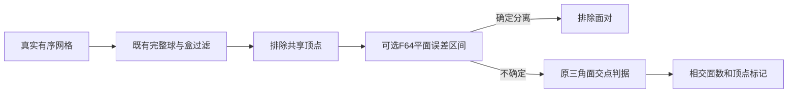
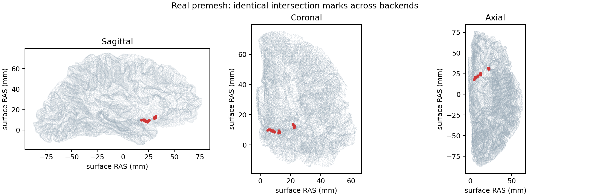

# F64 表面交点检查的保守平面过滤

## 1．功能简介

`mark_intersections()` 检查有序三角表面的自相交，返回涉及交点的顶点标记与相交面数。本次增加显式选择的 Numba CPU 和 PyTorch GPU 平面过滤。能确定两面分离时省去原逐对判定；靠近平面、共面、非有限、误差区间内及极端乘积保留原判定。原来的包围球、包围盒、共享顶点排除、1e-6 平面容差和共面规则保持。

该功能是完整清理和拓扑质量检查使用的独立 F64 检查器。它不移动坐标，不改变网格，不代替源有向标记、SOAP 清理、GA、remesh 或整例流程。默认 `separation_backend="python"` 保持。



## 2．Python 调用、输入与输出

```python
import nibabel.freesurfer.io as surface_io
from fnit.recon_all.mris_remove_intersection_python import mark_intersections

surface_vertices, surface_faces = surface_io.read_geometry("/data/own/lh.orig")
marked_vertices, intersecting_face_count = mark_intersections(
    vertices=surface_vertices,  # (N,3)；surface RAS，单位mm，内部F64
    faces=surface_faces,  # (F,3)整数；保留原顶点编号与有序面
    separation_backend="numba",  # 显式CPU候选；默认python；另可torch
    device=None,  # CPU保持None；torch须显式cuda:0等设备
    chunk_size=65536,  # 正整数；平面过滤每批面对数，不裁剪候选
)
```

| 参数 | 意义、格式与默认值 |
|---|---|
| `vertices` | 必填浮点 `(N,3)`；表面坐标，内部转换float64；不修改输入 |
| `faces` | 必填整数 `(F,3)`；有效顶点索引，内部int32；不重新排列 |
| `separation_backend` | 默认`python`；`numba`为F64 CPU过滤；`torch`为F64 CUDA过滤 |
| `device` | 默认None；GPU须显式带序号`cuda:N`，失败传播，不自动回退 |
| `chunk_size` | 正整数默认65536；控制过滤临时张量，不限制总面对数量 |

返回 `marked_vertices` 为 `(N,)` bool，`intersecting_face_count` 为Python整数，表示相交面数。两者不能混为一个计数。新增接口不写网格。Numba继承调用者线程预算；GPU无autocast、无矩阵乘法，不修改全局TF32策略。没有新增生产依赖，复用主页Conda中的NumPy、SciPy、Numba、PyTorch、nibabel。

低层 `separated_triangle_pairs(triangles_a=..., triangles_b=..., backend="numba", device=None, chunk_size=65536)` 接收同长 `(P,3,3)` 浮点面对，返回CPU `(P,)` bool；True仅表示确定分离。`backend`只允许numba或torch，其余参数同上。它不是相交判据；False必须继续原判定。非有限输入保留原判定；一个三角形退化时，另一三角形的可靠平面仍可能证明分离。两个方向都无法证明时保留原判定。

## 3．命令行与复现

没有新增生产CLI。独立真实benchmark入口：

```bash
# 每个后端使用新输出目录；线程与冷JIT缓存目录分别记录。
OMP_NUM_THREADS=4 OPENBLAS_NUM_THREADS=1 MKL_NUM_THREADS=1 NUMBA_NUM_THREADS=4 \
python tools/benchmark_recon_triangle_plane_filter.py \
  --input /data/own/lh.orig.premesh \
  --output /data/new-runs/numba-trial-01 \
  --backend numba --threads 4 \
  --source-commit aeabc5aba9341f0358772eb00b1f07eb2cbaf643
```

| CLI参数 | 意义与默认值 |
|---|---|
| `--input` | 必填三角表面文件；通过nibabel读入坐标与有序面 |
| `--output` | 必填报告目录；保存私有JSON和顶点bool数组，不输出修复网格 |
| `--vertices-npy` | 默认None；已有真实冻结 `(N,3)` 坐标，须与input有序面对应；另记SHA、dtype和加载耗时 |
| `--backend` | 必填python、numba或torch |
| `--device` | 默认cuda:0；torch实际使用；CUDA_VISIBLE_DEVICES须在导入前设置 |
| `--gpu-uuid` | 默认空；可记录目标UUID及设备总占用背景，不能当作本进程显存 |
| `--source-commit` | 必填冻结父提交；实际候选以源码SHA进一步绑定 |
| `--threads` | 默认4；Numba及Torch线程数；亲和性与BLAS环境另外记录 |
| `--profile` | 默认关闭；开启时保存cProfile，剖析开销单列 |
| `--oracle-source` | 默认关闭；仅对PYTHONPATH明确指向冻结基线的隔离进程使用旧两参数调用 |

`report.private.json` 记录输入、源码及标记SHA、面数/顶点数、完整检测秒数、原谓词调用数、确定排除数、加载与脚本时间、CPU亲和性、版本及资源背景。`marks.private.npy`为真实顶点标记；坐标文件留在服务器。脚本计时从Python脚本开始到最终报告写入前，不含解释器启动和最终JSON写入；完整外部进程墙钟用本任务Python包装记录：`python tools/time_recon_triangle_plane_filter.py --wall-report /data/new-runs/wall.json -- python tools/benchmark_recon_triangle_plane_filter.py ...`。包装的必填`--wall-report`是墙钟JSON路径；`--`后是完整子进程命令，继承环境，失败原样返回退出码。计时覆盖子进程启动至退出，包括最终JSON写入，排除包装自身导入和报告写入。GPUallocated/reserved属于PyTorch，NVML设备总占用只作共享环境背景；进程树归属未核实时不宣称连续峰值或整例20GB通过。

## 4．原软件调用

原内部检测没有独立官方CLI。[官方完整清理命令](https://surfer.nmr.mgh.harvard.edu/ftp/docs/wiki/mris_remove_intersection.help.xml.html)为 `mris_remove_intersection input.surface output.surface`，包含标记、SOAP和复检，不能把本次仅检测耗时与该完整命令直接比较。原软件只允许在隔离benchmark执行；本模块不查找或调用原程序。

原实现见[FreeSurfer固定参考提交](https://github.com/freesurfer/freesurfer/tree/d932c45b7941662ea380a05efef580568b98d41a)。本轮同输入比较对象是冻结提交中的FNIT原F64检查器；原软件完整清理已有证据见[完整修复说明](INTERSECTION_REPAIR.md)，那些记录保留其原版本绑定。

## 5．最新真实精度与耗时

基线绑定 `aeabc5aba9341f0358772eb00b1f07eb2cbaf643`，候选实际源码SHA见[16次完整测量](../../validation/recon_all/optimizations/20261011_fnit4_plane_filter/metrics.public.json)与[CSV](../../validation/recon_all/optimizations/20261011_fnit4_plane_filter/measurements.csv)。复用公开ds000114历史自产网格，两个不同半球和一个已有真实交点的冻结pial坐标；没有新原始T1运行。全部标记数组逐项一致，相交面数与顶点数均一致。13项新旧功能测试通过。

| 完整真实输入 | 相交面 / 标记顶点 | 原F64检测秒 | Numba检测秒 | GPU检测秒 | 原谓词调用 / 过滤后 |
|---|---:|---:|---:|---:|---:|
| A：左侧premesh，重复两轮 | 26 / 53 | 51.160、46.127 | 41.250、48.786 | 48.393 | 11,672 / 1,852 |
| B：另一例右侧premesh，重复两轮 | 7 / 19 | 17.420、16.033 | 16.613、17.319 | 17.582 | 8,754 / 1,662 |
| C：冻结真实pial，单轮 | 32 / 35 | 33.278 | 21.554 | 19.644 | 380,002 / 65,876 |

C单轮观察中Numba检测减少35.23%，GPU减少40.97%；这些是完整检测时间，包含过滤、剩余判据与临时数组，不是完整修复、GA或整例收益。A、B重复结果有共享负载波动，B平均检测无收益；默认保持python，显式候选可用于高面对数量的诊断。首次过滤的JIT/CUDA启动计入检测。

最终冷进程分步测量使用B相同真实输入，CPU亲和性80–83、总线程4；GPU为A100，实际UUID与逻辑cuda:0绑定已核对：

| 后端 | 原逐对谓词秒 | 平面过滤秒 | 完整检测秒 | 完整外部进程墙钟秒 |
|---|---:|---:|---:|---:|
| python | 0.464 | 0 | 18.223 | 21.520 |
| numba | 0.196 | 1.428，含首次JIT | 18.770 | 20.099 |
| torch | 0.211 | 2.947，含首次CUDA计算 | 19.887 | 28.475 |

剩余时间包含既有树查询、球/盒过滤、标记汇总与监测包装开销，不能将它称为某个单独算法步骤。外部墙钟覆盖解释器启动、导入、加载、计算、报告写入和退出。前三组旧字段`complete_cli_seconds`实为脚本开始至最终JSON写入前的时间，公共导出统一改为`script_wall_before_final_report_seconds`，不把它当完整外部墙钟。不同冻结脚本版本的SHA分别保留。

GPU使用F64元素运算、没有matmul或autocast，benchmark记录默认TF32开启；过滤没有改动进程精度策略。所有GPU测量的PyTorchallocated/reserved见JSON；实际进程树和连续NVML峰值未核实，因此本次不能证明整例20GB预算。



图中红点是19个标记顶点的三方向投影，三个后端一致；图使用真实表面，未输出MRI或坐标文件，[图像收据](../../validation/recon_all/optimizations/20261011_fnit4_plane_filter/PLOT_RECEIPT.json)保存输入、标记和图像SHA。

GA、修复、remesh和整例未由此候选重新评估。另附[已有拓扑证据边界审计](../../validation/recon_all/optimizations/20261011_fnit4_plane_filter/TOPOLOGY_BOUNDARY_AUDIT.json)：全9缺陷自有流程完成并通过最终结构和交点质量，但已有原版premesh对比的顶点/面数不同，双向最大距离1.090/6.828mm。不同冻结版本的首候选一致记录不能定位这一次全9缺陷中的首次算法分歧；不能把这项差异归于几何头尾舍入。整体等效保持not_assessed。

## 6．更新与benchmark记录

- 2026-10-11候选v1：新增保守Numba/PyTorch平面过滤，默认路径保持；7项边界/随机尺度/非零交点/异常策略测试通过。真实两例不同半球重复检测另行导出。
- 候选v2：benchmark显式支持冻结真实坐标NPY和独立SHA，面由原表面读取，避免写出F32表面造成额外转换；增加真实非零交点诊断。
- 文档明确脚本计时边界；共享负载变化保留原始观察，未作为默认后端切换依据。

## 7．参考文献与代码

- [FNIT原检测与完整清理](../../src/fnit/recon_all/mris_remove_intersection_python.py)。
- [本次过滤](../../src/fnit/recon_all/topology_triangle_plane_filter.py)与[真实benchmark脚本](../../tools/benchmark_recon_triangle_plane_filter.py)。
- Fischl B. FreeSurfer. *NeuroImage*. 2012;62:774–781. [DOI](https://doi.org/10.1016/j.neuroimage.2012.01.021)。
- Gorgolewski KJ et al. A test-retest fMRI dataset for motor, language and spatial attention functions. *GigaScience*. 2013;2:6. [数据及CC0许可](https://github.com/OpenNeuroDatasets/ds000114/blob/master/dataset_description.json)。本轮仅复用既有自产网格；没有新权重或模板，原始数据不作为代码提交。
