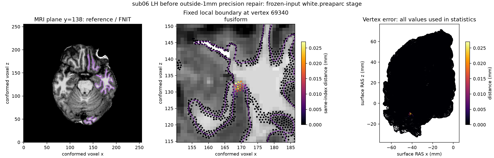
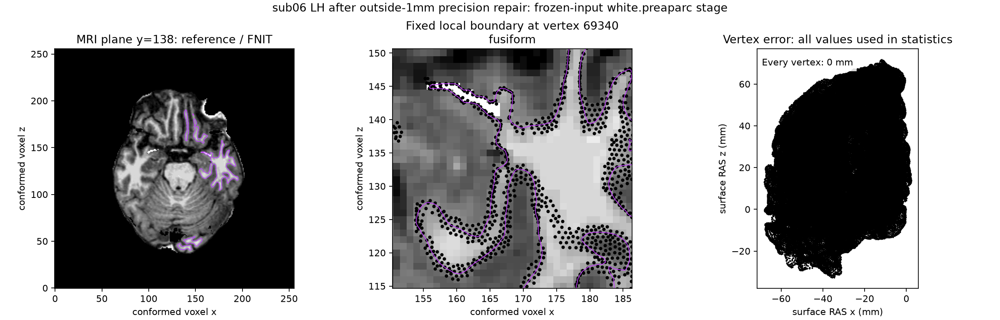

# 白质目标搜索：外侧 1 mm 表达式精度修复

## 1. 功能简介

`compute_border_values_first_pass()` 在固定 MRI 与表面状态上寻找白质或
软脑膜目标强度，供完整四轮放置复用。它不执行 MRI 预处理、rip、表面更新
或相交清理。这次修复成熟 FNIT 子函数的外侧 1 mm 采样坐标表达式；候选
扩展、局部峰选择、距离限制、TF32 策略和有序顶点接受保持原规则。


## 2. Python 调用与输入输出

```python
import numpy as np
from fnit.recon_all.place_surface_border import compute_border_values_first_pass

targets = compute_border_values_first_pass(
    volume=prepared_mri,                 # uint8 (W,H,D)，已有白质放置 MRI 预处理结果
    segmentation=aseg_labels,             # 同 MRI 网格的 int32 分割标签
    surface_xyz=current_surface_ras,      # float32 (N,3)，surface RAS，毫米
    surface_normals=current_normals,      # float32 (N,3)，单位法向
    original_xyz=initial_surface_ras,     # float32 (N,3)，固定初始坐标，毫米
    ripped=rip_flags,                     # bool (N,)，True 顶点排除
    previous_values=previous_targets,     # float32 (N,)，上轮目标值；无目标为 -1
    sras2vox=surface_ras_to_voxel,         # float32 (4,4)，毫米坐标到体素索引
    thresholds=np.asarray(
        [inside_hi, border_hi, border_low, outside_low, outside_hi],
        dtype=np.float64,
    ),                                   # 五项强度阈值，来自自产 autodet 统计
    hemisphere="lh",                     # lh 或 rh，决定对侧标签停止条件
    surface="white",                     # white 或 pial；默认 white
    sigma=2.0,                           # 梯度采样平滑尺度，单位体素；默认 2
    max_thickness=10.0,                   # 搜索距离上限，毫米；默认 10
)
target_values, normal_distance, peak_gradient, target_xyz, marked, used_sigma = targets
```

输入 MRI 必须同网格，表面顶点顺序必须对应。`volume` 转为 uint8，标签转为
int32，坐标与法向转为 float32，阈值转为 float64。`sigma` 应非负，搜索上限
应为正，影像和坐标须为有限值；函数只显式检查 `hemisphere` 和 `surface`。
不可转换输入产生 NumPy 异常，其他非法 shape 或索引在 Num ba 路径没有
完整保护，调用方须满足契约。

六项返回依次是 `(N,) float32` 目标强度、法向距离 mm、峰导数，
`(N,3) float32` 目标 surface RAS/mm，`(N,) int32` 有效标记，以及
`(N,) float32` 实际 sigma。没有新目标时保留上轮强度。峰导数是诊断量：
接口没有上轮 `mean` 输入，回退时返回 0；固定原生状态会保留旧 `mean`。
当前完整放置不读取该量，严格状态诊断仍报告这项差异。

调用范围包括 `place_white_preaparc_python` 的初始/轮间搜索、
`place_final_white_python` 复用的完整白质内核，以及 `place_pial_python`
的初始/轮间搜索。两处修复表达式不受 white-only 条件限制，因此
最终 white 和 pial 也使用新冻结代码另做同输入回归；不能仅凭
white.preaparc 通过便声称其他调用不受影响。

## 3. 命令行调用

该子函数没有独立生产 CLI。完整入口见
[white.preaparc](PYTHON_WHITE_PREAPARC.md)、[最终 white](PYTHON_FINAL_WHITE.md)
和 [pial](PYTHON_PIAL_PLACEMENT.md)。隔离诊断工具均接收显式路径：

```bash
# 第一条编译透明 benchmark 探针，生产流程不调用它。
python validation/recon_all/python_gpu_port/build_place_surface_target_pass_probe.py \
  --source /benchmark/fixed-source \
  --build /benchmark/fixed-build \
  --out /benchmark/new-target-probe

# 第二条运行同输入四轮，完整几何录取后才使用逐轮参考状态。
python validation/recon_all/python_gpu_port/diagnose_preaparc_target_passes.py \
  --subject /benchmark/self-generated-subject \
  --reference-surface /benchmark/reference/lh.white.preaparc \
  --native-probe /benchmark/new-target-probe/mris_place_surface_target_pass_probe \
  --assets-directory /benchmark/assets \
  --output-directory /benchmark/new-target-run \
  --hemisphere lh \
  --threads 4 \
  --code-base-commit ACTUAL_TESTED_COMMIT
```

源码库、编译器、二进制和每项输入的 SHA 必须绑定本次运行；透明程序的
最终坐标和有序面必须与未插桩参考一致。参考交叉输入只用于诊断。

## 4. 原软件调用及原因

这是固定 `mris_place_surface --white` 内部
`MRIScomputeBorderValues_new()` 的一步，没有单独官方 CLI。对应完整调用
的具名输入见 [原生 preaparc 对照](WHITE_PREAPARC_CONDA_CHAIN.md)。

固定源码使用 `v->x + v->nx * (dist + 1)`。`dist`、坐标和法向是 float，
字面量 `1` 是整数，因此距离相加、乘法及坐标相加逐级按 float 计算。
旧 FNIT 写成 `d + 1.0`，Num ba 把该子表达式提升为 double，再在体素
变换处转回 float。两者的外侧采样坐标可能相差一个舍入单位。

真实输入上，该差异触发外侧强度阈值筛选，选择了相邻的另一个梯度峰。
修复显式恢复源表达式的逐级 float32 舍入；没有针对某个顶点或被试
增加条件，也没有关闭 TF32、改用半精度或放宽阈值。

## 5. 当前精度、耗时与可视化

本次输入来自两例公开 T1 的 FNIT 自产 `79a41cdd` 连续链，使用新
`54f681dc` 放置适配器；不是旧 `803aec50` 网格。阶段输入和主 TU 固定
源码/Conda 程序均有 SHA。参考程序在同机同输入重跑稳定；透明梯度探针
和逐轮目标探针也分别通过完整几何录取。

首个异常 `sub06 LH`：

| 定位层级 | 修复前实测 |
|---|---:|
| 前 27 个接受更新 | 坐标全部相同 |
| 第 28 步进入状态 | 坐标、有效顶点法向、rip、sigma 相同 |
| 第三轮原始目标 | 124,095 个有效顶点中仅 1 个不同 |
| 该点目标强度 | 参考 56.476818；FNIT 53.758278 |
| 该点法向距离 | 参考 0.350000024；FNIT 0.450000018 mm |
| 五轮目标平滑后 | 93 个顶点不同，最大强度差 0.165108 |
| 完整最终表面 | 1,046 个坐标元素不同，最大顶点位移 0.027004 mm |

CPU 与 GPU 碰撞候选两条完整路径重现相同最终坐标和第 28 步首差；
对相同参考目标运行 FNIT 平滑完全相同。单独改原始位移投影为 double
仍保留该异常；仅修复外侧 1 mm 表达式后，四轮固定输入的目标、距离、
目标坐标、标记及 sigma 全部相同。

修复模块 SHA-256 为
`199cfd527493a31a8888df47622492a4faf68ee88ce41e57ae75e9c996640bd4`。
同机固定 Conda 参考程序 SHA-256 为
`78b64b7395aa0db0592ab6912fc026128b221c56d9f802db225fa59c18ceda44`。
公开完整收据见[报告目录](../../validation/recon_all/optimizations/20261010_preaparc_border_precision/)。

| 新冻结完整回归 | 迭代数 / 四轮终点 | FNIT API / 同输入参考墙钟 | 最终坐标 / 有序面 / MRI / 阈值 |
|---|---|---:|---|
| sub06 LH | 37 / 17,27,34,37 | 289.830 / 280.029 s | 全部 0 差异 |
| sub06 RH | 38 / 18,28,35,38 | 243.209 / 286.135 s | 全部 0 差异 |
| sub07 LH | 33 / 14,22,30,33 | 305.498 / 342.628 s | 全部 0 差异 |
| sub07 RH | 34 / 16,24,31,34 | 190.917 / 160.279 s | 全部 0 差异 |

sub06 LH 的全部 37 个接受更新坐标与录取后的透明参考逐元素相同；
其余已完成侧核对最终有序几何，没有采集逐步原生坐标，不能外推逐步一致。
四侧最终相交数均为 0，输入前后 SHA 不变。MRI 核对 shape、affine、dtype
及全部体素；阈值文本逐字节相同。表面尾部生成信息不同，未声称表面文件
逐字节相同。

使用 A100-SXM4-80GB、Xeon 8369B、各阶段四线程、float32 与默认 TF32，
未启用半精度。GPU 仅处理保守碰撞候选和源规则清理；采样、正则与目标
搜索保留既有 CPU 路径。FNIT 墙钟包含自产阈值、MRI/表面加载、传输、
迭代、最终清理、输出写入与原子轨迹记录；导入、CUDA 初始化和输入复制/
哈希在计时之前。原生参考包含包装器与写出，未包含大轨迹记录。节点负载
及卡上其他任务变化，以上是同输入运行观察，不是隔离配对性能门或整例提速。
四侧 PyTorch allocated 最大 720,923,136 字节、reserved 最大
1,795,162,112 字节；没有采集进程树显存，不用这些数代替整例预算证明。

下图固定同一个 MRI 平面和梭状回局部边界，颜色使用所有顶点的同索引
距离/mm；修复前最大 0.027004 mm，修复后所有顶点 0 mm。





旧失败记录保留。两例双侧新冻结完整阶段均已通过。逐步大快照、透明参考和表达式
隔离回放的耗时是诊断时间。跨环境官方安装版本另列；整体指标等效及
原始 T1 整例仍由独立完整 benchmark 判定。本轮本地白质接口/失败契约
21 项通过，不能替代真实回归。

共享函数的额外 8 次完整回归均已完成，仍使用修复模块 `199cfd52`。
逐文件核对旧 `54f681dc` 已完成基线的输入、候选与参考 SHA；候选独立
读取 `79a41cdd` 自产输入，参考仅供写出后比较。此批复用既有精确参考，
没有新增原生重复运行，不能外推其参考重复性。与四次 preaparc 合计
12 个完整冻结阶段的最终坐标和有序面均为 0 差异；不是原始 T1 整例结论。

| 新冻结共享函数回归 | 迭代数 / 四轮终点 | FNIT API 墙钟 | 最终坐标 / 有序面 / 清理后相交 |
|---|---|---:|---|
| sub06 LH final white | 35 / 12,22,30,35 | 202.051 s | 0 差异 / 相同 / 0 |
| sub06 LH pial | 44 / 27,33,37,44 | 408.191 s | 0 差异 / 相同 / 0 |
| sub06 RH final white | 35 / 12,22,30,35 | 225.909 s | 0 差异 / 相同 / 0 |
| sub06 RH pial | 43 / 24,31,36,43 | 301.054 s | 0 差异 / 相同 / 0 |
| sub07 LH final white | 31 / 11,19,27,31 | 161.376 s | 0 差异 / 相同 / 0 |
| sub07 LH pial | 39 / 22,29,34,39 | 355.356 s | 0 差异 / 相同 / 0 |
| sub07 RH final white | 29 / 10,18,25,29 | 175.071 s | 0 差异 / 相同 / 0 |
| sub07 RH pial | 40 / 23,30,35,40 | 281.216 s | 0 差异 / 相同 / 0 |

四次 final white 还核对预处理 MRI 的所有体素、几何及 dtype，全部相同；
八次输入 SHA 未变，也与旧候选最终几何相同。本批没有采集原生逐步坐标。
墙钟包含 API 读写与 GPU 同步，输入复制/哈希、导入与 CUDA 初始化另计；
共享负载变化，单次时间不作为配对提速结论。实际三项 CUDA 分配器环境
变量均未设置，使用环境默认策略；TF32 两项为 True，没有半精度。
PyTorch allocated 最大 718,661,632 字节、reserved 最大 3,737,124,864
字节，进程树 GPU 占用未测，仍不能据此宣布整例显存通过。

首版外进程阻止器在 NumPy/SciPy 首次 CPU 能力检查时拦截 `lscpu`，
两次在迭代前失败，原收据完整保留。这不是算法或 OOM 失败。新版仅允许
该只读硬件查询，八次禁止的原软件调用为 0，不调用参考程序进行生产计算。

另外在录取的 sub06 LH 四轮完整搜索快照上，独立验证 Num ba `prange`
按顶点并行、`fastmath=False`：16 次热 ABBA 调用的全部六项输出逐元素
相同。各轮串行中位数之和 31.069 s、并行 8.955 s，局部搜索快 3.47 倍；
首次编译另计 16.542 / 9.411 s。该实验使用四线程，不包含完整放置、
有序平滑或碰撞接受，不能称整阶段或整例提速。生产搜索仍是串行；
新显式并行接口及两线程完整阶段回归另见
[独立顶点并行搜索](BORDER_PARALLEL_TARGET_SEARCH_20261010.md)，仍不改变默认。

## 6. 更新与 benchmark 记录

| 日期 / 范围 | 实际结果 |
|---|---|
| 2026-10-10，完整独立曲率 | [32 个图与四侧完整 curv.stats](FULL_CURVATURE_STATS_PYTHON_20261010.md)精确通过，独立算子范围 |
| 2026-10-10，当前自产 preaparc | 首差定位到第三轮单点外侧阈值，CPU/GPU 最终误差相同 |
| 2026-10-10，表达式隔离 | 外侧 float32 修复四轮目标全部相同；Double 位移投影不是本例原因 |
| 2026-10-10，新冻结完整回归 | 两例四侧 preaparc 最终几何/MRI/阈值 0 差异；sub06 LH 全部 37 步坐标一致，四侧原生重复稳定 |
| 2026-10-10，共享调用回归 | 四侧 final white 与 pial 八个完整阶段最终几何 0 差异；复用哈希匹配的既有参考，没有新增原生重复 |
| 2026-10-10，独立并行搜索回放 | 四轮六项输出完全相同，四线程热搜索 31.069→8.955 s；完整阶段并行接口尚待验证 |

旧版本源码与运行目录不覆盖；本次完整回归已绑定实际模块 SHA。

## 7. 参考文献和源码

- [固定源码 MRIScomputeBorderValues_new](https://github.com/freesurfer/freesurfer/blob/d932c45b7941662ea380a05efef580568b98d41a/utils/mrisurf_mri.cpp)。
- [固定完整放置命令](https://github.com/freesurfer/freesurfer/blob/d932c45b7941662ea380a05efef580568b98d41a/mris_make_surfaces/mris_place_surface.cpp)。
- [固定目标平滑 MRISaverageMarkedVals](https://github.com/freesurfer/freesurfer/blob/d932c45b7941662ea380a05efef580568b98d41a/utils/mrisurf_vals.cpp)。
- Dale AM, Fischl B, Sereno MI. Cortical surface-based analysis. I.
  Segmentation and surface reconstruction. *NeuroImage* 1999;9:179–194.
  [DOI](https://doi.org/10.1006/nimg.1998.0395)。
