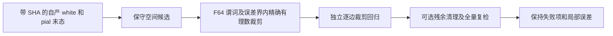

# white–pial 精确接触检查与可选残余清理

## 1．功能简介

`WhitePialCrossingIndex` 缓存 FNIT 自产 white，检查同一有序网格上的 pial。它区分正长度内部穿越、边或点接触、共面重叠和原碰撞谓词的近接触。两个独立表面即使顶点编号或角点坐标相同，也会检测完整面对。

这是独立几何检查。`crossing_guard=True` 是残余投影实验的显式选项，生产默认清理保持不变。已有初态穿越与“候选没有新增穿越”分别报告；后者不能说明最后零穿越、嵌套正确或整例指标等效。



精确相同角点位于对方平面，这是数学身份。误差界内使用有限 IEEE 坐标对应的有理数计算 determinant 和交线区间。没有用距离下限丢弃短穿越。现有 NumBa 碰撞和空间组件继续复用；没有原软件命令、半精度或新增依赖。

## 2．Python 调用、输入与输出

### 表面检查

```python
import nibabel.freesurfer as freesurfer_io
import numpy as np
from fnit.recon_all.white_pial_crossing_python import WhitePialCrossingIndex

white_vertices, ordered_faces = freesurfer_io.read_geometry(str(own_white_path))  # 自产 white，surface RAS/mm
pial_vertices, pial_faces = freesurfer_io.read_geometry(str(own_pial_path))        # 同一有序网格的自产 pial
if not np.array_equal(ordered_faces, pial_faces):
    raise ValueError("white 与 pial 的有序面必须相同")
fixed_vertices = own_ripped_vertices | ~own_cortex_vertices  # bool(N,)；保持进入时的坐标，不重新固定到 white
crossing_index = WhitePialCrossingIndex(
    white_vertices=white_vertices,             # 有限浮点数组 (N, 3)，缓存一份独立副本
    faces=ordered_faces,                       # 整数数组 (F, 3)，顶点索引必须有效
    fixed_vertices=fixed_vertices,             # bool(N,)，仅用于标记原有固定接触
)
proper_pairs, exact_contacts, fixed_contacts, diagnostics = crossing_index.query(
    pial_vertices=pial_vertices,               # 有限浮点数组 (N, 3)，顶点对应关系与 white 相同
    query_faces=None,                          # 默认全部面；局部查询可传有效整数面编号数组
)
```

三个集合的元素均为 `(pial面编号, white面编号)`，不作为同表面无向面对处理。`proper_pairs` 要求两面都严格跨越对方开平面且交线正长度。`exact_contacts` 包含非穿越的精确边/点/共面接触。`fixed_contacts` 只标识 pial 面全部固定、且其坐标与自产 white 同索引面逐元素相同的已有接触；正长度内部穿越从不被该标签豁免。该标签也不豁免 white 自相交或代表其已通过自相交检查。

`query_faces` 缺省 `None`；显式局部数组须为一维整数、无越界，内部去重。每次查询使用当前 pial 坐标，不能跨表面版本复用可变 pial 的缓存。white 缓存、坐标和有序面不改变。零面积面、非有限坐标、错误 shape/dtype、无效索引或非 bool 固定掩膜抛 `ValueError`。

`diagnostics` 的全部字段按以下组保存：

| 字段 | 结构与含义 |
|---|---|
| `query_faces`, `broad_phase_candidates`, `tested_pairs` | 非负整数；查询面数、保守候选数与最终 bbox 检测面对数，无候选数量截断 |
| `proper_crossing_pairs`, `exact_contact_pairs`, `legal_fixed_contact_pairs` | 非负整数；上述三个集合大小 |
| `classes` | 五个非负整数：`proper_crossing`、`noncoplanar_edge_or_point_contact`、`exact_coplanar_area_overlap`、`exact_coplanar_edge_or_point_contact`、`source_tolerance_contact` |
| `source_predicate_positive_pairs`, `source_negative_proper_crossings` | 原源谓词诊断计数；不代替精确穿越结论 |
| `short_positive_crossings_not_exempted` | 长度不超过展示尺度的真实正交线数，仍保留在穿越集合 |
| `maximum_intersection_length_mm`, `maximum_pial_plane_depth_mm`, `maximum_white_plane_depth_mm` | 最大交线长度与双方平面内部深度，float/mm |
| `proper_crossing_minimum_length_mm` | 固定为 0；没有最短交线豁免 |
| `near_contact_display_length_mm` | 1e-5 mm，仅分类展示，不是接受门槛 |
| `coordinate_space`, `coordinate_unit` | `surface_RAS`、`mm` |
| `strict_relation_backend` | `F64_with_exact_IEEE_fraction_fallback` |
| `exact_fallback_pairs`, `exact_shared_corner_plane_zero_proofs` | 精确回退面对数与共有角点平面零值身份数 |
| `adaptive_error_bound_epsilon_multiple` | 64；数值误差界系数，不是毫米质量阈值 |
| `source_predicate_contacts_are_not_strict_crossings` | 固定 `True` |
| `query_seconds` | 查询墙钟秒数，包含该调用的空间候选、谓词、精确回退和集合构造 |

### 残余清理的显式门

`resolve_projected_intersections(..., crossing_guard=False)` 兼容默认关闭此新实验门。`True` 时，每次接受前检查全部受影响面与缓存自产 white；不允许增加内部穿越面对或非内侧壁的精确接触面对。量化后的候选仍必须严格减少源与 F64 自相交集合、保持所有固定点、面朝向和面积约束，末态再全局复检。

实验既有参数为 `max_displacement_mm=1.0`、`minimum_area_ratio=0.2`、`clearance_mm=0.002`、`max_sweeps=4`、`optimizer_iterations=100`、`projection_mode="free_separating_plane"` 和 `diagnostic_pair_limit=None`。这些是事先冻结的候选算法约束，不是整体指标等效标准。其余输入输出见残余投影原说明。新增 `white_pial_guard` 保存初态/末态全量摘要、非内侧壁接触数、四项全局集合检查、`no_new_gate` 以及独立的末态零穿越/零接触布尔值；保留非零初态，不隐瞒失败。

### 只读独立精确审查

`tools/audit_white_pial_crossing_exact.py` 的 `run()` 使用具名参数：

| 参数 | 类型、默认值和含义 |
|---|---|
| `installed_directory` | 必填 `Path`；已冻结的 FNIT 安装包，不读工作区脏源码 |
| `overlay_directory` | 必填 `Path`；只含本次已冻结 helper 的目录 |
| `diagnostic_case` | 必填 `Path`；自产七前置 `subject/` 与 `cleanup-result.private.npy` |
| `input_hashes` | 必填 `Path`；七个相对路径→SHA-256 的 JSON |
| `terminal_sha256` | 必填 str；自产末态 SHA-256 |
| `expected_helper_sha256` | 必填 str；运行前固定 helper SHA-256 |
| `output` | 必填 `Path`；必须不存在的新报告文件 |
| `global_proper_sample` | 正整数，默认 1024；排序全集上的确定性等距样本 |
| `threads` | 正整数，默认 4；NumBa 线程预算 |

七个前置是 `lh.white`、`autodet.gw.stats.lh.dat`、`lh.cortex.label`、`lh.cortex+hipamyg.label`、`brain.finalsurfs.mgz`、`wm.mgz`、`aseg.presurf.mgz`。MRI 只校验字节 SHA，不解码体素、不更改几何。除了全局样本，还对源自相交所有受影响面与全部 white 的 bbox 候选逐一独立精确裁剪；其数学路径不调用源 `interval`。返回并写出 SHA、网格/样本/类别计数、分类差异数、完整局部集合相等性、墙钟与 RSS；不写坐标、私有路径或影像。输入漂移/参数错误抛异常；分类失败保留 `failed_independent_exact_audit` 报告，CLI 退出 1。

## 3．命令行调用

新函数没有生产 CLI 开关。只读冻结测试可在已安装依赖的环境执行；路径变量由任务索引指定：

```bash
# 所有输入来自同一冻结自产阶段；四核预算，隐藏 GPU，不改任何 MRI
CUDA_VISIBLE_DEVICES='' OMP_NUM_THREADS=4 OPENBLAS_NUM_THREADS=4 \
MKL_NUM_THREADS=4 NUMBA_NUM_THREADS=4 taskset -c 112-115 python \
  tools/audit_white_pial_crossing_exact.py \
  --installed-directory "$installed_directory" \
  --overlay-directory "$frozen_helper_directory" \
  --diagnostic-case "$own_diagnostic_case" \
  --input-hashes "$seven_input_hashes" \
  --terminal-sha256 "$own_terminal_sha256" \
  --expected-helper-sha256 "$frozen_helper_sha256" \
  --global-proper-sample 1024 \
  --threads 4 \
  --output "$new_audit_report"
```

完整候选继续使用 `tools/benchmark_recon_pial_residual_solver.py`，`protocol` 显式指定 `independent_free_plane_pair_solver_v2_crossing_guard` 与上述完整参数，`--reference-run` 不传。外层冷计时器包含解释器导入、七输入哈希、加载、所有候选、全部 QC、双向点到三角面距离与最终读写。

## 4．原软件调用

两个只读补充接口 `audit_pial_self_pairs_exact.run()` 和 `audit_pial_fixed_crossings_exact.run()` 用全部既有阳性面对确认精确类别及固定子结构障碍；完整输入/输出、参数、失败行为与示例见 [当前验证目录](../../validation/recon_all/optimizations/20261011_white_pial_crossing/README.md)。它们不修改检测器或固定点。

这是 FNIT 的独立几何检查与可选残余实验，**没有对应的独立 FreeSurfer CLI**。原完整 pial 的对照命令仍是 `mris_place_surface --pial`，固定七前置及全部参数见 [Python pial 放置](PYTHON_PIAL_PLACEMENT.md)。本函数不运行该程序；基准参考只在隔离路径生成。原碰撞谓词来自 `tritri.cpp`，其近接触规则仅保留为诊断；本新门不声称等于原 SOAP 清理。

## 5．当前真实数据精度、耗时和范围

本轮用此前冻结的公开 T1 自产数值拓扑网格：95,045 顶点、190,086 有序面、7,890 固定顶点。其原完整 pial 末态有 32 个源标记相交面，旧原生同输入两次与自产几何相同，已有证据单列在 [残余清理诊断](PIAL_RESIDUAL_CLEANUP_DIAGNOSTIC.md)。旧网格不能代替新原始 T1 拓扑 GA 整例结果。

| 真实只读任务 | v1 F64 原型 | v2 F64＋精确回退 |
|---|---:|---:|
| 原检测器输出的 raw proper 数 | 29,461（误判原型） | — |
| 当前分类 proper 数 | 未可靠判定 | 25,896（需结合独立审查范围理解） |
| 精确接触 | 163,148（原型分类） | 210,648 |
| 其中原有全固定精确接触 | 149,381（原型分类） | 193,655 |
| 冷 CLI 秒数 | 118.391889 | 326.245346 |
| 进程高水位 RSS/字节 | 645,734,400 | 781,176,832 |

v2 比 v1 去除 3,565 对误判：3,252 对有两个完全相同角点，313 对有一个；其中 3,379 对的 pial 面全固定且与自己的 white 相同。v2 不删除任何短正长度穿越，不把固定标签作为内部穿越豁免。v2 同一任务还完整重放 v1，工作量不同；这些墙钟不能当作受控加速比。完整/107 面局部查询的三种集合一致，七前置及自产末态 SHA 未变。输入、源码、原始收据与安全导出详见 [当前验证目录](../../validation/recon_all/optimizations/20261011_white_pial_crossing/README.md)。

GPU 隐藏，四线程和四核预算；不初始化 CUDA，显存标为未测 `null`。没有新原始 T1、另一半球/另一例、干净环境、整体等效或十分钟整例结论。独立精确审查完成 3,561 面对、分类差异 0（全局 1,024 样本和全部 107 个局部面 bbox 候选）；完整 guarded 候选 1,846 次尝试/1 次接受，F64 自相交对 40→38、相交面/顶点 32/35→31/34，仍为 `failed_residual`。最大同索引位移 0.013959759 mm、变化点 P99 0.013820218 mm，固定点零变化、有序面不变、面积比例最小 0.986478508；双向顶点到面最大 0.009796446/0.007788144 mm。white proper/非内侧壁接触均未变，无新增门通过，但最终两项零门均失败。冷 CLI 1,103.352676 秒、CPU 峰值 RSS 6,142,488,576 字节，完整阶段计时和全部失败见安全 JSON；不是显存或整例提速。无新增穿越门不等于末态穿越为零。本次未重新生成脑图；验证页明确复用同一进入末态的既有图。完整 selfpair 精确审查确认进入40/候选38全部 proper，并非接触误判；全部属于一个20固定顶点的组。固定子结构审查的10条面–边/38条边–边各自均无交会，仅排除这类不可移动障碍，不证明联合可行。全部20固定点由rip且cortex外指定，并等自产white。当前候选停止扩搜、残余失败完整保留。

## 6．版本与验证记录

- 删除新 classifier 未使用的浮点面积辅助函数，保留实际 v2 原字节并恢复为旧诊断工具的单位法向内部函数。活跃分类/集合算法未改；不是 MRI 精度修复。
- v1 保留原源码、协议和原始结果；运行退出 0，但接触分类存在浮点误判，不能视为质量通过。
- v2 保留 F64 快速路径；误差界内对 determinant/interval 作精确有理数回退。旋转、平移后的共享角点/共边、精确共面以及 1e-15 mm 短正交线均有合同测试。
- 独立审查通过逐边裁剪验证，不复用源 interval；局部 bbox 候选从全部 white 直接构造，检查空间索引没有漏对。
- 可选残余门只处理完整预定协议；仍失败则完整报告，不放宽面积、位移或碰撞条件。修复 `accepted` 行在复制前缺少 `decision` 字段的报告 bug，不改变兼容默认候选坐标。
- 固定结构审计的独立 API 现补完整名单/计数/唯一面对/全部 proper 与标签整数域预检；非法输入在精确运算前失败且不写输出。原几何判定不改。本地 13 passed、61 subtests；实际 40/38 固定结构结果仍绑定原工具 `4946afef…`，原源码/收据保留，没有重跑或把旧结果重标为新实现。输入、返回结构、具名示例与新合同收据见验证目录第 2、3、6 节。
- NumPy、SciPy、NumBa、nibabel 已在主页 Conda 环境；`Fraction` 为标准库，无新增依赖。生产源及运行中的冻结整例不修改。

## 7．参考与源码

- [FNIT 精确接触检查](../../src/fnit/recon_all/white_pial_crossing_python.py)、[残余投影实验](../../src/fnit/recon_all/place_surface_residual_projection.py)。
- [FreeSurfer 固定碰撞源码](https://github.com/freesurfer/freesurfer/blob/d932c45/utils/tritri.cpp)及[曲面形变](https://github.com/freesurfer/freesurfer/blob/d932c45/utils/mrisurf_deform.cpp)。
- Möller T. A fast triangle-triangle intersection test. *Journal of Graphics Tools* 2(2), 25–30 (1997). [DOI](https://doi.org/10.1080/10867651.1997.10487472)。
- Fischl B. FreeSurfer. *NeuroImage* 62, 774–781 (2012). [DOI](https://doi.org/10.1016/j.neuroimage.2012.01.021)。
