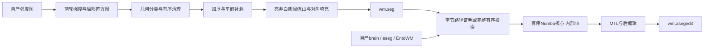
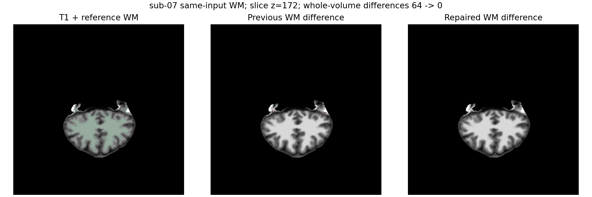
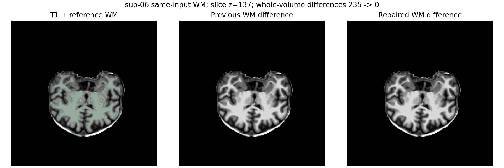

# 标准 WM 分割与编辑的自有实现

## 1. 功能与范围

标准单 T1 的 `mri_segment` 与 WM/aseg 编辑均已有自有 Python、Numba、PyTorch 实现。本次修复成熟 WM 子函数的算法错误，并补齐不依赖冻结被试哈希的完整 CPU 编辑文件接口。两个生产候选都不执行 FreeSurfer 程序；原生程序只出现在独立 benchmark。

`remove_bright_nonwhite` 曾照旧注释使用 14。固定源代码的整数表达式 `(3*3*3-1)/2` 实际为 13。两例逐阶段定位表明，直到加厚结束都完全一致；第一次差异发生于此规则，随后对角填充扩大了差异。修复公共阈值后，两例完整 WM 分割全部 13 个检查点均无不同体素，没有被试条件或体素补丁。

完整 CPU 编辑复用既有有序核心与后编辑，`fill_seg_wm` 在第一遍 WM 分支内执行。SCM-HA、keep-in、EntoWM level 3 和 ACJ 保持原顺序。`remove_paths_to_cortex` 保留原始四字节存储及快速几何证明；证明不成立时进入完整有序 NumPy/Numba 路径。左右半球的数值/字节访问差异按固定源保留，详见 [MTL 路径阻断](WM_REMOVE_PATHS.md)。



## 2. Python 调用、输入与输出

### 完整 WM 分割

完整分割仍复用已有 `segment_white_matter_mgz`；全部参数、张量接口和批处理规则见 [WM 平面缓存说明](WM_PLANAR_TORCH.md)。`device="cpu"`、`histogram_backend="cpu"`、`planar_backend="python"` 可使用完整原有 CPU 参考；显式 Torch/cached 组合加速可并行的静态计算，有序动态更新仍在 CPU。

```python
from fnit.recon_all.mri_segment import segment_white_matter_mgz

wm_report = segment_white_matter_mgz(
    source_path="mri/antsdn.brain.mgz",  # 自产3D uint8强度，XYZ体素网格
    output_path="mri/wm.seg.mgz",       # 新uint8 WM，保留毫米affine
    device="cuda:1",                   # 明确目标GPU，无隐式设备切换
    histogram_backend="torch",         # 复用完整分块局部直方图
    histogram_batch_size=2048,          # 候选分块，不删减候选
    planar_backend="cached",           # 静态几何缓存与有序Numba补洞
    planar_batch_size=256,              # 静态几何分块，不改变扫描顺序
)
```

成熟子函数 `remove_bright_nonwhite(image, masked)` 的两个必填输入均为同 shape 三维 uint8 Torch 张量：前者为原强度图，后者为加厚 WM。它返回新 uint8 张量，保留 `masked` 设备，不修改输入。3³邻域采用 nearest 边界；坐标为 XYZ 体素索引，无 RAS 变换。没有可配置阈值，保留固定源算法；维度、shape、dtype 错误抛 `ValueError`，设备传输失败传播。

### 完整 CPU 编辑

```python
from fnit.recon_all.edit_wm_aseg_core_python import write_wm_asegedit_profile

editing_report = write_wm_asegedit_profile(
    wm_file="mri/wm.seg.mgz",            # 自产3D uint8 WM与原编辑标记
    brain_file="mri/brain.mgz",          # 同网格uint8脑强度
    aseg_file="mri/aseg.presurf.mgz",    # 原存储int32或float32精确整数标签
    entowm_file="mri/entowm.mgz",        # 同网格精确整数EntoWM标签
    output_file="mri/wm.asegedit.mgz",   # 新uint8 WM，保留WM输入头尾
    fill_seg_wm=True,                    # 默认True，在原有序核心内部填充
)
```

| 参数 | 类型、默认值和含义 |
| --- | --- |
| `wm_file` | 必填 `str/Path`，三维 MGH/MGZ，原存储 uint8；0为非白质，既有强度和1/255手工编辑标记保留原定义 |
| `brain_file` | 必填，同网格三维 MGH/MGZ，原存储 uint8 强度 |
| `aseg_file` | 必填，同网格分割；原存储必须为 int32 或 float32 精确整数，不能将 int16/uint8 转换后代替原 byte-access 存储语义 |
| `entowm_file` | 必填，同网格精确整数标签；固定 level 3 的3006/3201/4006/4201写为255 |
| `output_file` | 必填，保存三维 uint8 新 WM；保留 WM 输入 MGH 头、附加尾部和毫米 affine |
| `fill_seg_wm` | 默认 `True`，严格布尔；False关闭内部 fill，其他标准选项保持固定 |

所有输入 shape 相同，affine 使用零相对误差、`1e-4 mm` 绝对误差校验；不重采样。返回字典包括 `implementation`、`device="cpu"`、`used_native_programs=False`、`fill_seg_wm`、`fill_insertion`、`path_proof_changed`（兼容字段）、`paths_filled`、`aseg_storage_dtype`、`timing_parts_seconds`、`array_stage_seconds`、`total_seconds`、`file_io_included=True`、`output`。数组阶段时间不含文件读取与写出，`total_seconds` 包含这些工作。

`edit_wm_aseg_profile(wm, brain, aseg, entowm, *, fill_seg_wm=True, aseg_storage_dtype="int32")` 是对应数组接口。前两个为 XYZ `numpy.uint8`，后两个为同 shape `numpy.int32`；返回 `(output_uint8, report)`，不修改输入。`aseg_storage_dtype` 指定 aseg 原四字节存储，默认 int32；float32 必须精确表示全部标签。文件入口在转换前校验并转发原 dtype。非法输入抛 `ValueError`；源内层传播重复完全不变的字节状态且仍增长计数时，本实现证明不终止后抛 `RuntimeError`，不返回近似结果；读写错误传播。SCM-HA半径固定1，其余原命令可选变体没有被暗示为已支持。

`wm_aseg_io.integer_label_array` 与 `validate_aseg_storage` 为 CPU/Torch 文件入口共用校验，旧 Torch 私有名称保留为别名。前者读取 XYZ 数据并拒绝小数、非有限或超 int32 范围；后者在任何转换之前检查原始4字节存储，不初始化 CUDA。

## 3. 命令行与复现

完整 CPU 编辑支持独立具名 CLI：

```bash
# 四线程预算；输入必须是同一自产网格，输出为新文件
OMP_NUM_THREADS=4 NUMBA_NUM_THREADS=4 MKL_NUM_THREADS=4 OPENBLAS_NUM_THREADS=4 \
python -m fnit.recon_all.wm_aseg_profile \
  --wm-file mri/wm.seg.mgz \
  --brain-file mri/brain.mgz \
  --aseg-file mri/aseg.presurf.mgz \
  --entowm-file mri/entowm.mgz \
  --output-file mri/wm.asegedit.mgz \
  --report scripts/wm-aseg-python.json
```

五个文件参数必填，含义与 Python API 相同；`--report` 可选，默认不另写JSON；`--no-fill-seg-wm` 可选，默认不传，即内部 fill 开启。库异常传播，CLI失败返回非零。

`benchmark/recon_wm_native_stage_diagnostic.py` 的必填 `--source` 为自产 uint8 强度图，`--output-directory` 为不存在的新诊断目录；`--reference-binary`、`--reference-sha256`、`--reference-assets`、`--reference-source-root` 仅用于独立参考；`--module-directory` 指向候选模块目录；`--code-version` 记录实际基线加执行模块SHA。设备默认cuda:1、线程默认4、直方图默认torch、平面默认cached，可显式选择CPU参考。它在自产候选每个真实阶段保存检查点，参考检查点只供比较，不进入候选算法。

`benchmark/recon_wm_aseg_independent.py` 的必填 `--mri-directory` 包含四个标准自产输入；`--output-directory` 必须不存在；`--module-directory`、`--reference-binary`、`--reference-assets`、`--reference-sha256`、`--code-version` 绑定实际程序和源码。设备默认cuda:1、线程4。顺序为 native→CPU→hybrid→hybrid→CPU→native；GPU同步仅用于benchmark。文件API计时包含读写和传输，导入及CUDA上下文初始化在计时前，首次CPU包含Numba JIT。

公开报告由 `collect_receipts.py` 的四个必填路径参数选择已声明任务和现有导出器，十份实际JSON先在服务器脱敏；数值/布尔/null的类型和遍历序列保持原样，清单分别记录原始 SHA 与公开 SHA。`summarize_results.py` 先校验公开 SHA 再生成CSV。`plot_results.py --fnit-directory ... --output-directory ...` 从声明的公开输入及实际前后输出画图，不修改候选输入。

## 4. 对应原软件

完整分割参考：

```bash
mri_segment -wsizemm 13 -mprage antsdn.brain.mgz wm.seg.mgz
```

完整标准编辑参考：

```bash
mri_edit_wm_with_aseg -keep-in -fix-ento-wm entowm.mgz 3 255 255 \
  -fix-acj aseg.presurf.mgz 255 255 -fill-seg-wm -fix-scm-ha 1 \
  wm.seg.mgz brain.mgz aseg.presurf.mgz wm.asegedit.mgz
```

固定源码提交为 `d932c45b7941662ea380a05efef580568b98d41a`。参考程序在 Conda 内源码构建并经过本机重定位，实际运行 SHA 写入报告。亮非白质、核心有序循环和后编辑都是上述命令的内部步骤，没有虚构独立原软件CLI。

## 5. 最新精度、时间与脑图

本次实际候选基线为 `54f681dcab210a22c2e6862b2854a7033b5a208d` 加执行模块 SHA；输入来自公开 ds000114 的 sub-06/sub-07，四线程、同 A100 节点。WM 编辑输入来自 `79a41cdd` 自产连续链；分割输入来自既有带 SHA 的自产检查点，两组用途分别记录，不称为本次原始T1整例。

| 同输入 WM 分割 | sub-07 | sub-06 |
| --- | ---: | ---: |
| 修复前首次不同阶段 | bright-nonwm，36体素 | bright-nonwm，138体素 |
| 修复前最终不同体素 | 64 | 235 |
| 修复后13个检查点不同体素 | 全部0 | 全部0 |
| 修复后最大/P99误差、最低逐标签Dice | 0 / 0 / 1 | 0 / 0 / 1 |

此前 CPU/Torch histogram 与旧/cached planar 的完整输出均相同；这次零差修复作用于所有后端共用的最后规则。完整CPU与Torch混合编辑同输入也都精确一致，精度没有因CPU路径改善或GPU路径变差。

| 完整 WM 编辑文件API（秒） | sub-07 | sub-06 |
| --- | ---: | ---: |
| 原生，两次 | 22.7993 / 22.7947 | 23.2639 / 23.1315 |
| 自有CPU，两次 | 13.9256 / 7.9757 | 8.8858 / 8.5294 |
| 自有Torch混合，两次 | 7.8050 / 6.7798 | 7.4037 / 7.2330 |

全部五组对照均0不同体素、最大/P99误差0、所有标签Dice1，dtype及affine一致，两次原生参考也重现。首例第一次CPU含JIT；不把首冷、后热与整例时间混为一谈。节点有共享任务，上述为这次固定预算的文件API观测；整例提速尚未测，不据此宣称整体等效或10分钟目标达成。

PyTorch allocated/reserved只覆盖本次混合部分，详见 [完整JSON及摘要](../../validation/recon_all/optimizations/20261010_wm_native_independent/README.md)。进程显存归属未测，记为null；CPU入口不初始化CUDA，也不改变全局TF32。生产Torch默认TF32保留，未启用半精度。没有新增计算依赖，主页Conda已有NumPy、SciPy、Numba、Torch和nibabel。




## 6. 更新与 benchmark 记录

- 2026-10-11：补齐 MTL 路径阻断的有序 NumPy/Numba 实现，CPU/Torch 文件入口保留原 int32/float32 存储。此页下方旧时间绑定此前版本；新增真实回归与活跃分支范围见 [路径阻断专页](WM_REMOVE_PATHS.md)。

- 2026-10-10：从两例实际13阶段定位并修复邻居阈值14→13；增加共享原存储检查与完整CPU标准编辑API/CLI；两例三方配对全部精确一致。早期64/235差异是已修复版本的定位证据，不能继续写成现版遗留结果。
- 同日清理未被生产调用的旧 `no_fill`/`fixed` 兼容接口中的被试哈希白名单：前者保留无fill有序规则及几何证明，后者复用完整标准CPU API。清理后的终版模块两例完整文件API再回归均0体素差异，源码SHA与完整报告另行绑定；限制不再依赖特定被试。
- 2026-10-09：既有PyTorch histogram、静态平面缓存和isolated worker完成同输入回归，当时64/235差异仍存在；这些报告保留为本次因果定位的参考。
- 本次没有把阶段测试或检查点补跑标成原始T1整例；后续连续链由主调度单独绑定代码与资源版本。

## 7. 源码与参考文献

- [固定 mri_segment](https://github.com/freesurfer/freesurfer/blob/d932c45b7941662ea380a05efef580568b98d41a/mri_segment/mri_segment.cpp)
- [固定 MRIfindBrightNonWM 实现](https://github.com/freesurfer/freesurfer/blob/d932c45b7941662ea380a05efef580568b98d41a/utils/mri2.cpp)
- [固定 WM/aseg 编辑](https://github.com/freesurfer/freesurfer/blob/d932c45b7941662ea380a05efef580568b98d41a/mri_edit_wm_with_aseg/mri_edit_wm_with_aseg.cpp)
- Dale AM, Fischl B, Sereno MI. Cortical surface-based analysis. I. Segmentation and surface reconstruction. NeuroImage 1999;9:179–194.
