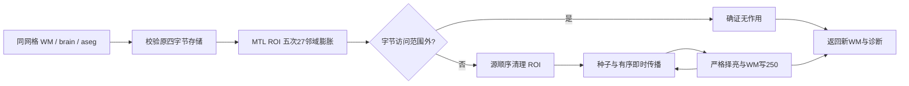
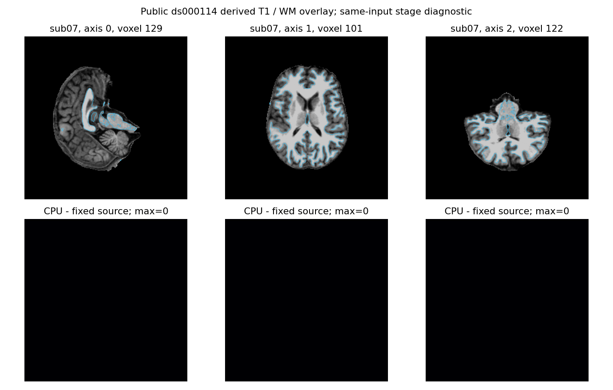
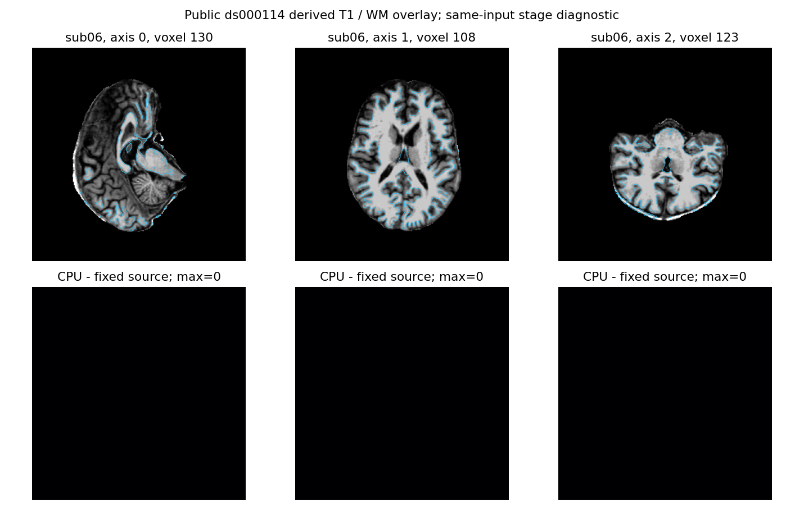

# MTL 到皮层的 WM 路径阻断

## 1. 功能简介

`wm_remove_paths.py` 为固定 WM 编辑命令的内部路径阻断提供独立 NumPy/Numba 实现。复用既有距离、边界和邻域函数；不调用原版程序或动态库，不使用参考结果。

这是原有完整 CPU/Torch 混合编辑子函数的功能补齐。此前只能证明某些输入不会进入路径搜索，证明失败就报未实现。现在保留快速证明，并执行尚未被证明无作用的完整有序搜索。文件入口额外修复了原 aseg 存储类型丢失的问题：标签可转为 int32 供其他规则使用，但路径临时卷仍必须使用原 int32/float32 存储。

源算法混合数值体素和 `MRIvox` 的单字节访问。左侧增长读取数值 ROI/filled，右侧读取字节 ROI/filled；两侧写入均是字节。实现保留这些实际行为，不把它们统一为普通洪泛搜索。



## 2. Python 调用、输入与输出

```python
from fnit.recon_all.wm_remove_paths import remove_mtl_paths

edited_white_matter, path_report = remove_mtl_paths(
    wm=white_matter_array,               # 三维XYZ uint8，WM强度及编辑值
    brain=brain_intensity_array,         # 同网格XYZ uint8脑强度
    aseg=segmentation_label_array,       # 同网格XYZ int32整数标签
    aseg_storage_dtype="float32",       # 标签文件实际存储；默认int32，不能猜测
    use_unreachable_proof=True,          # 默认True，仅跳过确证无作用的扫描
)
```

| 输入 | 结构、默认值及限制 |
| --- | --- |
| `wm` | 必填 `(X,Y,Z)` NumPy uint8；各轴≥3，源 WM `>5` 为传播屏障，六邻域检查用 `>=5` |
| `brain` | 必填，同 shape uint8，择亮时按原 x/y/z 顺序、严格 `>` 接受新候选 |
| `aseg` | 必填，同 shape int32 非负标签；左17/18/5，右53/54/44生成ROI，皮层为3/42 |
| `aseg_storage_dtype` | 默认 `"int32"`，可用 int32/float32 的 dtype或名称；必须对应原四字节存储。float32须精确表示全部标签；int16/uint8/float64拒绝 |
| `use_unreachable_proof` | 默认 `True`，严格布尔。False执行完整扫描用于诊断证明，不改变算法或候选范围 |

坐标均为 conformed XYZ 体素索引，距离窗口单位为体素；无 RAS 变换、毫米转换或重采样。内部把临时卷布局为 `(Z,Y,X)` 原生 little-endian 数值行，字节别名为 `(Z,Y,4X)`，两者共享缓冲。仅支持 little-endian 主机；MGH 文件读入后由 nibabel 转为数值，临时卷存储与原程序内存字节序一致。

返回 `(output, report)`：`output` 为新 XYZ uint8 WM，原输入不修改；`report` 包括 `implementation`、`used_native_programs=False`、`aseg_storage_dtype`、`host_byteorder`、字节可及的最大数值 x、两半球的 `proof_unreachable`/`filled`/`outer_iterations`/源 cap状态及实际墙钟。路径填充为250；源外层 `path && niter++ <100000` 保留，最多执行100001次实际填充，并显式报告触发情况。

非法输入抛 `ValueError`。源内层没有迭代上限；如果一次完整增长扫描仍计数、没有皮层且整个字节缓冲未改变，则 WM、ROI、aseg、brain、种子、bounds、xmedial以及全部下轮控制量都相同，下一扫描必然重复。该可证明的不终止状态抛 `RuntimeError`，不返回近似结果；这是明确失败行为，不是与原程序成功输出等价的声明。内存、Numba和读写异常传播。

完整 CPU 数组接口 `edit_wm_aseg_profile(..., fill_seg_wm=True, aseg_storage_dtype="int32")`、完整混合数组接口 `edit_wm_aseg_hybrid_diagnostic(..., device="cuda:0", fill_seg_wm=False, aseg_storage_dtype="int32")` 使用同一实现。两个文件 API 在转换前校验原 aseg dtype并自动转发，参数与完整配方见 [CPU说明](WM_NATIVE_INDEPENDENT.md) 和 [Torch说明](WM_ASEG_TORCH.md)。旧 `path_proof_changed` 字段兼容保留，同时报告 `paths_filled` 与原存储类型。

内部函数都是上述固定命令的一部分，无独立官方命令；本轮真实样本的路径搜索均由快速证明跳过，因此活跃内部核的真实精度和耗时尚未测。

| 内部函数 | 输入、输出与作用 |
| --- | --- |
| `_lateral_edge` / `_inferior_edge` | XYZ int32标签、原标签ID与体素索引；分别返回源方向上的体素距离；复用clamp和标签距离，未找到按源返回width或−1 |
| `_clean_roi_bytes` | 别名字节ROI、XYZ int32标签和左右布尔；原位执行五项源顺序清理，字节写0 |
| `_six_on` | XYZ uint8 WM与体素索引；返回六邻域 `>=5` 的数量，边界索引夹取，重复邻居仍计数 |
| `_search_hemisphere` | 同网格WM/brain/aseg，ZYX类型/字节别名、六个bbox索引、左右布尔；原位更新新WM及临时卷，返回填充数/外轮数/cap布尔；顺序不并行化 |
| `_row_views` | XYZ shape、原生四字节dtype及可选XYZ初值，默认零；返回共享内存的字节与数值ZYX临时卷 |
| `_bounds` | ZYX数值ROI和XYZ shape；按typed `>1` 返回六个内部扫描端点；空ROI为等价空扫描 |

## 3. 命令行调用

路径子函数没有独立生产 CLI，完整标准编辑 CLI 复用既有接口：

```bash
# 完整自有CPU编辑；同网格输入，源标准选项和输出保持完整
OMP_NUM_THREADS=4 NUMBA_NUM_THREADS=4 OPENBLAS_NUM_THREADS=4 \
python -m fnit.recon_all.wm_aseg_profile \
  --wm-file subject/mri/wm.seg.mgz \
  --brain-file subject/mri/brain.mgz \
  --aseg-file subject/mri/aseg.presurf.mgz \
  --entowm-file subject/mri/entowm.mgz \
  --output-file subject/mri/wm.asegedit.mgz \
  --report subject/scripts/wm-edit-python.json
```

四个输入与输出参数必填；`--report` 可选，JSON输出；`--no-fill-seg-wm` 可选，默认不传即开启内部填充。文件参数的结构和失败行为同第二节；CLI失败非零退出。

本轮可复现工具 `tools/benchmark_recon_wm_remove_paths.py` 支持 `--mode pair|one`（默认pair）、`--backend native|baseline|cpu|hybrid`（默认cpu）、`--case`、`--input-directory`（四标准文件）、`--output`（新目录）、`--source-manifest`、`--baseline-module`、`--producer-receipt`、`--code-version`、`--input-producer`（后六项均必填）。`--device` 默认cuda:0，`--threads`默认3；外层1线程采样加子3线程计算，总预算4。`--order`固定记录运行顺序；参考参数 `--reference-program`/`--reference-program-sha256`/`--reference-receipt`显式绑定独立源码构建程序，`--reference-timeout`默认300秒，只作用于本工具新建参考子进程。生产API不使用这些参数。

```bash
# 同输入完整阶段回归，包含校验、导入、加载、传输及读写；不是原始T1整例
python tools/benchmark_recon_wm_remove_paths.py \
  --mode pair --case sub06 --order baseline,cpu,native,native,cpu \
  --input-directory checkpoint/mri --output new-run/sub06 \
  --source-manifest freeze/SOURCE_MANIFEST.json --baseline-module freeze/baseline_core.py \
  --producer-receipt checkpoint/benchmark.json --code-version actual-commit-plus-SHA \
  --input-producer 79a41cdd --threads 3 --device cuda:0 \
  --reference-program benchmark-native/mri_edit_wm_with_aseg \
  --reference-program-sha256 declared-program-SHA256 --reference-receipt benchmark-native/runtime_receipt.json
```

上述具名参数的含义见前段。公开收据 `collect_receipts.py` 用必填 `--fnit-root`、`--source`、`--v1-run`、`--v2-run`、`--output` 选择本轮已完成冻结产物，只导出安全JSON/CSV与两图。只读 `scan_roi.py` 用必填 `--fnit-root`、`--input-manifest`（含case/relative_input清单）、`--output`复核实际类型和ROI范围，不生成参考或改影像。

## 4. 对应原软件调用

```bash
mri_edit_wm_with_aseg -keep-in -fix-ento-wm entowm.mgz 3 255 255 \
  -fix-acj aseg.presurf.mgz 255 255 -fill-seg-wm -fix-scm-ha 1 \
  wm.seg.mgz brain.mgz aseg.presurf.mgz wm.asegedit.mgz
```

固定源提交 `d932c45b7941662ea380a05efef580568b98d41a`，`remove_paths_to_cortex` 位于 WM 编辑源码2305–2768行；源文件 SHA `6cddf001f37981e7f96d5f4658bd16eb0b06d51cf8d235cac46ff8d8f9da6f21`。本轮独立 Conda benchmark程序SHA `239b181c45ed5cee91a112f7bcaa923226b2f0e1037974b18f5946642d1ed57d`，安装与重定位来自单独runtime收据；不复制预装程序。源临时MRIclone保持aseg类型；LH数值/RH字节不对称来自实际源操作，不能仅按函数名推断相同语义。

## 5. 本轮真实精度、耗时与脑图

输入为公开ds000114 sub-07/sub-06 的 `79a41cdd` 自产连续链中四个标准MGZ。候选源码绑定 `2474392b` 加显式SHA overlay；v1/v2执行算法模块相同，v2仅修复诊断工具的Numba缓存模块注册。完整阶段加载/校验/传输/写出均计时，导入及fresh CLI另列。A100物理GPU0，显式逻辑cuda:0；计算3线程加采样1线程，总预算4。首次JIT、页缓存和共享负载不抹除。

| 完整文件API，秒 | sub-07 | sub-06 |
| --- | ---: | ---: |
| 既有CPU一次 | 25.4038 | 21.6262 |
| 新CPU两次 | 24.9591 / 15.8292 | 19.9118 / 12.5974 |
| 固定源码参考两次 | 30.3222 / 39.8935 | 31.7058 / 26.8098 |
| 新Torch混合一次 | 44.1880 | 14.8702 |

两例所有旧/新CPU、混合/参考及自身重复比较：不同体素0，最大/P99差0，shape/dtype/毫米affine/surface-RAS矩阵一致，WM前景（uint8 `>=5`）Dice1，每个整数值Dice1。逐值Dice是WM强度/编辑值检查，不是最终脑区分割Dice。完整MGZ原字节比较不相同，报告原SHA与原字节失败，未将解码零差冒充逐字节复现。

真实两例填充数均0、ROI证明均成立。额外只读扫描冻结3a十例公开检查点：20侧均在四字节 `row[x]` 可及范围之外，无真实活跃分支。这十例只做输入检查，不是新WM重建或新整例。活跃RH填充、LH固定状态失败和存储别名由合同覆盖，活跃分支真实benchmark未验证，源cap实际触发也未验证。

TF32 matmul/cuDNN均开启、autocast关闭、没有半精度。Torch allocated峰值553,648,128字节，reserved641,728,512字节；采样目标卡使用上界1,164,967,936字节（1.165GB，1.085GiB）。父子进程归属无法在命名空间解析，合计值为null；不能把这个null或关闭缓存的计数解释成零显存。请求间隔0.5秒，实际最大间隔sub-07=5.0806秒、sub-06=1.7903秒，可能漏短峰值；这不是整个recon-all的连续峰值证明。

本轮目的为补齐原版依赖缺口；仅为共享节点完整文件阶段的实际观测，不据此宣称加速、整例10分钟或整体等效。无新增依赖，主页Conda已有NumPy、SciPy、Numba、Torch、nibabel。调用者在API计时前已同步初始化目标CUDA；父子同时持有GPU张量、非当前目标设备与整例接入未新增实测，无预装软件隔离未验证。

[完整机器报告及复现脚本](../../validation/recon_all/optimizations/20261011_wm_remove_paths/README.md)




## 6. 最近更新与 benchmark 记录

- 2026-10-11：完整有序NumPy/Numba路径及原存储转发；20个focused合同9.23秒，两例完整文件阶段解码精确一致。真实活跃分支/源cap触发未测。
- v1诊断工具第一例全部阶段成功，第二例旧CPU的磁盘Numba缓存因未注册动态模块失败，原失败日志SHA和exit1保留；v2只注册稳定模块名后第二例全部阶段成功，不覆写v1。
- 十例只读扫描首版显示名使用错误的父目录层级，数值、文件SHA和ROI计算未变；公开修正按已记录relative_input恢复case名字，标注原stdout SHA和不重读影像。
- 2026-10-10：完整标准CPU/混合编辑此前只有快速路径证明；旧页时间仍绑定旧代码，不能改标本轮。

## 7. 原实现与参考文献

- [固定 WM 编辑源码](https://github.com/freesurfer/freesurfer/blob/d932c45b7941662ea380a05efef580568b98d41a/mri_edit_wm_with_aseg/mri_edit_wm_with_aseg.cpp)
- [MRI 访问类型与阈值](https://github.com/freesurfer/freesurfer/blob/d932c45b7941662ea380a05efef580568b98d41a/include/mri.h)
- [MRIclone与bounding box](https://github.com/freesurfer/freesurfer/blob/d932c45b7941662ea380a05efef580568b98d41a/utils/mri.cpp)
- [MRIdilate](https://github.com/freesurfer/freesurfer/blob/d932c45b7941662ea380a05efef580568b98d41a/utils/mriset.cpp)
- Dale AM, Fischl B, Sereno MI. Cortical surface-based analysis. I. Segmentation and surface reconstruction. *NeuroImage*. 1999;9:179–194.
