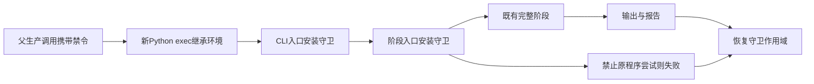

# 自有 exec worker 的生产程序守卫

## 1. 功能简介与修复原因

父进程的 Python audit hook 不随新解释器 exec 继承。以前 GCA、WM 和 Talairach SynthMorph 子进程只收到生产禁令环境标志，没有安装守卫。现在三个 worker 的 CLI 入口及阶段 Python 入口复用 `execution_recipe.original_stage_guard`，在任何阶段调用前安装守卫；只有继承 `FNIT_RECON_FORBID_ORIGINAL_STAGES=1` 时启用，独立 benchmark 不自动开启。正常返回或异常退出恢复守卫环境和作用域；禁止尝试抛出 `RuntimeError`，父隔离 API 保留 `CalledProcessError` 传播，不回退。



该修复没有更改注册、WM 或 SynthMorph 算法、文件格式、线程选择、分配器或 TF32 策略。阶段自身已有的子进程初始化设置继续保留：GCA/WM 在新进程选择线程和 TF32，Talairach affine 保留局部 FP32 例外与其原有恢复规则。守卫自身不设置这些数值状态，也不把 worker 改为可重入的任意进程数值接口。它拦截直接 Python `subprocess/exec/posix_spawn` 原程序及文件路径别名；不是 shell 子孙、动态库或文件访问的系统调用沙箱。可选隔离 Torch N4 不在本次三个 worker 修改范围内。

固定起点为 `9dce8be979863ab98a9389066e882537b5a22763`。现场复核该版生产 GCA 的进程内与隔离入口均进入 `register_t1`：候选搜索后调用稳定样本 `align_em(clamp=0, tolerance=1e-5)`，再调用全样本 `align_em(clamp=6, tolerance=1e-7)`，随后写 LTA。`align_em` 包含多方向 L-BFGS、7对历史、步长搜索、重启、准牛顿 pass 和外层终止。旧冻结版 `effa7fcf` 的首次方向线搜索结论只适用于旧版，不能继续套用到此版。配方元信息与整例放行由协调者另外更新。

## 2. Python 调用及逐项输入输出

没有新增用户参数或依赖。环境标志是进程内控制输入，不是影像字段。包装器 `inherit_original_stage_guard(function)` 输入一个可调用 worker 入口，输出保留签名、参数和返回值的包装函数；每次调用读取标志，不在模块导入时冻结。未设置、空字符串或 `0` 不自动启用守卫；当前外层已启用的生产守卫仍有效。装饰器本身没有文件输出、空间或单位。

```python
from pathlib import Path
from fnit.recon_all.execution_recipe import original_stage_guard
from fnit.recon_all.gca_torch_worker import run_isolated_registration
from fnit.recon_all.wm_torch_worker import run_isolated_segmentation
from fnit.recon_all.talairach_synthmorph import register_talairach

# 所有影像来自同一FNIT自产链；资源为已经按项目清单校验的本地文件。
subject_directory = Path("subject")
resource_directory = Path("resources")
with original_stage_guard(enabled=True):  # 传播生产禁令，退出恢复原环境
    registration_report = run_isolated_registration(
        nu_path=subject_directory / "mri/nu.mgz",  # 三维conform强度
        mask_path=subject_directory / "mri/brainmask.mgz",  # 同网格脑掩膜
        atlas_path=resource_directory / "average/RB_all_2020-01-02.gca",
        output_path=subject_directory / "mri/transforms/talairach.lta",  # 新voxel LTA
        report_path=subject_directory / "scripts/gca-isolated.json",  # 新JSON
        device="cuda:0", threads=4, candidate_chunk=1024,
        inverse_backend="torch", code_version="fixed-source-commit",
    )
    white_matter_report = run_isolated_segmentation(
        source_path=subject_directory / "mri/norm.mgz",  # 自产三维uint8强度
        output_path=subject_directory / "mri/wm.mgz",  # 新uint8 WM，同XYZ网格
        report_path=subject_directory / "scripts/wm-isolated.json",
        device="cuda:0", threads=4, histogram_batch_size=2048,
        planar_batch_size=256, profile_stages=False, code_version="fixed-source-commit",
    )
# Talairach affine是较早的独立步骤；此例单独说明接口，不表示上述三步顺序。
with original_stage_guard(enabled=True):
    talairach_ras_matrix = register_talairach(
        moving=subject_directory / "mri/synthstrip.mgz",  # 自产去颅骨MRI
        template=resource_directory / "average/mni305.cor.stripped.mgz",
        weights=resource_directory / "models/synthmorph.affine.2.h5",
        output_xfm=subject_directory / "mri/transforms/affine-only.xfm",
        output_lta=subject_directory / "mri/transforms/affine-only.lta",
        device="cuda:0", threads=4, precision_report=[],
    )
```

资源示例路径仅说明角色，按既有清单定位实际文件，不据示例下载或替换权重。三个接口的参数如下。

| 接口/参数 | 意义、格式、默认值与输出 |
| --- | --- |
| GCA `nu_path`, `mask_path` | `Path`，同shape/毫米affine的三维conform强度与脑掩膜；仅消费自产输入 |
| GCA `atlas_path` | `Path`，声明并校验的固定GCA；不下载，不读参考结果 |
| GCA `output_path` | 新 `Path`，type=0源voxel→图谱voxel的4×4 FP32 LTA及双方几何 |
| GCA `report_path` | 新JSON；完整注册轨迹、输入/源码SHA、精度/线程、GPU张量峰值及计时 |
| GCA `device`, `threads` | 隔离API必填CUDA设备，worker默认cuda:0；线程默认4，子线程预算 |
| GCA `candidate_chunk`, `inverse_backend` | 默认1024及torch；完整候选分批数量、cpu/torch同公式求逆选择 |
| GCA `code_version` | 隔离API默认FNIT-source-hashes；worker必填版本标识，实际源码另以SHA绑定 |
| WM `source_path`, `output_path` | 自产三维uint8强度与新uint8 WM；保持原XYZ网格及毫米affine |
| WM `report_path` | 新JSON；输入/输出/源码SHA、完整阶段报告、精度/线程、缓存及张量峰值 |
| WM `device`, `threads` | 隔离API必填显式cuda:N，worker默认cuda:0；线程默认4 |
| WM `histogram_batch_size`, `planar_batch_size` | 默认2048、256；正整数批量，只分块完整直方图/平面候选 |
| WM `profile_stages`, `code_version` | 默认False：不增加逐段同步；版本默认与GCA隔离API相同，worker必填 |
| Talairach `moving`, `template`, `weights` | MRI路径、声明的MNI305模板路径、本地affine权重路径；不读取参考输出 |
| Talairach `output_xfm`, `output_lta` | XFM路径及可选LTA路径（默认None）；scanner RAS/mm线性变换 |
| Talairach `device`, `threads` | 默认cpu、4；生产调用明确CUDA，保留既有线程协议 |
| Talairach `precision_report` | 默认None，或可写前向记录列表；返回4×4 FP32 RAS矩阵 |

隔离 GCA/WM 返回报告字典并补全进程墙钟，失败不产生伪成功回执。GPU allocated/reserved 是张量分配器峰值，不能当作进程树显存。所有参数验证、读取、计算或输出错误继续传播。与父 API 状态保持相关的已有合同继续执行；本次守卫仅负责程序禁令环境及审计作用域的恢复。

## 3. 命令行调用

```bash
FNIT_RECON_FORBID_ORIGINAL_STAGES=1 python -m fnit.recon_all.gca_torch_worker \
  --nu subject/mri/nu.mgz --mask subject/mri/brainmask.mgz \
  --atlas resources/average/RB_all_2020-01-02.gca \
  --output subject/mri/transforms/talairach.lta --report subject/scripts/gca-isolated.json \
  --device cuda:0 --threads 4 --candidate-chunk 1024 --inverse-backend torch \
  --code-version fixed-source-commit

FNIT_RECON_FORBID_ORIGINAL_STAGES=1 python -m fnit.recon_all.wm_torch_worker \
  --source subject/mri/norm.mgz --output subject/mri/wm.mgz \
  --report subject/scripts/wm-isolated.json --device cuda:0 --threads 4 \
  --histogram-batch-size 2048 --planar-batch-size 256 --code-version fixed-source-commit

FNIT_RECON_FORBID_ORIGINAL_STAGES=1 python -m fnit.recon_all.talairach_synthmorph \
  subject/mri/synthstrip.mgz resources/average/mni305.cor.stripped.mgz \
  --weights resources/models/synthmorph.affine.2.h5 \
  --xfm subject/mri/transforms/talairach.xfm --lta subject/mri/transforms/aff.lta \
  --device cuda:0 --threads 4 --memory-report subject/scripts/talairach-child-gpu.json
```

GCA CLI参数与Python worker逐项对应。WM额外 `--profile-stages` 默认关闭。Talairach `--memory-report` 默认不写；提供时保存设备、前向策略和张量峰值JSON。守卫没有独立CLI。

## 4. 原软件调用

程序守卫是 FNIT 调度控制，没有独立原软件命令。GCA阶段对应独立参考：

```bash
mri_em_register -uns 3 -mask reference-input/brainmask.mgz \
  reference-input/nu.mgz resources/average/RB_all_2020-01-02.gca reference-only/talairach.lta
```

WM和Talairach的完整参考参数沿用已有阶段说明；本次不更改或执行参考程序。独立 benchmark 必须与生产禁令作用域分离，不能为了参考测试在活动生产作用域内清除标志。

## 5. 本版验证、精度与耗时

本次是本地执行边界合同验证：真实 Python worker 入口、真实新 exec、实际 subprocess audit 事件、异常传播、嵌套父守卫和状态恢复。测试探针是只写标记的自有脚本；在第一个数值调用及阶段内部注入故障，不读取 MRI、不加载权重、不初始化 CUDA。未运行原版程序、整例或GPU benchmark。没有本版真实影像误差、端到端/分步骤耗时和脑图，也不以这些合同替代科学 benchmark。

完整 EM 两轮接线另有真实 `register_t1` 入口合同；该合同替换数据加载/优化依赖，仅验证实际接线顺序和输出消费。优化器本身运行既有完整协议单元检查。起点所携带的两例真实 GCA、CA 和volume prefix证据见 [完整GCA说明](GCA_COMPLETE_PYTHON.md) 和其绑定回执，属于对应源码版本的组件实测；没有在本次补守卫后重跑或改标为当前整例。最新合同数量、版本及源码SHA见专属 `validation/recon_all/optimizations/20261011_worker_program_guard`。

## 6. 更新记录

- `effa7fcf`：静态审查发现隔离worker缺少守卫、旧EM仅首次方向；保留历史报告。
- `9dce8be9`：本任务冻结新起点，重新核对完整稳定/全样本EM接线；撤销将旧EM缺口套用到新版的结论。
- 本版：三个worker及CLI按继承标志安装同一守卫；无数值算法或线程/精度策略变更，新增故障/传播合同。

## 7. 原实现与参考文献

守卫是 FNIT 原创调度控制，使用 Python [audit hook](https://docs.python.org/3/library/sys.html#sys.addaudithook) 及 [ContextVar](https://docs.python.org/3/library/contextvars.html)，不复制原软件阶段代码。GCA原算法来源与参考文献见 [完整GCA说明](GCA_COMPLETE_PYTHON.md#7-原实现与参考文献)。SynthMorph来源见 [SynthMorph](https://github.com/voxelmorph/synthmorph)；原版完整表面重建框架见 [FreeSurfer](https://github.com/freesurfer/freesurfer)。
