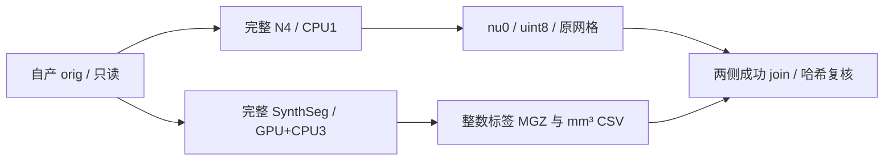

# 完整 N4/SynthSeg 并行组：两例同输入 ABBA

## 1. 功能与验证范围

本次复用完整 SimpleITK N4 与 FNIT 自有 GPU SynthSeg，在同一 conformed `orig.mgz` 上以两个 fresh-exec Python 子进程执行。串行每阶段四线程；并行使用 N4 一线程与 SynthSeg 三线程，总计算预算四线程。N4 拟合始终一线程，仅将重建预算由四改为一，并先通过完整浮点输出的同输入门。



两例来自公开 ds000114 的 sub-07/sub-06。输入为 `79a41cdd` FNIT 自产 `orig`；本次不从原始T1跑完整 recon-all，也没有读取官方结果作为生产输入。测得的是两个完整阶段的组墙钟，整例提速与整体指标等效均未判定。原版阶段程序没有进入本辅助组。

## 2. Python、输入与输出结构

完整函数调用、全部参数及失败行为见[功能页](../../../../docs/recon_all/INPUT_N4_SYNTHSEG_PARALLEL.md)。本次实际调用方式如下；所有输出必须是新路径。

```python
from fnit.recon_all.input_stage_parallel import run_input_stage_group

stage_group_result = run_input_stage_group(
    orig_path="subject/mri/orig.mgz",                   # 自产conformed三维T1，XYZ网格
    n4_output="diagnostic/group/nu0.mgz",               # 同网格uint8输出，不读参考图
    segmentation_output="diagnostic/group/synthseg.mgz", # 原整数标签，float32 MGZ存储
    volumes_output="diagnostic/group/synthseg.vol.csv",  # 原格式32组织软体积与颅内容积，mm³
    weights_dir="resources/weights",                   # 已有四文件模型与标签资源
    color_lut="resources/assets/FreeSurferColorLUT.txt", # 已声明颜色表，只读取
    report_path="diagnostic/group/group.json",          # 完整join及父子执行收据
    device="cuda:5",                                   # 目标GPU显式指定，核对实际UUID
    threads=4,                                         # 固定总计算预算，parallel分为1+3
    execution="parallel",                              # 默认serial，不改变默认配方
    profile_stages=True,                                # 同输入剖析同步目标GPU
    code_version="frozen-base-plus-overlay-manifest",   # 实际版本另以逐文件SHA绑定
)
```

`nu0` 与分割均为 `(256,256,256)`，scanner-RAS affine和surface-RAS头几何保持输入。分割保存复用成熟保存器，实测磁盘dtype为大端float32，标签值为原整数。CSV为软组织体积，不等于离散标签体素数。

`workers.n4/synthseg.value` 保留各原完整返回值；SynthSeg另含 `total_intracranial_mm3` 和真实 `precision.forwards`。父报告还记录实际线程、父前后精度与CUDA状态、输入/模型/资源/子函数和输出SHA、重叠时间及同一时刻显存快照。失败保留子日志和failed JSON，并只取消本组新建独立会话的子进程树。

`reports/` 的71份JSON已脱敏且保留原始SHA与公开SHA，原JSON的16,152个数值、bool、null及类型均未改变；另有公开导出manifest。`summary/` 包含完整八次CLI秒数、误差表和摘要；`plots/` 包含两张公开影像派生图与输入/绘图SHA。原影像、浮点数组、模型、许可证、地址和私有路径不提交。

## 3. 命令行与复现

执行前固定已有orig、模型、颜色表、代码及SHA清单，并使用一个不存在的新输出目录。CLI总四线程，设备用显式编号；本次先sub07，再sub06，各执行 `[serial,parallel,parallel,serial]`。

```bash
# 完整冷CLI ABBA；包含子进程启动、导入、模型加载、传输及所有输出写入
python tools/benchmark_recon_input_stage_parallel.py \
  --mode abba \
  --module-directory src/fnit/recon_all \
  --input subject/mri/orig.mgz \
  --output diagnostic/new-ABBA \
  --weights resources/weights \
  --color-lut resources/assets/FreeSurferColorLUT.txt \
  --device cuda:5 \
  --source-manifest diagnostic/SOURCE_MANIFEST.json \
  --code-version frozen-base-plus-overlay-manifest
```

额外父CUDA API回归将 `--mode` 改为 `group`，另加 `--execution parallel --initialized-parent`，仍使用新目录。N4重建线程门使用 `--mode reconstruction-gate --reference-directory diagnostic/fit1-reconstruction4`，参考必须带相同输入/源码SHA和已完成的float/uint8文件；交叉参考仅进入诊断比较器。

`collect_receipts.py` 在声明FNIT任务目录内复核EXIT0、775个冻结文件大小/SHA、overlay、九组worker/前向/线程、原始文件与SHA后，复用既有数值保真导出器。具名参数为 `--fnit-root`（授权任务根）、`--output`（新公开JSON目录）、`--exporter`（既有 `export_receipts.py` 路径）和 `--replacements`（仅在私有环境保存的字符串替换清单）。`summarize_results.py --reports public/reports --output public/summary` 再验证公开SHA；`plot_results.py` 从同一授权公开数据生成图，具体输入参数见其 `--help`，不读取其他项目。

无需新增依赖：使用主页既有PyTorch、nibabel、Surfa和SimpleITK==2.5.6。本次证明阶段调用与同输入输出，未完成干净Conda环境整例或OS文件/动态库隔离验收。

## 4. 原软件与版本绑定

SynthSeg参考命令为 `mri_synthseg --i orig.mgz --o synthseg.rca.mgz --vol synthseg.vol.csv --keepgeom`，非robust/非parcellation33类配方。N4参考为固定recon-all N4阶段及make_nu包装；Shrink、全分辨率B-spline、Exp/Divide属于库内部，没有编造独立等价CLI。详见[N4 SimpleITK页](../../../../docs/recon_all/N4_SIMPLEITK.md)及[FNIT SynthSeg](../../../../src/fnit/synthseg_parc/synthseg.py)。

本次完整参考为同输入串行FNIT组；没有新增原版程序执行。既有固定原生N4重复对照仍分别记录sub07/sub06相对SimpleITK的28/99个±1量化体素差，本并行组不消除或扩大该历史差异。官方重复性和两例前段传播另见N4专页与对应原始报告，不能把本组零差称作与官方零差。

| 版本对象 | 实际SHA-256 |
| --- | --- |
| 基线775文件manifest，Git `922f5698` 加逐文件overlay | `21bfe987f5f2cfde992578208d8235b1ed90ad2c4608c95df1b0f4c6751b9d9a` |
| 本次测量helper | `8af12262635fd545288f34225a45f5693b9874e0dc38e603b4210bb96443be22` |
| 完整SimpleITK N4模块 | `c14e8eb46fb408926ddb9a7fe3d35d97bb5201382928e87226f71f8e01041b90` |
| 完整benchmark工具 | `6eba47b177583765d0a3911a60f76c6643a648db76020e4b3ce5df0215efb118` |

发布时helper仅修正了磁盘分割dtype的docstring，去docstring后可执行AST完全相同。实测SHA、发布SHA与AST核验分开保留在 `publication_source_binding.json`；没有重写冻结收据。`contract_tests.json` 是发布文件的11项本地合同，workers使用mock；真实数据证据为下表九组完整执行。

## 5. 完整阶段精度、耗时、显存与脑图

同一共享A100节点，目标cuda:5、实际UUID固定，CPU100–103、总四线程、缓存关闭环境相同。九组模型两次完整前向均为FP32，matmul TF32开启、cuDNN FP32例外、autocast关闭。

| 数据 | serial 1，秒 | parallel 2，秒 | parallel 3，秒 | serial 4，秒 | serial→parallel中位，秒 | 本组观察缩短 |
| --- | ---: | ---: | ---: | ---: | --- | ---: |
| sub07 | 209.851828 | 191.511268 | 190.139539 | 208.393827 | 209.122827→190.825404 | 8.7496% |
| sub06 | 209.811487 | 189.638661 | 190.260523 | 220.994975 | 215.403231→189.949592 | 11.8167% |

以上为外部完整冷CLI墙钟；组API与内部最后JSON写出前计时单列在 `summary/stage_times.csv`。每例每策略只有两次样本；sub06最后一次串行的导入和SynthSeg较慢，共享负载也有变化，因此不能将其25.45秒中位差全部归因为并行。算法计算区间实际重叠11.44–15.38秒。完整N4 worker仍约186–188秒，是本组剩余主瓶颈。

| 检查 | 两例实际结果 |
| --- | --- |
| fit1重建1 vs4完整float32 / uint8 | 不同元素/体素0，最大/P99为0；几何相同 |
| 串并N4及SynthSeg | 所有不同体素0、最大/P99为0、dtype/shape/affine/tkr相同 |
| 每例32个非零标签 | 每一标签Dice=1 |
| 软体积与颅内容积CSV | 全文件字节相同 |
| 三输出文件 | 每例四次以及sub07额外API的各自SHA相同 |
| 父CUDA已初始化API | buffer、current cuda:0、4线程、精度/缓存环境保持；target cuda:5，全部输出相同 |

额外API脚本含导入/父初始化为191.909691秒，内部完整组为187.992446秒；该次不加入冷CLI ABBA中位数。九组同期进程树显存因PID命名空间归属未能证明而为null。目标整卡采样峰范围5,550,112,768–13,603,176,448字节（5.55–13.60 GB），包含共享任务；未通过将不同时间进程峰相加估算树占用。缓存关闭的PyTorch allocated/reserved不可用，不用0填补。请求采样0.5秒，最大实测间隔4.964059秒、一次采样失败，未证明连续峰值和整例20 GB上限。本次冻结旧采样器，不套用之后NVML实现的性能或精度。

结论分开保存：同输入完整组严格复现通过；该优化在已测试完整输出中无新增退化；整体指标等效 `not_assessed`；原始T1整例提速 `not_measured`；10分钟整例目标尚未验证。


## 6. 更新与benchmark记录

- 2026-10-10：两例完整N4重建1/4前置门通过；拟合仍1。
- 2026-10-10：两例八次冷CLI ABBA及一个live-parent CUDA API均EXIT0、完整输出零差；以fresh exec隔离精度和线程，未改生产默认。
- 2026-10-10：71份原JSON/16,152数值叶原样发布，原始SHA与脱敏公开SHA分列。两CSV仅在发布副本统一为LF，字段值不变，原始与公开CSV SHA由publication manifest分列。
- 2026-10-10：首次批量下载因未逐项核验载荷被自动审批拒绝；现场检查78项文件的格式、大小、SHA及私有字符串后，锁定清单下载获得批准。未扩大载荷或重跑测量。

## 7. 原实现与参考文献

- [公开数据OpenNeuro ds000114](https://openneuro.org/datasets/ds000114)，本页仅保存授权公共数据派生PNG与去敏感JSON。
- [SimpleITK N4 API](https://simpleitk.readthedocs.io/en/master/link_N4BiasFieldCorrection_docs.html)
- [SynthSeg原仓库](https://github.com/BBillot/SynthSeg)、[FreeSurfer SynthSeg说明](https://surfer.nmr.mgh.harvard.edu/fswiki/SynthSeg)
- Tustison NJ et al. N4ITK: Improved N3 Bias Correction. IEEE Trans Med Imaging. 2010;29:1310–1320.
- Billot B et al. SynthSeg: Segmentation of brain MRI scans of any contrast and resolution without retraining. Medical Image Analysis. 2023;86:102789.
