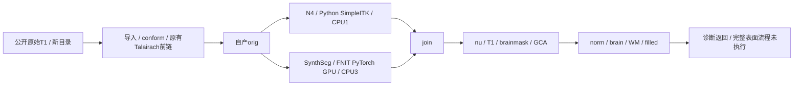
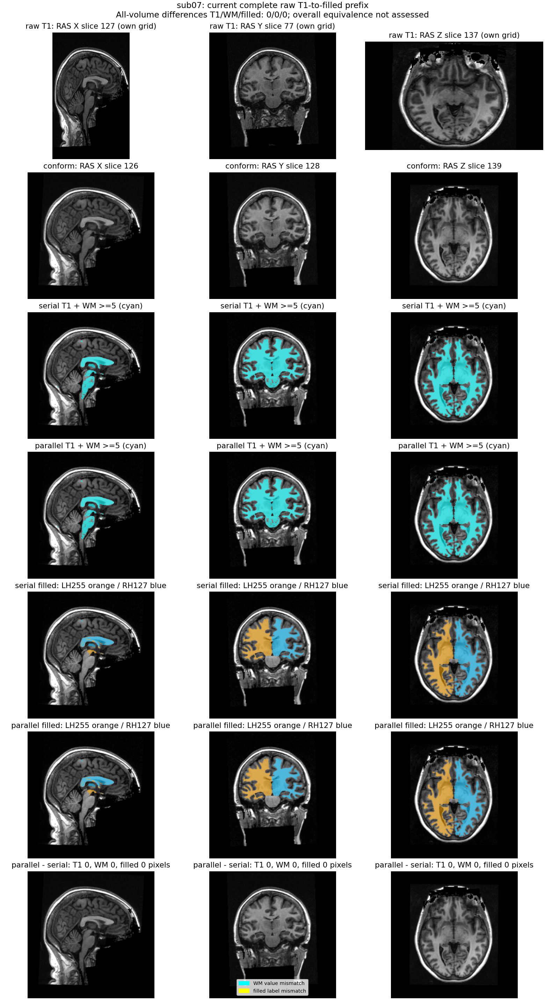
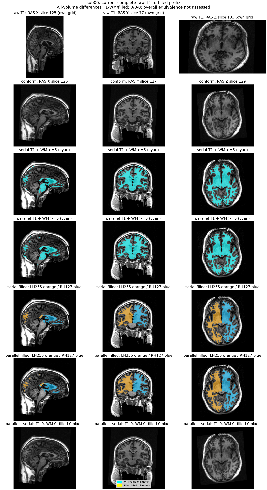

# 原始 T1 → filled 的输入并行接线回归

## 1. 功能与验证范围

本轮把已经验证的完整 N4/SynthSeg 并行组接入 recon-all 的 API、CLI 和 batch。两阶段只读同一个自产 `orig`，分别写 `nu0` 与分割/体积表；join 后继续原有强度归一化、GCA、WM 和 filled。后面的 SynthSeg 消费已生成结果，不再加载第二次模型。默认仍为 `input_execution="serial"`。

两例公开 ds000114 T1 各完成一次串行和一次并行，从原始影像、新目录连续运行至 `filled_auto_checkpoint`。诊断工具只在这个既有保存屏障后插入三条报告/返回语句，不删除或替换生产语句；原始函数及诊断 AST 的 SHA 都由实际运行保存。这不是完成的 recon-all 整例。



## 2. Python 调用、输入与输出

```python
from fnit.recon_all.native_free import run_recon_all_python

reconstruction_report = run_recon_all_python(
    t1="input/sub01_T1w.nii.gz",  # 原始单幅三维T1w，允许原始网格
    subject_dir="output/sub01",  # 不存在的新目录，从原始影像计算
    weights_dir="resources/weights",  # 声明网络权重，校验SHA与许可
    assets_dir="resources/assets",  # 声明模板、图谱和LUT
    native_bin_dir=None,  # Python配方不发现或读取原版阶段程序
    backend="python",  # 自有Python/Numba/Torch与通用SimpleITK库
    device="cuda:0",  # 显式目标GPU，按CUDA_VISIBLE_DEVICES解释
    threads=4,  # 固定总线程预算；并行输入组为1+3
    input_execution="parallel",  # 显式启用；缺省serial
    profile_stages=True,  # 剖析模式同步目标GPU，生产缺省False
    cuda_allocator_cache="auto",  # 保留既有低显存策略及已初始化API状态
)
```

上例是完整生产 API，不含诊断提前返回。当前独立流程的表面质量失败另见[整例报告](../20261010_python_profile/README.md)；输入回归通过不代表该调用整例成功。参数、完整输出、失败行为及空间见[主功能页](../../../../docs/recon_all/README.md)和[输入组说明](../../../../docs/recon_all/INPUT_N4_SYNTHSEG_PARALLEL.md)。

本轮新增参数 `input_execution` 为 `serial/parallel` 字符串；parallel 必须为完整 SimpleITK/in-process N4、显式 `cuda:N`、整数总线程4且调用方 autocast 关闭。非法组合在创建输出或初始化 CUDA 前失败，子阶段失败不继续注册/WM。父进程精度不被子进程模型构造覆盖。

前段输出14张 MRI：`rawavg` 保留原始导入网格，另13张为 conformed 256³、1 mm 网格；扫描仪 RAS affine 与 surface RAS 的 voxel 变换分别检查。灰度数据按存储数值比较；SynthSeg/aseg/filled 是离散标签，标签含义保持，Dice 无单位。SynthSeg MGZ 实际为 float32 存储整数标签；CSV 是 mm³ 软组织体积。LTA 为 type 0、源 voxel 到图谱 voxel 的仿射，平移不是直接毫米。

诊断报告含输入/源/权重/资产 SHA、原始及修改 AST SHA、API与外层墙钟、全部阶段、设备/线程/实际精度、CUDA采样、程序启动审计；比较器另存14图全部数值/几何/dtype、逐标签 Dice、LTA16元素和CSV字节比较。失败抛异常、保留部分报告，不生成占位输出。

## 3. CLI、复现与安装

以下工具专用于前段定位；每例输出目录必须不存在。`sub07` 是 serial→parallel，`sub06` 是 parallel→serial，两组同设备顺序执行，不能称为 ABBA 重复。

```bash
# 使用实际冻结源码与清单；声明中的全部权重/资产在每次运行前复核
python tools/benchmark_recon_input_prefix.py \
  --mode pair \
  --case sub07 \
  --output diagnostic/sub07 \
  --t1 input/sub07_ses-test_T1w.nii.gz \
  --weights-dir resources/weights \
  --assets-dir resources/assets \
  --device cuda:0 \
  --source-manifest frozen/SOURCE_MANIFEST.json \
  --code-version tested-commit-and-source-manifest \
  --resource-declaration prior-FNIT-producer/benchmark.json \
  --audit-helper-file frozen/audit/sitecustomize.py
```

`--resource-declaration` 只提供16个权重和102个资产的文件SHA清单，不读取此前候选的影像或官方输出。`--audit-helper-file` 必须已在 fresh Python 启动时加载，拦截禁止的原版阶段程序；运行中检查 helper 字节及未初始化 CUDA。新输出含两个执行目录及 `COMPLETE.json`；终态为 `complete_prefixes`，`full_workflow_complete=False`。

`compare_prefix.py` 接受具名 `runs_root/source_root/source_manifest/raw_sub06/raw_sub07/color_lut/output`，先核两例完成门和版本，再只读比较。`plot_prefix.py` 接受具名输入/自产MRI/比较JSON与新输出目录，生成两张派生图及 provenance。`export_reports.py` 只枚举本轮 JSON、固定源码 manifest 和两张 PNG；公开副本移除私有路径/主机/账号，全部数值、bool、null与哈希保真，原始文件不改写。

没有新增依赖，沿用主页 Conda。离线 wheel 构建及安装后四个相关模块与工作树 SHA 相同，API/batch 默认 serial、新 CLI 选项可用，导入/帮助不初始化 CUDA；详见 [install_check.json](install_check.json)。这不是全新操作系统或 GPU 推理安装验收。49 项测试与14项子测试通过，含参数失败门、单次完整分割、join屏障、CLI/batch接线及首次Numba线程初始化；[测试收据](routing_contracts.json)和[JUnit](routing.junit.xml)保留实际版本。

## 4. 原软件调用

这是 FNIT 调度优化，没有等价的独立 FreeSurfer 并行命令。对应算法参考是 `recon-all -i T1w.nii.gz -s subject -all` 的输入/N4/SynthSeg及WM/filled前段。原软件 SynthSeg 命令为 `mri_synthseg --i orig.mgz --o synthseg.rca.mgz --vol synthseg.vol.csv --keepgeom`。SimpleITK使用完整N4配方，不调用原版 N4 程序。

本轮比较对象是同一冻结 FNIT 配方的串行/并行，未新跑官方前段，不能将其0差异解释为与官方一致。已有原版重复性和数值误差保留在各自原版本报告，不重标为本次结果。

## 5. 本轮真实数据、精度、耗时与显存

实际冻结标识为 `516a93e287d1610b50201e48e6c49cf63ff7e1a4+dirty-prefix:655ac22bd8d0503652bba5947db64704f398fc867b247cb9e9e3c9484ac687b3`，783个源码文件；manifest SHA 为 `655ac22bd8d0503652bba5947db64704f398fc867b247cb9e9e3c9484ac687b3`。没有用随后提交的 HEAD 重写这个测试版本。

同一台共享 A100 节点、每例固定GPU与四核亲和性，案例分别使用独立卡并发，单例两种策略顺序执行。Synth GPU前向保留已验证 FP32例外、matmul TF32，未启用半精度。完整 API 含前置校验、线程管理、模型加载、传输、读写和报告；外层 fresh CLI 另外含冷进程导入、额外资源哈希、监测及审计读取。

| 公开T1 | 顺序 | 串行完整前段API | 并行完整前段API | 串行外层墙钟 | 并行外层墙钟 |
| --- | --- | ---: | ---: | ---: | ---: |
| sub07 | 串行→并行 | 486.859 s | 450.809 s | 510.200 s | 468.649 s |
| sub06 | 并行→串行 | 464.285 s | 503.020 s | 475.026 s | 523.222 s |

sub07观察API缩短7.40%，sub06观察增加8.34%；不是稳定前段加速。每次使用独立冷Numba缓存，共享负载和顺序影响尚未隔离。完整组既有ABBA缩短8.75%/11.82%不能外推本前段，更不能相加作为整例提速。因此保持serial默认。

14图每例全部解码体素0差异、最大/P99为0；shape、存储dtype、affine、voxel→surface-RAS变换、zooms和MGH头一致。LTA16元素0差异，CSV原字节相同。SynthSeg33类、aseg.presurf38类、filled3类（含背景）Dice全部1；三个WM图按WM≥5前景定义的Dice全部1，另保留非零前景诊断。

每例六张MGZ原文件及完整解压MGH的SHA不同；gzip头flags为0、mtime为0且无FNAME，不能归因于时间戳。逐段检查确认284字节MGH头、16,777,216字节体素和20字节scan footer全部相同。`orig/nu0/nu/T1/brainmask`只在TAG31中保存各自`talairach.xfm`路径；`filled`的旧CTAB相同，TAG3保存的四个自产路径不同。仅将subject路径规范化、重编码对应tag长度后，六件完整MGH字节分别相同。这是元数据来源差异，原文件严格字节比较仍为失败，不改写生产影像或原比较；详见[逐段诊断](reports/diagnostics/compare_plot_v1/mgh_sections_diagnosis_v2.json)。

四次采样请求间隔0.5 s，实测最大间隔0.550–0.596 s、查询失败0；整卡NVML采样峰为12.851–14.985 GB，包含其他共享任务。主机/容器PID无法证明映射，父子同期进程树峰值为null，不报告0，也不把整卡值当候选独占峰；allocated/reserved依既有缓存策略记录不可用。未证明连续峰值或完整整例20 GB合格。

程序启动审计没有拦截到原版阶段执行；这不是没有预装软件的干净环境、动态库或文件访问隔离验收。完整138项、表面质量、最终脑区指标、整体等效和600秒整例目标在本前段均未测。





## 6. 更新及机器记录

- 2026-10-10：成熟输入并行组接入公开API、CLI和batch；非法组合提前失败、保留串行默认、后段不重复分割。
- 2026-10-10：两例原始T1空目录共四次前段完整结束；0数值/几何退化，单配对耗时方向不同，保持默认。
- 原始机器JSON、冻结SOURCE_MANIFEST、比较与脑图provenance的公开副本在 `reports/`，`PUBLIC_EXPORT_MANIFEST.json` 对照原始/公开SHA并记录数值叶子数；原始报告、影像、权重和许可证保留服务器，不发布。
- 本轮完整阶段表见 `stage_times.csv`，原数值与全部采样保留JSON。现版没有将历史整例或阶段时间改成这次整例结果。

## 7. 参考

- [recon-all主说明](../../../../docs/recon_all/README.md)、[输入并行函数说明](../../../../docs/recon_all/INPUT_N4_SYNTHSEG_PARALLEL.md)
- [FNIT完整SimpleITK N4](../../../../docs/recon_all/N4_SIMPLEITK.md)、[SynthSeg原代码](https://github.com/BBillot/SynthSeg)
- [FreeSurfer原代码](https://github.com/freesurfer/freesurfer)、[OpenNeuro ds000114](https://openneuro.org/datasets/ds000114)
- Tustison NJ et al. N4ITK. IEEE Trans Med Imaging. 2010;29:1310–1320.
- Billot B et al. SynthSeg. Medical Image Analysis. 2023;86:102789.
