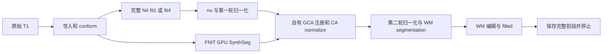
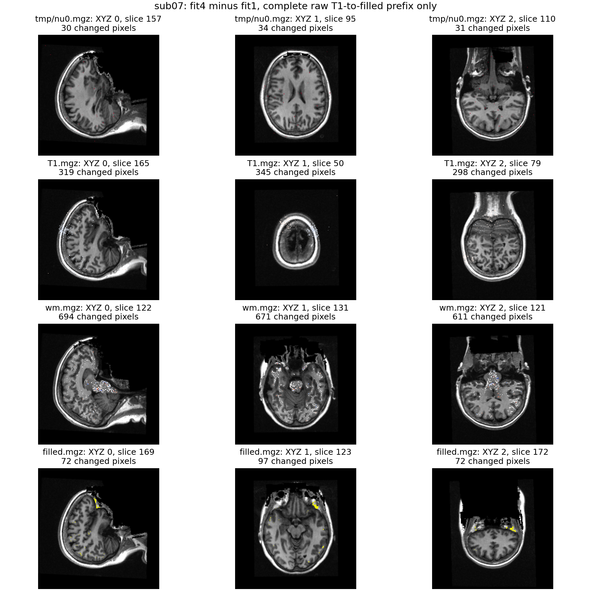
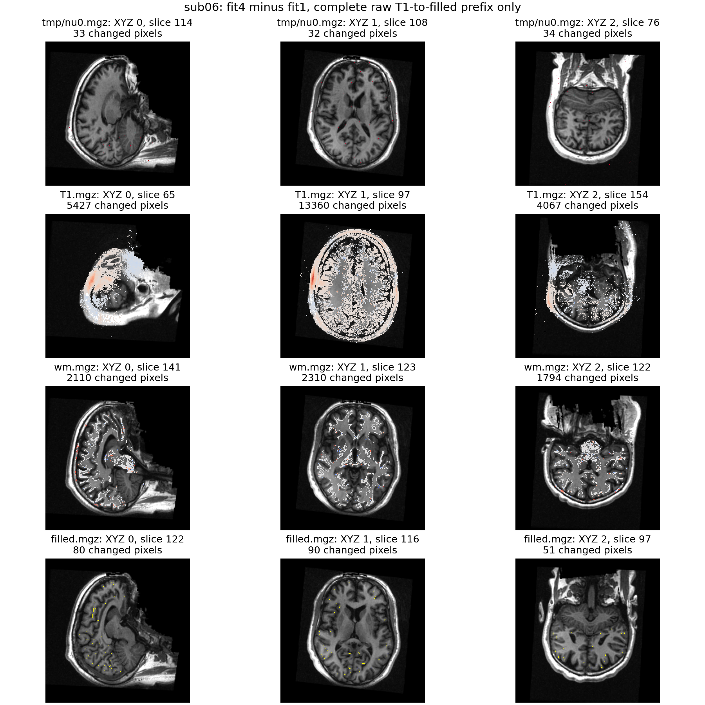

# N4 拟合线程：原始 T1 到 filled 连续验证

## 1. 功能和范围

本页核对 SimpleITK 完整 N4 的拟合线程从 1 改为 4 后，数值变化如何传到注册、归一化和 WM/filled。两例都从同一原始公开 T1 和空目录运行到 `filled_auto_checkpoint`。本轮没有重跑表面、分区或整例 recon-all，生产默认仍为 `fitting_threads=1`。



诊断复用冻结 v4 的完整调度和公开 wrapper，仅在唯一的 `filled_auto_checkpoint` 后插入三个返回语句；原有语句没有删除。N4 使用已经通过完整阶段 ABBA 的 `c14e8eb4…` 适配器，只追加 `fitting_threads`，其余 N4 参数和全分辨率重建线程保持相同。两条链均使用 FNIT 自产中间结果；官方影像没有进入生产输入。

## 2. Python 调用、输入与输出

低层可调用接口见 [完整 N4 SimpleITK 说明](../../../../docs/recon_all/N4_SIMPLEITK.md)。本页连续验证复用 `run_prefix.py` 的 `run_one()` / `run_group()`，属于诊断入口，不提供新的生产停止选项。

```python
from pathlib import Path
from fnit.recon_all.n4_simpleitk import correct_volume

result = correct_volume(
    input_file=Path("subject/mri/orig.mgz"),  # conform 后三维强度；同一受试网格
    output_file=Path("diagnostic/nu0.mgz"),   # 同网格 uint8 N4 校正体积
    reconstruction_threads=4,               # 全分辨率场重建线程；两组相同
    fitting_threads=4,                      # 唯一改变的 N4 拟合线程，默认 1
    profile_path=Path("diagnostic/N4.json"),  # 实际线程、版本、源码/输入/输出 SHA 和耗时
)
```

连续诊断的全部具名参数：

| 参数 | 输入意义和限制 |
|---|---|
| `mode` | `group` 固定两例顺序配对；`one` 运行一个 fresh 子进程 |
| `output` | 新建诊断目录；已存在则报错，不续跑、不复制检查点 |
| `n4_module_directory` | 本轮 N4 适配器和 `CANDIDATE_BINDING.json` 所在独立目录 |
| `weights_dir` / `assets_dir` | 声明的模型权重/模板；按固定资源清单 SHA 核对 |
| `source_manifest` | 完整 v4 冻结源码清单；包含实际提交与 overlay 文件 SHA |
| `audit_helper_file` | 现有 `sitecustomize.py`；必须在 Python startup 已生效并 SHA 相同 |
| `code_version` | 冻结配方的实际版本标签；不是把当前 HEAD 冒充测试版本 |
| `device` | 显式 CUDA 设备；本轮物理 GPU5 映射为子进程 `cuda:0` |
| `raw_t1_directory` | group 模式：含 `sub06_ses-test_T1w.nii.gz` 和 `sub07_ses-test_T1w.nii.gz` |
| `producer_directory` | group 模式：只从既有 benchmark JSON 读取声明权重/资产清单 |
| `resource_declaration` | one 模式：当前个案的资源清单 JSON；不读取其 MRI 输出 |
| `t1` / `case` | one 模式：原始三维 NIfTI T1 与个案名称 |
| `fitting_threads` | one 模式：1 或 4；低层通用函数接受任意正整数，生产默认 1 |

输出包括 `benchmark.json`、完整调度的 `subject/fnit-native-free-run.json`、N4 profile、子进程墙钟/审计/显存样本，以及 14 张 MRI 和 `talairach.lta`。`rawavg` 保留导入网格；conform 后 MRI 使用同一 conformed 网格、affine 和 surface RAS 变换。文件 shape/dtype、affine、`vox2ras_tkr` 和 zooms 都逐项报告，不将原始采集网格与 conformed 网格混淆。强度误差以存储强度单位报告，标签 Dice 无单位，type-0 LTA 平移单位为 atlas voxel。

成功状态是 `complete_prefix`，`full_workflow_complete=False`。输出写入失败、资源/源码 SHA 变化、非法线程或执行审计阻断均抛异常，保留失败日志；不以近似结果替代，也不把前段状态写成完整 recon-all 成功。

## 3. 命令行与复现

```bash
prefix_arguments=(
  --mode group                                          # 两例各运行 fit1、fit4
  --output "$FNIT_TASK_RUN/prefixes"                     # 必须不存在的输出目录
  --n4-module-directory "$FNIT_N4_SOURCE"                # 本轮独立 N4 源码和绑定清单
  --weights-dir "$FNIT_WEIGHTS"                          # 声明的 Synth GPU 模型权重
  --assets-dir "$FNIT_ASSETS"                            # 声明模板，不含参考被试结果
  --source-manifest "$FNIT_FROZEN_SOURCE/SOURCE_MANIFEST.json" # 实际完整冻结源码
  --audit-helper-file "$FNIT_AUDIT/sitecustomize.py"      # 必须已通过 PYTHONPATH 生效
  --code-version "v4-frozen-source-plus-c14e8eb4-N4-overlay" # 当前明确的冻结版本标签
  --device cuda:0                                       # CUDA_VISIBLE_DEVICES 映射后的显式目标
  --raw-t1-directory "$FNIT_PUBLIC_T1"                   # 两例公开原始 NIfTI T1
  --producer-directory "$FNIT_V4_PRODUCERS"              # 只读取声明资源 JSON
)
python run_prefix.py "${prefix_arguments[@]}"
```

`FNIT_TASK_RUN` 是空输出目录；`FNIT_N4_SOURCE` 是候选源码而非原程序；`FNIT_FROZEN_SOURCE` 对应冻结 manifest；`FNIT_AUDIT` 只包含现有执行审计；`FNIT_PUBLIC_T1` 含上述两张原始影像；`FNIT_V4_PRODUCERS` 仅提供声明资源 JSON。配对进程分别使用 cold NumBa cache，CPU 总预算 4。计时包含校验、模型加载、传输和写出；剖析阶段显式同步目标 GPU。

比较和发布脚本分别是 `compare_prefixes.py`、`collect_receipts.py`、`summarize_results.py` 和 `plot_results.py`。比较器复用现有 `_volume` / `_label_dice` / `read_voxel_lta`，要求双方完成同一前段。公开导出保留数值类型、原始 SHA 与公开 SHA，服务器原始路径只进行字符串脱敏。影像、数组、权重、许可证及原软件 C++ 不发布。

## 4. 原软件调用和对照范围

对应原步骤是 FreeSurfer 单 T1 流程中的 `mri_nu_correct.mni --i orig.mgz --o nu.mgz --n 1`，其中 N4 是固定 C++ 源码 recipe 内部步骤。生产候选只调用 SimpleITK Python API，不启动该命令或 FNIT 原版源码构建程序。这里没有人为编造独立原软件的“线程 4 N4 CLI”。

同输入 N4 浮点/量化与原固定程序的两次重复对照，在 [完整阶段 ABBA](../20261010_n4_fitting_threads/README.md) 中单独给出。原固定程序重复输出稳定；两种 SimpleITK 线程配置各自重复也稳定，但跨线程配置有确定性差异。本页只比较自产 fit1/fit4 连续链，不把历史原版结果重新标为本轮整例官方比较。

## 5. 当前实测、精度和脑图

| 个案 | fit1 完整 API / cold 进程（秒） | fit4 完整 API / cold 进程（秒） | 观察前段缩短 |
|---|---:|---:|---:|
| sub07 | 487.306 / 501.042 | 344.254 / 357.096 | 29.36% |
| sub06 | 496.002 / 507.701 | 364.611 / 375.439 | 26.49% |

下表每格为**不同体素数 / 最大绝对误差 / P99 误差**；完整浮点数仍在 JSON/CSV 中。

| 体积 | sub07 | sub06 |
|---|---:|---:|
| `rawavg.mgz` | 0 / 0 / 0 | 0 / 0 / 0 |
| `orig.mgz` | 0 / 0 / 0 | 0 / 0 / 0 |
| `tmp/nu0.mgz` | 2,406 / 1 / 0 | 3,233 / 1 / 0 |
| `nu.mgz` | 8,382 / 3 / 0 | 2,995 / 3 / 0 |
| `T1.mgz` | 21,971 / 13 / 0 | 464,416 / 23 / 1 |
| `brainmask.mgz` | 4,710 / 13 / 0 | 200,774 / 23 / 1 |
| `synthseg.rca.mgz` | 0 / 0 / 0 | 0 / 0 / 0 |
| `norm.mgz` | 33,731 / 4 / 0 | 550,938 / 7 / 1 |
| `brain.mgz` | 145,487 / 16 / 0 | 754,569 / 22 / 2 |
| `aseg.presurf.mgz` | 0 / 0 / 0 | 0 / 0 / 0 |
| `wm.seg.mgz` | 51,407 / 230 / 0 | 203,253 / 230 / 1 |
| `wm.asegedit.mgz` | 36,723 / 255 / 0 | 144,341 / 250 / 0 |
| `wm.mgz` | 36,811 / 255 / 0 | 144,787 / 250 / 0 |
| `filled.mgz` | 2,060 / 255 / 0 | 4,582 / 255 / 0 |

| 指标 | sub07 | sub06 |
|---|---:|---:|
| WM segmentation 前景 Dice | 0.9960599565 | 0.9851326396 |
| WM 编辑前景 Dice | 0.9975656453 | 0.9919209253 |
| 最终 WM 前景 Dice | 0.9975329791 | 0.9917653657 |
| filled 标签 127 Dice | 0.9981213068 | 0.9954507842 |
| filled 标签 255 Dice | 0.9974151809 | 0.9955967375 |
| type-0 LTA 不同元素 / 最大误差 | 0 / 0 | 4 / 0.30466651916503906 |

两例全部输出的 shape、dtype、affine、`vox2ras_tkr` 和 zooms 一致；SynthSeg 与 aseg.presurf 全标签 Dice=1。旧 79 conformed `orig` 和本次自产 `orig` 的文件 SHA 不同，但实际体素、dtype、affine 和 `vox2ras_tkr` 全部相同，已直接验证。

**sub07** 注册矩阵相同，强度归一化与 WM 仍发生变化。**sub06** 注册第三行发生变化，T1、brain 和 WM 的差异进一步放大。拟合线程变化不能统一解释成随机性，也不能仅凭 N4 的 ±1 就认定下游无影响。

显存采样请求间隔 0.5 秒。四次进程树归属均 `ownership_unresolved`，`peak_tree_total_bytes=null`；整卡采样峰 sub07 fit1/fit4 为 13,603,176,448 / 8,227,127,296 字节，sub06 为 11,992,563,712 / 8,227,127,296 字节。fit4 组有 13/8 次 `nvidia-smi` 超时，最大观察间隔 28.385/28.276 秒；fit1 组最大间隔 3.708/3.111 秒。因此这些样本不能证明连续峰值低于 20 GB，缓存关闭后的 unavailable/0 计数也不当作零显存。

四次 startup 执行审计各 15 条事件、0 阻断；775 个冻结源码文件的大小/SHA 均复核通过，N4 overlay 单独校验。实际 Synth 系列为 GPU float32，没有启用 autocast；TF32/FP32 例外以 runtime 的实际前向记录为准。公开 23 份 JSON 的 13,565 个数值/布尔/null 叶与服务器原始收据保持相同，原始和公开 SHA 分开保存。

完整 API 和 cold 子进程墙钟分别报告，诊断比较/绘图耗时不属于前段时间。两例都是单次顺序配对，共享主机实际负载另有记录；完整 N4 的八次 ABBA 见上文独立阶段报告。不能把阶段提速或前段提速外推为整例提速。

`volumes` 保留全部不同体素数、最大/P99/平均绝对误差、shape/dtype 和几何差异。离散分割逐标签报告 Dice，WM 同时保留非零前景 Dice 和 byte 强度差。相关性仅为旧比较器的辅助字段，不作为标签验收。




每个体积/轴选择变化体素最多的切面，完整误差来自全体积；色图不是逐切面平均。filled 使用黄色标出标签不一致，强度图使用 fit4−fit1 有符号差异。图像 SHA、各体积 SHA 和切面规则见 `plots/plot_provenance.json`。

## 6. 更新与验证记录

1. SimpleITK 原适配器已完成两例与固定 N4 程序的同输入比较，仍有既有 28/99 个量化体素差异。
2. 本轮低层增加显式 `fitting_threads`，默认 1；同机两例八次完整文件 API ABBA 各配置重复逐位一致，线程 4 观察约 3.5 倍阶段提速，跨配置量化有 2406/3233 个 ±1 差异。对应冻结源码 `c14e8eb4…`，交付提交 `9031fdba…`。
3. 连续前段诊断 v1 因自写审计误拒绝 NumPy 合法 `lscpu` 调用而失败，未计为成功前段。原失败和脚本 SHA 保留。v2 原样复用成熟 Python startup 审计，允许通用编译器，仍禁止原版阶段程序。
4. 本页 v2 比较绑定实际 v4 冻结源码、N4 overlay、原始 T1、权重和资产 SHA；不修改旧整例或表面失败记录。执行审计不等于操作系统/动态库/文件访问隔离。

严格复现、优化引入的变化和整体指标等效分别报告。整体指标等效仍 `not_assessed`；没有依据这些结果事后设置或放宽门槛。生产默认尚未改为四线程。

## 7. 参考文献与原实现

- Tustison NJ et al. N4ITK: improved N3 bias correction. IEEE TMI 2010. [论文 DOI](https://doi.org/10.1109/TMI.2010.2046908)。
- [SimpleITK N4BiasFieldCorrectionImageFilter](https://simpleitk.org/doxygen/latest/html/classitk_1_1simple_1_1N4BiasFieldCorrectionImageFilter.html) 与 [ITK N4 原实现](https://github.com/InsightSoftwareConsortium/ITK/blob/v5.4.0/Modules/Filtering/BiasCorrection/include/itkN4BiasFieldCorrectionImageFilter.hxx)。
- [FreeSurfer 源码](https://github.com/freesurfer/freesurfer)、[recon-all 文档](https://surfer.nmr.mgh.harvard.edu/fswiki/recon-all)。原 recipe 和候选 Python 库 SHA 见完整阶段报告。
- [OpenNeuro ds000114](https://openneuro.org/datasets/ds000114)：本轮复用已下载的两例公开原始 T1，不发布影像。
