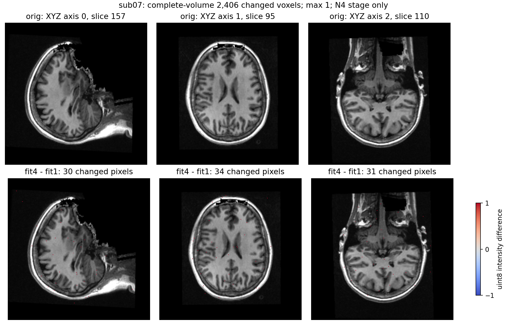
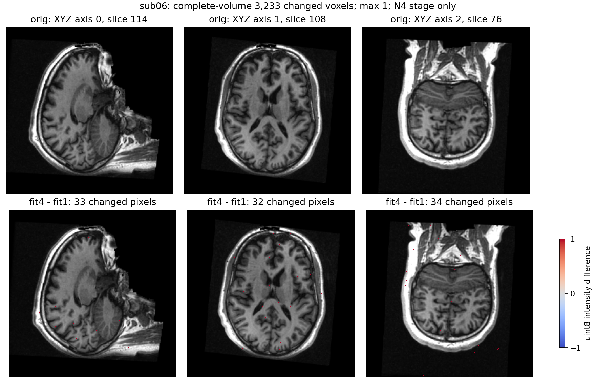

# N4 完整 Python 文件阶段：拟合线程 1 / 4 对照

## 1. 功能与范围

本次保留已有完整 SimpleITK N4 配方，只增加低层 `fitting_threads` 参数。原实现将拟合固定为1线程，真实两例约180秒的主要计算都在拟合；全分辨率重建、指数、除法和量化仍沿用已有实现。现在可以显式使用4线程，默认仍1，兼容包装器及生产配方没有自动切换。

两例公开 ds000114 T1 各完成 ABBA `[1,4,4,1]`，八个新进程均退出0。输入是 `79a41cdd` 自产链的 conformed `orig.mgz`，本页是冻结同输入完整 N4 文件阶段，不是原始 T1 整例。单线程中位183.7–184.6秒，四线程51.5–52.4秒；线程数之间存在可重复的浮点与量化差异。


## 2. Python 调用、输入和输出

```python
from fnit.recon_all.n4_simpleitk import correct_volume

n4_report = correct_volume(
    input_file="mri/orig.mgz",                 # 自产conformed三维T1，不传参考结果
    output_file="diagnostic/nu0-fit4.mgz",      # 新uint8输出，保留原网格和头几何
    fitting_threads=4,                         # 新显式拟合线程选项；默认仍1
    reconstruction_threads=4,                  # 全分辨率重建线程，与拟合独立
    profile_path="diagnostic/n4-fit4.json",     # 实际库版本、线程、分段时间及SHA
)
```

| 输入参数 | 类型、默认值、意义和限制 |
| --- | --- |
| `input_file` | 必填str/Path，三维MGH/MGZ；各轴至少8体素，有限非负且有正信号；强度无物理单位 |
| `output_file` | 必填str/Path，新三维uint8结果路径；不重采样、不换XYZ顺序 |
| `fitting_threads` | 正整数，默认1；不接受bool、0、负数或浮点数；本次只验证1和4 |
| `reconstruction_threads` | 正整数，默认1；本次固定4，控制完整偏置场重建及Exp/Divide |
| `profile_path` | str/Path或None，默认None；指定则写完整参数/耗时/SHA JSON |

数组接口 `correct_array(image, *, spacing, reconstruction_threads=1, fitting_threads=1)` 输入 XYZ三维float32 NumPy强度和三个有限正毫米间距；返回新同shape float32数组及报告。内部 origin=0、identity direction；文件输出仍保留原 scanner-RAS 毫米affine，不把内部计算坐标写入图像头。log偏置场为无量纲float32。量化使用原 `_to_uchar` 的 clip和最近整数规则，源码未改变。

返回字典记录 `fitting_threads`、`reconstruction_threads`、`actual_fitting_work_units`、`actual_fitting_filter_threads`、库与ITK版本/SHA、`recipe`、内部几何、实际末层迭代、分段秒数、线程原值/恢复值，以及文件输入/输出SHA。低层 `total_seconds` 含加载/写出；本次外侧 `complete_API_seconds_including_read_write_profile_hash` 还包含元数据处理，另记导入及完整子进程墙钟。保存诊断float数组在API计时之外，完整子进程墙钟包含这项额外诊断IO。

非法输入抛ValueError，缺SimpleITK抛ImportError，库和读写错误传播。模块锁保护自己的ITK全局线程设置，成功或异常均恢复；同进程其他ITK任务应隔离执行。没有改变CUDA、TF32或精度策略，不调用原版阶段程序，不用平滑残差近似。

## 3. 命令行与复现脚本

```bash
# 低层完整N4；i/o为必填路径，fit默认1，这里显式4。
python -m fnit.recon_all.n4_simpleitk \
  --i mri/orig.mgz \
  --o diagnostic/nu0-fit4.mgz \
  --fitting-threads 4 \
  --reconstruction-threads 4 \
  --profile diagnostic/n4-fit4.json

# 私有FNIT根只作运行时变量；复用已有公开数据，不重复下载。
python benchmark_threaded_n4.py \
  --mode group \
  --fnit-root "$FNIT_ROOT" \
  --module-directory "$N4_FROZEN_MODULES" \
  --output "$NEW_ABBA_OUTPUT"
```

`benchmark_threaded_n4.py` 的 `mode=group` 依次运行sub07四次、sub06四次；`fnit_root` 是已有FNIT统一目录，`module_directory` 是包含本轮N4/量化/IO模块和 `CANDIDATE_BINDING.json` 的冻结目录，`output` 必须不存在。`mode=one` 另需 `case=sub07|sub06`、`fitting_threads=1|4`。线程/CPU affinity由外层统一固定；每次新Python进程，重建均4线程，不用GPU。

`collect_receipts.py` 的具名输入是 `fnit_root`、新 `output_directory`、已有数值保真 `exporter_file`、私有str→str `replacements_file`；只有八次成功、输入/源码/比较SHA一致才导出。`summarize_results.py` 输入已公开 `reports` 和汇总 `output`，先校验公开SHA与原始run SHA，再输出JSON和CSV。`plot_results.py` 输入 `fnit_root`、新 `output`，生成两张三正交脑图和选片/输入/PNG SHA；不发布MGZ、NumPy浮点数组、权重或原始源码。

新增拟合参数只在本页低层接口。`n4_itk`/`input_n4_chain` 兼容路由的 `threads` 仍只控制重建，拟合仍1。既有固定 `SimpleITK==2.5.6` 已纳入主页依赖；本次未新增包或更改共享安装。

## 4. 对应原软件与固定算法

固定完整 N4：全1 uchar mask/label1，shrink4³，cubic spline、初始控制点4³，四层各50轮、convergence0、200直方图bin、FWHM0.15、Wiener0.01。除了拟合线程数，ABBA全部参数相同。滤波器末层计数实际51保留原值，不伪装成总200轮。

既有独立原生N4参考为固定ITK配方的 Conda源码构建程序，不是系统FreeSurfer二进制；程序SHA `5c6156bd2e05806dee387abea24050a4bbb92b16ea4988747ca1ddd60d9c437b`，配方源码SHA `c281204beb21ba756257449c564c23a3f0efc0a15387b7d3527cf858042fca8f`。本次读取同一主机已有两次float输出做诊断，原生未重新计时。原生旧affinity24–27，本次100–103；均4线程预算，不把旧原生秒数当新配对速度。

整例官方命令是独立benchmark中的 `recon-all -i public_T1w.nii.gz -s reference_subject -all`。Shrink/GetLogBiasFieldAsImage/Exp/Divide没有各自的FreeSurfer CLI。本实现只执行通用SimpleITK Python API。

## 5. 两例真实精度、耗时和脑图

代码绑定：冻结时Git `86ae36bde8c0ec5960fbb9142af2b060c24d1d25` 加未提交overlay；本次实际N4模块SHA `c14e8eb46fb408926ddb9a7fe3d35d97bb5201382928e87226f71f8e01041b90`，benchmark SHA `f9cb2f2d3f49fde9f5ef8c7cfceb89b0b5519aaa51de963e2586f24ad070e733`。实际库SimpleITK2.5.6/ITK5.4，库SHA `c25cd8cf7053c8224c246744e1f1bc9af12db0c95a8221b27e9546cc4511b62c`。CPU为Xeon Platinum8369B，affinity100–103，总预算4；同共享A100主机，不使用GPU。所有请求线程与实际work units/filter threads一致，结束恢复原全局值4。

| 完整MGZ文件API，秒 | sub07 | sub06 |
| --- | ---: | ---: |
| A1：拟合1 | 185.063551 | 183.220339 |
| B1：拟合4 | 52.638639 | 51.525127 |
| B2：拟合4 | 52.159471 | 51.541909 |
| A2：拟合1 | 184.126209 | 184.212133 |
| A中位→B中位 | 184.594880→52.399055 | 183.716236→51.533518 |
| 阶段观察比值 / 缩短 | 3.5229× / 71.6140% | 3.5650× / 71.9494% |

完整 API 包含读写与profile/hash处理，导入单列约0.2秒，完整进程含额外诊断保存的时间见 [stage_times.csv](stage_times.csv)。N4拟合由约179–180秒降到约47–48秒，是本次实际加速来源；重建、Exp/Divide及IO保持同调用。共享主机load被逐次记录，只是本组阶段观察，没有原始T1整例提速或稳定吞吐结论。

| 同输入A1 vs B1，严格差异 | sub07 | sub06 |
| --- | ---: | ---: |
| log偏置场不同体素 | 16,777,216 | 16,777,216 |
| log场最大 / P99 | 0.0000239015 / 0.0000230670 | 0.0000242591 / 0.0000231862 |
| 校正float32不同体素 | 7,013,238 | 8,038,769 |
| float32最大 / P99 | 0.0029907227 / 0.0017013550 | 0.0029296875 / 0.0019226074 |
| uint8 nu0不同体素 | 2,406 | 3,233 |
| uint8最大 / P99 | 1 / 0 | 1 / 0 |
| 原生对照：fit1 / fit4 uint8不同体素 | 28 / 2,420 | 99 / 3,134 |
| A1 vs A2、B1 vs B2，各三数组不同体素 | 全0 | 全0 |

八次shape、毫米affine、uint8 dtype完全相同。各线程设置自身两次log场、FP32和量化输出逐位重复；既有原生两次也逐位重复。线程1和4之间是本次可重复的线程相关变化，未定位到ITK内部某一归约，不能归因于随机性或预先归因于编译器。

**严格复现**：线程1和4之间、相对既有原生均未逐位一致。**优化是否引入变化**：具体float/量化差异如上，并未用平均相关性或放宽门槛隐藏。**整体指标等效**：未判定；这份阶段报告没有下游标签Dice、网格、厚度/面积/体积或整例结果。不能仅凭±1直接判断存在或不存在实质影响。默认fit1保持，独立原始T1→filled配对另行验证。

下图按每个XYZ轴“量化变化最多切面”的预先规则显示误差，不插值扩张误差点；表中计数始终来自全体积。脑图输入、切面、输出与PNG SHA见 [plot_provenance.json](plots/plot_provenance.json)。




本次CPU阶段没有CUDA操作；不把它写成已测“零GPU显存”，也没有新的20GB整例资源证据。七项既有adapter合同通过，增加非法拟合线程和异常恢复子检查，实际1.733秒；合同不是benchmark替代。37份公开JSON保留1,496个数值/布尔/null叶及原始和公开SHA，见 [PUBLIC_EXPORT_MANIFEST.json](reports/PUBLIC_EXPORT_MANIFEST.json)。

## 6. 最近更新与验证记录

- 2026-10-10 v2：低层新增 `fitting_threads=1`；两例八次完整ABBA成功，真实速度、浮点、量化、几何与重复性完整发布。没有默认切换。
- v1诊断失败保留：首个完整N4调用及nu0写出已经完成，但诊断shape含NumPy int32导致JSON序列化失败。v2只把诊断shape元素转Python int；v1不计入ABBA、不是N4失败或OOM。[失败记录](reports/failed-v1.json) 与原完成profile均保留。
- [原SimpleITK适配器验证](../20261010_n4_simpleitk/README.md) 保留同输入28/99量化差异及独立安装边界，不用本次线程4结果覆盖历史版本。
- 既有完整Torch N4连续链的误差放大和网格问题见[四输入归因](../20261010_n4_gca_cross_inputs/README.md)，不是本次SimpleITK fit1/4实测结论。

## 7. 参考文献与原实现

- [FNIT N4完整接口说明](../../../../docs/recon_all/N4_SIMPLEITK.md)、[实际源码](../../../../src/fnit/recon_all/n4_simpleitk.py)
- [SimpleITK N4完整示例](https://simpleitk.readthedocs.io/en/master/link_N4BiasFieldCorrection_docs.html)
- [SimpleITK源码](https://github.com/SimpleITK/SimpleITK)、[ITK N4源码](https://github.com/InsightSoftwareConsortium/ITK/blob/v5.4.0/Modules/Filtering/BiasCorrection/include/itkN4BiasFieldCorrectionImageFilter.hxx)
- Tustison NJ et al. N4ITK: improved N3 bias correction. IEEE Trans Med Imaging. 2010;29:1310–1320. doi:10.1109/TMI.2010.2046908.
