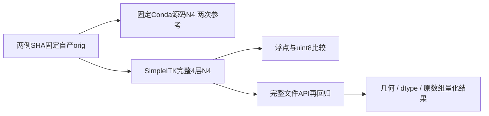
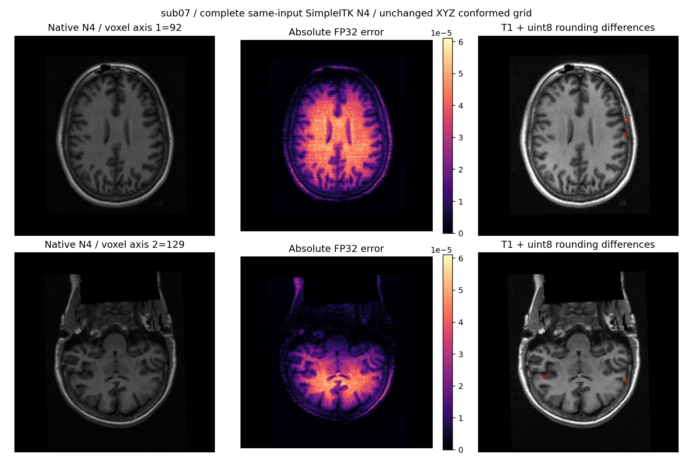
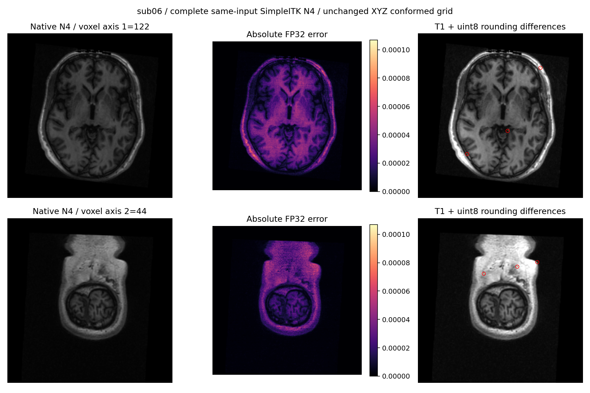

# 两例完整 SimpleITK N4：独立 Python 路径

## 1. 功能与范围

此报告绑定 `54f681dcab210a22c2e6862b2854a7033b5a208d` 加实际执行模块 SHA。候选完整拟合和重建通过 SimpleITK Python API，原生程序仅生成独立参考。这里是冻结同输入完整数组及文件阶段，不是原始T1连续整例。



## 2. 输入、输出及 Python 调用

公开 ds000114 sub-07/sub-06，原图使用 `79a41cdd` 自产连续链的 `orig.mgz`，均256³ uint8、毫米affine。计算模块为 `n4_simpleitk.correct_array`；实际文件链 `input_n4_chain.run_n4_stage(..., n4_backend="simpleitk", n4_execution="in-process", threads=4)` 输出同网格 `nu0.mgz`。候选只接受自产原图，参考只在运行后比较。

全部函数/参数、坐标、结构及带中文注释示例见[完整功能页](../../../../docs/recon_all/N4_SIMPLEITK.md)。输出JSON保留浮点及量化差异、版本、依赖程序/源码/输入/输出SHA、线程和分步时间；公开清单将原始 `raw_sha256` 与脱敏后的 `published_sha256` 分开。

## 3. 命令行与复现

完整阶段driver为 `benchmark/recon_n4_python_adapter.py`：源图、输出新目录、候选模块目录、参考程序及其SHA、参考源码、实际代码版本必填；线程默认4，`--repeat-reference` 显式开启重复性。它用真实浮点输出比较，不将量化图一致冒充浮点一致。

`regress_file_api.py` 的FNIT根、计算模块目录、路由目录、新输出目录、case和代码版本必填；线程默认4。先验证旧收据完成和全部SHA，再调用完整生产文件接口，不向函数传入任何参考图。

```bash
# 先验证公开SHA，然后生成逐比较CSV和摘要
python validation/recon_all/optimizations/20261010_n4_simpleitk/summarize_results.py

# 合同仅测接口，不代替完整真实N4
PYTHONPATH=src python -m unittest discover \
  --start-directory tests/recon_all --pattern test_n4_simpleitk_adapter.py
```

`collect_receipts.py` 的四个具名路径参数均必填；复用现有保数值/类型导出器。`plot_results.py` 仅有两个必填路径参数，选取量化差异最多的两个体素轴切片；图中坐标为conformed XYZ体素索引，不另重采样为扫描空间。

## 4. 参考配方及程序

固定N4参考程序在Conda内从声明源码构建：ITK5.4.7，实际程序SHA `5c6156bd2e05806dee387abea24050a4bbb92b16ea4988747ca1ddd60d9c437b`、源码SHA `c281204beb21ba756257449c564c23a3f0efc0a15387b7d3527cf858042fca8f`。生产候选不调用此程序。

全1掩膜、shrink4、cubic初始控制点4³、4×50轮、convergence0、200bin/FWHM0.15/Wiener0.01；拟合1线程、全分辨率重建4线程。原始完整官方recon-all或N4的其他mask/参数组合不属于这次结果。Shrink及全分辨率重建为库内部API，没有独立FreeSurfer CLI。

## 5. 实测精度、时间及资源

| 完整同输入指标 | sub-07 | sub-06 |
| --- | ---: | ---: |
| FP32不同体素 | 6,416,123 | 8,038,768 |
| FP32最大 / P99 | 6.103515625e-5 / 3.4332275390625e-5 | 1.068115234375e-4 / 4.57763671875e-5 |
| FP32 MAE | 2.0711561798947287e-6 | 5.373405022268685e-6 |
| uint8不同体素 | 28 | 99 |
| uint8最大 / P99 | 1 / 0 | 1 / 0 |
| 原生重复float / uint8差异 | 0 / 0 | 0 / 0 |
| native第一次秒数 | 163.2296925485134 | 164.97464363556355 |
| Python完整数组调用秒数 | 181.94136800151318 | 181.1083045778796 |
| Python完整MGZ文件API秒数 | 186.38168290816247 | 185.29012457095087 |

原生计时含raw文件输入/输出；Python数组计时含返回元数据，不含MGZ加载/写出。完整文件API含读写的实测墙钟另列 `stage_times.csv`，相对旧完整Python数组量化结果逐体素比较为0，并检查原affine、shape、uint8；不能将不同计时范围直接解释为速度比。原生第二次、全部四组误差、实际库分段时间和最终路由/程序SHA均保留在九份JSON中。公开脱敏保留277个数值/布尔/null值及其类型；七项接口合同通过并保留实际日志。

同A100主机CPU24–27，四核预算，CPU实现，没有GPU计时或GPU显存统计；进程显存归属保留null。首个数组run与文件API复测期间有其他共享任务，合同在同四核内短时运行；不宣称独占吞吐。版本/环境/线程实际记录保留，未测干净独立部署。严格复现不同、完整文件路由无新增差异、整体指标等效未判定；后续注册/网格传播要另测，不把尾差一概归为随机或编译器。




## 6. 最新更新和历史边界

2026-10-10首次完成此Python库路径。模块SHA `185c0864e777796c828a6edf4d230375a8dd5953fc23ea44edf6c8c820bdc02a`；SimpleITK2.5.6/ITK5.4、库SHA `c25cd8cf7053c8224c246744e1f1bc9af12db0c95a8221b27e9546cc4511b62c`。实际wheel大小/SHA在 `dependency_receipt.json`，主页固定新依赖；不更改现有共享Conda安装或删除Torch候选。

这里未调用跨输入GCA诊断，也未扩大输出范围。此前完整Torch N4的放大与局部mesh失败是另一实现/代码版本的证据，仍单独保留。当前路径的严格、路由回归和最终整体等效分别报告。

## 7. 原代码和文献

- [完整Python实现](../../../../src/fnit/recon_all/n4_simpleitk.py)
- [SimpleITK官方N4完整例子](https://simpleitk.readthedocs.io/en/master/link_N4BiasFieldCorrection_docs.html)
- [SimpleITK源码](https://github.com/SimpleITK/SimpleITK)
- Tustison NJ et al. N4ITK: improved N3 bias correction. IEEE Trans Med Imaging. 2010;29:1310–1320. doi:10.1109/TMI.2010.2046908.
