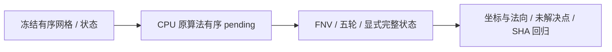

# 五轮顶点法向修复：独立 CPU 候选与真实状态回归

## 1. 功能与结论

新增 `normal_pending_python.repair_vertex_normals()`，复用成熟 CSR、一环和单位化，完整转写原法向步骤的五轮有序重试。函数可能修改共享几何，返回坐标、法向、面积、原始面叉积、border 及 pending；尚不接生产，不冒充完整 metric properties。

五个真实快照均未触发全抵消；相对当前修复后的 FNIT Torch CPU 法向，坐标及全部法向逐元素相同。真实非零 pending 分支尚未验证，11 项合同不替代真实 benchmark。全部 1001 个动态清理状态也未逐轮检查；当前清理循环本身没有调用顶点法向。异常球面既有 7507 翻折仍未通过，整体等效 `not_assessed`。



## 2. Python 与全部输入输出

完整具名示例、参数/返回字段、空间、单位、状态依赖与失败条件见[功能页](../../../../docs/recon_all/NORMAL_PENDING_PYTHON.md)。输入是有限 float32 `(N,3)` surface RAS/mm 和同序整数 `(F,3)` 面；默认 sphere、unitize=True、面积除3、全部 rip=False。几何先复制。返回的坐标必须由上层显式接纳，动态度量缓存必须失效；不能只取法向丢弃移动。

最后一轮仍扰动而不进行第六次重算，未解决顶点显式返回。成功但作为邻居移动的顶点保留该轮旧法向。原面积仅在初始值小于零时赋值。该接口未新增依赖，使用主页已有 NumPy/Numba；没有原版程序或原版链接库调用。

## 3. 命令行与复现

```bash
# 同一冻结代码及已授权公开 T1 的自产状态；output 必须新建。
PYTHONPATH="$FROZEN_SOURCE/src" python benchmark_real_states.py \
  --fnit-root "$PRIVATE_FNIT_ROOT" --output "$PRIVATE_NEW_RUN/benchmark" --threads 4

# 仅合同，不称为 MRI benchmark。
PYTHONPATH=src python -m unittest discover \
  -s tests/recon_all -p test_normal_pending_python.py -v

# 重建公开汇总及检查已发布文件、候选源码和测试 SHA。
python summarize_results.py --report-root "$PUBLIC_REPORT_DIRECTORY"
python verify_publication.py --report-root "$PUBLIC_REPORT_DIRECTORY"
```

脚本固定五份既有状态，并要求对照模块 SHA `47107b48…`。`fnit-root/output` 必填，`threads` 默认4；状态 NPZ/表面留在私有目录，仓库只发布数值报告。首两份检查点几何相同而来源文件不同，两份独立 SHA 均保留，不计为两个独立被试。输入只覆盖 sub-06 LH 的动态、初始和末态，以及同被试正常 79 网格，不称跨被试验收。

## 4. 原软件对照

对应固定 d932c45 的 `MRIScomputeNormals` / `MRISMP_computeNormals`，属于球面流程度量内部，没有独立官方 CLI。源规则与4个源文件完整 SHA 见 [source_rules.json](source_rules.json)。慢版及默认 MRIS_MP 分支已读；另一个 `FS_FASTER_MP` 分支不在本轮覆盖范围。原 CPP/头文件没有复制发布或运行。

本轮对照是已修复的 FNIT Torch CPU 法向函数，不是官方程序。原版同输入非零 pending 参考未运行；不存在原版程序重复性结果。候选源静态无原版 command/库调用，运行未做 OS 级进程/动态库/文件访问隔离审计，不能宣布独立部署验收。

## 5. 实测精度、耗时和资源

候选源 SHA `8c4d8c1aaf8781735581f25579dc22cbf0de2e666a987ea4283c60a504691ee3`；复用基线 src 绑定 [base_stage_binding.json](reports/base_stage_binding.json)，其中 v4 原始 manifest 为 `21bfe987…`、基线 Git `922f5698` 加精确修复 overlay，不改标为当前 HEAD。首次10合同测试文件、后续11合同测试文件分别记录 SHA。候选算法未变。

| 真实状态 | 顶点 / 面 | pending / 坐标变化 / 法向差异元素 | 首 API / 复测 API / 对照法向（s） |
| --- | --- | --- | --- |
| 真实角点首差 | 107770 / 215536 | 0 / 0 / 0 | 0.410592 / 0.197817 / 0.123862 |
| 真实面首差 | 107770 / 215536 | 0 / 0 / 0 | 0.200279 / 0.202250 / 0.100585 |
| v4 注册末态 | 107770 / 215536 | 0 / 0 / 0 | 0.195238 / 0.197557 / 0.092194 |
| 正常79球面 | 130679 / 261354 | 0 / 0 / 0 | 0.254578 / 0.261057 / 0.119771 |
| v4 球面输入 | 107770 / 215536 | 0 / 0 / 0 | 0.195297 / 0.197245 / 0.099602 |

全部 max/P99 法向误差为0，全部重复输出一致，输入字节及数组 SHA 不变。[完整实测](reports/benchmark.json)保留全精度时间、数据版本与输出数组 SHA；[CSV](stage_metrics.csv)只由这些实际值生成。

候选含拓扑、面积和完整缓存，对照只算法向，计算范围不同，不作加速比。首次真实调用前已运行 JIT 合同；冷启动/JIT不能从表中推断。五状态诊断完整墙钟 **6.2178615080192685 s**（含导入、IO、hash、重复和比較），不是整例计时。CPU亲和性100–103、总4线程；未采样共享负载/CPU内存，未初始化CUDA，GPU显存未测，不作20GB或全流程提速结论。

11合同远端完整进程墙钟 **0.6430460242554545 s**，包含启动/import；前一版10合同首次JIT unittest为7.288 s，两者范围和冷热不同。完整参考图与质量失败见[同来源真实球面图](../20261010_registration_zero_corner/plots/sphere_zero_normals.png)，本次五状态坐标没改变，不声称生成了新的已修复球面脑图。

## 6. 更新与保真记录

- 独立候选返回完整几何变更，没有改生产法向、球面算法或停止条件。
- 合同覆盖固定FNV、排序共享邻居、第二轮恢复、第五轮仍移动、未解决旧状态、rip/border、plane/cut、origarea、缓存身份和输入不修改。
- 本地首次两个测试夹具失败已保留在 [unit_attempts.json](unit_attempts.json)；修正后通过，算法未变，没有删失败尝试。
- [PUBLIC_EXPORT_MANIFEST](reports/PUBLIC_EXPORT_MANIFEST.json)区分原服务器报告SHA与公开JSONSHA；只替换私有根路径/主机标识，96个数字、bool、null叶及类型保真。数组、CPP、MRI、许可证和凭据未转入仓库。
- [summary.json](summary.json)分别保留执行完成、快照严格复现、真实pending未触发、全轮未测、整体未判定与未生产接线；未据此切默认。

## 7. 来源与文献

原实现和官方链接：[规则收据](source_rules.json)；完整算法出处见[功能页参考文献](../../../../docs/recon_all/NORMAL_PENDING_PYTHON.md#7-来源与参考)。Fischl B. *FreeSurfer*. NeuroImage 2012;62:774–781，[DOI](https://doi.org/10.1016/j.neuroimage.2012.01.021)。
