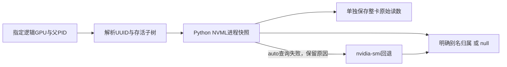

# Python NVML 显存查询回归

## 1. 功能与范围

复用主页已声明的 NVIDIA Python NVML 库，减少 recon-all 父子进程采样中反复启动 `nvidia-smi` 的开销。仅修改采样器，不改变 T1、表面、标签、精度、allocator 或阶段顺序。



本轮是 GPU 遥测回归，没有运行新的 MRI 整例。96 次组内查询和 2 次初始化前检查不替代真实 T1 验证。

## 2. Python 调用与输入输出

```python
import os
from fnit.recon_all.profiling import ProcessTreeDeviceSampler

process_memory_sampler = ProcessTreeDeviceSampler(
    device="cuda:1",             # 调用方的目标逻辑 GPU，已初始化时核对实际 UUID
    parent_pid=os.getpid(),       # 父进程及其存活子进程
    interval=0.5,                # 计划间隔，单位秒
    query_backend="auto",        # NVML 优先，错误有记录且允许 CLI 回退
)
try:
    process_memory_sampler.sample_if_due(force=True)  # 立即取样，不建立 CUDA context
finally:
    process_memory_sampler.close()                   # 只释放本实例 NVML 引用
process_memory_report = process_memory_sampler.report()  # JSON 兼容的完整字典
```

全部参数、内部查询接口、错误行为和 JSON 字段见 [功能说明](../../../../docs/recon_all/GPU_PROCESS_MEMORY.md)。不接收影像；空间和影像 dtype 不适用。显存为字节，时钟和查询耗时为秒。明确查询失败、unsupported MIG 或无法归属 PID 时，保留错误及 `null`。

实测 Python API 的当前卡为逻辑 0，目标卡为逻辑 1；两次取样后当前卡、既有 16 字节 sentinel 的地址和值均保留。CLI 在未建立 CUDA context 时先用 NVML 查询，初始化状态未改变。

## 3. 命令行复现

```bash
python tools/benchmark_recon_process_memory.py \
  --output-path /results/new_query_benchmark.json \
  --device cuda:0 \
  --repeats 12 \
  --interval 0.1 \
  --held-bytes 134217728 \
  --code-version ACTUAL_TESTED_COMMIT
```

输出路径必须为新文件；每组 12 次、计划间隔 0.1 秒，持有 128 MiB uint8 缓冲。完整导入由外层进程计时，函数墙钟包含缓冲分配、目标卡同步、查询、等待及报告准备；不将这些值称为 recon-all 耗时。工具也可用具名 Python 参数调用 `run_benchmark(...)`，从已初始化 CUDA 的调用方运行，不改变当前卡。

## 4. 原工具调用

无对应的 FreeSurfer 算法命令。CLI 对照使用 `nvidia-smi --query-compute-apps=pid,gpu_uuid,used_gpu_memory` 与 `--query-gpu=uuid,memory.used`；NVML 使用计算进程列表和 v1 memory-info。前者 MiB 转字节，后者直接保存字节。各后端先后快照不声称严格同时。

## 5. 最新实测结果

最终冻结代码基于 `66a9be092d78922bdb4eb1db992f57442aad1475`，两候选模块和工具的实际 SHA 见 [SUMMARY.json](SUMMARY.json)；提交基线不是用来替代未提交源码哈希。NVIDIA A100-SXM4-80GB、Xeon Platinum 8369B、CPU 96–99、4 线程预算、Torch 2.5.1/CUDA 11.8、驱动 550.54.14。固定 `nvidia-ml-py==13.580.82` wheel SHA 为 `4361db337b0c551e2d101936dae2e9a60f957af26818e8c0c3a1f32b8db8d0a7`，仅安装到新私有验证依赖目录，没有变更既有环境。

| 调用方式 | CLI 后续查询中位数 | NVML 后续查询中位数 | NVML 最大实际间隔 | 全新子进程墙钟 |
|---|---:|---:|---:|---:|
| CLI | 0.758135 s | 0.004506 s | 0.107814 s | 30.880472 s |
| 已初始化 CUDA API | 0.685390 s | 0.003529 s | 0.112779 s | 25.850264 s |

每行采用同进程 `CLI → NVML → NVML → CLI` 的 ABBA，每组 12 次。查询中位数排除每组首次 UUID/后端初始化查询；全部原始查询和首调用耗时仍保存。每个子进程包含两种后端、四组等待和导入，不能将其墙钟当作单一后端耗时。

两种调用均 48/48 组内快照成功，失败查询 0；[64 项本地契约](CONTRACTS.json)通过。所有组的宿主 PID 无法确认与容器子树对应，因此父子同期显存峰值仍为 `null`，不是 0。原始 CLI 与 NVML 整卡口径实测不同，详见 [MEMORY_SEMANTICS.json](reports/v3/MEMORY_SEMANTICS.json) 和功能页；进程列表数据保留，不减去固定经验常数。

严格影像复现、整体指标等效、完整 MRI 提速、20 GB 整例预算和无预装软件隔离运行：本轮均未评估。查询开销改善不能转换成整例加速百分比。

## 6. 版本与证据

- v1：启动模板误替换 `PYTHONPATH`，查询前语法失败；保留失败 JSON 和原 launcher SHA。
- v2：CLI 查询完成，API 子脚本因嵌套换行转义在查询前失败；保留两者。
- v3：已初始化 API 完成。另保存实际 NVML v1/v2/CLI 整卡口径，未修改原读数。
- v4：最终模块增加整卡读数来源字段，CLI/API 全部完成；作为本页最新版结果。
- [完整公开 JSON](reports/PUBLIC_EXPORT_MANIFEST.json)仅替换私有路径与主机名；逐项核对所有数值、布尔和 `null`，保留原始/公开 SHA。原始收据未覆盖，许可证、影像和模型未发布。

## 7. 原实现与参考

- [NVIDIA Python NVML 固定发行版本](https://pypi.org/project/nvidia-ml-py/13.580.82/)
- [NVIDIA NVML 查询 API](https://docs.nvidia.com/deploy/nvml-api/latest/api/group__nvmlDeviceQueries.html)
- [NVIDIA nvidia-smi 文档](https://docs.nvidia.com/deploy/nvidia-smi/)
- [Linux proc_pid_status](https://man7.org/linux/man-pages/man5/proc_pid_status.5.html)
