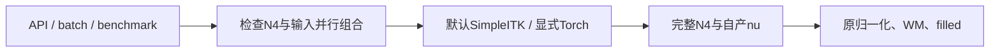

# 公开独立 Python 流程保留 N4 选择

## 1．功能

修复单例、batch 和 benchmark 无条件覆盖显式 Torch N4 的接线。`backend="python"` 仅把历史缺省 `n4_backend="native"` 映射为完整 SimpleITK N4；显式 `torch`、`in-process/isolated` 原样进入已有完整实现。其余 19 个配方键保持，不更换算法、不减少 200 轮反馈。独立 benchmark 启动审计另补拦截 `fnit_n4_itk`，防止仅凭名字不以 `mri_` 开头而漏检原阶段程序。



## 2．Python、输入与输出

完整函数的全部参数、输出路径、空间和失败结构见 [生产接口](../../../../docs/recon_all/PYTHON_SURFACE_PIPELINE.md) 和 [N4选择](../../../../docs/recon_all/PYTHON_PROFILE_N4_SELECTION.md)。本次变更的参数如下：

| 参数 | 默认及范围 |
| --- | --- |
| `backend` | 公开入口默认 `native` 混合对照；本独立候选明确选择 `python`，不读取原版程序目录 |
| `n4_backend` | 历史默认 `native` 在独立候选中映射为 `simpleitk`；也可明确选完整 `torch`，其数值影响另报 |
| `n4_execution` | 默认 `in-process`；`isolated` 仅允许 `torch`，新 Python exec 开阶段缓存，保留父进程策略 |
| `input_execution` | 默认 `serial`；`parallel` 仅允许 SimpleITK/in-process、明确 `cuda:N` 和总 4 线程；与 Torch 组合直接报错 |
| `device/threads` | 完整独立配方要求明确 `cuda:N`、至少 2 个总 CPU 线程；不因 N4 是 CPU 而改变其他 GPU 阶段 |

```python
from fnit.recon_all.native_free import run_recon_all_python

report = run_recon_all_python(
    t1="data/sub-06_T1w.nii.gz",  # 原始三维单幅T1w
    subject_dir="runs/sub-06-python",  # 新目录或空目录
    weights_dir="resources/weights",  # 提前核验大小和SHA-256的权重
    assets_dir="resources/assets",  # 提前核验的模板、图谱和LUT
    backend="python",  # 选择不调用原阶段程序的完整候选
    n4_backend="torch",  # 显式保留已有完整Torch N4
    n4_execution="isolated",  # 独立Python worker局部开缓存
    input_execution="serial",  # 不能与当前SimpleITK/SynthSeg并行组混用
    device="cuda:0",  # 明确GPU，默认TF32及已验证FP32例外保持
    threads=4,  # 整例总CPU预算
    profile_stages=True,  # 测评同步指定GPU；生产通常设False
    cuda_allocator_cache="auto",  # 保留已初始化API的策略
)
```

影像输入是原始网格；`nu0/nu` 等体积在自产 conform 网格，单位 mm，`nu0` 是 uint8 强度图而非标签。完整表面用 surface RAS/mm，顶点图对应该有序网格。返回 JSON 可序列化完整运行报告；执行失败抛异常并尽量保存诊断报告，非法组合在创建输出/CUDA 前失败。整体等效尚未判定。

## 3．命令行与安装检查

完整候选 CLI 示例：

```bash
fnit-recon-all data/sub-06_T1w.nii.gz runs/sub-06-python \
  --weights-dir resources/weights \
  --assets-dir resources/assets \
  --backend python --device cuda:0 --threads 4 \
  --n4-backend torch --n4-execution isolated \
  --input-execution serial --profile-stages
```

`check_installed.py` 仅检查离线安装接口，不读取 MRI。具名参数 `--snapshot` 是含 `source/`、`SOURCE_MANIFEST.json` 的构建快照，`--installed` 是 wheel 安装目录，`--wheel` 是实际构建产物，`--output` 是不得存在的新 JSON 文件。输出包括 6 个模块的相对路径/源码与安装 SHA、默认与显式配方、CLI help 状态、CUDA 未初始化状态。路径/字节不符或默认改变报错。复现示例：

```bash
python check_installed.py \
  --snapshot /tmp/fnit-python-n4-build \
  --installed /tmp/fnit-python-n4-build/installed \
  --wheel /tmp/fnit-python-n4-build/wheel/fudan_neuroimaging_toolkit-0.16.0-cp311-cp311-linux_x86_64.whl \
  --output /tmp/fnit-python-n4-build/new-install-check.json
```

新 `tools/benchmark_recon_input_prefix.py --mode single` 是原始 T1→filled 专用诊断，不是整例 CLI。它在唯一 `filled_auto_checkpoint` 后插入返回而保留全部原阶段语句。`--n4-backend/--n4-execution` 同生产语义；`--mode pair` 仅比较原 SimpleITK 串行/并行。完整资源、审计、源码 manifest 参数及计时边界见 [前段复现说明](../20261010_input_n4_synthseg_prefix/README.md) 和工具 `--help`。

## 4．原软件调用

接线与安装检查是内部调度，没有独立原软件命令。N4 对照参数见 [固定 N4 配方](../../../../docs/recon_all/N4_ITK_CONDA.md)；参考仅在独立 benchmark 生成。SimpleITK/ITK 通用库可以使用，不是运行原版 FreeSurfer 重建阶段。

## 5．实测范围

公开 API/batch/非法组合及审计回归：**50 项测试和 15 个子检查通过，pytest 17.14 秒**；JUnit 为 17.097 秒。初次 3 个失败来自测试把省略的默认 `in-process` 当作必传关键字，修正测试为 `.get(..., "in-process")`；[两版原结果](contracts.json) 与 XML 保留，不把它算作 MRI 算法差异。

当前源码快照离线 wheel 构建、独立目录安装成功，大小 **5,174,602 字节**，SHA-256 `c254e3db39a6429afb4b5dcbd2e4c8ccc8a71ae8c188b80a76c9aeef4e715a95`。6 个已安装模块与实际快照逐字节相同，API/batch 默认串行、显式 Torch/isolated 配方、CLI help 均通过，CUDA 未初始化。详情见 [install_check.json](install_check.json) 与 [源码清单](WHEEL_SOURCE_MANIFEST.json)。这是接口安装门，不是新 Conda 环境 MRI 或无预装软件的隔离整例证明；本地没有实际导入 SimpleITK，主页已声明该依赖，本轮没有新依赖。

两例公开原始 T1→filled 的完整 Torch/isolated 连续运行已完成；真实误差、阶段耗时、NVML 采样和脑图以 [专用比较报告](../20261010_torch_n4_prefix_compare/README.md) 为准。不能从安装门、缓存 N4 局部速度或前段完成推导 138 输出、最终指标等效或 600 秒整例。

## 6．版本与记录

接口测试按原 JUnit 时间和分支提交顺序重建为 `04d97928` 加实际工作树；wheel 则冻结为稍后的 `9fd532d8` 加同一计算源码。两者版本单列；8 个相关文件的实际 SHA 保持相同。首次收据误用了后来的 wheel 提交作为测试提交，[更正记录](receipt_correction.json) 保留原收据 SHA 和 Git 位置，测试数值、源码 SHA 与 wheel 收据均未改变。完整文件 SHA 见 [contracts.json](contracts.json)，wheel 源码清单另列。后续提交不会把已有报告重标为新运行。

此前 `1f098ea0` 的 81 个提交文件另外按 Git blob 核对：77 个仍相同，4 个调度/工具文件是本次继续修改，其旧 blob SHA 与原 routing receipt 相同；旧串行/并行前段证据保留。原版程序审计仅覆盖 Python 启动和子命令；动态库与全部文件访问尚未做干净环境隔离验收。

## 7．参考与实现

- [FNIT Python配方](../../../../src/fnit/recon_all/python_profile.py)、[公开入口](../../../../src/fnit/recon_all/native_free.py)、[batch](../../../../src/fnit/recon_all/batch.py)。
- [完整 Torch N4 实现与原参考](../../../../docs/recon_all/N4_COMPLETE_TORCH_20261009.md)。
- Tustison 等，N4ITK，*IEEE TMI*，2010，[DOI](https://doi.org/10.1109/TMI.2010.2046908)。
