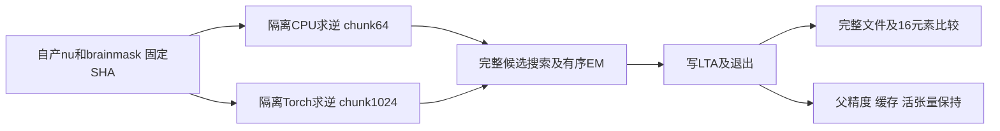
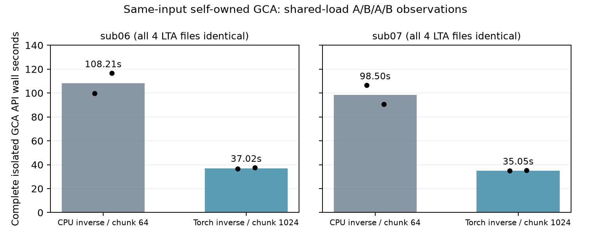

# 两例自产输入的完整自有 GCA 隔离回归

## 1. 功能与范围

本轮复用现有完整 Python/Numba GCA 优化器和 PyTorch GPU 候选评分，验证新 `backend="python"` 原始T1候选实际生成的 `nu.mgz`、`brainmask.mgz`。两种配置都使用独立 Python worker，`binary=None`，不调用 FreeSurfer 阶段程序；没有新增算法或改动生产源码。

冻结生产来源是 `recon_python_profile_20261010_v3`，Git `43be4a5b0b0215c91865b2292a92244e03547f0a` 加源码清单 SHA `ce01deee5ebcf2bac6339cdc28071591aa981155b7f7e8def0e6a870049dcbc2`。这份冻结配方仍是当时的14项，不是随后21项配方。所有实际执行模块与输入SHA逐项保留在12份JSON中。



## 2. Python 调用、输入与输出

实际调用现有 `native_free._run_native_em_register()`，其完整参数和输出解释见[隔离GCA功能页](../../../../docs/recon_all/GCA_ISOLATED_TORCH_20261009.md)。本次接口示例中的路径变量均由调用者赋值，参考结果不作为输入。

```python
from fnit.recon_all.native_free import _run_native_em_register

registration_result = _run_native_em_register(
    binary=None,                      # 独立自有配方，不提供原版阶段程序
    mri=diagnostic_mri_directory,      # 新诊断目录中的自产nu、brainmask及transforms
    atlas=declared_gca_file,           # 已核对SHA的声明GCA图谱
    assets=declared_assets_directory,  # 声明的FNIT资产目录
    backend="torch",                  # 现有自有GPU评分；有序EM继续Python/Numba CPU
    binary_sha256=None,                # 无原版程序，故无程序SHA
    threads=4,                        # 父子总线程预算4
    device="cuda:5",                  # 本轮实际物理A100，未重映射CUDA_VISIBLE_DEVICES
    inverse_backend="torch",          # 已有批量Torch求逆
    candidate_chunk=1024,             # 每块候选矩阵数量
    execution="isolated",             # fresh exec局部开启缓存，保持父进程缓存策略
)
```

`run_diagnosis.py` 参数均为具名参数：`--root` 是FNIT私有根；`--source` 是带 `SOURCE_MANIFEST.json` 的冻结代码；`--run` 是生产run父目录；`--subject` 为 `sub06` 或 `sub07`；`--out` 必须不存在；`--device` 默认 `cuda:5`；`--inverse-backend` 为 `cpu/torch`，未给时读取生产checkpoint；`--candidate-chunk` 未给时读取生产checkpoint。本driver固定线程4并要求来源记录原 `gca_execution="in-process"`，只用于本轮迁移诊断。输入拷贝前后校验SHA，失败抛异常并留下JSON/日志，不修改生产目录。

输入为公开ds000114两例的FNIT自产MGZ，conformed XYZ网格，MRI强度单位；形状、几何不在本阶段改变。GCA SHA为 `2fcd276a39800f01f93a4c8828ae6d0a8cea3d8b8b9fe1599d4ee54e806be93e`。输出为 `mri/transforms/talairach.lta` 和完整worker报告，type-0 LTA把源体素映射到atlas体素：线性项无量纲，平移为目标体素单位，不能标毫米。

父CUDA在调用前已初始化并保留4,194,304字节FP32活张量；父缓存关闭，子worker局部缓存开启。双方matmul/cuDNN TF32均开启、autocast关闭、未请求半精度。记录中autocast默认dtype虽为float16，`enabled=false`，不表示运行了半精度。

## 3. 命令行、报告与复现

stage driver不是新公共CLI。实际对照依次是每例 `cpu64-r1 → torch1024-r1 → cpu64-r2 → torch1024-r2`，即A/B/A/B，不能改称ABBA。

```bash
# 所有路径由调用者显式指定；后台taskset固定四核，勿与其他任务抢同一GPU
PYTHONPATH="$frozen_source_directory/src" python run_diagnosis.py \
  --root "$fnit_private_root" \
  --source "$frozen_source_directory" \
  --run "$producer_run_directory" \
  --subject sub06 \
  --out "$new_diagnostic_directory" \
  --device cuda:5 \
  --inverse-backend torch \
  --candidate-chunk 1024

# 只读重建公开JSON对应的CSV；输出目录必须不存在，不执行注册
python validation/recon_all/optimizations/20261010_python_gca_isolated/summarize_results.py \
  --reports-directory validation/recon_all/optimizations/20261010_python_gca_isolated/reports \
  --output-directory "$new_metrics_directory"
```

`summarize_diagnosis.py --root` 在私有环境只读解析已有8份收据、4个执行模块、manifest、生产和复制输入及LTA，写来源v2摘要；保留旧摘要和原始收据。`summarize_results.py` 使用标准库检验公开 `published_sha256`、原始 `raw_sha256` 与关键合同后写 `stage_calls.csv`、`worker_phases.csv`、`summary.json`。`plot_results.py --summary-file --output-file` 只读摘要绘制PNG；输出已有时拒绝。生成图需要项目已有matplotlib，没有新增依赖。

## 4. 原软件对应过程

算法对应 `mri_em_register -mask brainmask.mgz nu.mgz RB_all_2020-01-02.gca talairach.lta`。本报告比较的是两种自有完整GCA配置，没有重新执行原版程序，不能据此宣称对官方逐位复现。原版源码构建程序的独立比较另见[GCA四输入诊断](../20261010_n4_gca_cross_inputs/README.md)，其不同输入/版本结果不改标签并入本表。

## 5. 本版实测精度、时间与资源

| 两例完整阶段API墙钟，秒 | CPU求逆 / chunk64 | Torch求逆 / chunk1024 |
| --- | ---: | ---: |
| sub06，第一次 / 第二次 | 99.82208846323192 / 116.59606395754963 | 36.61056594736874 / 37.43457784689963 |
| sub06，中位数 | 108.20907621039078 | 37.022571897134185 |
| sub07，第一次 / 第二次 | 106.49610196612775 / 90.50752543285489 | 34.9155460447073 / 35.178239720873535 |
| sub07，中位数 | 98.50181369949132 | 35.04689288279042 |

8/8正常完成。每例四份LTA的完整字节一致，实际解析16个元素的不同数、最大/P99均为0；父当前设备、TF32、autocast、缓存环境及活张量均保持。这里同时改变求逆后端和块大小，没有把收益归因于单个因素。两配置都已隔离，不能据此单独证明缓存相对in-process的收益。

以第一次为例，sub06线性搜索70.78755786735564→10.632058899849653秒；sub07为76.6978228809312→9.043358197435737秒。准备约12秒、EM约7秒仍保留，全部分段值及嵌套总墙钟在CSV中，不重复累加。完整调用计时包含线程预算作用域、worker启动/导入、校验、加载、传输、候选搜索、EM、LTA写出、进程退出及显式目标GPU同步；父前置初始化、诊断输入拷贝与收据整理在计时外，不是冷父API或原始T1整例时间。



共享A100-SXM4-80GB，目标 `cuda:5`，UUID `GPU-anonymized-device-008`，CPU24–27，总线程4；存在其他同卡任务，不宣称独占吞吐。CPU求逆子worker allocated/reserved峰29,433,856/44,040,192字节；Torch求逆为219,581,440/257,949,696字节。父缓存关闭时统计不可用，不能把0当零显存。进程命名空间归属未解析，父子同刻合计保持null；同期整卡上界25,610,420,224–41,179,676,672字节包含其他任务，不能当作FNIT自身峰值或20GB通过证明。采样设置0.5秒，实际最大间隔2.7117415657266974秒，无采样失败；卡级与进程查询并非严格同时。未执行干净Conda整例/运行时隔离。

旧v3 in-process完整LTA在本次发布时尚未生成，对它的比较明确为 `pending_v3_lta`。新原始T1整例由协调者另跑，严格复现、整体指标等效和10分钟目标都不在本阶段判断。

## 6. 更新记录与来源限制

2026-10-10完成两例八次独立GCA真实回归；没有替换默认或改生产算法。公开导出仅替换私有路径/主机等字符串，66,105个数字、布尔、null值及类型保持，12份原始和公开SHA分列在 `reports/PUBLIC_EXPORT_MANIFEST.json`。

首次最终来源断言因整份生产 `benchmark.json` SHA不同而失败。运行器持续更新 `periodic_checkpoint_seconds`、`cli_elapsed_seconds_partial`、`process_memory` 等字段，阶段开始记录与结束后快照不能要求逐字节稳定。历史整份checkpoint原文当时未留存；8个捕获SHA全部保留，来源限制明确为 `historical_raw_snapshot_unavailable_live_periodic_updates`，没有重新构造或声称原文验证通过。固定code_version/GCA配置、SOURCE_MANIFEST原文SHA及语义、实际4个执行模块SHA、输入复制前后/生产当前SHA均另外核验一致。来源v1和v2摘要均保留，旧数值不覆盖。

此前其他N4候选或旧原始T1阶段时间不作为本次观测。未添加脑图：本阶段只写同一LTA，没有生成新重采样体积或表面；当前附图只展示实测墙钟，不伪造解剖差异图。

## 7. 代码与参考

- [完整GCA优化器](../../../../src/fnit/recon_all/mri_em_register_python.py)、[GPU评分与求逆](../../../../src/fnit/recon_all/mri_em_register_score_gpu.py)、[独立worker](../../../../src/fnit/recon_all/gca_torch_worker.py)。
- [FreeSurfer mri_em_register源码](https://github.com/freesurfer/freesurfer/tree/dev/mri_em_register)。原软件仅为算法来源/独立benchmark，不进入本次生产调用。
- Fischl B et al. Whole brain segmentation: automated labeling of neuroanatomical structures in the human brain. Neuron. 2002;33:341–355. doi:10.1016/S0896-6273(02)00569-X.
