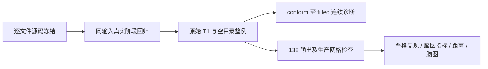

# 不执行原版阶段程序的 Python 整例验证

## 1. 功能与范围

本目录保存完整 Python 候选的源码冻结、接线回归和真实数据收据。Python、Numba、PyTorch 和通用 Python 库均可使用；没有将 CPU 步骤计为迁移失败。生产候选不执行 FreeSurfer 阶段程序，不读取官方中间结果。



数字拓扑候选与 FS GA 算法不同，存在明显局部形状差异，不能将结构检查通过解释为解剖等效。详细算法、参数和真实阶段结果见[功能说明](../../../../docs/recon_all/PYTHON_SURFACE_PIPELINE.md)。

## 2. Python 接口、输入和输出

`freeze_source.freeze_source(repository=..., archive=..., label=...)` 输入仓库路径、新 tar 路径和标签，输出归档、`manifest.json`、`sha256.json` 及可序列化收据。源码在读取时捕获，记录 HEAD、工作树状态、实际逐文件 SHA；冻结期间 HEAD 改变则失败。归档没有原版程序、C++ 源码、影像、权重和许可证。

`tools/evaluate_recon_volume_prefix.py` 的 `evaluate_prefix(reference_benchmark=..., candidate_benchmark=..., output=...)` 输入完整参考 FNIT 链和已完成 `filled_auto_checkpoint` 的候选收据，输出逐体积几何、dtype、不同体素数、最大/P99 误差，分割标签 Dice、WM 非零前景 Dice、LTA 16 元素误差和文件 SHA。两收据的原始 T1 SHA 必须相同；输出及三份收据快照路径必须不存在；另保存 reference_producer、candidate_producer_checkpoint、candidate_runtime_checkpoint 原样字节，读取期间 MRI 变化时报错。不重采样、不写回生产目录、不判断等效。

`rawavg` 为原始导入网格，本次 sub06 为 `(256,156,256)`；其余 MRI 为各自产出的 256³ conform 网格。强度无物理单位，分割为离散标签；LTA 为 VOX_TO_VOX。此诊断不要求候选整例完成，也不能据此前段状态声称整例完成。

## 3. 命令行复现

```bash
# repository：实际待测工作树；archive：新归档；label：本次验证标签。
python validation/recon_all/optimizations/20261010_python_profile/freeze_source.py \
  --repository /data/FNIT/repo \
  --archive /data/FNIT/archive/python_profile.tar \
  --label python-profile

# t1：原始三维 T1；output-root：不存在的目录；资源须已校验。
# device：明确 GPU；threads：总 CPU 预算；code-version 绑定归档 manifest SHA。
python tools/benchmark_recon_torch_end_to_end.py \
  --t1 /data/sub01_T1w.nii.gz \
  --output-root /data/FNIT/runs/python-sub01 \
  --weights-dir /data/FNIT/weights \
  --assets-dir /data/FNIT/assets \
  --backend python --device cuda:0 --threads 4 \
  --code-version '<Git HEAD>+manifest:<SHA-256>'

# 只读比较已经完成的前段；reference-benchmark 不会进入生产输入。
python tools/evaluate_recon_volume_prefix.py \
  --reference-benchmark /data/FNIT/runs/control/benchmark.json \
  --candidate-benchmark /data/FNIT/runs/python-sub01/benchmark.json \
  --output /data/FNIT/runs/evaluation/prefix.json
```

整例 benchmark 保存完整资源、输入、源码哈希和 CLI/API/外层墙钟；剖析同步明确设备，时间包含加载、传输和读写。执行审计作用于候选 Python 进程和继承的子进程启动，原版阶段程序请求会报错；它不是操作系统文件和动态库隔离证明。失败保留日志和部分报告，不补跑缺失步骤。

## 4. 原软件参考

组合参考为固定版本 `recon-all -i /data/sub01_T1w.nii.gz -s sub01 -all`。同输入 white、pial、N4、WM、曲率和 paint 各自固定命令与版本、线程和程序 SHA 见对应功能页。已有官方整例与本轮候选跨环境，官方历史时间不能作为当前同主机速度对照。参考只用于独立比较，不作为候选输入。

## 5. 当前实测与边界

- `reports/surface_adapters_v2/`：两例、双侧、三阶段，12 个完整冻结同输入调用均 exit 0。11 个阶段坐标相同；修复前 sub06 LH preaparc 最大距离 0.027004 mm。阈值和诊断 MRI 无差，网格先检查有序面一致。包含真实耗时，不能相加得到整例时间。
- white 边界搜索修复后，两例双侧 preaparc、最终 white、pial 共 12 个完整冻结同输入阶段的最终坐标和有序面均无差，white 诊断 MRI、dtype、几何、阈值表相同。八个 white/pial 使用既有带 SHA 的参考，并未新跑原生重复实验；精确来源及各自读写耗时见[边界修复完整回归](../../../../docs/recon_all/WHITE_BORDER_TARGET_PRECISION_20261010.md)。它不是原始整例通过或提速结论。
- 本地 v4 配方接线及执行审计：56 项通过，48.81 秒；`contracts_v4_56_junit.xml` 与收据保存。这是契约回归，不是影像 benchmark。
- GCA：两例各四次完整同输入调用的 LTA 字节和 16 个矩阵元素相同。隔离 CPU/64 为 sub06 99.822/116.596 秒、sub07 106.496/90.508 秒；隔离 Torch/1024 为 36.611/37.435 秒、34.916/35.178 秒。共享负载且非 ABBA，不将组合变化归因单一算子，不外推整例提速。
- 完整 N4、WM 编辑、曲率及 paint 的真实回归见功能页，保留 N4 两例的 28/99 个 uint8 体素尾差；没有因 GPU 或 Python 调用而删除严格比较。
- v3 原始整例使用进程内 GCA、CPU 求逆和 64 候选；原任务保留。v4 使用成熟 GPU 配方与 white 修复，从两例原始 T1 和新空目录重新运行，不修改 v3 源码或补跑。

v4 源码：`922f569806bfdfafb9ba16355ae9660efd261eba` 加 `source_v4.manifest.json` 的实际字节；775 文件，archive SHA `5fdc490a8f3a3cb9c6abc924de76da4ae7d01422f01702703597458d62e593c7`，manifest SHA `21bfe987f5f2cfde992578208d8235b1ed90ad2c4608c95df1b0f4c6751b9d9a`。不只用 HEAD 描述未提交改动。

两例 v4 原始整例现已退出并失败，完整评价未生成；整体指标等效未判定、十分钟目标未达到。共享 GPU 的外部进程归属未解析时，进程树显存为未知，不能用 Torch allocated/reserved 或数值 0 宣称满足 20,000,000,000 字节。主页已声明 SimpleITK 依赖，独立 wheel 安装结果另有收据；没有干净无预装软件环境的整例证明。

### 原始 T1 连续前段 v4（实测，非官方整例比较）

同原始 T1 对照是已经完成的 FNIT `79a41cdd` 混合链，两例均从原始影像和空目录连续运行。它不是官方参考，也不是冻结官方上游的阶段测试。14 张 MRI 的 shape、dtype、affine、surface RAS 变换均一致；LTA 的 16 元素无差，所有体积的绝对差 P99 为 0。

| MRI 文件 | sub06 不同体素 / 最大差 | sub07 不同体素 / 最大差 |
|---|---:|---:|
| `rawavg.mgz` | 0 / 0 | 0 / 0 |
| `orig.mgz` | 0 / 0 | 0 / 0 |
| `tmp/nu0.mgz` | 99 / 1 | 28 / 1 |
| `nu.mgz` | 92 / 3 | 28 / 3 |
| `T1.mgz` | 1549 / 8 | 41 / 3 |
| `brainmask.mgz` | 1103 / 8 | 21 / 3 |
| `synthseg.rca.mgz` | 0 / 0 | 0 / 0 |
| `norm.mgz` | 1563 / 4 | 16 / 3 |
| `brain.mgz` | 13133 / 16 | 25 / 4 |
| `aseg.presurf.mgz` | 0 / 0 | 0 / 0 |
| `wm.seg.mgz` | 10162 / 230 | 40 / 230 |
| `wm.asegedit.mgz` | 7566 / 230 | 32 / 167 |
| `wm.mgz` | 7583 / 230 | 32 / 167 |
| `filled.mgz` | 485 / 255 | 8 / 255 |

两例 SynthSeg 与 `aseg.presurf` 全部非背景标签 Dice 为 1。`filled` 的标签 127/255 Dice 分别为 sub06 **0.999408/0.999644**、sub07 **0.999998/0.999985**。WM 非零前景 Dice 分别为 `wm.seg` 0.998699/0.999983，`wm.asegedit` 0.999459/0.999992，最终 `wm` 0.999452/0.999992。强度差和标签 Dice 分开报告，没有对标签值计算 Pearson r；sub06 的强度差会传播，是否影响最终指标尚未判定。

只读比较 v2 为 34.869/34.222 秒，含 14 张影像读入；这个时间不计入生产整例。v2 保留三份原样生产收据快照，SHA 绑定实际解析字节，避免运行中报告更新造成版本错配；与 v1 的全部 MRI 数值及 LTA 结果相同。公开版本保留数值、哈希与原始/公开 SHA 对照，见 `reports/continuous_v4/PUBLIC_EXPORT_MANIFEST.json`。

v4 sub06 已完成双侧表面生成，但左侧球面配准在非有限采样坐标处失败。独立回放确认：第一个接受更新前输出有限，随后第 3 次顶点法向调用有 6 个严格零叉积，直接单位化产生 4 顶点/12 个非有限元素。原 `mrisNormalize` 只在长度大于零时相除，第一版修复后其他 107766 个有限顶点逐位保持；正常 `79a41cdd` 同输入完整配准的 130679 个顶点、有序面及输出 SHA 均保持。

同一异常输入继续回放，又定位到面法向单位化的两个零叉积、六个 NaN。面法向原 `V3_NORMALIZE` 对 `abs(length)<FLT_EPSILON` 使用乘数 1，区别于角点的严格零规则。第二版分别实现两个原有分支，12 项内核测试通过。真实状态的面积及普通面法向逐位保持；278 个非零 FZERO 面恢复原公式，不能声称全部旧有限法向保持。异常输入完整 stage 已执行结束，API 263.914 秒、冷进程 283.389 秒；网格有限且 Euler/边界/非流形/零面积检查通过，但保存后仍有 **7507 个负径向面，球面质量未通过**，负面积合计 51.518 mm²、P99 0.116918 mm²、最大 0.413423 mm²。正常79输入新版再次逐位保持，冷进程154.484秒。执行完成不替代质量验收。固定原 sphere/register caller 都设1000，另有1000次无进展停止；现上限属于源语义，不能删掉或任意增加次数。本轮新增诊断保留旧坐标和停止轨迹，Python候选 sphere/sphere.reg 写出前严格拒绝翻折，并保存 `quality_failure`；通用参考接口默认保持。成功、失败及实际源版本见[配准回归](../20261010_registration_zero_corner/README.md)。

零 incident 法向的[五轮有序几何扰动候选](../20261010_normal_pending_python/README.md)已完成独立转写，返回完整共享坐标及状态。11 项合同通过；五个真实冻结状态坐标和法向均无差异，却均未触发非零 pending。候选未接入生产度量链；当前内核的该分支仍明确报错，全部 1001 个动态状态未逐轮检测，翻折原因尚未由此确定。

原 v4 失败产物保留：CLI 墙钟为 **1368.894 秒**，API 为 **1363.345 秒**，包含前置检查的完整 harness 为 **1377.794 秒**；监督 shell 为 1379.582 秒。这是失败运行时间，不是完成整例或最终提速。保存的球面坐标有限、半径正常，有 6946 个负径向面和微小三角面；动态非有限值另行回放定位。sub07 已完成球面配准与注释，但最终 pial 清理失败；两例最终收据见下表。

两例 N4 实际为 184.698/184.775 秒；GCA 为 36.171/36.143 秒。候选仅执行 Python 阶段，原版程序 SHA 清单为空；源码审查与启动审计不替代无预装软件环境的隔离验收。显存进程归属未解析，目标卡有其他任务；采样请求间隔 0.5 秒，但 sub06 实际最大间隔 11.925 秒，含查询超时。进程树峰值未知，不能将共享卡总占用或缓存关闭的统计 0 当作候选峰值。

公开入口和worker的质量失败接线已做本地CPU回归：30项测试及8项子测试通过，包含严格球面参数透传、写出前失败和机器可读诊断保留。完整[Junit与源码SHA收据](quality_wiring_contracts.json)不替代真实网格或整例结果。

Python 最终放置后续拆为 `final_white` / `pial_surface` 双侧 exec 组：只为完整 white 新子进程开缓存，pial 保留继承策略，指标仍在发布屏障后串行。原 v4 冻结结果不改标为新调度实测；实际配对见[表面分配器验证](../../../../docs/recon_all/SURFACE_CUDA_ALLOCATOR.md)。新调度尚未完成原始 T1 整例。

双侧组质量异常的后续接线修复使公开报告也保留 `quality_failure.stage_group/hemispheres`，原 worker 和组报告保持。仅提取真实失败 worker 的字典质量诊断，不把取消、I/O 或资源失败归为网格失败。23 项本地接线回归通过，见[完整源码和 JUnit 收据](group_quality_contracts.json)；这不是新整例或真实 MRI 数值结果，旧 v3/v4 报告不改写。

### 两例 v4 最终执行收据（只读收集，不改标为新代码整例）

| 原始运行 | sub06 | sub07 |
|---|---:|---:|
| 完整 API 墙钟 / 秒 | 1363.345 | 11069.505 |
| CLI 墙钟 / 秒 | 1368.894 | 11074.201 |
| 含预校验的 harness / 秒 | 1377.794 | 11083.228 |
| 已记录父阶段 | 25 | 27 |
| 失败阶段 | 球面配准组 | 最终 white/pial 组 |
| 原版阶段程序启动尝试 | 0 | 0 |
| Python 启动审计事件 | 839 | 10940 |
| 整例完成 / 138 输出验收 | 否 / 未评价 | 否 / 未评价 |

这些是**失败运行时间**，没有完成整例的提速倍数。sub07 左侧明确因残余相交拒绝写出，`cuda_oom=false`，右侧 worker 计算完成；半球组未发布完整结果。旧 v4 white/pial 继承关闭缓存，最终组墙钟9350.684秒，不将其当作后续已开缓存 white 子阶段的耗时。原始源码、脚本、输入和资源哈希及52份完整公开收据见 [最终收据](reports/completed_v4/PUBLIC_EXPORT_MANIFEST.json)，机器摘要见 [COMPLETED_V4_SUMMARY.json](COMPLETED_V4_SUMMARY.json)，逐项父阶段墙钟见 [CSV](completed_v4_stage_metrics.csv)。旧运行中检查点和失败产物均保留。

终态pial另外复用已有独立cKDTree/F64三角面几何谓词重新检查：95045顶点、190086面，有**32相交面、35顶点**；两次既有原生参考的同序面和全部坐标均与Python终态相同。具名参数版本的读入/哈希0.128秒、几何计算26.133秒，见[终态复检收据](reports/completed_v4/pial_geometry_recheck.json)。故该输入未通过几何质量门，并非仅因Python源有向标记产生不同计数；没有重跑或复制原生结果进生产。[具名参数诊断器](diagnose_pial_geometry.py)只读冻结终态，与原始T1完整运行分开。

显存同期进程树归属均未知，峰值保留`null`；采样请求0.5秒，实际最大间隔11.925/11.523秒，失败查询6/11次。共享整卡峰44.141/45.084GB包括其他进程，不能判为候选峰值，也没有20,000,000,000字节整例通过证据。原版程序清单为空和Python启动审计通过只覆盖实际执行到失败的部分；后续未运行阶段仍只有源码审核，干净环境及系统文件/库审计未验证。

复现收据采集时，`run-root`为已经退出的原始运行，`archive`为新tar；标准输出模式需以`collector-sha256`明确绑定采集器字节。输出含原JSON/审计字节和`CAPTURE.json`，原件在采集期间变化则失败，不含影像、坐标文件、权重或许可证。`summarize`的`receipt-root`为导出目录，`summary-path/stage-csv`均为新文件；返回逐例状态、秒数、版本和显存边界，未建立等效标准。

```python
from pathlib import Path
from diagnose_pial_geometry import diagnose  # 从该验证目录导入，不属于安装后的公共API

report = diagnose(
    coordinates_path=Path("/data/FNIT/diagnostics/cleanup-result.npy"),  # (N,3)，surface RAS/mm
    faces_path=Path("/data/FNIT/diagnostics/lh.white"),  # 同顶点顺序的(M,3)三角面
    reference_surfaces=(Path("/data/FNIT/reference/lh.pial.T1"),),  # 只用于隔离诊断的参考
    output_path=Path("/data/FNIT/diagnostics/pial-geometry.json"),  # 新JSON，存在则失败
)
# report的mesh_quality_passed保留False，不把诊断完成解释为网格通过。
```

```bash
# run-root：已退出的整例；archive：新收据归档，不补跑任何阶段。
python validation/recon_all/optimizations/20261010_python_profile/capture_completed_runs.py \
  --run-root /data/FNIT/runs/python-v4 \
  --archive /data/FNIT/archive/python-v4-final.tar

# receipt-root：清理机器信息后的公开收据；两个输出路径必须不存在。
python validation/recon_all/optimizations/20261010_python_profile/summarize_completed_runs.py \
  --receipt-root /data/FNIT/reports/completed_v4 \
  --summary-path /data/FNIT/reports/final-summary.json \
  --stage-csv /data/FNIT/reports/final-stages.csv

# coordinates-path：(N,3)终态surface RAS/mm坐标；faces-path：同序三角面文件。
# reference-surface：隔离benchmark参考，可重复传入；output-path：新诊断JSON。
python validation/recon_all/optimizations/20261010_python_profile/diagnose_pial_geometry.py \
  --coordinates-path /data/FNIT/diagnostics/cleanup-result.npy \
  --faces-path /data/FNIT/diagnostics/lh.white \
  --reference-surface /data/FNIT/reference-1/lh.pial.T1 \
  --reference-surface /data/FNIT/reference-2/lh.pial.T1 \
  --output-path /data/FNIT/diagnostics/pial-geometry.json
```

## 6. 更新与 benchmark 记录

2026-10-10 v2：冻结完整表面适配器同输入测试；v3：启动首次完整 Python 原始整例；v4：接入成熟 GPU GCA、归一化控制点/偏置、sphere 收尾及 MNI 后置并行，修复通用 float32 边界分支，并重新冻结原始整例。各版保持自己的源码和收据，未将后续结果改写为旧版实测。

固定 v4 的 24 组阶段、71 条函数 SHA 的独立静态审核见 [迁移表与复现脚本](../20261010_python_profile_static/README.md)。审查绑定 v4 的实际字节，后续内核修复不改写其报告。

公开收据只替换私人路径/主机字符串，保留全部数值、输入、源码和程序 SHA；原始与公开 SHA 在 `PUBLIC_EXPORT_MANIFEST.json` 分开。真实影像、权重和许可证不进入 Git。

## 7. 原实现与参考文献

- [FreeSurfer 源码](https://github.com/freesurfer/freesurfer)；实际固定版本以各收据为准。
- [SimpleITK](https://simpleitk.org/)；本轮固定 2.5.6。
- Dale AM, Fischl B, Sereno MI. Cortical surface-based analysis. I. Segmentation and surface reconstruction. *NeuroImage* 9, 179–194 (1999).
- Fischl B, Dale AM. Measuring the thickness of the human cerebral cortex from magnetic resonance images. *PNAS* 97, 11050–11055 (2000).
