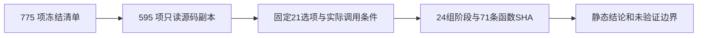

# v4 独立 Python 配方：静态调用审查

## 1. 功能与范围

本页核对 v4 固定 21 项配方实际选择的函数、设备和条件分支。唯一代码源是 Git `922f569806bfdfafb9ba16355ae9660efd261eba` 加冻结 overlay；源码包 SHA `5fdc490a8f3a3cb9c6abc924de76da4ae7d01422f01702703597458d62e593c7`，SOURCE_MANIFEST SHA `21bfe987f5f2cfde992578208d8235b1ed90ad2c4608c95df1b0f4c6751b9d9a`。775 项在服务器逐项核对，下载的 595 个 Python/JSON 文件再次核对；其中 564 个为 Python 模块。



完整迁移表见 [migration_table.md](migration_table.md)，机器报告见 [static_audit.json](static_audit.json)。本任务不编辑生产代码、不导入模型，也不启动 MRI 或 GPU 计算。

## 2. Python 复现与输入输出

复现脚本仅用标准库 AST 和 SHA-256。输入 `source` 是带本页精确 SOURCE_MANIFEST 的冻结源码副本；报告读取其中 `src/fnit` 的 Python/JSON，不读取影像、权重或许可证。`output` 是独立输出目录；不改变冻结源码。

```python
from pathlib import Path
from build_static_audit import main

main(
    source=Path("/path/to/frozen_source"),  # 带精确 SOURCE_MANIFEST 的只读源码副本
    output=Path("/path/to/new_audit"),     # 本次审查独立输出目录
)
```

输出 `static_audit.json` 包含冻结源绑定、21 项参数、24 组阶段、71 条函数/类/方法的行号与文件/函数 SHA、未选中的 C++ 分支、报告字段问题和验证范围。函数 SHA 覆盖原始 UTF-8 源码行、装饰器及原换行。`migration_table.md` 是中文实现类型摘要，无体积或表面坐标数据；没有空间或长度单位。清单或副本 SHA 不符、AST/函数缺失时直接失败，不猜测版本。

## 3. 命令行复现

```bash
python3 build_static_audit.py \
  --source /path/to/frozen_source \
  --output /path/to/new_audit
```

`--source`、`--output` 均必填。脚本只复现已人工核对的调用表与源码绑定，不是形式化的任意程序可达性分析器。发布目录的 SHA 在 `PUBLICATION_MANIFEST.json` 中逐项记录。

## 4. 原软件阶段与实现边界

对照名称包括 N4、`mri_em_register`、`mri_ca_normalize`、`mri_segment`、`mri_edit_wm_with_aseg`、`mri_fill`、拓扑、inflate、sphere/register、white/pial、`mrisp_paint`、`mris_curvature_stats` 和 `mri_label2vol`。本任务没有执行这些命令。

v4 球面及配准平均器显式走 CUDA/Triton，未进入 CPU `_average_cpu_cpp` 惰性构建/ctypes 路径。SynthSeg CPU columns、SynthMorph CPU joint Eigen 同样受 CPU 张量条件限制，本配方均为 CUDA。white/pial 的 `retained_mht_backend=compiled` 是 Numba `@njit` 有序循环与 Python `objmode`，不是 C++ 共享库。曲率 `source_libm` 是 Numba 使用系统数学库，不是原版 FS 库。defects 走 Torch 投射。

SimpleITK/ITK、NumPy/SciPy、PyTorch、Triton、Numba 的通用底层编译实现属于用户允许范围。Python fresh exec、nvidia-smi 监测、nibabel 的 FreeSurfer 格式读写也不等于运行原版阶段程序。原生混合分支保留作独立对照，固定 Python 配方不消费它们。

## 5. 本版证据与尚未执行的验证

在人工核对的固定配方调用和 guard 中，没有发现消费原版 FS 可执行程序、阶段链接库或 C++ 编译回退。该结论不替代运行时进程、动态库、文件访问审计；没有预装软件的干净环境验收仍未验证。本审查没有计时、显存或脑图，不以静态源码代替真实 benchmark，也不声称整例完成、十分钟达标或整体指标等效。

N4 是 SimpleITK CPU；GCA 是 Python/Numba EM 与 Torch 评分混合；CA-normalize、filled、remesh、部分拓扑和几何控制点保留自有 CPU。数字拓扑是完整独立候选，但不同于 FS GA，其下游结果需由本版整例独立评价。默认 TF32 与已有逐阶段 FP32 例外保留；本配方未新增 FP16/BF16。

## 6. 本次发现与版本边界

冻结 v4 的顶级 WM `implementation` 错误写成 Conda C++ edit，实际 `wm_edit_backend=python` 调用完整自有编辑；独立 `edit_implementation` 字段正确。这是报告字段缺陷，已通知协调者修新版；没有追写 v4 冻结代码或原始报告。

本页仅审 v4。既有 GCA 八次同输入测试属于 v3 manifest `ce01deee5ebcf2bac6339cdc28071591aa981155b7f7e8def0e6a870049dcbc2`，没有改标 v4；wheel 安装检查绑定更早 14 项配方快照，不能当作 21 项的整例验证。`overall_metric_equivalence` 保持 `not_assessed`。

## 7. 源码与参考

原版算法对照来自固定 FreeSurfer 8.2.0 源码提交 `d932c45b7941662ea380a05efef580568b98d41a`。本页不复制其 C++ 源码；自有函数入口与实际文件 SHA 全部列于机器报告，沿这些函数及 guard 可复核实现类型。

运行、指标和隔离证据应分别绑定各自整例产物，不从本静态审查推导。参考总说明 [recon-all](../../../../docs/recon_all/README.md) 和 [独立 Python 表面流程](../../../../docs/recon_all/PYTHON_SURFACE_PIPELINE.md)。
