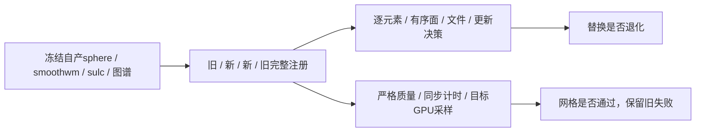

# 完整球面配准的当前几何复用回归

## 1. 功能简介

本轮只移除FNIT完整sulc/smoothwm积分中对同一坐标状态的重复法向和弧距计算，复用既有`distance_gradient`。无新算法、无原版程序调用、无轮次缩减、无半精度。父生产流程已使用这两个函数；接口与GPU有序平均器保持。



## 2. Python与输入输出

全部输入为公开ds000114两例的FNIT自产表面与声明TIFF，没有读取官方输出。冻结的是79a41cdd自产上游，不是本轮原始T1整例。源码基线由Git`86ae36bde8c0ec5960fbb9142af2b060c24d1d25`导出603文件；候选只覆盖两个`mris_register_*_run.py`，SHA见[summary.json](summary.json)与`sub06/{baseline,candidate}/STAGE_SOURCE_BINDING.json`。

函数输入为同序surface RAS/mm的`(N,3)`表面、`(F,3)`整数有序面、`(N,)`sulc及半球图谱。返回表面路径/哈希、完整sulc与smoothwm轨迹和嵌套计时；所有具名参数、默认值、结构、失败行为和示例见[功能页](../../../../docs/recon_all/REGISTRATION_CURRENT_STATE_REUSE.md)。

公共产物包括原阶段JSON、父阶段JSON、全部启动审计事件、逐文件源绑定、逐行CSV、精确比较、局部QC及图像。JSONL转换为JSON事件列表，不更改数值；原字节SHA及公开副本SHA分开记录。sub06有14份JSON/6,918数值、布尔或null叶；sub07有13份JSON/20,078叶，均逐项保留。公共报告的路径和主机名已替换，不含影像数组、许可证或凭据。

`reevaluate.py`只读四份已经完成的表面，调用现有工具的`evaluate_completed_reports(summary=..., output_dir=...)`重做精确比较，质量失败仍为`failed_mesh_quality`。它的完成不是新的MRI运行，0.400秒复核不能计入优化阶段或整例收益。

## 3. 命令行复现

```bash
python tools/benchmark_recon_registration_geometry.py \
  --baseline-source /work/frozen-before \
  --candidate-source /work/frozen-after \
  --subject /runs/own-upstream/subject \
  --atlas /assets/average/lh.folding.atlas.acfb40.noaparc.i12.2016-08-02.tif \
  --stage-driver validation/recon_all/optimizations/20261010_registration_zero_corner/benchmark_registration_v2.py \
  --output-dir /runs/registration-abba \
  --threads 4 --device cuda:0 --hemi lh
```

六个路径参数必填，分别为两版完整冻结源、自产被试、声明图谱、既有完整驱动和不存在的输出目录。`threads=4`、`device=cuda:0`、`hemi=lh`为默认值。GPU显式同步；每次fresh exec有独立JIT缓存，缓存在child中unset禁用变量后开启，父环境保持。

```bash
# 复核现存四行；不覆盖原父失败JSON，不改变42翻折的质量门。
python validation/recon_all/optimizations/20261010_registration_current_state/reevaluate.py \
  --summary /runs/registration-abba/summary.private.json \
  --output /runs/registration-reevaluation.json \
  --comparison-tool tools/benchmark_recon_registration_geometry.py
```

`--summary`、`--output`、`--comparison-tool`均必填，输出必须不存在。发布工具`export_receipts.py`的`--input-dir`、`--output-dir`、`--private-root`、`--private-host`均必填；输出必须新建，复用`tools/export_recon_gca_receipts.py`检查全部数值不变。`plot_registration_geometry.py`的`--baseline`、`--candidate`、`--smoothwm`、`--output-dir`必填，`--display-max-mm=0.001`仅是色条；完整有序面必须对应，失败不生成伪图。所有工具不调用官方程序，不降级结果。

## 4. 对应原软件

本次替换对应`mris_register -curv`内的距离力，不存在独立官方CLI。本轮ABBA仅比较FNIT旧、新完整阶段；原软件命令、固定源码链接和文献见功能页。没有新增同机原版完整配准计时，不用历史耗时代替新测。

## 5. 最新真实精度、时间与脑图

固定同一A100 80GB、同4个CPU核、同线程预算。Torch2.5.1/cu11.8、默认TF32，无半精度。完整API含输入读取、计算、传输和表面写出；fresh墙钟另含导入/JIT/检查与采样器。

| 同输入完整左侧注册ABBA | sub06 | sub07 |
| --- | ---: | ---: |
| 原/新API中位数 | 130.790 / 123.495 s | 142.988 / 136.456 s |
| 原/新fresh墙钟中位数 | 144.758 / 138.037 s | 155.129 / 150.608 s |
| API缩短 | 5.58% | 4.57% |
| fresh墙钟缩短 | 4.64% | 2.91% |
| 完整计算退出0 | 4/4 | 4/4 |
| 坐标元素 / 面序 / 文件 / 已记录决策差异 | 全0 | 全0 |
| 最终径向翻折，原/新 | 0 / 0 | 42 / 42 |
| 严格网格门 | 通过 | **失败保留** |
| 整体指标等效 | 未评价 | 未评价 |

第二例的第一版父比较因已有翻折失败，原文件保留；后续只读复核补齐全部四行，优化未引入退化。它不是将质量失败改成成功。`stage_metrics.csv`保留八条独立完整运行，不隐去失败行或以平均相关性替代局部检查。

目标卡全卡采样上界466,616,320B，但进程树归属未解析，峰值为null。Torch allocated峰值sub06为14,113,792B，sub07为13,254,144B，reserved均23,068,672B，旧、新相同。设定采样间隔0.5s，实际最大间隔3.681–5.940s，不认定整例20GB门通过。启动审计均0次阻断，只是Python启动层证据；无干净OS整例隔离证明。


图在真实同序smoothwm展示完整sphere.reg误差；完整网格max/mean/P99均0。图像不代替第二例翻折检查。整例没有新完成结果，600s/subj未验证。18项CPU几何/严格接线合同通过，JUnit保留原SHA和仅替换主机的公开SHA，不充当真实benchmark。

## 6. 版本记录

- 基线源与两文件候选各自603文件SHA完整记录，不包含其他人的未提交修改。
- 第一组实际驱动SHA`c7c632c1…`；第二组`ba6eb8a3…`加入严格质量拒绝，原失败和四份child保留。
- 最终工具`80a2ea8b…`只将所有质量行和数值退化分开记录，仍保留严格门。只读复核SHA`fda276d9…`不用于重新标记原驱动版本。
- 完整源码SHA、输入SHA、原始/公开报告SHA与实际CSV见机器报告。历史候选的球面/网格问题单列，本次复用几何没有修复这些问题。

## 7. 参考文献与源码

[固定原配准入口](https://github.com/freesurfer/freesurfer/blob/d932c45b7941662ea380a05efef580568b98d41a/mris_register/mris_register.cpp)，
[几何优化实现](https://github.com/freesurfer/freesurfer/blob/d932c45b7941662ea380a05efef580568b98d41a/utils/mrisurf_deform.cpp)。
Fischl等，Human Brain Mapping，1999，8:272–284；Fischl等，NeuroImage，1999，9:195–207。完整接口与引用见功能页。
