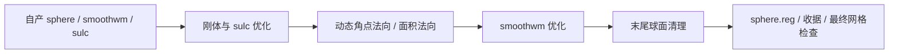
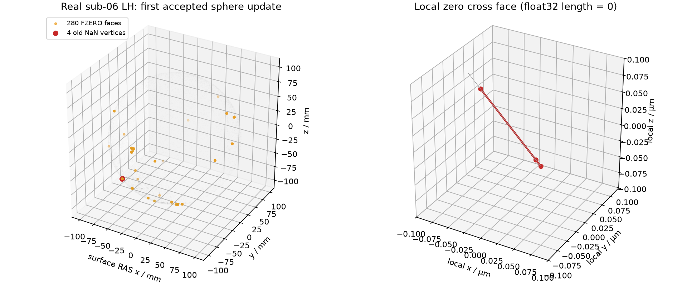

# 球面配准：真实退化角点与零面积面的单位法向修复

## 1. 功能与本次修复

Python 独立 recon-all 配方生成的新网格触发了已有球面配准函数未覆盖的退化分支。
第一次接受球面更新后，`sphere_vertex_normals` 的第 3 次调用遇到 6 个严格零角点叉积，
直接除以长度产生 4 个顶点、12 个 NaN。修复角点后继续完整配准，又在
`face_area_normals` 第 3 次调用遇到 2 个零面积面、6 个 NaN。
输入坐标仍有限；两次失败均不是显存不足。完整首差回放见
[第一次](reports/v1/first-nonfinite-diagnostic.json)与[第二次](reports/v1/second-nonfinite-diagnostic.json)。

两种单位化规则分别沿固定原算法实现：

- 角点沿 `mrisNormalize`：长度 `d > 0` 才除，严格零向量保留零。
- 面法向沿 `V3_NORMALIZE`：`abs(length) < FLT_EPSILON` 时乘子为 1，其余用原倒数。
  不改坐标、面积、有向符号或普通非零向量的运算次序。
- 顶点全部 incident 法向抵消涉及原算法另外的五轮几何扰动。本次没有实现此分支；
  当前接口明确抛出 `ValueError`，不添加 epsilon 或静默 jitter。



这里的回归对象是完整**冻结同输入阶段**。原始 T1 的 v4 整例失败保留；
修复后从检查点或表面重放不构成新的整例完成、10 分钟达标或整体指标等效。

## 2. Python 调用、输入与输出

```python
from pathlib import Path
from fnit.recon_all.mris_register_run import run_register_sphere

output_directory = Path("/data/diagnostic/register_new")   # 新目录，保留旧结果
output_directory.mkdir(parents=True, exist_ok=False)        # 已存在则明确失败
report = run_register_sphere(
    sphere="/data/subject/surf/lh.sphere",                  # 标准球面，surface RAS/mm
    smoothwm="/data/subject/surf/lh.smoothwm",              # 同顶点和面编号的皮层几何
    sulc="/data/subject/surf/lh.sulc",                      # 同序 (N,) sulc 顶点图
    atlas="/data/assets/average/lh.folding.atlas.acfb40.noaparc.i12.2016-08-02.tif",  # 声明的 LH 图谱
    output=output_directory / "lh.sphere.reg",              # 完整配准输出、有序面和几何尾部
    overlap_device="cpu",                                  # 本轮末尾清理保持 CPU
    averaging_device="cuda:0",                              # 有序平均显式选择 GPU，默认接口为 cpu
)
```

`sphere/smoothwm` 是 `(N,3)` 浮点坐标与 `(F,3)` 整数三角面的表面文件；
输入必须同序，坐标采用 surface RAS、单位 mm。`sulc` 是同序顶点图；
`atlas` 是对应半球的 folding TIFF；输出父目录必须存在。返回 dict 包含输入/输出路径与
SHA、临时 sulc seed SHA、两遍全部 `updates`、设备、清理 `negative_counts`、读写内墙钟。
清理 history 的末项不能代替保存后的最终负面数。输入不对应、特征数量错误、
单遍优化无法完成或无法处理的零顶点法向会抛异常；末尾清理返回的负面计数仍须单独验收。

修改的两个内部函数没有独立 CLI：

| 函数/参数 | 输入与默认值 | 输出与限制 |
| --- | --- | --- |
| `sphere_vertex_normals(positions, faces, incidence=None)` | float32 `(N,3)`；整数 `(F,3)`；可选同网格版本有序 incidence 缓存 | 同设备 `(N,3)` 法向；不改顶点、面序；真正零顶点和明确失败 |
| `face_area_normals(positions, faces, signed_sphere=False)` | 同上；`False` 为绝对面积，`True` 按径向符号定向 | `(F,)` mm² 面积与 `(F,3)` 法向；保留零面及 FZERO 小法向；非有限输入由上层检查 |

独立 API 的 CPU 平均对照分支不在本次 CUDA 配方的运行审查范围内。本次采用
`averaging_device="cuda:5"`，有序平均为 FNIT Triton，主优化、目标和步长仍有 CPU 计算。
完整参数与返回字段见[已有球面配准页](../../../../docs/recon_all/SPHERE_REGISTRATION_PERFORMANCE.md)。

## 3. 诊断命令行与复现

```bash
# 冻结首个真实角点状态；NPZ 留在私有诊断目录，旧新源码分别保持不可变。
PYTHONPATH="$NEW_SOURCE/src" python benchmark_registration.py \
  --mode checkpoint --source "$NEW_SOURCE" \
  --baseline-source "$OLD_SOURCE" --checkpoint "$CORNER_NPZ" \
  --output "$NEW_RUN/checkpoint" --device cuda:5 --threads 4

# 从完整自产表面开始，包含两遍优化、末尾清理和文件写出。
PYTHONPATH="$NEW_SOURCE/src" python benchmark_registration.py \
  --mode full --source "$NEW_SOURCE" --subject "$SUBJECT" \
  --atlas "$LH_ATLAS" --hemi lh --output "$NEW_RUN/full" \
  --device cuda:5 --threads 4

# 完整阶段比较先验证相同输入 SHA、顶点数和有序面，才能按索引比较。
python compare_frozen_outputs.py \
  --control "$OLD_RUN" --candidate "$NEW_RUN/full" \
  --output "$NEW_RUN/comparison.json"

# 只读取公开收据，校验原始 SHA/公开 SHA 的用途及实际成功、失败状态，汇总 JSON/CSV。
python summarize_results.py --report-root "$PUBLISHED_REPORT_DIRECTORY"
```

`benchmark_registration.py` 的 `mode/source/output` 必填；`baseline-source/checkpoint`
用于真实首差回放，`subject/atlas/hemi` 用于完整阶段；`hemi` 默认 lh，`device` 默认
cuda:5，`threads` 默认 4。采用新目录，报告包含失败异常，不生成占位表面。
第二版脚本增加 `checkpoint-function=corner|face`（默认 corner），分别比较
角点的 `d>0` 规则和面的 FZERO 域；完整调用接口保持相同。

[`diagnose_first_nonfinite.py`](diagnose_first_nonfinite.py) 与
[`diagnose_second_nonfinite.py`](diagnose_second_nonfinite.py) 是本次实际观察脚本，
原脚本 SHA 见[收据](diagnostic_script_sources.json)。观察包装器读回中间数组，
其耗时包含诊断开销，不能用来报告整例或原优化器速度。

## 4. 对应原算法

完整参考阶段对应独立 benchmark 中的：

```bash
mris_register -curv "$SUBJECT/surf/lh.sphere" "$LH_ATLAS" "$OUTPUT/lh.sphere.reg"
```

两个单位法向函数属于其内部度量步骤，没有独立官方命令。本次核对固定提交
`d932c45b7941662ea380a05efef580568b98d41a`：角点是 `mrisurf_base.h:156–168`
与 `mrisurf_metricProperties_slow.h:119–167`；面积和面法向是
`MRIScomputeTriangleProperties_extracted.h:123–150`，其 `V3_NORMALIZE` 位于
`matrix.h:283–286`，FZERO 定义位于 `macros.h:80`。
[完整源文件/函数段 SHA 收据](normal_source_rules.json)只发布哈希、规则和官方链接，
原 C++/头文件不复制到仓库，不参与本次阶段运行。

本节点已声明的参考资源中 `mris_register/mris_sphere` 都缺失，
[现场程序清单](reference_program_inventory.json)保留存在性及迁移收据 SHA。
本轮没有执行异常 v4 球面的原程序同输入对照或原程序重复性；既有正常输入、
官方整例与其他版本的同输入记录不能替代这项缺失。

## 5. 当前真实回归、耗时与显存

冻结基础为 v4：Git `922f5698` 加已有 overlay；775 项 SOURCE_MANIFEST SHA
`21bfe987...`。阶段复制并验证其中 601 项 src，只覆盖 `mris_register_nonlinear.py`。
原模块 SHA `f5d1ba93...`；第一修复 `f376d928...`；第二修复 `47107b48...`。
原始输入来自已授权公开 T1 的 FNIT 自产 v4 sub-06 LH 与正常 79 sub-06 LH，
每份输入/图谱/代码完整 SHA 在 [源码绑定](reports/v1/source-new.json)与机器报告中。

| 实际测试 | 结果 |
| --- | --- |
| 原 v4 首差观察 | 第 3 次角点法向出现 4 顶点/12 NaN；6 个真实零角点叉积 |
| 第一修复真实检查点 | 0 NaN；此前有限的 107,766 顶点全部逐位不变 |
| 第一修复 v4 完整阶段 | 失败；冷进程 33.165194 s，后续出现非法 atlas 索引；保留原异常 |
| 正常 79 输入，旧/第一修复完整阶段 | 两者 exit0；130,679 顶点、261,354 面、输出文件与全部坐标逐位一致 |
| 第二首差观察 | 第 3 次面法向产生 2 面/6 NaN；其他已观察球面距离和距离梯度有限 |
| 第二修复真实面检查点 | 0 NaN、面积逐位不变、普通面 0 差；280 个 FZERO 面中 278 个原有限小法向改为保留叉积 |
| 第二修复 v4 完整阶段 | 执行 exit0；107,770 顶点/215,536 面、全有限；保存后 7,507 个径向负面，网格质量未通过 |
| 正常 79 输入，旧/第二修复完整阶段 | 130,679 顶点、261,354 面、有序面/全部坐标/文件 SHA 完全相同；最大/P99 位移均 0 mm |

278 个小法向的变化是固定原算法遗漏分支的修复，不能写成“所有原有限面不变”。
严格复现与整体指标等效分别记录；整体为 `not_assessed`。当前只覆盖一例一侧的
完整配准回归，不将正常输入的零差推广到全部被试。

旧/第一修复完整 API（含 IO、同步）为 **147.056081 / 143.735176 s**；
冷进程（含 Python 启动）为 **156.837359 / 154.180053 s**，仅一次配对。
同一 A100、目标 GPU5、CPU100–103、总 4 线程，TF32 开启，未用半精度。
共享任务负载和采样查询成本存在，不能把此观察称为稳定提速。
第二修复的正常输入完整 API 为 **142.658271 s**、冷进程 **154.483512 s**。
第二修复 v4 完整 API 为 **263.914135 s**、冷进程 **283.388669 s**，
其 sulc/smoothwm 结束轮号为 71/219。清理 history 1001 项、首 9220/末 7501，
保存后独立 FP64 检查为 7507；执行结束不能当成网格质量通过或配准验收。
原清理源同时检查无改善 1000 步与调用者 `niterations` 上限；本报告保留源文件哈希与规则。
独立核对已确认该调用者设置 `niterations=1000`，不能删除现有上限或将残留归为额外 cap。
进一步的完整去翻折诊断另行记录，不回写本次冻结运行。

正常旧/第一修复结束轮号 sulc=58、smoothwm=110；Euler=2、边界/非流形/零面积/负径向面均 0，
半径 99.99999492–100.00000525 mm。这里未另测球面三角形自相交或 white/pial 穿越。

两者 PyTorch allocated/reserved 峰值为 **14,113,792 / 23,068,672 B**。
进程树显存归属均 `null`；整卡上界为 **21,594,374,144 / 23,282,581,504 B**，
包括其他任务，不能作为本阶段显存或 20 GB 验收。目标采样间隔 0.5 s，实际最大间隔
3.5151 / 9.4322 s；第二修复正常输入的整卡上界 38,247,858,176 B（含其他任务），
实际最大采样间隔 2.9529 s；v4 第二修复 allocated/reserved 为
15,169,536 / 35,651,584 B、整卡上界 24,459,083,776 B、最大间隔 5.8271 s，
进程树仍为 null。无干净系统隔离测试。所有采样、精度和失败记录保留。

[机器汇总](summary.json)、[逐阶段表](stage_metrics.csv)与
[第二版完整异常收据](reports/v2/v4-new2.json)同时给出 API、包含导入/校验/QC 的 harness，
以及冷子进程墙钟；三者不是可相加的独立阶段。
汇总器验证 19 份公开收据的 SHA/字节数，以及原始比较报告 SHA 的绑定；
两轮分别保留 3,852 / 7,115 个数值、布尔与 null 叶子。



左图保留全部异常点，稀疏灰色背景仅用于显示；右图坐标以局部中心为零、单位 µm。
绘图不参与误差比较；NPZ 只在私有目录，图像来源 SHA 见[绘图收据](plots/visualization_source.json)。

## 6. 版本与证据边界

- 原 v4 冻结模块：首差观察定位角点 0/0；原始整例失败没有改写。
- 第一修复：完整真实角点回放通过、正常输入完整旧新零差；v4 完整阶段再次失败，
  真实代码、输入、退出码和异常全部保留。
- 第二修复：按原算法分别处理角点和面的零长规则；完整阶段结果独立记录，
  不覆盖第一修复或修改 v4 生产目录。
- 公开报告仅替换私有 FNIT 路径字符串；原始 SHA 与公开 SHA 分别保留，
  数值、布尔、null 的每个叶子逐项校验。原始影像、NPZ、图谱和许可证不发布。

本轮未新增计算依赖；已有 Conda 中 Torch/Numba/Triton/nibabel 继续复用。
没有运行原版阶段程序；静态规则审查、带阻断器的独立 Python 运行与物理无原软件
环境的整例隔离是三件不同的事，最后一项未验证。

## 7. 参考资料

- [FreeSurfer 固定源码](https://github.com/freesurfer/freesurfer/tree/d932c45b7941662ea380a05efef580568b98d41a)。
- [角点单位化](https://github.com/freesurfer/freesurfer/blob/d932c45b7941662ea380a05efef580568b98d41a/include/mrisurf_base.h#L156)、
  [面度量](https://github.com/freesurfer/freesurfer/blob/d932c45b7941662ea380a05efef580568b98d41a/utils/MRIScomputeTriangleProperties_extracted.h#L123)、
  [V3_NORMALIZE](https://github.com/freesurfer/freesurfer/blob/d932c45b7941662ea380a05efef580568b98d41a/include/matrix.h#L283)。
- [Fischl et al., 1999：球面配准](https://doi.org/10.1002/(SICI)1097-0193(1999)8:4%3C272::AID-HBM10%3E3.0.CO;2-4)。
- [FNIT 既有完整球面配准与历史 benchmark](../../../../docs/recon_all/SPHERE_REGISTRATION_PERFORMANCE.md)。
