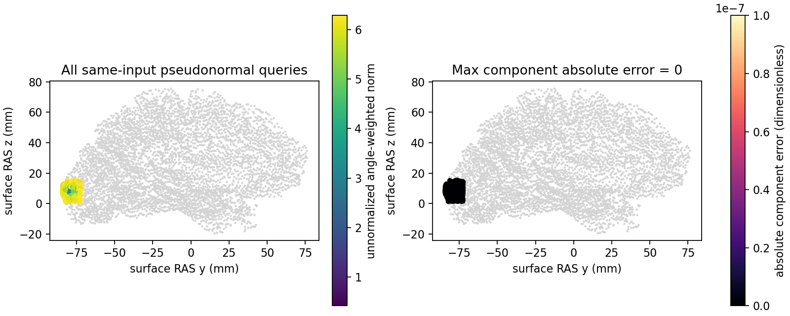

# 完整真实拓扑角度伪法向回归

## 1．本轮实现范围

独立 NumPy/Numba 的角度伪法向和原序相邻面查找，复用当前 surface RAS 几何、面法向及 incident CSR。原版 C++ 只在隔离 benchmark 生成参考和数学类型探针；生产函数不调用或加载原程序。完整函数、逐项参数及失败行为见 [中文功能页](../../../../docs/recon_all/TOPOLOGY_ANGLE_PSEUDONORMALS.md)。

本目录是冻结同输入阶段回归，不是完整 GA、自产拓扑连续链或原始 T1 整例。允许使用高效 Python/Numba CPU 核，不因严格 CUDA 旧配方的缺口拒绝这条独立路线。

## 2．输入、输出和版本

公开 CC0 ds000114/sub-07/ses-test，来自 `79a41cdd` 的 FNIT 原始 T1 自产上游；候选由隔离参考 GA 首次生成后冻结。完整 110,534 顶点、216,860 面、650,580 incident entries，903 个伪法向查询和 1,628 个 buffer 面。当前模块 SHA：

`562d7f5f617048b19d133fc74ebd4ed1800a4932f168a010a1c74ce54d76ddd0`

实际上传快照 HEAD `ae868024cee3abd14521fe5c44c897b6827855f4`，包含并发未提交源码；580 个 payload 全部按大小/SHA 校验。报告绑定逐文件字节，没有将历史 HEAD 当作干净测试版本。原影像、capture/NPZ、原程序及完整内部编译命令不发布；本目录保留 33 个去敏元数据/复现脚本/派生 PNG，原与公开字节 SHA 及全部数值、布尔、null 叶一致性见 `reports/PUBLIC_EXPORT_MANIFEST.json`。

输出为 `(903,3)` float32 未归一化伪法向、`(1628,3)` int64 原面索引。单位、数组关系、surface RAS/mm 和有序 corner 约定在功能页逐项说明。原始参考 buffer 行顺序受 OMP 追加影响；原二进制 SHA 不同，不能写成字节相同；按 fno 对应后完整字段精确。

## 3．复现调用

```bash
# 完整两次参考检查点只用于冻结诊断；自产输出必须使用新目录。
python tools/benchmark_recon_topology_pseudonormals.py \
  --capture benchmark/reference/repeat0/distance.bin \
  --repeated-capture benchmark/reference/repeat1/distance.bin \
  --observer-receipt benchmark/reference/receipt.json \
  --output benchmark/new-angle-components \
  --threads 4
```

参数依次为两次真实同输入检查点、参考版本收据、新输出目录和 CPU 线程预算。`reports/workspaces/topology_angle_pseudo_20261010_v3/` 保存实际 driver、run.sh 和 SHA 清单；公开脚本中的 `<FNIT_ROOT>` 是去敏占位，复现时映射到授权存储。`collect_receipts.py --fnit-root ... --output ...` 在原存储就地去敏，只输出固定元数据与已绑定 PNG，所有数值叶逐路径保留。格式、线程、输入或严格比较失败会报错并保留已有诊断，不生成完成占位文件。

## 4．参考与误差原因

原内部步骤分别是 `computeVertexPseudoNormal` 和 `findOtherEdgeFace`，没有独立官方命令；参考完整入口为 `mris_fix_topology -ga -seed 1234 -threads 4`，观察器只捕获第一候选后停止。

先验证两次参考原序几何、CSR、伪法向和最终距离稳定，再测四组数学类型。旧 Python 强制 double 的 sqrt/acos，产生 656 个分量尾差；double/float 四组不同数依次为 656、566、201、0。实际固定 C++17 编译单元独立探针确认 sqrt、acos、点积、范数及两次除法均 4 字节；含 0.0/1.0 的 MIN/MAX 表达式为 8 字节，再写回 float32 alpha。故修复类型边界，不按已知顶点、被试或数据加例外。

类型探针在参考构建主机执行，两次标准输出相同，accelerator-b 只接收白名单类型/位模式/源码、编译器、程序与原收据 SHA。原收据 SHA 为 `21e0f1ccf16d939858fa246d856b875af4c93d9a942201e4d3c4fb53f292f241`；去敏选定字段精确声明及 SHA 留在 `reports/workspaces/topology_numeric_type_public_20261010_v2/types.json`。这是类型证据，不是跨环境性能对比。

## 5．真实精度、耗时和图

| 指标 | v1 修复前 | v3 正式修复后 |
| --- | ---: | ---: |
| 伪法向不同元素 / 2,709 | 656 | 0 |
| 最大 / P99 分量误差 | 9.536743e−7 / 4.768372e−7 | 0 / 0 |
| 相邻面不同元素 / 4,884 | 0 | 0 |
| 两次自产调用不同位数 | 0 | 0 |
| 实际边界契约 | 8 通过 | 9 通过 |
| driver 最终退出码 | 1：严格比较失败 | 0 |

accelerator-b Xeon Platinum 8369B，四线程、affinity 120–123。修复后完整 API 在契约后首次/热调用：伪法向 **0.003581132 / 0.003121958 秒**，相邻面 **0.001368764 / 0.001258845 秒**。契约 **0.802316 秒**；含捕获读取、计算和自产 NPZ/PNG 写出的工具段 **0.874600 秒**；driver 导入后包括契约及回归报告写出的已测段 **1.678432 秒**，排除解释器启动、导入及最终 COMPLETE 写入。首次 API 不代表冷 JIT。无单独原参考子步骤计时，不给出加速比或整例收益。

CUDA 前后均未初始化，原调用方 TF32 标志与线程设置保持；未采集进程树 GPU 显存，报告值为 null。运行不启用 FP16/BF16，没有新增依赖；NumPy、Numba、matplotlib 已在主页 Conda 环境和包依赖内。



图展示全部查询的原 surface RAS 位置，灰色仅为抽样顶点背景；误差全零，色标保留明确量纲。它不能替代完整网格的表面距离、自相交或最终脑区指标评估。完整距离阶段另有 [六组内部、完整距离及八场反馈验证](../20261010_topology_signed_distance/README.md)。

## 6．失败与最近记录

- v1：保持源序输入和参考稳定，但 double 数学严格门失败；保留 656 项实际差异、源码 SHA 和退出码。
- v2：正式算子比较通过，driver 最后错读另一主机的类型探针路径，退出码 1。阶段报告与 traceback 保留，未手动补造 COMPLETE。
- v3：新空目录原样执行正式模块，绑定可访问的去敏探针，退出码 0；9 个契约及全部真实查询通过。
- 根目录状态说明修正了“Python 仅预检查”“完整曲率统计未实现”的旧表述，严格 CUDA 配方仍未完成；不会把本次阶段成功称为全流程成功。

完整 GA 仍缺候选主曲率、局部 MRI/PDF 准备及搜索控制器自产闭合。两例独立 Python 原始整例的历史质量失败另留原记录，本次没有新的整例或整体等效结论。

## 7．原源码与参考

- [固定伪法向函数](https://github.com/freesurfer/freesurfer/blob/d932c45b7941662ea380a05efef580568b98d41a/utils/mrisurf_metricProperties.cpp)。
- [固定相邻面函数](https://github.com/freesurfer/freesurfer/blob/d932c45b7941662ea380a05efef580568b98d41a/utils/mrisurf_topology.cpp)。
- Fischl B, Liu A, Dale AM. Automated manifold surgery. IEEE Transactions on Medical Imaging. 2001. [DOI](https://doi.org/10.1109/42.906426)。
