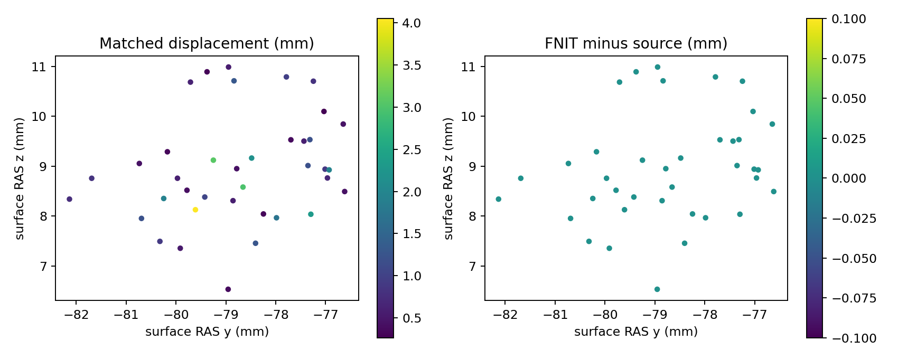

# 完整缺陷域的自产位移与反馈回归

## 1．功能与范围

独立NumPy从匹配前fx和匹配后orig计算全未丢弃缺陷位移，送已有完整unMRI。测试为冻结同输入阶段，不是原始MRI→全候选或完整GA。

## 2．Python、输入与输出

[功能页](../../../../docs/recon_all/TOPOLOGY_CANDIDATE_DISPLACEMENT.md)列出全部参数/格式/空间/限制/失败。输入完整原序缺陷映射及status；输出active索引和位移毫米，不修改完整旧状态。其余MRI/PDF/距离为明确冻结阶段输入，参考active位移不入求解。

## 3．复现命令

```bash
python tools/benchmark_recon_topology_candidate_displacement.py \
  --capture reference/repeat0/volume.bin \
  --native-repeat reference/repeat1/volume.bin \
  --observer-receipt reference/receipt.json \
  --output new_diagnostic/displacement \
  --threads 4
```

影像、捕获bin、NPZ、原程序均不发布；`collect_receipts.py`在授权服务器就地去敏，只导出元数据、脚本及绑定SHA的PNG，数值/bool/null逐路径保持。

## 4．原软件与版本

固定d932 `mris_fix_topology` 内部computeDisplacement，源码Conda构建观察器，种子1234/四线程。原参考独立两次重复稳定，仅诊断路径使用，不作生产依赖。没有该内部步骤独立CLI或原软件子项计时。

## 5．当前真实精度、时间与图

ds000114 sub-07 ses-test LH、自产79a41cdd上游；候选110,534顶点，缺陷67条（38active/29DISCARD）。全部38自产位移、后续8项体积字段及全110,534反馈均0bitdiff、max/P99=0。自产和参考相关字段各两repeat exact；四契约通过。

完整位移API首次/热0.0013461309/0.0009866739s；unMRI首次含JIT0.6820834521s；工具2.4028510982s到报告写入前、含读写/PNG的API2.1970808888s。四线程共享CPU，仅本阶段实测，无原子项timer/速度比、整例提速或600s结论。GPU未用且未采样，null不是0。



源码a78d2022；实际snapshot53469bbd+dirty，589payload均大小/hash验证，不反标为后续干净commit。PUBLIC_EXPORT_MANIFEST绑定原/publicSHA、字节数和数值叶保真，PUBLICATION_MANIFEST绑定本轮公开内容。

## 6．更新与benchmark

- v1 全域位移独立实现和完整真实反馈回归；没有用参考active curvbak补齐算法。
- 不按patch inside缩小计算域，不用未丢弃但未触及状态伪造全数组；控制器显式写回。
- 上游25步smooth/40步match、自生成几何/概率场和完整GA仍须连续验证，整体等效未判。

## 7．参考文献与代码

见[功能页](../../../../docs/recon_all/TOPOLOGY_CANDIDATE_DISPLACEMENT.md)及[固定原步骤](https://github.com/freesurfer/freesurfer/blob/d932c45b7941662ea380a05efef580568b98d41a/utils/mrisurf_defect.cpp#L7395-L7415)。只用已有NumPy，不增加依赖；本轮未进行干净环境整例安装验收。
