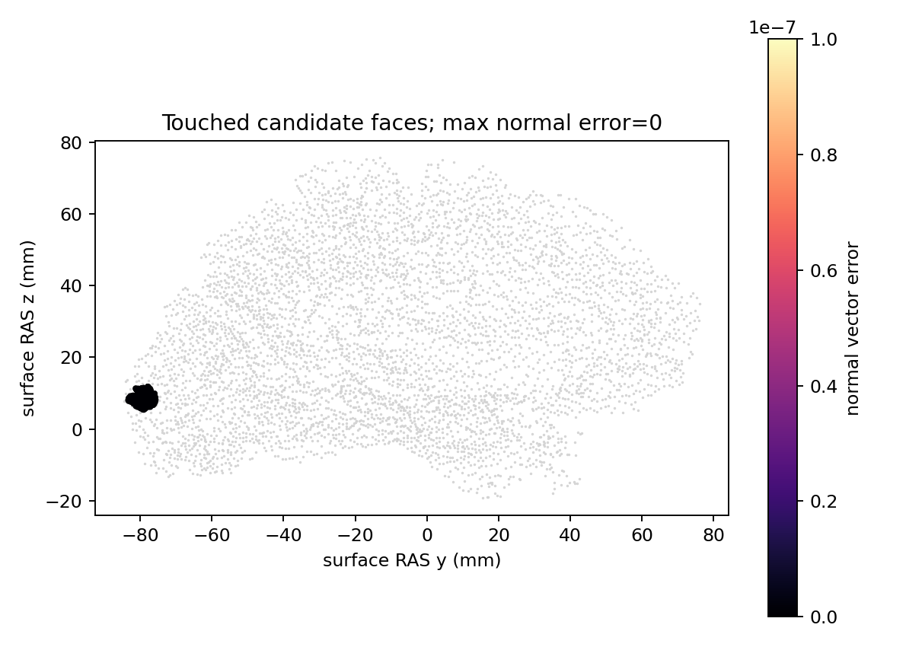

# 真实候选面法向：独立 Python 回归

## 1．功能与范围

从完整真实候选 orig 几何计算 patch 实际触及面法向，复用完整自产距离进行传播验证。没有候选生成、原始MRI准备或完整GA；不是原始T1整例。

## 2．Python、输入与输出

[功能页](../../../../docs/recon_all/TOPOLOGY_CANDIDATE_NORMALS.md)列出全部参数、空间、数组结构、默认值与失败行为。输入为当前 surface RAS/mm、有序面和原 incident CSR；自产261面法向替换到冻结的其余输入缓存，参考距离不进入计算。缓存面积与统计面积分开；评分caller不自动重算顶点法向。

## 3．复现命令

```bash
python tools/benchmark_recon_topology_candidate_normals.py \
  --capture reference/repeat0/distance.bin \
  --native-repeat reference/repeat1/distance.bin \
  --patch-capture reference/same_candidate_patch_statistics.bin \
  --observer-receipt reference/receipt.json \
  --output new_diagnostic/candidate_normals \
  --threads 4
```

原始capture、MRI、NPZ和原程序留在授权服务器，不公开。`collect_receipts.py`就地去敏后只导出JSON、复现脚本、日志及绑定SHA的PNG，保持全部数值/bool/null叶原值。

## 4．原软件与版本

固定d932、Conda源码构建的隔离 `mris_fix_topology` 参考，种子1234、四线程；参考两次相关面法向/完整距离逐位稳定。源码引用、原命令及许可见功能页与项目原通知。参考程序不作候选生产依赖。

## 5．当前真实精度、时间与图

ds000114 sub-07 ses-test LH、自产79a41cdd上游，候选110,534V/216,860F；99 patch顶点触及261面。面法向783分量与完整21×19×16距离：不同元素/字节0，最大/P99=0，自身重复精确；七契约通过。源 `FaceNormCache.orig_area` 未捕获，真实精度未判；顶点法向和回退仅契约，不宣称整套缓存自产或整体等效。

完整面API首次/热重复0.0019049244/0.0016568638s，首次在契约后；下游距离首次含JIT4.1079869829s，工具6.6779945893s到报告写入前，完整读取/NPZ/PNG等API5.4538954198s；共享CPU四线程，无源子项timer/速度比。GPU未用且未测占用，null不是0；不宣布整例/600s通过。



实际代码快照420f98c3+dirty，正式模块d9bedc28、584上传payload均校验；收据绑定每个实际文件SHA，不反标为后续clean commit。PUBLIC_EXPORT_MANIFEST保存原/public大小与SHA及数值叶保真；PUBLICATION_MANIFEST绑定公开文件。

## 6．更新与失败记录

- v1漏打包现有统计解析器，导入失败、exit1；保留日志和快照，未执行算法回归。
- v2新目录补齐解析器，算法未变，完整face/distance/self/reference字段全通过且exit0。
- 没有改变验收阈值；当前生产完整拓扑控制器和原始T1质量仍是下一验证范围。

## 7．参考文献与代码

见[功能页参考](../../../../docs/recon_all/TOPOLOGY_CANDIDATE_NORMALS.md#7参考文献与源码库)及[源面缓存](https://github.com/freesurfer/freesurfer/blob/d932c45b7941662ea380a05efef580568b98d41a/utils/mrisurf_metricProperties.cpp)。新依赖为无；NumPy、Numba、nibabel、Matplotlib均已有主页Conda声明，本轮未做全新环境整例部署。
