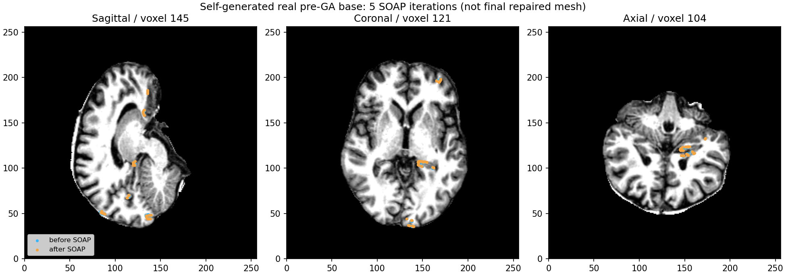

# 最终 SOAP 与有序压缩：真实 pre-GA 基底兼容性

- 数据：公开 ds000114 既有3a左侧 nofix，输入基底由本轮 rawBase v2 自产；原影像不入Git。
- 本轮 v4 状态：退出0；126,778顶点/246,985面、25有序regions。压缩后124,723顶点/246,985面，移除2,055已rip顶点/0面。
- 两次finish全状态、compact全状态和幂等检查全部0 byte差异；有序面与五坐标/法向域映射精确，max/P99=0。源码参考完整25收尾、最终mesh QC与整例未评估。
- 四核8–11/总4线程、GPU隐藏；fresh诊断CLI193.088720s，RSS1,197,672 KiB。finish首次/热12.222687/7.279538s；其后compact9.455284/9.438866s。CLI包含六次压缩/两次finish和重复检查，不能拿它作一次API或整例耗时。
- 同环境10契约通过，fresh测试进程9.155709s；无新增库，当前Conda已有NumPy/Numba/nibabel，独立部署未验证。

## 机器记录

[report.json](report.json) 仅安全指标和哈希，无内部主机、地址、账号、命令或原数据。[numeric_preservation.json](numeric_preservation.json) 证明所选1,104个数值/布尔/null叶保真；原私有完整报告留服务器。[earlier_failures.json](earlier_failures.json) 保留v1缺依赖、v2错误merge键、v3错误比较键的真实失败，不覆盖旧记录或重标版本。

完整源码、接口及逐参数说明见 [七节说明](../../../../docs/recon_all/TOPOLOGY_COMPACT.md)。公开这些组件证据不表示GA、原始T1或整体等效通过；参考after没有进入本次计算。

## 实际脑图

[visualization.json](visualization.json) 绑定本次NPZ和原MRI哈希。940个保留顶点实际移动，max1.690949mm/全顶点P99=0，属于算法前后位移，不是官方误差；只展示修复前母板。本次首次图启动的 taskset 参数格式错误，未执行绘图，原收据留服务器；第二次仅修启动参数完成，算法和阶段报告未变。
