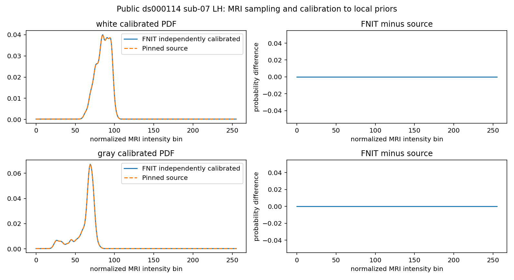
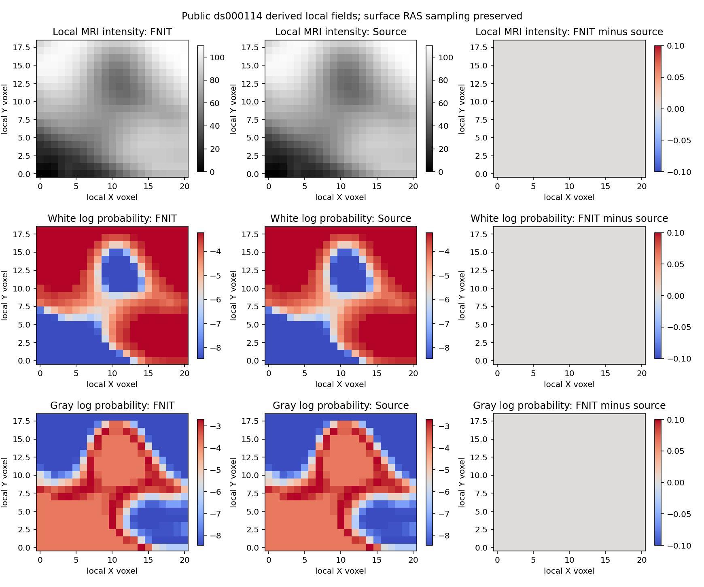

# 自产白灰校准与局部概率场：真实同输入回归

## 1．功能和范围

新增 `calibrated_defect_volume_priors()` 从 FNIT 自产 nofix/qsphere/归一化 MRI，通过已有强度采样、两次中值、完整 chull 校准和局部采样生成全部白灰 PDF 与局部场。生产函数不消费参考校准或局部体积。完整输入输出与流程图见[中文功能页](../../../../docs/recon_all/TOPOLOGY_DEFECT_CALIBRATION.md)。

本目录是首缺陷同输入完整子链，不是完整 GA 或原始 T1 整例。原始 T1、MRI、网格和完整 NPZ 保留服务器，不发布。默认生产接口不变；整体指标等效 `not_assessed`。

## 2．Python 接口与输入绑定

原 nofix 顺序用于采样与校准；完整候选边用 corrected 顺序；显式 original→corrected 全排列连接两者。不能将另一版本网格或 border 当作完整 chull。函数复用 `prepare_topology_edge_inputs`、`first_defect_intensity_histograms` 和 `defect_volume_priors`，没有重复写采样器或以实验 tissue patch 配方代替源算法。

公开 CC0 ds000114 `sub-07/ses-test` 左半球，上游来自原始 T1 连续 `79a41cdd` 运行。候选诊断由 `69467e58` 加实际文件快照运行，源码 SHA 全在 [source_manifest.json](reports/source_manifest.json) 和 [report.json](reports/report.json)。原始 T1、brain/nofix/qsphere、实际程序和原始 producer JSON SHA 见 [provenance.json](reports/provenance.json)；公开件 SHA 与原件 SHA 分开保留。

## 3．复现与报告

`tools/benchmark_recon_topology_calibration.py` 具名参数从自产 MRI 和网格独立生成全部上游，保存候选以后才读取参考进行比较。完整 CLI 见功能页。四项合同见 [contracts.json](reports/contracts.json)，服务器7.197秒通过，合同与候选共用任务 JIT cache。

`tools/compare_recon_topology_calibration_fields.py` 在候选快照先行校验后，只读比较新三时点捕获，没有重新运行影像或将参考写回候选。具名参数明确两个parser、六个捕获、原nofix、候选NPZ/report以及observer收据；输出必须新建。

`collect_receipts.py` 在授权服务器现场核对退出、原报告、源码、程序和全部输入/参考 SHA，只导出明确 JSON 与两张公开T1衍生 PNG；完整数字、布尔、null及其类型保持。`summarize_results.py` 校验 [公开清单](reports/PUBLIC_EXPORT_MANIFEST.json) 后生成 [字段表](stage_comparison.csv)、[时间表](stage_times.csv)和 [SUMMARY.json](SUMMARY.json)。

## 4．原程序和源规则

固定 FreeSurfer `d932c45b…` 的独立 Conda 源码构建观察程序，参考在 `mris_fix_topology -ga` 的真实 first-defect calibration/volume准备处捕获。两个进程同机、固定CPU8–11四线程，完整创建/采样后捕获重复逐字节同。

源 white/gray bins 为0..255、bin_size保持0；完整 chull 两层 vtotal（每层两环）、marked排除和一次计数规则见 [source_rules.json](source_rules.json)。HISTOsmooth 为 sigma2/17核，float32有序累计，边界单独归一化，保留 bin_size。此轮不修改既有成熟hist算法。

## 5．真实精度、时间与图

110,534顶点、221,116原面，当前 chull125顶点、校准472顶点、完整候选边4,723。白灰PDF及bins/bin_size、corrected原坐标、排序边、21×19×16初mask/强度/白灰logP、几何及4统计全部0数值差、原始位相同。两次候选输出严格相同，参考两次也相同。

内部MRI-only矩阵有正负零位差，数值0差；原 `strict_full_internal_fields_passed=false` 保留，不改标为全面严格复现。source字段单列，computed字段逐位一致。方差仅有候选重复验证，参考未捕获该值。新的入口/raw/smooth三时点捕获补齐全110,534顶点白灰中值、原坐标、221,116有序面、125 ordered chull、两种raw/smooth256-bin PDF及metadata，全部0bit差。全110,534行one-ring顺序、2,166,570项vtotal的两环集合均相同；472 selected集合相同，现有接口升序输出与原访问顺序不同，`ordered_equal=false`原样保留。计数是精确整数后F32归一化，两PDF仍逐位同，未改成熟接口。六个捕获在两个参考进程中逐字节同；七个旧完整fitness输出SHA不变。详见 [calibration_details.json](reports/calibration_details.json) 和 [字段补表](calibration_field_comparison.csv)。只读比较6.233150987885892秒，不属于新MRI计算。

完整 API9.687754550948739/9.565229784697294秒；准备9.603506948798895/9.488756678067148秒，校准0.013688899576663971/0.013481971807777882秒，priors0.07055662292987108/0.06298846658319235秒。前置自有canonical/labels/edges46.24284235201776秒；候选到打开参考前含写入66.16516894567758秒；工具含比较/绘图67.70834112539887秒。bootstrap导入、解释器启动及末尾JSON写出不在工具timer内。脚本导入0.004069223068654537秒发生在依赖已预加载后，不能当完整导入。

同机四线程，候选CPU100–103，GPU隐藏；共享负载未排除，GPU显存未测。原参考5.665037437342107/5.559619378298521秒含其他上游和观察I/O，范围不同，不计算性能比。没有原始T1整例新速度结论。

## 6．版本和未完成项

- 已有成熟 MRI 准备 v3 全顶点数值一致，保持其实际 source hash 和原记录。
- 旧两半球 histogram 门只验证十位文本，不当本版 F32 全字段证据。
- 先前 [priors](../20261010_topology_volume_priors/README.md) 采用冻结校准输入，本版从 MRI 完整自产，两个报告范围分开。
- 新wrapper的translation全排列、缺陷屏蔽、bin_size0和非法状态先行合同已过；原生产默认、成熟矩阵和hist内核未改。
- 实测模块SHA为 `0a67acfc…`；发布仅更正docstring中 `normals` 为实际键名 `original_normals`。全部可执行AST相同，旧报告不重标，见 [DOC_SOURCE_CHANGE.json](DOC_SOURCE_CHANGE.json)。
- 新三时点是额外同输入只读对照；私有候选未保存initial normals，未声称新快照对这一字段做了比较。原法向证据沿用原MRI准备v3的实际范围。
- 原始T1整例、完整GA控制/接受和另一例未执行；干净环境、进程/文件/动态库OS隔离未验证。

## 7．原实现和文献

[固定拓扑源码](https://github.com/freesurfer/freesurfer/blob/d932c45b7941662ea380a05efef580568b98d41a/utils/mrisurf_defect.cpp#L15214-L15365)，[HISTOsmooth](https://github.com/freesurfer/freesurfer/blob/d932c45b7941662ea380a05efef580568b98d41a/utils/histo.cpp)。Fischl B, Liu A, Dale AM. *Automated manifold surgery*. IEEE TMI (2001)，[DOI](https://doi.org/10.1109/42.906426)；Ségonne F, Pacheco J, Fischl B. IEEE TMI (2007)，[DOI](https://doi.org/10.1109/TMI.2006.887364)。不发布上游CPP、原程序、许可证或原MRI。
