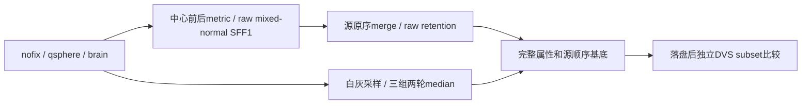

# 原始 nofix 到独立 GA 初始基底：2026-10-10

## 1．功能和验证范围

本版复用 FNIT 的中心化、有序邻域、metric/法向、SFF、MRI采样、中值、坐标平均、原序merge和retention，产生完整初始基底。实际候选只读取授权公开数据的 nofix、同序 qsphere 和归一化MRI；参考状态在独立比较器中事后读取。未调用原版阶段程序，没有完成 GA 搜索或原始T1整例。



特别修复两个接口问题：源merge可产生不直接连通的inside union，必须保留合并concat顺序；初始component normal来自中心前球面metric，merge重算法向来自中心后metric，不能复用同一相位。原component area写入val在merge前，merge平均area不回写val。

## 2．Python调用及完整输入输出

完整具名例和四个接口见[中文功能页](../../../../docs/recon_all/TOPOLOGY_GENETIC_BASE_PREPARE.md)。组合入口：

```python
from fnit.recon_all.topology_genetic_base_prepare import prepare_nofix_genetic_base

result = prepare_nofix_genetic_base(
    vertices=own_nofix_vertices,          # float32(N,3)，原surface RAS/mm
    faces=own_ordered_faces,             # 整数(F,3)，原三角面顺序
    qsphere_vertices=own_qsphere,        # float32(N,3)，同顶点及有序面
    volume=own_normalized_brain,         # uint8(X,Y,Z)，原MRI网格
    ras_to_voxel=own_ras_to_voxel,        # (4,4)，surface RAS→连续体素
    source_metadata=own_surface_header,  # 自产空间、半球、fresh状态
)
base_state = result["surface_state"]      # 五向量、十五标量、全有序拓扑
original_to_base = result["vertex_translation"]  # 独立自产的完整映射
```

六参均必填，输入保持不变；新数组不与输入别名。不更改线程、CUDA、TF32。完整输出另含面映射、新→原顺序、metadata、SFF1、merge、retention、准备诊断和墙钟。非法形状、类型、索引或不完整属性抛ValueError；normal pending导致共享坐标变化或仍未解决时明确NotImplementedError，须在前序完整传播，不默默丢掉修复。

中间接口保持raw TMP、两轮平均original、中心前/后球面相位分开。base K/H来自SFF1；base复制后原mris的SFF2不写回clone。fresh未写入七标量由读取/分配源码规则自产零，不用参考值。

## 3．命令行和复现

内部步骤无独立生产CLI。复现工具不含reference输入：

```bash
PYTHONPATH=src python tools/benchmark_recon_topology_raw_base.py \
  --input-surface "$OWN_NOFIX" \
  --input-qsphere "$OWN_QSPHERE" \
  --brain "$OWN_NORMALIZED_BRAIN" \
  --hemisphere lh \
  --input-manifest "$INPUT_MANIFEST" \
  --source-manifest "$FROZEN_SOURCE_MANIFEST" \
  --output "$FRESH_STAGE_OUTPUT" \
  --threads 4
```

三个数据参数分别为原同序几何、球面和归一化MRI；hemisphere是lh/rh；两manifest记录输入和实际源码SHA；output必须不存在；threads是总CPU预算。私有state/maps NPZ只留服务器。`benchmark_recon_topology_genetic_base_prepare.py`和`benchmark_recon_topology_sff1_inputs.py`分别复现median及SFF准备；只有诊断参数才可在候选保存后打开参考。

源码绑定使用实际bundle祖先`861bc23549cbeac16eeba6d3fc338b2da2a1d055`及明确overlay/所有运行文件SHA。rawBase v2的38项overlay、13项实用模块和输入SHA见[原始源码manifest的安全副本](reports/raw_base_source_v2.public.json)及[祖先manifest](reports/ancestry_source.public.json)；不把发布提交改标为已运行版本。

## 4．原软件调用和参考边界

对应固定`d932c45b7941662ea380a05efef580568b98d41a`的`mris_fix_topology -ga`内部流程，没有这些子函数的独立官方CLI。原程序只用于隔离观察，参考捕获不是producer输入。逐规则和固定源码SHA见[source_rules.json](source_rules.json)。

参考DVS record位于base复制及缺陷准备之后，适合事后geometry/K subset，不是base-before完整状态。原参考在另一环境生成，候选在共享计算节点CPU100–103运行；没有配对子步速度比，OS隔离未验证。

## 5．真实精度、耗时和可视化

| 实测阶段 | 公开输入及范围 | 精度 | API/s | 工具墙钟/s；导入另计 |
| --- | --- | --- | ---: | ---: |
| 原median v3 | ds000114 sub-07 LH，79a41cdd上游；N=110534 | 非缺陷108538个val及全部白灰0差；自身/原参考两次稳定 | 冷8.67810／热4.98999 | 两次API+I/O/preflight30.56884 |
| SFF1+merge v3 | 历史3a sub-06 LH；N=126778/F=253652 | 全自产SFF输入、K/H/E和merge字段自身重复0bits | SFF冷8.21174／热0.39596；merge10.30635／10.33770 | 54.18403 |
| rawBase v1 | 同3a输入；25域，merge0 | 自产773 KEEP/2055 DISCARD；保留旧单相位诊断 | 77.04331 | 80.30637 |
| rawBase v2 | 同3a输入；显式中心前/后相位 | 完整自身state/maps与v1逐位相同 | 79.61141 | 82.02197 |

rawBase两次独立比较分别绑定v1和v2生产者，见[DVS-after完整报告](../20261010_topology_sff1_base_subset/README.md)。先确认全部126778个current/original XYZ和246985个有序面0bits，证明同索引；自产完整映射为互逆排列，已捕1889前缀与源一致；全部K1/K2对两份稳定参考均0bits。参考没有参与生成或调整状态。

本报告不宣布full-base strict通过：H/K/E、curv/valbak、canonical/TMP及部分标量没有对应参考；precenter normal before未捕获；该真实例merge0，非零merge只有合同。完整GA、最终网格和整体指标等效未判定。median内显式初始val=0只用于该隔离子步；完整组合的component val已自产，不混用两者。全部本版运行4线程/BLAS1，无GPU；显存字段null，不当作零GPU占用。导入分别见机器报告，嵌套秒数不累加。

真实表面K误差脑图见[DVS比较图](../20261010_topology_sff1_base_subset/figures/sff1_base_curvature_error.png)。本阶段未跑新整例，不制作或引用成当前整例脑图，也不宣称10分钟目标已达。

## 6．版本和机器收据

- `423972c`仅初版base合同候选；本版三组23项本地接口/相位合同通过，见[local_contracts.json](local_contracts.json)。
- median部署v1/v2只在导入失败，未运行MRI算法；v3完整显式依赖修复后真实成功。SFF+merge v2工具误用`e1`返回键，计算后写出前失败；v3仅改为成熟`tangent_e1`。失败SHA及退出码分别保留在[导入失败](reports/retained_failures.public.json)和[工具schema失败](reports/retained_sff_tool_failure.public.json)。
- rawBase v1单相位诊断保留；v2两相位源码修正只新建workspace/output，不追写旧结果。当前prepare=`678354d3`、base=`948da30e`、merge依赖=`31d5c452`；所有state/maps位级兼容见[相位比较](reports/phase_fix_comparison.public.json)。
- [PUBLIC_EXPORT_MANIFEST](reports/PUBLIC_EXPORT_MANIFEST.json)分别保存原始SHA和发布SHA，检查全部数值/bool/null类型保真。只导出JSON，不导出MRI、NPZ、源码参考、程序、库或私有日志。当前源文件、测试、工具和文档的发布payload SHA由PUBLICATION_MANIFEST绑定。

## 7．参考文献和原代码

- [固定原拓扑源码](https://github.com/freesurfer/freesurfer/blob/d932c45b7941662ea380a05efef580568b98d41a/utils/mrisurf_defect.cpp)
- [原启动入口](https://github.com/freesurfer/freesurfer/blob/d932c45b7941662ea380a05efef580568b98d41a/mris_fix_topology/mris_fix_topology.cpp)
- [读取与度量](https://github.com/freesurfer/freesurfer/blob/d932c45b7941662ea380a05efef580568b98d41a/utils/mrisurf_io.cpp)
- Ségonne F, Pacheco J, Fischl B. Geometrically accurate topology-correction of cortical surfaces using nonseparating loops. IEEE TMI, 2007.
