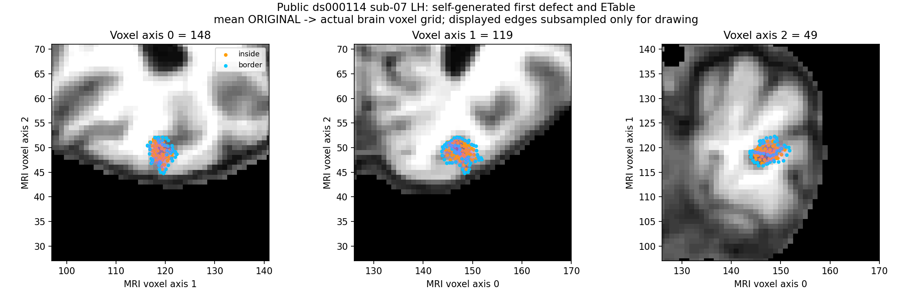
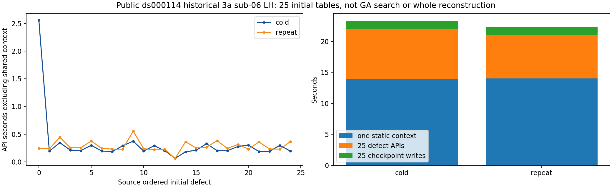

# 有序缺陷输入与共享静态缓存：真实阶段验证

## 1. 功能和验证范围

本版独立生成有序区域的ETable、MRI代价、原边ES分段和可选相交列表，复用FNIT已有Numba算子。没有调用原版阶段程序。新增同网格只读缓存，避免每个区域重建全部邻接和原边集合。

首表使用公开ds000114 sub-07的79版自产冻结输入；25域使用公开sub-06历史3a网格经本轮自有rawBase producer生成的初态。这些是当前函数的冻结同输入阶段测试，不是新的原始T1整例或完整GA。

**所有25域结果只适用于初态。** 固定源每个缺陷读取当前 `mris_corrected` 的一环邻接决定base边并做删边，前一缺陷修复可能改变它；完整连续GA不能预先固定这25张表。原网格邻接、原边和原域映射可复用。动态当前状态接口另行验证。

## 2. Python输入、输出和失败行为

完整具名示例、全部参数、坐标和单位见 [功能页](../../../../docs/recon_all/TOPOLOGY_GENETIC_DEFECT_INPUTS.md)。单域函数接收原域float32 canonical、平均ORIGINAL及其法向、原有序faces、完整labels/±1 status、显式区域顺序、原→corrected映射、自产白灰median、uint8 MRI与surface RAS→MRI矩阵。

`context=None` 默认独立准备；传同版本缓存时校验数组shape/dtype/SHA和区域顺序。批量函数一次建立缓存，返回25个初始表及完整API/缓存秒数。错误版本、区域、BFS映射、半精度或非法数据拒绝执行。两个公开阶段均不读取参考字段生成上游。

标准源配方 `edge_table=0` 对应 `use_overlap=False`，相关输出为None。显式True实际计算交叉，发现第1001项才截断保存首1000并标不完整；不是用空列表充当已计算。

## 3. 复现和收据

首表调用 `tools/benchmark_recon_topology_genetic_defect_inputs.py`，具名参数依次为 `--prepared-checkpoint`、`--prepared-report`、`--regions-json`、`--brain`、`--source-manifest`、两次 `--reference-edges` / `--reference-edges-repeat`、`--reference-retess`、`--output` 和 `--threads 4`。`--reuse-context` 显式启用共享缓存，`--use-overlap` 和 `--reference-use-overlap` 分别声明实际策略。候选先计算落盘，再读参考。

批量工具为 `tools/benchmark_recon_topology_all_defect_inputs.py`：具名 `--base-state`、`--base-maps`、`--base-report`、`--regions-checkpoint`、`--input-surface`、`--brain`、`--source-manifest`、`--output`、`--threads 4`。原MRI/mesh只读一次，平均ORIGINAL法向计算一次；每次完整批量调用只建立一次静态上下文。

本目录 `export_receipts.py --fnit-root <私有FNIT> --output <新目录>` 只导出JSON；数值、bool、null逐叶保真。`plot_results.py` 同样两参，在服务器读取已授权公开派生影像，只输出PNG与SHA。不上传MRI、NPZ、原版源码/程序、许可证或日志。原始报告SHA与公开字节SHA分别保存在 `reports/PUBLIC_EXPORT_MANIFEST.json`，最终Git payload由 `PUBLICATION_MANIFEST.json` 绑定。

## 4. 原软件和源码语义

固定源码为 `d932c45b7941662ea380a05efef580568b98d41a`。参考是独立Conda源码构建观察器，原程序两次ETable逐字节稳定；程序与捕获SHA保存在 `reports/source_edge_reference.public.json`。它的耗时包含原上游准备与观察I/O，不能与仅ETable API秒数作整步速度比。

`mrisTessellateDefect_wkr` 内部生成ETable、ES，外层命令是benchmark专用 `mris_fix_topology -ga <subject> <hemi>`；没有独立ETable CLI。源MRI及原边判断使用原 `mris`；base边存在性/相交和由used标记生成的ES依赖当前 `mris_corrected`。确切文件SHA、行号与策略见 `source_rules.json`。

## 5. 实际精度、耗时、内存和图

CPU同机固定4线程；无GPU，显存记录null。共享主机，只有一次冷/重复阶段观察，不是ABBA吞吐或整例提速。

| 实际版本 | API冷/重复（秒） | 静态准备 | 精度边界 |
| --- | ---: | --- | --- |
| v1，显式True | 23.368920 / 18.991206 | 每次独立建立 | ETable/MRI/域一致；参考实际False，旧严格整字段报告False保留；True原生相交未测 |
| v2，标准False | 15.901212 / 11.677250 | API内每次建立 | 首表4723边/138旧边：ETable、代价、inside/status/border/hull、RTS端点/used全部0bits；ES原生参考缺失 |
| v3，同网格缓存 | 3.468933 / 0.298747 | 11.885980秒另列 | 同上全部0bits；缓存后完整首次应包含这次初始化，不用3.47秒冒充首次墙钟 |
| v4，3a全25初态 | 22.041266 / 21.043986 | API内13.870048 / 14.000253秒 | 86,623未删边/84,577保留边；全部域计算字段两次0bits；原生全25尚未评估 |

v3完整harness含两次调用、缓存、加载写出和比较为16.379536秒。v4两次批量分别写出1.282876 / 1.285356秒，完整harness含IO和比较48.713683秒，导入另2.168949秒。v4平均ORIGINAL法向2.403624秒，加载和准备合计2.626488秒。所有逐域/逐算子原始精确值在JSON和 `timings.csv`。

v4峰值RSS为881,758,208字节，包括两批保留结果和两个上下文；不能解释为单缓存内存。缓存报告仅列自身数组507,112字节、760,956邻接项及380,478原边/370,958初始base边；没有把Python容器总内存伪装为数组大小。

**分别结论：** 首表已测字段严格复现通过；所有本版计算字段自重复通过；原生ES/开启相交/全25原生门未测；完整GA、最终网格质量和整体指标等效均未判定。生产默认未改变。

## 6. 版本记录和保留失败

- v1实际开启相交而参考关闭，完整严格比较False保留；计算3,566,224交叉项、2,245行不完整，自重复0bits。
- v2按固定源标准关闭相交，首表同输入门通过。
- v3复用静态缓存；首表独立COMPLETE通过。随后批量工具错误读取 `vertex_translation`，实际NumPy错误为该字段不在archive，driver EXIT1；计算前失败，原日志SHA与退出码保留。
- v4只修批量工具为自产检查点实际的 `merged_vertex_translation`，同a50fba61算法冻存下全25完成。没有重写v3失败或首表报告。
- 本地10合同覆盖原序合并域、错误映射拒绝、1000/1001、缓存失效和批量一致性。模拟合同与真实benchmark分别报告。

## 7. 原实现和文献

- [固定FreeSurfer源码](https://github.com/freesurfer/freesurfer/blob/d932c45b7941662ea380a05efef580568b98d41a/utils/mrisurf_defect.cpp)；本目录只保存SHA/规则，不发布其源码。
- Fischl B, Liu A, Dale AM. Automated manifold surgery. IEEE TMI, 2001;20:70–80. [DOI](https://doi.org/10.1109/42.906426)、[PubMed](https://pubmed.ncbi.nlm.nih.gov/11293693/)。
- 复用FNIT `topology_edge_mri_score.py`、`topology_preflight_python.py`、`topology_edge_segments.py`。现有NumPy/Numba/nibabel安装覆盖，无新增依赖。安装隔离/OS执行审计和原始T1整例不在本报告范围。
