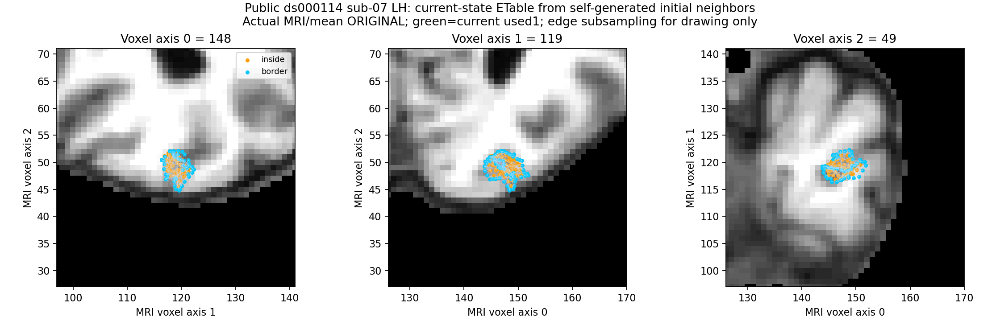
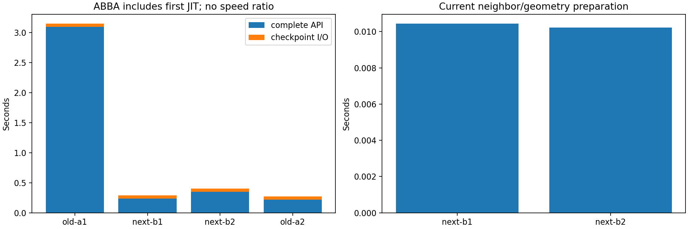

# 当前 corrected 状态→下一缺陷 ETable

## 1．功能与验证范围

新增 `next_ordered_genetic_defect_inputs()`，按当前 corrected 有向邻接的 vnum 前缀识别 used1，并在当前 canonical 球面上执行原有序剪枝、ES 分段及可选 overlap。原 MRI 评分和原边惩罚复用已验证的 `a50` 实现。

本次真实回归为公开 ds000114 sub-07 ses-test 左半球，输入来自 FNIT 自产冻结前段。当前初始 canonical/邻接由自产原表面、区域和映射生成；参考边表、旧计算输出仅在四次新输出落盘后打开。没有执行连续 GA、最终网格 QC 或原始 T1 整例。

## 2．Python 调用和数据结构

完整逐参数调用与返回结构见[功能页](../../../../docs/recon_all/TOPOLOGY_GENETIC_NEXT_DEFECT_INPUTS.md)。三个新消费字段：

- `current_surface_state['canonical_vertices']`：corrected 域 float32(N,3)，球面 mm。
- `vertex_topology`：整数(N,7)，仅消费第3列 vnum（从0计）。
- `neighbor_storage`：N 个有序整数行，读取有效前缀；不对称化、不 rip 过滤、不从当前面表重建。

原网格/MRI 上下文按版本共享，当前几何和 used1 每缺陷更新。旧25初态表不能直接用于连续搜索。初态报告保持原版本，不被新参数回标。

## 3．复现命令

```bash
# CPU四线程；MRI/NPZ均留在授权私有诊断目录
python tools/benchmark_recon_topology_genetic_next_defect_inputs.py \
  --prepared-checkpoint own_preparation.npz \
  --prepared-report own_preparation_report.json \
  --regions-json own_ordered_regions.json \
  --brain own_brain.mgz \
  --source-manifest source_manifest.json \
  --reference-checkpoint old_computed_etable.npz \
  --reference-report old_computed_report.json \
  --reference-edges independent_reference_edges.bin \
  --output fresh_current_state_diagnostic \
  --threads 4
```

同输入顺序 old→next→next→old。导入、共享上下文、自产初态、API、写出和输出后比较分开记录；内部步骤不可重复加到完整 API。

## 4．原软件对应步骤

固定 `d932c45b7941662ea380a05efef580568b98d41a`：`mrisTessellateDefect_wkr()`11458读取当前邻接；11499–11522只针对当前 ETable 的 used1 行做 forward 剪枝。`edgeExists()`320–329仅查询 vno1[:vnum]。属于 `mris_fix_topology -ga` 内部步骤，无独立 CLI。

标准 `edge_table=0` 明确关闭 overlap，不将空列表当作已经计算全部重叠。真实动态非初态、ES 原分段行和启用 overlap 的原程序参考仍未评估。

## 5．实际结果、耗时和脑图

| 检查 | 实测结果 |
| --- | --- |
| 四次计算 | 全部17组字段逐字节相同，包含 ETable/分组/完整序号 |
| 冻结旧自产输出 | 四次全部字段零差；四份 NPZ SHA 均 `2f7dcfad…` |
| 固定原 ETable | 4,723边端点、used、MRI分数零差；旧边138 |
| 当前查询 | 4,851个有向候选对，98行，65个 used1 候选对 |
| 输入状态 | canonical、topology、邻接计算前后字节不变 |
| 合同 | accelerator-b 12项通过，5.614秒；本地12项通过，3.127秒 |

| 顺序 | 完整 API（秒） | 输出写入（秒） | 当前状态准备（秒） |
| --- | ---: | ---: | ---: |
| old-a1 | 3.094444 | 0.050005 | — |
| next-b1 | 0.238836 | 0.049383 | 0.010433 |
| next-b2 | 0.351365 | 0.049420 | 0.010227 |
| old-a2 | 0.221553 | 0.050581 | — |

导入4.322186秒另计；共享原上下文12.829794秒，自产初始邻接1.441539秒。完整诊断墙钟 **19.493969秒**，包含加载、上下文、四次 API、初态/结果写出及比较。CPU100–103、总4线程、共享主机；进程峰值 RSS698,585,088字节包括上下文、各次输出及比较。无 GPU 计算，显存字段 null。

首个 old 包含 JIT，不能拿它与热 next 求速度比。本接口闭合当前状态语义；未运行连续全缺陷参考/整例，不给整例提速或整体等效结论。原程序本轮没有重跑，复用带 SHA 的独立冻结 ETable；自身重复性是本轮实际四次计算。



只对绘图中的边线抽样；全部4,723边参与诊断。绿色为当前 used1。



机器记录见 [stage.json](reports/stage.json)、[source.json](reports/source.json)、[导出清单](reports/PUBLIC_EXPORT_MANIFEST.json)。当前代码是已冻结 v4 FNIT 源树加三个显式新文件，不把完整源树改标为 Git cd531；该 commit 只是新文件打包时的本地 HEAD。各函数 SHA 在实际源码清单中。

## 6．版本与保真

- 旧 `a50fba61…` 初态 producer 未修改，仍作为首缺陷/历史诊断参考。
- 新 `1bddff32…` 保留同算法，追加当前状态读取和局部 transient context；不改变原静态缓存。
- 合同覆盖反向独有邻接、分配尾部、rip、used1优先、前一缺陷新边、current canonical、forward-only剪枝和表外边不额外剪枝。
- 原始 stage SHA 与公开 stage SHA 本次恰好相同；导出仍分别记录 raw/published SHA，数值、bool、null不改变。
- `complete_ga=False`、`final_mesh_quality=not_assessed`、整体等效 `not_assessed`。真实非初态 native 门未完成，不能由首缺陷通过推断。

## 7．参考文献和原代码

[固定 FreeSurfer 源码](https://github.com/freesurfer/freesurfer/tree/d932c45b7941662ea380a05efef580568b98d41a)；只记录文件 SHA 和源行，不复制发布 `.cpp`/程序/许可证。Fischl B, Liu A, Dale AM. Automated manifold surgery. IEEE TMI, 2001. [DOI:10.1109/42.906426](https://doi.org/10.1109/42.906426)。
