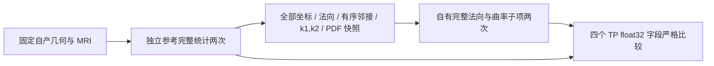

# 完整冻结统计中的法向与曲率似然

## 1．功能与范围

本目录验证自有 `topology_defect_normal_likelihood.py` 的完整法向点积和二维主曲率联合 PDF 子项。生产算子只使用 Python/NumPy/Numba，不调用原程序；固定源码 Conda 编译程序仅用于独立 benchmark。

真实输入为公开 ds000114、sub-07、ses-test、LH。输入表面和 MRI 由 `79a41cdd` 从原始 T1 连续生成；本轮从该有哈希的初始统计快照做**冻结同输入算子回归**，未运行新的原始 T1 整例。没有动态 retessellation patch、完整 fitness、GA、拓扑质量或整体指标等效通过的结论。



## 2．Python、输入和输出

全部具名参数、结构、空间、单位、缺省和失败规则见 [功能页](../../../../docs/recon_all/TOPOLOGY_NORMAL_CURVATURE_LIKELIHOOD.md)。两个函数消费当前候选的 orig surface RAS/mm、原顺序一环邻接、当前法向/mm² 面积和同几何的 k1/k2（mm⁻¹）。三个正 PDF 和联合 PDF 原点/间距不被改写或重新归一化。

累计采用源 double 顺序，四个输出按 TP float32 字段写回。法向 `curv_ll` 是逐顶点平均，不是邻边直接平均；`cll` 是面积加权诊断。曲率最终 `qcurv_ll` 和 `qcll` 均使用二维联合 PDF；原 marginal 中间量只保留诊断。空 patch 为零；非法 CSR、索引、非有限字段或非正 PDF 明确报错。模块无持久缓存，不跨几何版本复用旧状态。

完整真实快照：110,534 顶点、108,538 选中顶点、663,348 有序一环项。参考快照及逐顶点 NPZ 留在服务器；Git 仅保留公开数值、程序/源码/输入 SHA 和公开影像衍生图。

## 3．复现命令

```bash
# 同输入、同统计阶段；不会把参考快照接回生产流程。
python tools/benchmark_recon_topology_normal_likelihood.py \
  --capture isolated_reference/repeat0/statistics.bin \
  --native-repeat isolated_reference/repeat1/statistics.bin \
  --observer-receipt isolated_reference/build.public.json \
  --output isolated_diagnosis/current_normal_curvature \
  --threads 4

# 原始数值JSON与公开PNG导出；不复制MRI、NPZ、许可证或权重。
python validation/recon_all/optimizations/20261010_topology_normal_curvature_likelihood/collect_receipts.py \
  --fnit-root private_fnit_root \
  --output fresh_public_export
```

benchmark 复用既有 `load_statistics_capture`，不重写二进制解析器。`reports/PUBLIC_EXPORT_MANIFEST.json` 记录原报告 SHA、公开 SHA、大小、JSON 数值/布尔/null 叶的逐项保真。`PUBLICATION_MANIFEST.json` 进一步绑定本目录与源码提交时的实际载荷；原始 SHA 与去敏后 SHA 分开。

## 4．原软件对应与版本

固定 FreeSurfer 提交 `d932c45b7941662ea380a05efef580568b98d41a`，`utils/mrisurf_defect.cpp` SHA `55ace70ab09b1868a8cb152a9547879abdce790635b484bef1bf056986958187`。对应内部函数为 `mrisComputeDefectNormalDotLogLikelihood`（1502–1557）和 `mrisComputeDefectCurvatureLogLikelihood`（1560–1623），无独立官方 CLI。

独立观察器只在初始全表面统计后读取字段，在既有首次边表诊断停点结束；两个新评分函数没有改变参考程序的数值轨迹。实际命令、编译/链接、源码与程序 SHA 见 `reports/native_build.json`、`native_repeat.json`；并非预装 FreeSurfer 二进制。

`source_rules.json` 记录原 TP 字段、nint 半分离零舍入、curvature 商的 float32 截断和双精度有序累计规则。全部八个 TP 字段实际 `sizeof=4` 已从原快照核实，避免把返回类型 double 误认为 TP 存储也是 double。

## 5．实测结果、耗时和脑图

| 字段 | 自有 / 固定源码参考共同值 | 不同字段数 | 最大 / P99 误差 |
| --- | ---: | ---: | ---: |
| curv_ll | −3.6333346366882324 | 0 | 0 / 0 |
| cll | −3.63374662399292 | 0 | 0 / 0 |
| qcurv_ll | −6.340480327606201 | 0 | 0 / 0 |
| qcll | −6.261255741119385 | 0 | 0 / 0 |

原程序两次完整快照 SHA 同为 `6259f860c7e6f6a4f157ca0705d611df4083072e381933ee7d476867751a873f`；候选四标量和两个逐顶点数组两次完全相同。原程序未捕获逐顶点 logP，故没有逐顶点原版严格比较结论。8项合同在同节点 0.750 秒通过，模拟合同只验证边界，真实 benchmark 独立列在上表。

| 观察范围 | 秒 |
| --- | ---: |
| 法向完整 API，首次 benchmark（已有合同 Numba cache） | 0.2221974292770028 |
| 曲率完整 API，首次 benchmark（已有合同 Numba cache） | 0.016058498062193394 |
| 法向完整 API，热重复 | 0.03531407658010721 |
| 曲率完整 API，热重复 | 0.012981283478438854 |
| 快照读取/校验/两次API/NPZ/哈希，不含图或最终JSON | 1.4980444079264998 |
| 绘图导入与 PNG 写出 | 15.56628400273621 |
| benchmark 工具入口起墙钟，尚不含前置 bootstrap 和最终 JSON 写出 | 18.842103580012918 |
| 固定源码观察器两次（包含其他准备/统计/边表） | 7.614243036136031 / 5.0891895443201065 |

参考和候选同主机、预算4线程、CPU分别8–11和100–103。共享负载没有独立排除；只作为阶段观察。原函数没有独立 timer，不能计算原生加速倍率。CPU 子项不使用 GPU；显存为不适用/null，不能把 null 解读为采样到零占用。没有本次整例耗时、GPU、OS 隔离或总体等效验收；其边界另见 `measurement_scope_notes.json`。


颜色是候选逐顶点 logP；图不是逐顶点原版误差图或完整 GA 成果。源几何/主曲率冻结后只计算统计，未用参考坐标修补网格。

## 6．更新与记录

- 候选代码绑定上传时 `9fd532d8` 和明确模块 SHA；`reports/launch.json` 保存当时真实代码版本，不以之后提交重标运行。
- 部署 v1 因 companion parser 尚未存在，在 benchmark 启动前失败；`deployment_failure_v1.json` 保留原因。新 v2 目录携带既有解析器、复用已完成 companion source 后运行，无算法修改。
- 模块 SHA `bfb461f202353ab92da426e92f978e82b08174a19633ffc3e26c12e23a7c273a`；原参考程序 SHA `1c41ff4d8c58931de1a81ae5b68ef5c42b0427170d029d0374be5fbf01c960b1`；输入/字段/PDF及原始T1绑定见 `reports/provenance.json` 和 `report.json`。
- 本轮未接生产 GA，未改现有主曲率/retessellation/controller，未添加依赖或放宽门槛。接入前仍需动态完整 patch 回归与全缺陷控制链验证。

## 7．参考、许可和代码

完整具名 API 为 `src/fnit/recon_all/topology_defect_normal_likelihood.py`；合同为 `tests/recon_all/test_topology_defect_normal_likelihood.py`。现有 NumPy/Numba 依赖已在主页 Conda 环境，无新增安装步骤。

- [固定上游函数](https://github.com/freesurfer/freesurfer/blob/d932c45b7941662ea380a05efef580568b98d41a/utils/mrisurf_defect.cpp#L1502-L1623)。
- Ségonne F, Pacheco J, Fischl B. IEEE TMI. 2007;26:518–529. [DOI](https://doi.org/10.1109/TMI.2006.887364)。
- 原许可证和来源通知见 [licenses/FreeSurfer.txt](../../../../licenses/FreeSurfer.txt)、[THIRD_PARTY_NOTICES.md](../../../../THIRD_PARTY_NOTICES.md)。本目录不发布原 `.cpp`、原程序、MRI、逐顶点 NPZ、许可证内容或权重。
